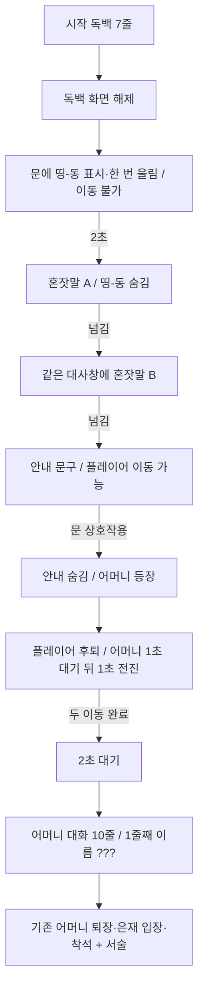

# 시작 독백과 첫 손님 입장

**상태:** rev.4 구현 완료 · Play 검증 완료 (rev.4 변경분, 2026-11-09)

## 문서 기준

이 프로젝트에서 적용 가능한 별도 스펙 양식이나 기존 기능 스펙을 확인하지 못해, 사용자 결정과 `AGENTS.md`, `docs/claude.md`, 현재 코드·씬을 근거로 간결한 양식을 사용했다. `docs/README.md`는 없으며, 사용자 결정에 따라 없는 상태로 진행한다.

rev.2는 사용자가 `docs/DialogueInventory.md`에 적은 새 흐름(독백 7줄, 문 앞 호출 대사, 안내 문구, 어머니 대사 9줄)을 반영한다. 인벤토리와 이 스펙이 다르면 이 스펙의 결정을 따른다. 문 열림은 넣지 않기로 했고, 인벤토리 문구도 이에 맞춰 고쳤다.

## 목적과 범위

게임 시작 독백을 지정된 7줄로 교체한다. 독백이 끝나면 문에서 `띵-동` 글씨가 나오고, 주인공의 짧은 혼잣말 두 줄이 이어진다. 그 뒤 플레이어가 직접 문으로 이동해 상호작용한다. 그때 은재 어머니가 출입구에서 나타나고 두 인물이 서로 반대 방향으로 한 걸음씩 움직인다. 두 이동이 모두 끝난 뒤 2초가 지나면 새 은재 어머니 대화를 시작한다.

이번 범위는 게임 시작부터 은재 어머니의 대화가 끝날 때까지와, 은재 착석 뒤 서술 문구다. 어머니 퇴장, 은재 입장·착석 동작은 기존 컷신 흐름을 그대로 쓴다.

## 확정된 대사

### 시작 독백 (검은 독백 화면)

`OpeningMonologue`에서 다음 순서로 한 줄씩 표시한다. 기존 줄은 모두 대체한다.

1. 눈은 영혼의 창이라는 말이 있다.
2. 내겐 이 말이 단순한 비유가 아니다.
3. 언제부터인가, 사람의 눈을 들여다보면 그 너머 마음의 조각을 읽을 수 있게 되었다.
4. 상담소를 연 것도 그래서였다. 내가 본 것을 그들도 보았으면 해서.
5. 그토록 아름다운 마음의 조각들을.
6. 띵-동
7. ..?

### 문 앞 혼잣말 (필드 대사창, 화자 이름·초상화 없음)

- A. 뭐야? 한창 분위기 잡고있는데.
- B. 아직 첫 상담까지는 시간이 남았을 텐데...

### 안내 문구

- 문을 열어서 손님을 맞이하세요.

### 은재 어머니 (`FieldNPC.TalkLines`, 10줄)

1번 줄에서는 이름 자리에 `???`를 보이고, 2번 줄부터 `은재 어머니`를 보인다.

1. 안녕하세요, 선생님. 상담 시간 전인데 번거롭게 죄송해요.
2. 오늘 첫 상담으로 예약한 은재 말인데요... 상담을 신청한 게 저예요.
3. 미리 설명드릴 게 있어서 예약 시간보다 일찍 찾아뵈었어요.
4. 우리 은재가... 세 달째 아무말도 하지 않고 있어요. 단 한마디도요.
5. 세 달 전에 콩쿠르 결선이 있었어요. 그리고 그날 은재 아빠가 공연장 로비에서 쓰러졌어요.
6. 쓰러지기 전 은재에게 전화를 했나봐요. 은재는 무대 위라 전화를 못 받았대요.
7. ...그게 그이가 살면서 한 마지막 전화였어요.
8. 그 날 이후 피아노는 거들떠보지도 않고, 휴대전화도 늘 뒤집어 놓아요.
9. 이미 여러 상담소를 찾아가보았지만 은재는 한번도 입을 열지 않았어요. 선생님은 다르다고 해서… 그래서 찾아왔어요.
10. 꼭 좀 부탁드릴게요. 무슨 말이라도 좋으니 은재와 다시 이야기하게 해주세요.

### 은재 착석 뒤 서술 (`FieldNPC.RevealLines`, 은재 초상화와 함께 한 줄씩)

1. 정은재. 17세. 아직 얼굴에서 앳됨이 묻어나오는 소녀.
2. 하지만 표정에는 그 나이답지 않은 짙은 그늘이 드리워져있다.
3. 은재는 나를 잠깐 보더니, 말없이 창밖으로 시선을 돌렸다.

## 기능 요구사항

### FR-001 · 시작 독백

새 게임의 시작 독백은 위 7줄을 순서대로 보여준다. 6·7번 줄도 독백 화면의 일반 줄과 같은 방식으로 표시한다. 기존 `OpeningMonologue`의 글자 출력, 넘기기 입력, 마지막 줄 뒤 암전 해제 동작을 유지한다. 독백이 표시되는 동안 필드 이동과 상호작용은 막는다.

### FR-002 · 문 앞 호출 연출 (신규)

독백 화면이 완전히 걷히면 상담실 `문` 위에 `띵-동` 글씨가 나타나 한 번 울린다. 2초 뒤 필드 대사창이 열리며 혼잣말 A를 보여준다. 대사창이 열리면 `띵-동` 글씨는 사라지고 다시 나타나지 않는다. A를 넘기면(Space·Enter·Z) 대사창을 닫지 않은 채 같은 창에 혼잣말 B가 이어진다. B를 넘기면 플레이어가 움직일 수 있다.

- 이 구간 동안 플레이어 이동과 필드 상호작용은 막는다. 대사 넘기기는 기존 입력으로 한다.
- `띵-동` 글씨는 나타나는 순간 초인종이 울리듯 한 번 커졌다 작아지며 좌우로 흔들린 뒤 제자리에 멈춘다. 울림 횟수(기본 1, 0이면 계속)·간격·길이·크기·각도·흔들림 횟수는 `FieldDoor` Inspector에서 조절한다.
- 대사창이 열리기까지의 대기(기본 2초)는 Inspector에서 조절한다.
- 혼잣말은 기존 `GameFlow.ShowConversation`으로 화자 이름·초상화 없이 띄운다. 문구는 `FieldCutscene` Inspector에 저장한다.

### FR-003 · 문 상호작용과 안내

B가 닫힌 뒤부터 문 상호작용이 수락될 때까지 다음을 유지한다.

- 문 위에 `띵-동` 글씨는 보이지 않는다.
- 화면 오른쪽 위의 기존 필드 조작 안내 자리(`GameFlowUI`의 `_fieldHint`)에 "문을 열어서 손님을 맞이하세요."를 표시한다.
- 플레이어는 이동할 수 있다. 어머니는 아직 등장하지 않으며, 시간이 지나도 자동 입장하지 않는다.
- 플레이어가 문에 접근하면 기존 상호작용 안내(`Z  맞이하기 — 문`)가 뜨고, 기존 필드 상호작용 입력(Z·Enter·Space)으로 문과 상호작용할 수 있다.

상호작용이 수락되면 안내 문구가 사라진다.

### FR-006 · 대사 넘김 표시 (rev.3)

모든 필드 대사창의 오른쪽 아래에 `▼` 삼각형을 둔다. 한 줄이 끝까지 찍히면 삼각형이 나타나 제자리에서 위아래로 천천히 오르내리고, 글자가 찍히는 동안에는 숨긴다. Space·Enter(기존 Z 포함)로 넘길 수 있다는 시각 정보다. 오르내리는 폭과 빠르기는 `GameFlowUI` Inspector에서 조절한다.

### FR-004 · 첫 손님 등장

문 상호작용을 한 번 수락하면 은재 어머니가 기존 출입구 위치에서 나타난다. 문짝과 손잡이에는 열림 애니메이션을 넣지 않는다. 플레이어는 상호작용 직후 출입구에서 멀어지는 방향으로 한 걸음 물러선다. 어머니는 출입구에 나타난 뒤 1초 동안 가만히 서 있다가, 실내 방향으로 한 걸음 걸어 들어온다. 이 한 걸음은 출발부터 도착까지 1초가 걸린다. 이때 추가 문 상호작용이나 플레이어 이동 입력으로 시퀀스를 중복 실행하거나 이동을 끊을 수 없다.

한 걸음은 상대 거리로 정한다. 플레이어는 상호작용한 위치에서 지정 거리만큼 물러서고, 어머니는 출입구에서 지정 거리만큼 들어온다. 플레이어가 문에 바짝 붙어 있어 두 사람의 간격이 최소 간격보다 좁아지면 플레이어가 그 간격까지 더 물러선다. 어머니가 서 있는 시간과 걸어 들어오는 시간, 플레이어의 이동 시간은 `FieldCutscene`의 값으로 조절한다.

한 걸음 거리·최소 간격·이동 시간과 호출 글씨의 위치는 씬/Inspector에서 제작자가 조절할 수 있게 한다. 이후 씬에서 수동으로 조절한 값을 재생 시작 시 덮어쓰지 않는다.

### FR-005 · 어머니 대화와 기존 흐름 연결

플레이어와 어머니의 한 걸음 이동이 **모두 끝난 순간부터** 2초를 센다. 그동안 두 인물은 멈춰 있고 플레이어 이동·상호작용은 막는다. 2초 뒤 어머니 대사(위 10줄, `Data/Dialogue/Eunjae_Day1.csv`의 `section=talk`, `actor=EunjaeMom`, `id=enter`)를 시작한다. 첫 줄의 이름은 `???`로 가리고 2번 줄부터 `은재 어머니`를 보인다. 이름 가리기는 같은 줄의 `speaker` 칸에 `???`를 적어 정한다. 대사를 넘기는 기존 입력은 작동한다. 마지막 줄 이후의 어머니 퇴장, 은재 입장·착석은 기존 `FieldCutscene` 동작을 따르고, 착석 뒤에는 위 서술 3줄을 차례로 표시한다.

대기 시간 2초는 Inspector에서 조절할 수 있게 하되, 기본 설정값은 2초다.

## 상태 흐름

## 구현 방식

- 대사는 `dev`의 CSV 데이터 구조를 따른다. 시작 독백은 `Data/Strings.csv`의 `opening`, 혼잣말 A·B는 `field.call_first`·`field.call_second`, 문 안내 문구는 `hint.door`, 어머니 대사와 착석 뒤 서술은 `Data/Dialogue/Eunjae_Day1.csv`의 `actor=EunjaeMom` talk 줄 `enter`·`reveal`에 둔다. 씬·Inspector 값은 CSV에 해당 줄이 없을 때만 쓰는 예비값이다.
- `speaker` 칸에 `???`를 쓰면 이름 자리에 `???`를 보이고 초상화는 말을 건 사람 것을 쓴다(`TalkScript.Unknown`).
- UI는 사용자 결정에 따라 씬에 이미 있는 uGUI 레거시 `Text`(Galmuri11) 방식을 쓴다. `docs/claude.md`의 TextMeshPro 규칙에 대한 예외이며, 이유는 프로젝트에 TMP Essentials와 한글 TMP 폰트 에셋이 없기 때문이다.
- 안내 문구는 기존 `_fieldHint` Text를 재사용하므로 새 UI 오브젝트가 필요 없다.
- `띵-동` 글씨는 화면 전체로 늘어난 `필드 UI` 아래의 uGUI `Text` 하나로 만들고, 폰트는 Galmuri11을 쓴다. 제작자가 에디터 메뉴(GameObject > UI > Legacy > Text)로 만들어 씬에 저장한다. `FieldDoor`가 그 Text를 `[SerializeField]`로 참조하고, 켜고 끄며, 문 월드 위치 + Inspector 오프셋으로 화면 위치를 맞춘다. 런타임에 UI GameObject를 생성하지 않는다.
- 넘김 삼각형은 `텍스트 상자/속지` 아래의 uGUI 레거시 `Text`(Galmuri11, `▼`)로 에디터 메뉴(GameObject > UI (Canvas) > Legacy > Text)로 만들어 씬에 저장하고, `GameFlowUI`가 `[SerializeField]`로 참조한다.
- rev.1 구현 때 씬에 직접 넣은 `TextMesh` 오브젝트(`문/호출 글씨 (띵-동)`)는 이 개정안에서 제거한다.

## 기존 구현과 변경 접점

- `OpeningMonologue.cs`: `DefaultLines()`를 7줄로 교체한다.
- `FieldCutscene.cs`: 독백 종료와 문 상호작용 사이에 FR-002 단계를 추가하고, FR-003 안내 문구 상태를 노출한다.
- `FieldDoor.cs`: 호출 글씨를 TextMesh 대신 uGUI Text 참조로 바꾸고, 화면 위치를 맞춘다.
- `GameFlowUI.cs`: 문을 기다리는 동안 `_fieldHint`에 안내 문구를 표시한다. 넘김 삼각형을 켜고 끄며 오르내리게 한다(FR-006).
- `FieldNPC.cs`·`GameFlow.cs`: 서술을 여러 줄(`_revealLines`)로 바꾸고, 첫 대화 앞쪽 줄의 이름을 가리는 설정을 추가한다(rev.4).
- `Assets/Scenes/EyeMaze.unity`: 어머니 `_talkLines`·`_revealLines`·가릴 이름 설정 교체, 혼잣말·대기 값 저장, TextMesh 제거, 새 uGUI Text 연결.

## 인수 조건

1. 새 게임을 시작해 독백을 끝까지 넘기면 지정한 7줄만 정확한 순서로 보이고, 마지막 줄 뒤 기존 방식으로 필드가 드러난다.
2. 독백이 걷히면 문 위에 `띵-동`이 나타나 한 번만 울리고, 약 2초 뒤 혼잣말 A가 뜨면서 `띵-동`이 사라진다. A에서 Space를 누르면 대사창이 닫히지 않은 채 B가 이어진다. `띵-동`은 다시 나타나지 않는다. 이 구간에서는 플레이어가 움직일 수 없다.
3. B를 넘기면 플레이어가 움직일 수 있고, 오른쪽 위 안내 "문을 열어서 손님을 맞이하세요."가 보이고, 문 위에 `띵-동`은 보이지 않는다. 아무 입력 없이 3초 이상 기다려도 어머니가 자동 입장하지 않는다.
4. 문에 다가가면 `Z  맞이하기 — 문`이 뜨고, Z·Enter·Space로 상호작용하면 안내 문구가 사라지며 어머니가 출입구에서 나타난다. 문짝·손잡이는 움직이지 않는다.
5. 상호작용 직후 어머니가 출입구에 나타나고 플레이어가 물러선다. 어머니는 1초 서 있다가 1초에 걸쳐 한 걸음 들어온다. 한쪽이 먼저 도착해도 다른 쪽이 끝나기 전에는 대사가 나오지 않는다. 이동 중 반복 입력으로 재등장하거나 대사가 중복 시작되지 않는다.
6. 두 이동을 모두 마친 시점부터 약 2초 뒤 어머니 대사 10줄이 순서대로 나온다. 1번 줄의 이름은 `???`, 2번 줄부터는 `은재 어머니`다. 그 전에는 플레이어가 움직일 수 없다.
7. 어머니의 마지막 대사 이후 기존 퇴장·은재 입장·착석이 이어지고, 착석 뒤 서술 3줄이 차례로 나오며 은재 상담에 들어갈 수 있다.
8. 필드 대사창에서 한 줄이 다 찍히면 오른쪽 아래에 `▼`가 보이며 오르내리고, 글자가 찍히는 동안에는 보이지 않는다.

## 미결 사항

없음.

## 승인

- rev.1: 2026-11-09 사용자가 FR-001~FR-004 전체를 승인했다(상대 한 걸음 + 간격 보정).
- rev.2: 2026-11-09 사용자가 다음을 결정했다.
  - 인벤토리 기준으로 스펙을 개정한다.
  - 문 열림은 넣지 않는다.
  - 독백 6·7번 줄은 독백 화면에 표시한다.
  - UI는 기존 uGUI 레거시 Text를 재사용한다.
- rev.2: 같은 날 사용자가 FR-001~FR-005 전체 구현을 승인했다. 호출 글씨 폰트는 Galmuri11로 정했고, 인벤토리의 문 열림 문구는 스펙에 맞춰 고쳤다.
- rev.3: 같은 날 사용자가 구현 세션에서 다음을 요청했다. 혼잣말 A의 `뭐야..?`를 `뭐야?`로 바꾼다. A 뒤에는 대사창을 닫고 `띵-동`이 더 확실히 움직이게 하며, Space를 눌러야 B가 열린다. 모든 필드 대사창 오른쪽 아래에 넘김 삼각형을 둔다(FR-006).
- rev.3: 같은 날 사용자가 어머니가 너무 급하게 들어온다고 하여, 문 앞에 나타난 뒤 1초 서 있다가 1초에 걸쳐 걸어 들어오도록 바꿨다(FR-004, 페이드 없음 유지).
- rev.4: 같은 날 사용자가 `DialogueInventory.md`에 적은 대화 변경을 적용하도록 요청했다. 어머니 대사 10줄, 1번 줄 이름 `???`, 은재 착석 뒤 서술 3줄(FR-005).
- rev.5: 같은 날 `dev` 병합 충돌 해결 중 사용자가 결정했다. 대사는 `dev`의 CSV 방식으로 옮기고, `???` 이름 가리기는 CSV `speaker` 값으로 추가한다.
- rev.6: 같은 날 사용자가 `띵-동`이 너무 많다고 하여, 독백 직후에만 나타나 한 번 울리고 A 뒤와 문 대기 중에는 글씨를 보이지 않게 했다(FR-002, FR-003).
- rev.7: 같은 날 사용자가 A에서 Space를 누르면 대사창을 닫지 않고 바로 B가 이어지도록 바꿨다(FR-002). A 뒤의 입력 대기와 대기 시간 설정은 없앤다.
