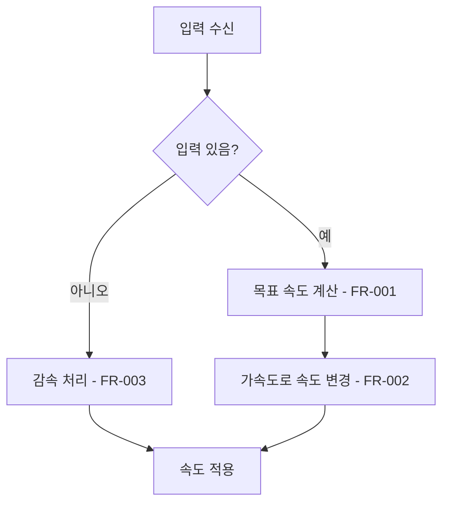

<!--
작성 규칙은 docs/README.md를 따른다.
이 주석은 스펙 문서에 복사하지 않는다.
해당 없는 섹션은 삭제하지 말고 "해당 없음"으로 적는다.
-->

# {기능 이름}

## 1. 개요

- 목적: 이 기능이 해결하는 문제 (1~2문장)
- 대상: 이 기능을 사용하는 주체 (플레이어, 제작자, 다른 시스템 등)

## 2. 범위

- 포함:
  - {항목}
- 제외:
  - {항목}

## 3. 기술 방향

<!-- 구현에 사용할 기술과 방식을 구체적으로 쓴다. 모호한 표현은 쓰지 않는다. -->

- 사용 기술/API: {예: Unity Input System, Cinemachine, ScriptableObject}
- 핵심 방식: {예: 이동은 Rigidbody velocity 기반, 가속도는 MoveTowards로 처리}
- 선택하지 않은 방식: {예: transform.Translate 직접 이동은 사용하지 않는다}
- 외부 의존성: {패키지, 다른 시스템, 기존 클래스}

## 4. 구조

| 구분 | 이름 | 역할 |
|------|------|------|
| 클래스 | {이름} | {역할} |
| 프리팹 | {이름} | {역할} |
| 씬 | {이름} | {역할} |
| ScriptableObject | {이름} | {역할} |

- 오브젝트 구성: {어떤 GameObject에 어떤 컴포넌트를 붙이는지}
- 클래스 간 관계: {누가 누구를 참조하고 어떤 방향으로 호출하는지}
- 실행 순서 의존성: {Awake/OnEnable/Start 사이에서 지켜야 할 순서}
- 기존 코드와의 접점: {수정해야 하는 기존 클래스/메서드}

## 5. 동작 플로우차트

<!--
Mermaid flowchart TD를 사용한다.
노드 문구는 짧게 쓰고, 분기에는 조건을 라벨로 적는다.
차트의 각 핵심 단계에 대응하는 FR 번호를 노드에 표기한다.
기능이 여러 동작으로 나뉘면 동작마다 차트를 따로 만든다.
-->

## 6. 요구사항

<!-- "~할 때 ~한다" 형태로 쓰고, 요구사항 하나에는 동작 하나만 쓴다. -->

- FR-001: {조건}일 때 {대상}은 {동작}한다.
- FR-002: {조건}일 때 {대상}은 {동작}한다.

### 상태와 데이터

| 이름 | 타입 | 설명 | 초기값 |
|------|------|------|--------|
| {이름} | {타입} | {설명} | {값} |

### 예외 및 경계 조건

- {조건}: {처리 방식}

## 7. Inspector 노출값

<!-- 제작자가 조절할 값만 적는다. 위 상태와 데이터 표와 같은 필드를 중복해서 설명하지 않는다. -->

| 필드 | 타입 | 기본값 | 설명 |
|------|------|--------|------|
| {필드} | {타입} | {값} | {설명} |

## 8. 인수 조건

<!-- 테스트 코드를 작성하지 않으므로 Play Mode/Inspector에서 확인 가능한 절차로 쓴다. FR과 1:1로 대응시킨다. -->

- FR-001: {확인 절차와 기대 결과}
- FR-002: {확인 절차와 기대 결과}

## 9. 미결 사항

<!-- 확정되지 않은 질문을 적는다. 이 항목이 "없음"이어야 구현을 시작할 수 있다. -->

- 없음