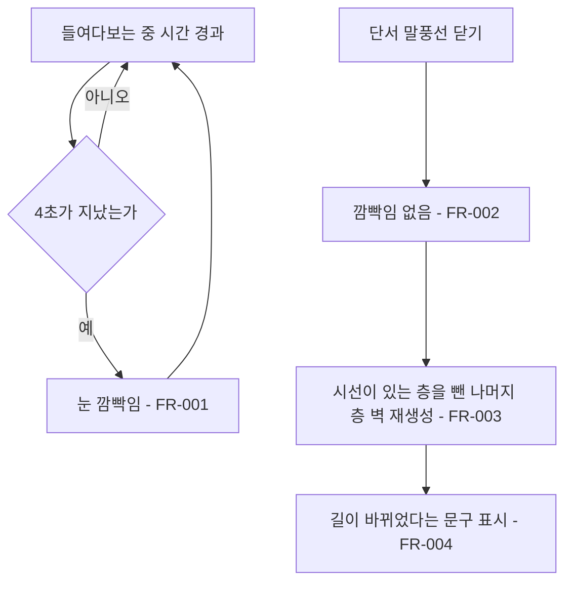

# 눈 깜빡임 조건 단일화

## 1. 개요

- 목적: 눈 깜빡임이 일어나는 조건을 시간 경과 하나로 줄여, 단서 말풍선을 닫을 때 화면이 감기지 않게 한다.
- 대상: 플레이어

## 2. 범위

- 포함:
  - 단서 말풍선을 닫을 때 일어나는 눈 깜빡임 제거
  - 벽 재생성 안내 문구에서 깜빡임 표현 제거
- 제외:
  - 시간 경과 깜빡임의 주기 변경
  - 단서 말풍선을 닫을 때의 벽 재생성 제거

## 3. 기술 방향

- 사용 기술/API: Unity MonoBehaviour, 기존 `_blinkPhase` 진행 로직
- 핵심 방식: `EyeMazeDirector.RespawnMaze()`에서 `_blinkPhase`를 시작하는 코드를 지운다. 깜빡임 시작은 `EyeMazeDirector.TickBlink()`의 시간 경과만 남는다.
- 선택하지 않은 방식: `_respawnMazeAfterReading`을 꺼서 막는 방식은 벽 재생성까지 사라지므로 사용하지 않는다.
- 외부 의존성: `IrisMaze`

## 4. 구조

| 구분 | 이름 | 역할 |
|------|------|------|
| 클래스 | EyeMazeDirector | 들여다본 시간으로 깜빡임을 시작하고, 말풍선을 닫을 때 벽을 재생성한다 |
| 씬 | EyeMaze | 위 컴포넌트의 Inspector 값을 가진다 |

- 오브젝트 구성: 변경 없음
- 클래스 간 관계: `EyeMazeDirector`가 들여다보는 동안 매 프레임 `TickBlink()`를 부르고, 시간이 차면 `Blink()`를 부른다.
- 실행 순서 의존성: 해당 없음
- 기존 코드와의 접점: `EyeMazeDirector.RespawnMaze()`

## 5. 동작 플로우차트

## 6. 요구사항

- FR-001: 들여다보는 동안 `_blinkInterval`초가 지날 때마다 `EyeMazeDirector`는 눈을 한 번 깜빡인다.
- FR-002: 단서 말풍선을 닫을 때 `EyeMazeDirector`는 눈을 깜빡이지 않는다.
- FR-003: `_respawnMazeAfterReading`이 켜진 상태에서 단서 말풍선을 닫을 때 `EyeMazeDirector`는 시선이 있는 층을 뺀 나머지 층의 벽을 무작위로 다시 만든다.
- FR-004: FR-003의 벽 재생성이 일어날 때 `EyeMazeDirector`는 "다른 층의 길이 바뀌었다." 문구를 표시한다.

### 상태와 데이터

| 이름 | 타입 | 설명 | 초기값 |
|------|------|------|--------|
| `_blinkPhase` | float | 깜빡임 진행 단계. 0 미만이면 깜빡이지 않는 상태 | -1 |
| `_blinkElapsed` | float | 마지막 깜빡임 뒤 들여다본 시간(초) | 0 |

### 예외 및 경계 조건

- 단서를 읽는 중 또는 심연에 있는 중: 깜빡임 시간 누적이 멈춘다.
- 시간 경과 깜빡임이 진행 중일 때 말풍선을 닫음: 진행 중인 깜빡임은 그대로 끝까지 진행한다.
- `_rotateOnBlink`가 있는 층: 깜빡임 중에만 돌므로 말풍선을 닫을 때는 돌지 않는다.

## 7. Inspector 노출값

| 필드 | 타입 | 기본값 | 설명 |
|------|------|--------|------|
| `_blinkInterval` | float | 4 | 들여다보는 동안 몇 초마다 눈을 깜빡이는지. 0이면 깜빡이지 않는다 |
| `_respawnMazeAfterReading` | bool | true | 단서를 읽은 뒤 나머지 층의 벽을 다시 만들지 여부 |

## 8. 인수 조건

- FR-001: Play Mode에서 눈을 들여다본 채 기다리면 4초마다 화면이 한 번 감겼다 뜬다.
- FR-002: 단서 말풍선을 닫는 순간 화면이 감기지 않는다.
- FR-003: 단서 말풍선을 닫으면 시선이 있는 층의 벽은 그대로이고 나머지 층의 벽 배치가 바뀐다.
- FR-004: 단서 말풍선을 닫으면 "다른 층의 길이 바뀌었다." 문구가 표시된다.

## 9. 미결 사항

- 없음
