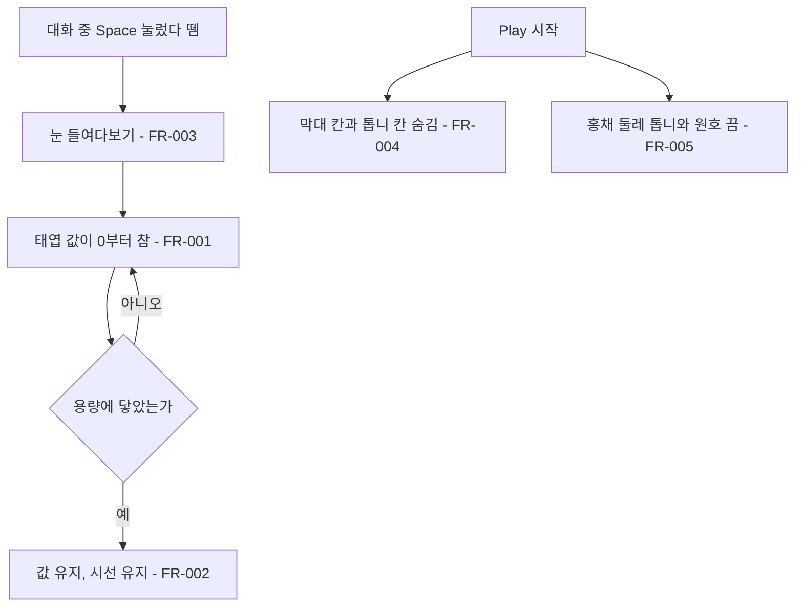

# 태엽 조작 제거와 차오르는 구조

## 1. 개요

- 목적: 태엽 게이지와 Space 감기, 파란 선 타이밍, 시간 만료 동작을 없애고, 태엽을 0에서 가득으로 차는 보이지 않는 값으로 바꾼다.
- 대상: 플레이어

## 2. 범위

- 포함:
  - 태엽 막대, 파란 선, 톱니 표시 제거
  - Space 감기와 타이밍 판정 제거
  - 태엽 값의 진행 방향을 감소에서 증가로 변경
  - 태엽 값에 따른 시선 강제 해제, 들여다보기 제한, 초점 흐려짐 제거
- 제외:
  - 태엽 값과 용량 체계 삭제
  - UI 칸 배치 변경과 미로 크기 변경
  - 대사 문구 수정

## 3. 기술 방향

- 사용 기술/API: Unity Input System, uGUI, LineRenderer
- 핵심 방식: `WindingIntro.Unwind()`가 `_wound`를 늘리고, 용량에 닿으면 값을 그대로 유지한다.
- 선택하지 않은 방식: `WindingIntro` 클래스 삭제는 태엽 값을 나중에 다른 시스템으로 바꿔 쓰기 위해 사용하지 않는다.
- 외부 의존성: `EyeMazeDirector`, `EyeMazeUI`, `GameFlow`

## 4. 구조

| 구분 | 이름 | 역할 |
|------|------|------|
| 클래스 | WindingIntro | 보이지 않는 태엽 값과 들여다보기 입력을 처리한다 |
| 클래스 | EyeMazeUI | Play 시작 시 태엽 표시 칸을 숨기고 안내 문구를 표시한다 |
| 클래스 | EyeMazeDirector | 들여다보는 동안 매 프레임 태엽 값을 채운다 |
| 씬 | EyeMaze | 태엽 막대 칸과 톱니 칸을 가진다 |

- 오브젝트 구성: 변경 없음
- 클래스 간 관계: `EyeMazeDirector`가 `WindingIntro.Unwind()`를 부르고, `WindingIntro`가 대화 중 입력으로 `EyeMazeDirector.ToggleGaze()`를 부른다.
- 실행 순서 의존성: 해당 없음
- 기존 코드와의 접점: `WindingIntro`, `EyeMazeUI.Update()`, `WindingIntroEditor.OnInspectorGUI()`

## 5. 동작 플로우차트

## 6. 요구사항

- FR-001: 들여다보는 동안 `WindingIntro`는 태엽 값을 초당 `_unwindPerSecond`칸씩 0에서 용량까지 채운다.
- FR-002: 태엽 값이 용량에 닿을 때 `WindingIntro`는 값을 용량에 유지하고 시선을 거두지 않는다.
- FR-003: 대화 중 Space(패드 A)를 눌렀다 뗄 때 `WindingIntro`는 태엽 조작 없이 바로 눈을 들여다보게 한다.
- FR-004: Play를 시작할 때 `EyeMazeUI`는 태엽 막대 칸과 톱니 칸을 숨긴다.
- FR-005: `WindingIntro`는 홍채 둘레의 톱니와 원호를 표시하지 않는다.
- FR-006: 안내 문구는 태엽 감기와 파란 선을 언급하지 않는다.
- FR-007: 대화 선택지의 `Spring` 값이 양수일 때 `WindingIntro`는 그만큼 태엽 값을 낮춰 들여다볼 시간을 늘린다.
- FR-008: 태엽 값과 상관없이 `WindingIntro`는 미로와 눈의 초점을 선명하게 유지한다.
- FR-009: 대화 중일 때 `EyeMazeDirector`는 태엽 값과 상관없이 들여다보기를 허용한다.

### 상태와 데이터

| 이름 | 타입 | 설명 | 초기값 |
|------|------|------|--------|
| `_wound` | float | 지금 찬 칸 수 | 0 |
| `_holding` | bool | Space를 눌러 뗄 때를 기다리는 중인지 | false |

### 예외 및 경계 조건

- 신뢰 감소로 용량이 태엽 값보다 작아짐: 다음에 값이 찰 때 용량으로 맞춘다.
- 심연에 들어감 또는 단서를 읽는 중: 태엽 값이 차지 않는다.
- 편집 화면: 태엽 막대 칸과 톱니 칸은 Play 중에만 숨겨지고 씬에는 그대로 남는다.

## 7. Inspector 노출값

| 필드 | 타입 | 기본값 | 설명 |
|------|------|--------|------|
| `_baseCapacity` | int | 14 | 신뢰 0일 때의 용량 |
| `_capacityPerTrust` | int | 5 | 신뢰 1당 늘어나는 용량 |
| `_unwindPerSecond` | float | 1 | 들여다보는 동안 초당 차는 칸 수 |
| `_firstGuide` | string | Space 안내 | 처음 만날 때의 안내 문구 |
| `_againGuide` | string | Space 안내 | 다시 만날 때의 안내 문구 |

## 8. 인수 조건

- FR-001: Play Mode에서 들여다본 채 Inspector의 `_wound`가 0부터 초당 1씩 늘어나는지 확인한다.
- FR-002: 신뢰 0에서 14초가 넘도록 들여다봐도 시선이 유지되고 `_wound`가 14에 머문다.
- FR-003: 대화 중 Space를 짧게 눌렀다 떼면 바로 눈을 들여다본다. 길게 눌러도 막대나 타이밍 판정이 나타나지 않는다.
- FR-004: Play Mode 화면에 태엽 막대, 파란 선, 톱니 아이콘이 보이지 않는다.
- FR-005: Play Mode에서 홍채 둘레에 톱니와 원호가 보이지 않는다.
- FR-006: 대화 화면의 안내 문구에 파란 선과 태엽 감기 표현이 없다.
- FR-007: `Spring`이 양수인 선택지를 고르면 Inspector의 `_wound`가 그만큼 줄어든다.
- FR-008: 태엽 값이 용량에 닿아도 미로와 눈이 흐려지지 않는다.
- FR-009: 태엽 값이 가득 찬 상태에서 시선을 거둔 뒤 Space를 눌렀다 떼면 다시 들여다본다.

## 9. 미결 사항

- 없음
