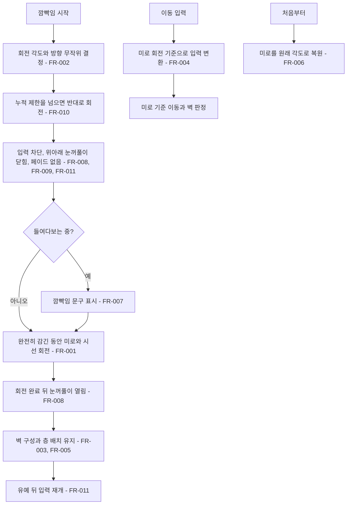

# 깜빡임 착시 회전

## 1. 개요

- 목적: 눈을 깜빡일 때 층을 실제로 돌려 길을 바꾸는 대신, 맵과 시선을 함께 무작위로 돌려 맵이 변한 것처럼 보이게 한다.
- 대상: 플레이어

## 2. 범위

- 포함:
  - 깜빡임 동안 미로 전체와 시선의 무작위 회전
  - 맵이 돌아간 상태에서의 화면 기준 이동 입력
  - 층별 깜빡임 회전 제거
  - 위아래 눈꺼풀이 닫혔다가 열리는 깜빡임
  - 화면 전체 페이드 제거
- 제외:
  - 깜빡임 주기 변경
  - 단서 말풍선을 닫을 때의 벽 재생성
  - 깜빡임 문구 변경

## 3. 기술 방향

- 사용 기술/API: `Transform.Rotate`, `UnityEngine.Random`, `Mathf.SmoothStep`, `Mesh`, `MeshRenderer`
- 핵심 방식: `IrisMaze`의 Transform만 Z축으로 돌린다. 층, 벽, 문, 파편, 시선은 그 자식이고 로컬 좌표로 판정하므로 판정은 그대로다. 이동 입력은 미로 Transform의 현재 회전 기준으로 바꾼다.
- 선택하지 않은 방식: `MazeLayer.Offset`을 바꾸는 방식은 층끼리 어긋나 실제 길이 바뀌므로 사용하지 않는다. 카메라를 돌리는 방식은 눈과 동공, UI 구도까지 함께 돌아가므로 사용하지 않는다.
- 외부 의존성: `IrisMaze`, `GazeCursor`, `MazeLayer`

## 4. 구조

| 구분 | 이름 | 역할 |
|------|------|------|
| 클래스 | EyeMazeDirector | 깜빡임마다 회전량을 정하고 미로를 돌리며, 이동 입력을 미로 기준으로 바꾼다 |
| 클래스 | EyeVisual | 닫힘 정도에 맞춰 눈꺼풀 선과 속눈썹을 옮기고 눈 안쪽을 덮는 메시를 그린다 |
| 클래스 | EyeMazeUI | 깜빡임 전체 화면 페이드를 처리하지 않는다 |
| 클래스 | MazeLayer | 깜빡임 회전 설정을 갖지 않는다 |
| 클래스 | `EyeInspectors.cs`의 디렉터 인스펙터 | 깜빡임 버튼을 표시하지 않는다 |
| 씬 | EyeMaze | 구성 변경 없음 |

- 오브젝트 구성: 변경 없음. `눈 (Eye)` 아래 `미로 (Iris Maze)`가 층과 `시선 (Gaze)`을 자식으로 가지고, `동공 (Pupil)`은 미로의 형제라 돌지 않는다.
- 클래스 간 관계: `EyeMazeDirector`가 `IrisMaze`의 Transform을 돌리고, 미로의 부모에서 찾은 `EyeVisual.Closed`에 닫힘 정도를 전달한다. 덮개 오브젝트는 Play 중에 코드로 만들어 씬에 저장되지 않는다.
- 실행 순서 의존성: 해당 없음
- 기존 코드와의 접점: `EyeMazeDirector.Update()`, `Blink()`, `Steer()`, `Nudge()`, `ResetAll()`, `ApplyBlinkRotation()`, `MazeLayer._rotateOnBlink`, `EyeInspectors.cs`의 깜빡임 버튼, `EyeVisual.UpperEdge()`, `EyeMazeUI._blinkOverlay`

## 5. 동작 플로우차트

## 6. 요구사항

- FR-001: 눈이 완전히 감겨 있는 동안에만 `EyeMazeDirector`는 미로 오브젝트를 시선과 함께 회전시키고, 눈을 뜨기 시작하기 전에 회전을 끝낸다.
- FR-002: 깜빡임이 시작될 때 `EyeMazeDirector`는 `_blinkTurnMinSectors`와 `_blinkTurnMaxSectors` 사이의 칸 수와 회전 방향을 무작위로 정한다.
- FR-003: 깜빡임이 일어날 때 `EyeMazeDirector`는 벽, 문, 파편의 구성을 바꾸지 않는다.
- FR-004: 맵이 돌아간 상태에서 이동 입력을 받을 때 `EyeMazeDirector`는 시선을 화면 기준 입력 방향으로 움직인다.
- FR-005: 깜빡임이 일어날 때 `EyeMazeDirector`는 `MazeLayer.Offset`을 바꾸지 않는다.
- FR-006: `ResetAll`이 호출될 때 `EyeMazeDirector`는 미로를 깜빡임 회전 전 각도로 되돌린다.
- FR-007: 들여다보는 중 눈이 완전히 감길 때 `EyeMazeDirector`는 "눈을 깜빡였다. 무언가가 돌아갔다." 문구를 표시한다.
- FR-008: 깜빡임이 진행될 때 `EyeVisual`은 위아래 눈꺼풀로 눈 영역을 덮으며 닫았다가 다시 연다.
- FR-009: 깜빡임이 진행될 때 `EyeMazeUI`는 화면 전체를 어둡게 하지 않는다.
- FR-010: 이번 회전으로 누적 각도가 `_blinkTurnLimitDeg`를 넘게 될 때 `EyeMazeDirector`는 회전 방향을 반대로 바꾼다.
- FR-011: 깜빡임이 진행 중일 때와 눈을 뜬 뒤 `_blinkRecoverSeconds` 동안 `EyeMazeDirector`는 이동 입력을 받지 않는다.

### 상태와 데이터

| 이름 | 타입 | 설명 | 초기값 |
|------|------|------|--------|
| `_mazeTurnDeg` | float | 깜빡임으로 누적된 미로 회전각(도) | 0 |
| `_blinkTurnFrom` | float | 이번 깜빡임을 시작할 때의 회전각(도) | 0 |
| `_blinkTurnDelta` | float | 이번 깜빡임에서 돌 각도(도, 부호가 방향) | 0 |
| `_blinkPhase` | float | 깜빡임 시작 뒤 지난 시간(초). 0 미만이면 깜빡이지 않는 상태 | -1 |
| `_blinkRecoverT` | float | 눈을 뜬 뒤 입력 유예가 남은 시간(초) | 0 |
| `_closed` | float | `EyeVisual`의 눈꺼풀 닫힘 정도. 0은 뜸, 1은 완전히 감김 | 0 |

### 예외 및 경계 조건

- 깜빡임 도중 시선을 거둠: 진행 중인 회전은 끝까지 진행하고, 회전한 각도는 대화 중에도 유지한다.
- 깜빡임 도중 이동 키를 누름: 입력을 무시하고, 유예가 끝난 뒤 누르고 있으면 그때부터 움직인다.
- 프레임이 길게 끊김: 구간 경계에서 시간을 멈춰 회전이 감기기나 뜨기 구간에 섞이지 않게 한다.
- 깜빡임 중 `ResetAll`: 깜빡임을 멈추고 눈을 뜬 상태로 미로를 바로 원래 각도로 되돌린다.
- 편집 화면: 회전값이 씬에 저장되지 않도록 깜빡임 버튼을 표시하지 않는다.
- `_blinkTurnLimitDeg`가 최대 회전량보다 작음: 방향을 바꾼 뒤의 각도도 제한을 넘을 수 있으므로 최대 회전량 이상으로 설정한다.

## 7. Inspector 노출값

| 필드 | 타입 | 기본값 | 설명 |
|------|------|--------|------|
| `_blinkTurnMinSectors` | int | 1 | 깜빡임 한 번에 도는 최소 칸 수 |
| `_blinkTurnMaxSectors` | int | 2 | 깜빡임 한 번에 도는 최대 칸 수 |
| `_blinkTurnLimitDeg` | float | 45 | 처음 방향에서 벗어날 수 있는 최대 각도(도) |
| `_blinkRecoverSeconds` | float | 0.2 | 눈을 뜬 직후 이동 입력을 받지 않는 시간(초) |
| `_blinkCloseSeconds` | float | 0.35 | 눈이 감기는 시간(초) |
| `_blinkTurnSeconds` | float | 0.1 | 완전히 감긴 채 미로가 도는 시간(초) |
| `_blinkOpenSeconds` | float | 0.35 | 눈이 떠지는 시간(초) |
| `_lidCoverColor` | Color | 검정 | 눈을 감을 때 눈 안쪽을 덮는 색 |

## 8. 인수 조건

- FR-001: Play Mode에서 눈을 들여다본 채 기다리면 눈이 감기는 도중과 떠지는 도중에는 미로가 멈춰 있고, 눈을 떴을 때 미로와 붉은 시선이 함께 돌아가 있으며 시선은 칸 안의 상대 위치를 유지한다.
- FR-002: 깜빡임을 여러 번 보면 회전 방향과 칸 수가 달라지고, `미로 (Iris Maze)`의 Z 회전 변화량이 22.5도 또는 45도다.
- FR-003: 깜빡임 전후로 벽의 켜짐 상태와 문, 파편의 칸이 같다.
- FR-004: 맵이 돌아간 뒤 위쪽 키를 누르면 시선이 화면 위쪽으로 움직이고, 화면에 보이는 벽에 정상적으로 막힌다.
- FR-005: 깜빡임 전후로 `층 2`의 Offset이 그대로다.
- FR-006: 맵이 돌아간 상태에서 R을 누르면 미로의 Z 회전이 Play 시작 때 값으로 돌아온다.
- FR-007: 들여다보는 중 눈이 완전히 감기는 순간 "눈을 깜빡였다. 무언가가 돌아갔다."가 표시된다.
- FR-008: 깜빡일 때 위아래 눈꺼풀이 가운데로 닫혀 흰자와 미로를 모두 가렸다가 다시 열린다.
- FR-009: 깜빡이는 동안 눈 바깥의 UI 글자가 어두워지지 않는다.
- FR-010: 깜빡임을 여러 번 봐도 `미로 (Iris Maze)`의 Z 회전이 처음 값에서 45도 넘게 벗어나지 않는다.
- FR-011: 깜빡임 중 이동 키를 눌러도 시선이 움직이지 않고, 눈을 뜨고 0.2초 뒤부터 움직인다.

## 9. 미결 사항

- 없음
