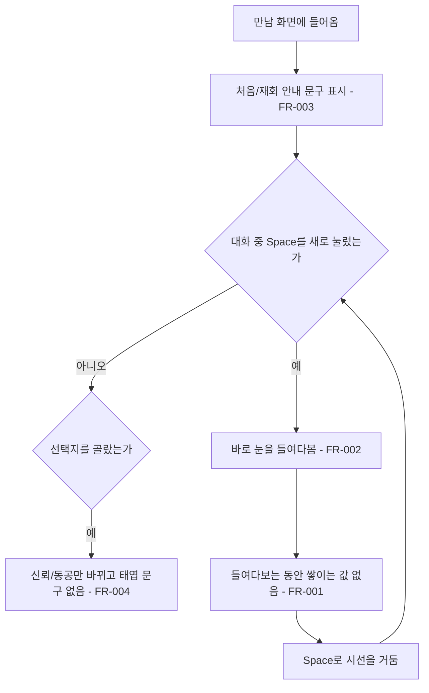

# 태엽 시스템 제거

## 1. 개요

- 목적: 게임플레이에 더 이상 쓰이지 않는 태엽 값(`_wound`, 용량, 선택지의 `Spring`)과 태엽을 언급하는 모든 문구, 씬 오브젝트를 없앤다.
- 대상: 플레이어, 개발자(인스펙터 사용자)

## 2. 범위

- 포함:
  - `WindingIntro` 클래스와 그 인스펙터 삭제
  - 대화 중 Space 들여다보기와 만남 안내 문구를 `EyeMazeDirector`로 이전
  - `DialogueOption`의 `Spring` 값과 그 결과 문구 삭제
  - 화면 문구, 툴팁, 주석, 인스펙터 표시에서 태엽 언급 삭제
  - 씬의 태엽 오브젝트와 태엽 UI 칸, 톱니 텍스처 삭제
- 제외:
  - 신뢰, 동공, 깜빡임 동작 변경
  - 만남 UI의 다른 칸 배치 변경
  - 태엽과 상관없는 대사 수정

## 3. 기술 방향

- 사용 기술/API: Unity Input System, uGUI
- 핵심 방식: `EyeMazeDirector.HandleInput()`이 대화 중 Space(패드 A)를 누르는 순간 `ToggleGaze()`를 부른다. 입력을 받기 시작한 첫 프레임의 누름은 무시한다.
- 선택하지 않은 방식: `WindingIntro`를 이름만 바꿔 남기는 방식은 남는 역할이 입력 한 줄과 문구 두 개뿐이라 사용하지 않는다.
- 외부 의존성: `GameFlow`, `EyeMazeUI`, `FieldInspectors`

## 4. 구조

| 구분 | 이름 | 역할 |
|------|------|------|
| 클래스 | EyeMazeDirector | 대화 중 Space로 들여다보기를 시작하고, 만남 시작 시 안내 문구를 보여준다 |
| 클래스 | GameFlow | 만남에 들어갈 때 `EyeMazeDirector.ShowEncounterGuide()`를 부른다 |
| 클래스 | EyeMazeUI | 태엽 칸을 숨기는 코드 없이 상황과 안내 문구를 표시한다 |
| 클래스 | DialogueOption | `Spring` 없이 신뢰, 동공, 반응, 엔딩만 가진다 |
| 씬 | EyeMaze | 태엽 오브젝트와 태엽 UI 칸이 없다 |

- 오브젝트 구성: `태엽 (Mainspring)`, `눈 (Eye)/태엽 톱니 (Crown)`, `UI (Canvas)/만남 UI/태엽 막대 칸`, `UI (Canvas)/만남 UI/톱니 칸`을 하위 오브젝트까지 삭제한다.
- 클래스 간 관계: `GameFlow` → `EyeMazeDirector.ShowEncounterGuide(first)`
- 실행 순서 의존성: 해당 없음
- 기존 코드와의 접점: `EyeMazeDirector.HandleInput()`, `ToggleGaze()`, `ChooseOption()`, `ResetAll()`, `Nudge()`, `GameFlow.EnterEncounterNow()`, `EyeMazeUI.Start()`, `EyeMazeDirectorEditor`, `GameFlowEditor`

## 5. 동작 플로우차트

## 6. 요구사항

- FR-001: 들여다보는 동안 `EyeMazeDirector`는 시간에 따라 쌓이는 값을 갖지 않는다. (`WindingIntro`, `_wound`, 용량, `_editStepUnwind` 삭제)
- FR-002: 대화 중 Space(패드 A)를 누를 때 `EyeMazeDirector`는 바로 눈을 들여다본다. 입력을 받기 시작한 첫 프레임의 누름은 무시한다.
- FR-003: 만남을 시작할 때 `EyeMazeDirector`는 처음 만나면 `_firstGuide`, 다시 만나면 `_againGuide`를 문구로 보여준다.
- FR-004: 대화 선택지를 고를 때 `EyeMazeDirector`는 신뢰와 동공만 바꾸고, 태엽 결과 문구를 붙이지 않는다. 좋은 말 판정은 신뢰 또는 동공이 오르는 선택지로 한다.
- FR-005: 플레이어에게 보이는 문구는 태엽을 언급하지 않는다.
  - `시선을 거뒀다. 남은 태엽은 그대로다.` → `시선을 거뒀다.`
  - `{Name}의 눈을 들여다본다. 태엽이 풀리는 동안만 볼 수 있다.` → `{Name}의 눈을 들여다본다.`
  - `시선이 파편에 머문다. 태엽이 잠시 멈췄다.` → `시선이 파편에 머문다.`
  - `Space / Z  계속 (읽는 동안 태엽이 멈춤)` → `Space / Z  계속`
- FR-006: 스크립트의 툴팁, 주석, 인스펙터 표시와 버튼은 태엽을 언급하지 않는다. (`태엽 가득` 버튼, 상태 줄의 태엽 수치, 도움말 문장 삭제)
- FR-007: `EyeMaze` 씬은 태엽 오브젝트와 태엽 UI 칸을 갖지 않고, `gear_white.png`는 프로젝트에서 삭제된다.
- FR-008: `EyeMaze` 씬의 `EyeVisual`과 `IrisMaze`는 초점(`_focus`) 1로 저장되어, 초점을 조절하는 코드 없이도 눈과 미로가 선명하게 보인다. 초점 값과 흐림 표현은 나중 연출을 위해 남긴다.

### 상태와 데이터

| 이름 | 타입 | 설명 | 초기값 |
|------|------|------|--------|
| `_acceptedLastFrame` | bool | 이전 프레임에 입력을 받고 있었는지 | false |

### 예외 및 경계 조건

- 필드에서 만남으로 넘어오는 프레임에 Space가 눌려 있음: 그 프레임에는 들여다보지 않는다.
- 들여다보는 중 Space: 지금처럼 시선을 거둔다. 거둔 그 프레임에 다시 들어가지 않는다.
- 심연과 엔딩 중 Space: 지금처럼 거둘 수 없다.

## 7. Inspector 노출값

| 필드 | 타입 | 기본값 | 설명 |
|------|------|--------|------|
| `EyeMazeDirector._firstGuide` | string | `Space를 누르면 은재의 눈을 들여다본다.` | 처음 만날 때의 안내 문구 |
| `EyeMazeDirector._againGuide` | string | `다시 마주 앉았다. Space를 누르면 눈을 들여다본다.` | 다시 만날 때의 안내 문구 |

## 8. 인수 조건

- FR-001: 프로젝트에서 `WindingIntro`, `_wound`, `Capacity`, `_editStepUnwind`가 검색되지 않고 컴파일 에러가 없다.
- FR-002: Play Mode 대화 중 Space를 누르는 순간 눈을 들여다보고, 다시 누르면 시선을 거둔 채 대화로 돌아온다.
- FR-003: 처음 만나면 첫 안내 문구가, 필드로 나갔다 다시 만나면 재회 안내 문구가 보인다.
- FR-004: 선택지를 골라도 `태엽이 N칸` 문구가 나오지 않는다. 신뢰나 동공이 오르는 선택지는 두 번째부터 `이미 한 이야기다.`가 나온다.
- FR-005: Play Mode에서 들여다보기, 시선 거두기, 파편 읽기 화면에 `태엽`이라는 말이 보이지 않는다.
- FR-006: `Assets/EyeMaze/Scripts`에서 `태엽`이 검색되지 않는다.
- FR-007: 씬을 열었을 때 Missing Script 경고가 없고, 하이어라키에 `태엽`이 들어간 오브젝트가 없다.
- FR-008: 에디트 모드와 Play Mode 모두에서 미로 벽이 가늘고 선명하며, 눈이 어둡게 번지지 않는다.

## 9. 미결 사항

- 없음
