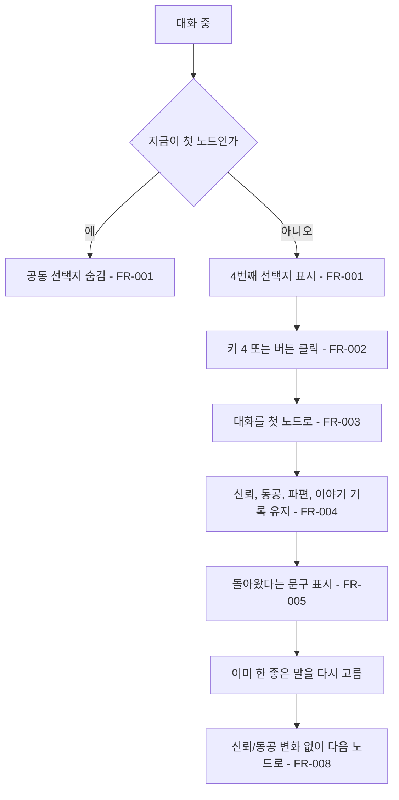

# 처음 이야기로 돌아가는 공통 선택지

## 1. 개요

- 목적: 대화 루트를 따라가다가 언제든 첫 대화 노드로 돌아갈 수 있도록, 모든 노드의 맨 마지막에 공통 선택지를 둔다.
- 대상: 플레이어

## 2. 범위

- 포함:
  - 첫 노드가 아닐 때 보이는 4번째 공통 선택지 `다른 이야기를 해볼까요?`
  - 키 4와 버튼 클릭으로 선택
  - 만남 UI에 4번째 선택지 버튼 추가와 선택지 버튼 4개 재배치
  - 디렉터 인스펙터의 같은 버튼, 대화 안내 문구 갱신
- 제외:
  - 신뢰, 동공, 파편, 층 회전, `이미 한 이야기다` 기록 되돌리기
  - 한 단계씩 이전 노드로 돌아가기
  - 게임패드로 선택지 고르기 (지금도 1~3번 선택지에 패드 입력이 없다)

## 3. 기술 방향

- 사용 기술/API: Unity Input System, uGUI `Button`
- 핵심 방식: 공통 선택지는 `DialogueNode` 데이터에 넣지 않고 `EyeMazeDirector.ReturnToStart()`로 처리한다. UI는 별도 버튼 하나로 표시한다.
- 선택하지 않은 방식: 노드마다 `DialogueOption`을 하나씩 추가하는 방식은 노드가 늘 때마다 같은 데이터를 반복해서 넣어야 하고, 지금 선택지 칸(1~3번)을 이미 다 쓰고 있어서 사용하지 않는다.
- 외부 의존성: `EyeMazeUI`, `EyeMazeDirectorEditor`

## 4. 구조

| 구분 | 이름 | 역할 |
|------|------|------|
| 클래스 | EyeMazeDirector | 공통 선택지를 보여줄지 판단하고, 고르면 대화를 첫 노드로 되돌린다 |
| 클래스 | EyeMazeUI | 4번째 버튼을 보이거나 숨기고, 글을 표시한다 |
| 클래스 | EyeMazeDirectorEditor | 에디트 모드에서 같은 선택지를 버튼으로 보여준다 |
| 씬 | EyeMaze | `대화 칸/속지/선택지 4` 버튼을 가진다 |

- 오브젝트 구성: `선택지 3`을 복제해 `선택지 4`를 만들고, 클릭 시 `EyeMazeDirector.ReturnToStart()`를 부른다. 선택지 1~4의 세로 앵커를 다음처럼 바꾼다. 가로 배치는 그대로 둔다.

| 버튼 | AnchorMin.y | AnchorMax.y |
|------|-------------|-------------|
| 선택지 1 | 0.75 | 0.95 |
| 선택지 2 | 0.52 | 0.72 |
| 선택지 3 | 0.29 | 0.49 |
| 선택지 4 | 0.06 | 0.26 |

- 클래스 간 관계: `EyeMazeUI` → `EyeMazeDirector.CanReturnToStart`, `ReturnText`
- 실행 순서 의존성: 해당 없음
- 기존 코드와의 접점: `EyeMazeDirector.HandleInput()`, `EyeMazeUI.Update()`, `EyeMazeDirectorEditor.OnInspectorGUI()`

## 5. 동작 플로우차트

## 6. 요구사항

- FR-001: 대화 중이고 지금 노드가 첫 노드가 아닐 때 `EyeMazeUI`는 4번째 선택지 `4. 다른 이야기를 해볼까요?`를 보여준다. 마지막 노드를 지나 다른 선택지가 없을 때도 보여준다. 첫 노드, 들여다보는 중, 엔딩 중에는 숨긴다.
- FR-002: 공통 선택지가 보일 때 키 4를 누르거나 버튼을 누르면 `EyeMazeDirector.ReturnToStart()`가 실행된다.
- FR-003: `ReturnToStart()`가 실행될 때 `EyeMazeDirector`는 대화를 첫 노드로 되돌린다.
- FR-004: `ReturnToStart()`는 신뢰, 동공, 주운 파편, 층 회전, `이미 한 이야기다` 기록을 바꾸지 않는다.
- FR-005: `ReturnToStart()`가 실행될 때 `EyeMazeDirector`는 문구를 `_returnMessage`로 바꾼다.
- FR-006: 대화 중 화면 안내는 `Space = 눈 들여다보기   ·   1 2 3 4 대화   ·   Q 자리 떠나기`로 표시한다.
- FR-007: 디렉터 인스펙터는 공통 선택지가 보일 조건에서 `4. 다른 이야기를 해볼까요?` 버튼을 보여주고, 누르면 `ReturnToStart()`를 Undo 가능한 조작으로 실행한다.
- FR-008: 이미 한 좋은 말(신뢰 또는 동공이 오르는 선택지)을 다시 고를 때 `EyeMazeDirector`는 신뢰와 동공을 바꾸지 않고 `이미 한 이야기다.` 문구를 보여주며, 그 선택지가 `Advance`면 다음 노드로 넘어간다. 첫 노드로 돌아온 뒤에도 대화를 다시 진행할 수 있게 하기 위해서다.

### 상태와 데이터

| 이름 | 타입 | 설명 | 초기값 |
|------|------|------|--------|
| `CanReturnToStart` | bool (계산값) | 대화 중이고 `_currentNode > 0`인지 | - |

### 예외 및 경계 조건

- 들여다보는 중에 키 4: 아무 일도 일어나지 않는다.
- 첫 노드에서 키 4: 아무 일도 일어나지 않는다.
- 뒤로가기까지 합쳐 선택지가 4개인 장면: 공통 선택지를 숨기고, 키 4는 네 번째 선택지를 고른다.
- 엔딩 중: 숨기고 입력을 무시한다.
- 손님(케이스)이 바뀜: 그 손님 대화의 첫 노드로 돌아간다.

## 7. Inspector 노출값

| 필드 | 타입 | 기본값 | 설명 |
|------|------|--------|------|
| `EyeMazeDirector._returnText` | string | `다른 이야기를 해볼까요?` | 공통 선택지에 보이는 글 |
| `EyeMazeDirector._returnMessage` | string | `화제를 돌렸다.` | 고른 뒤 보이는 문구 |
| `EyeMazeUI._returnButton` | Button | `선택지 4` | 공통 선택지 버튼 |
| `EyeMazeUI._returnLabel` | Text | `선택지 4`의 글 | 공통 선택지 글 |

## 8. 인수 조건

- FR-001: Play Mode 첫 노드에서는 선택지가 3개만 보이고, 한 번 넘어간 뒤에는 4번째 선택지가 보인다. 마지막 노드를 지난 뒤에도 4번째 선택지만 보인다.
- FR-002: 키 4와 버튼 클릭이 각각 첫 노드로 돌려보낸다.
- FR-003: 고른 직후 첫 노드의 상황 문구와 선택지가 보인다.
- FR-004: 고르기 전후로 상단의 신뢰, 동공 값과 파편 목록이 같다. 이미 한 좋은 말을 다시 고르면 `이미 한 이야기다.`가 나온다.
- FR-005: 고른 직후 `화제를 돌렸다.`가 보인다.
- FR-006: 대화 중 하단 안내에 `1 2 3 4 대화`가 보인다.
- FR-007: 에디트 모드에서 두 번째 노드로 넘긴 뒤 인스펙터 버튼으로 첫 노드로 돌아가고, Ctrl+Z로 되돌릴 수 있다.
- FR-008: 01 노드에서 2번으로 넘어간 뒤 4번으로 돌아와 다시 2번을 고르면, 신뢰와 동공은 그대로이고 `이미 한 이야기다.`가 보이며 02 노드로 넘어간다.

## 9. 미결 사항

- 없음
