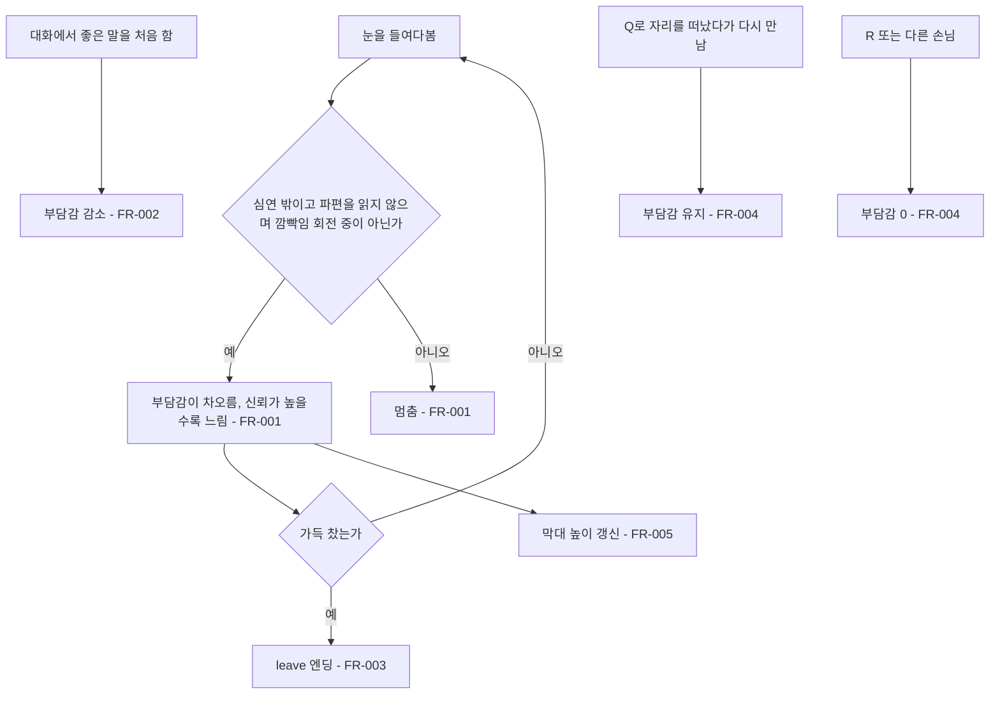

# 부담감 게이지

## 1. 개요

- 목적: 눈을 들여다보는 동안 내담자의 부담감이 차오르게 하고, 끝까지 차면 상담이 끝나게 해서 들여다보는 시간에 긴장감을 준다.
- 대상: 플레이어

## 2. 범위

- 포함:
  - 들여다보는 동안 차오르는 부담감 값 (0~1)
  - 신뢰가 높을수록 느리게 차오르는 속도
  - 좋은 말을 처음 했을 때 부담감 감소
  - 끝까지 차면 leave 엔딩
  - 만남 UI 눈 왼쪽(예전 태엽 막대 자리)의 세로 부담감 막대, 디렉터 인스펙터 표시
- 제외:
  - 대화 중 시간에 따른 자연 감소
  - 눈 연출(떨림, 화면 어두워짐)
  - 새 엔딩 추가, 엔딩 대사 수정

## 3. 기술 방향

- 사용 기술/API: uGUI `Image`, `RectTransform`
- 핵심 방식: `EyeMazeDirector`가 `_burden`을 가지고, 깜빡임과 같은 조건(들여다보는 중, 심연 밖, 파편을 읽지 않는 중)에서만 매 프레임 채운다. 막대는 아래에서 위로 차오르며, 채움 오브젝트의 피벗을 아래쪽에 두고 `localScale.y`를 부담감 값으로 맞춘다. (앵커로 높이를 줄이면 0 근처에서 높이가 음수가 되어 얇은 띠가 그려진다)
- 선택하지 않은 방식: `Image.Type.Filled`는 스프라이트가 있어야 동작하므로 사용하지 않는다. 별도 컴포넌트로 분리하는 방식은 대화 결과, 엔딩, 리셋과 모두 맞물려 있어 사용하지 않는다.
- 외부 의존성: `EyeMazeUI`, `EyeMazeDirectorEditor`

## 4. 구조

| 구분 | 이름 | 역할 |
|------|------|------|
| 클래스 | EyeMazeDirector | 부담감 값을 채우고 줄이며, 가득 차면 leave 엔딩을 시작한다 |
| 클래스 | EyeMazeUI | 부담감 막대의 채움 너비를 맞춘다 |
| 클래스 | EyeMazeDirectorEditor | 상태 줄에 부담감 %를 보여준다 |
| 씬 | EyeMaze | `만남 UI/부담감 막대 칸/속지/채움`과 그 위의 `만남 UI/부담감 글`을 가진다 |

- 오브젝트 구성: 스펙 003에서 지운 `태엽 막대 칸` 구성(칸 → 속지 → 채움)을 같은 자리에 `부담감 막대 칸`으로 되살린다. 칸과 속지의 모양은 다른 칸과 같고, 파란 목표선은 넣지 않는다. 위에 있던 톱니 칸 자리에는 `부담감`이라는 글을 두고, 막대 칸은 그 아래(0.93)까지 늘린다. 글은 상태 글과 같은 글꼴, 크기, 색으로 가운데 정렬한다. `깜빡임` 오버레이보다 먼저 그려지도록 `파편들 칸` 바로 뒤에 둔다.

| 오브젝트 | AnchorMin | AnchorMax | SizeDelta | 색 |
|----------|-----------|-----------|-----------|-----|
| 부담감 글 | (0.231, 0.935) | (0.28, 0.977) | (0, 0) | 상태 글과 같음 (회색 0.6) |
| 부담감 막대 칸 | (0.231, 0.368) | (0.28, 0.93) | (0, 0) | 예전 칸과 같음 |
| 속지 | (0, 0) | (1, 1) | (-20, -20) | 예전 속지와 같음 |
| 채움 | (0, 0) | (1, 1) | (-12, -12) | 붉은색 (1, 0.3, 0.25, 0.9), 피벗 (0.5, 0), 세로 스케일 = 부담감 |

- 클래스 간 관계: `EyeMazeUI` → `EyeMazeDirector.Burden`
- 실행 순서 의존성: 해당 없음
- 기존 코드와의 접점: `EyeMazeDirector.Update()`, `ChooseOption()`, `ResetAll()`, `EyeMazeUI.Update()`, `EyeMazeDirectorEditor.OnInspectorGUI()`

## 5. 동작 플로우차트

## 6. 요구사항

- FR-001: Play Mode에서 들여다보는 중이고 심연 밖이며 파편을 읽지 않고 스펙 007의 깜빡임 회전 중이 아닐 때 `EyeMazeDirector`는 부담감을 초당 `1 / (_burdenFillSeconds + _burdenSecondsPerTrust × 신뢰)`씩 채운다. 신뢰가 0보다 작으면 0으로 계산한다.
- FR-002: 좋은 말(신뢰 또는 동공이 오르는 선택지)을 처음 고를 때 `EyeMazeDirector`는 부담감을 `_burdenRelief`만큼 줄이고(0 아래로는 내려가지 않음), 실제로 줄었으면 결과 문구에 `(부담이 조금 줄었다.)`를 붙인다. 이미 한 좋은 말을 다시 고를 때는 줄이지 않는다.
- FR-003: 부담감이 1에 닿을 때 `EyeMazeDirector`는 `_burdenEndLine`을 첫 줄로 leave 엔딩을 시작한다. 지금 손님에게 leave 엔딩이 없으면 같은 문구로 시선을 거두게 한다.
- FR-004: 같은 손님과 다시 만날 때(Q로 자리를 떠났다가 돌아옴) 부담감은 그대로 남는다. 내담자의 휴식 신호를 보고 쉬어 준 경우만 스펙 009를 따른다. `ResetAll()`(R, 다른 손님 불러오기)은 부담감을 0으로 되돌린다.
- FR-005: `EyeMazeUI`는 부담감 막대의 `채움` 높이를 부담감 값(0~1)에 맞춘다.
- FR-006: 디렉터 인스펙터 상태 줄은 `부담감 N%`를 함께 보여준다.
- FR-007: 만남 UI는 부담감 막대 바로 위에 `부담감`이라는 글을 보여준다.
- FR-008: Play Mode에서 부담감 값이 갑자기 바뀔 때(대화, 리셋) `EyeMazeUI`는 막대를 초당 `_burdenAnimSpeed`만큼 실제 값 쪽으로 움직여, 차오르거나 떨어지는 모습을 보여준다. 들여다보는 동안의 차오름은 이 속도보다 느리므로 그대로 따라간다. 에디트 모드에서는 바로 맞춘다.

### 상태와 데이터

| 이름 | 타입 | 설명 | 초기값 |
|------|------|------|--------|
| `_burden` | float | 지금 부담감 (0~1). Inspector에서 확인과 조절이 가능하다 | 0 |

### 예외 및 경계 조건

- 심연 안, 파편을 읽는 중, 깜빡임 회전 중, 대화 중, 엔딩 중: 부담감이 차오르지 않는다.
- 에디트 모드: 시간이 흐르지 않으므로 차오르지 않는다. Inspector에서 `_burden`을 직접 바꿔 막대를 확인한다.
- 같은 프레임에 신뢰가 바뀜: 다음 프레임부터 새 속도로 찬다.
- 엔딩이 시작된 뒤: 부담감 값은 1로 남고 더 이상 바뀌지 않는다.

## 7. Inspector 노출값

| 필드 | 타입 | 기본값 | 설명 |
|------|------|--------|------|
| `EyeMazeDirector._burdenFillSeconds` | float | 85.8 | 신뢰 0일 때 0에서 가득까지 걸리는 들여다보기 시간(초) |
| `EyeMazeDirector._burdenSecondsPerTrust` | float | 17.2 | 신뢰 1당 늘어나는 시간(초) |
| `EyeMazeDirector._burdenRelief` | float | 0.25 | 좋은 말을 처음 했을 때 줄어드는 양 (0~1) |
| `EyeMazeDirector._burdenEndLine` | string | `은재가 시선을 피했다. 더는 마주 보기 힘든 것 같다.` | 가득 찼을 때 엔딩 앞에 보이는 한 줄 (이름은 손님에 맞게 바뀐다) |
| `EyeMazeUI._burdenAnimSpeed` | float | 0.5 | 막대가 실제 값을 따라가는 속도 (초당 비율) |
| `EyeMazeUI._burdenFill` | RectTransform | `부담감 막대 칸/속지/채움` | 높이를 맞출 채움 오브젝트 |

## 8. 인수 조건

- FR-001: 신뢰 0에서 깜빡임 회전 시간을 빼고 약 86초 동안 들여다보면 가득 찬다. 신뢰 2에서는 약 120초가 걸린다. 파편을 읽는 동안, 깜빡임 회전 중, 심연 안에서는 막대가 멈춰 있다.
- FR-002: 부담감이 있을 때 좋은 말을 처음 고르면 막대가 1/4만큼 줄고 `(부담이 조금 줄었다.)`가 보인다. 같은 말을 다시 고르면 줄지 않는다.
- FR-003: 가득 차는 순간 시선이 풀리고 `은재가 시선을 피했다. 더는 마주 보기 힘든 것 같다.` 뒤로 leave 엔딩 대사가 이어진다. 지수에게는 `지수가 시선을 피했다.`로 보인다.
- FR-004: 막대가 절반쯤 찬 상태에서 Q로 나갔다가 다시 말을 걸면 막대가 그대로다. R을 누르면 0이 된다.
- FR-005: 들여다보는 동안 눈 왼쪽의 붉은 막대가 아래에서 위로 차오른다. 눈을 깜빡일 때 막대도 함께 가려진다.
- FR-006: 디렉터 인스펙터 상태 줄에 `부담감 N%`가 보인다.
- FR-007: 만남 화면에서 붉은 막대 칸 바로 위에 `부담감` 글이 보인다.
- FR-008: 부담감이 있을 때 좋은 말을 고르면 막대가 한 번에 바뀌지 않고 약 0.5초에 걸쳐 1/4만큼 내려간다. R을 누르면 0까지 같은 속도로 내려간다.

## 9. 미결 사항

- 없음
