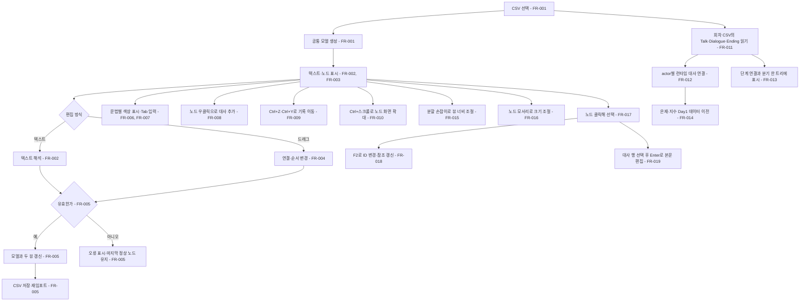

# 두 뷰 대사 편집기

## 1. 개요

- 목적: 한 인물의 한 회차에 속한 등장 대화, 상담 선택지, 결말을 한 CSV와 두 뷰에서 함께 편집하고 전체 흐름을 확인한다.
- 대상: 대사를 쓰고 분기를 조정하는 게임 제작자

## 2. 범위

- 포함:
  - `Data/Dialogue/<인물>_Day<번호>.csv`에서 Talk·Dialogue·Ending을 함께 편집
  - 등장·필드 대화부터 상담 선택지와 결말까지 단계 연결과 분기를 한 트리에 표시
  - 기존 은재·지수 1회차 CSV의 통합, 런타임 참조와 씬 연결 이전
  - 두 뷰의 동기화, 유효한 변경의 즉시 CSV 저장, 오류 표시
  - 텍스트 문법 강조와 Tab 입력, 노드 우클릭 대사 추가, 실행 취소·다시 실행, 노드 뷰 확대·축소
  - 텍스트·트리 뷰의 분할 너비와 트리 노드 크기 조절·유지, 노드 선택과 F2 ID 변경, 대사 행 선택과 Enter 본문 편집
- 제외:
  - SUDS 엔진 도입과 `.sud` 파일 저장·내보내기
  - 게임 실행 시 대사 처리 방식 변경
  - `Flags.csv` 편집과 게임 UI 변경
  - CSV 주석, 미사용 열, 공백, 인용 방식의 원문 보존
  - Day2 이후 회차 선택·진행·저장 로직 (파일 이름과 열 구조만 준비)
  - 공용 `Strings.csv`의 인물별 파일 편입

## 3. 기술 방향

- 사용 기술/API: Unity 6000.3 EditorWindow, IMGUI, `Handles`, `AssetDatabase`, 기존 `Csv`, `DialogueScript`, `TalkScript`, `EndingScript`, `Strings`, `DialogueData`. 에디터 창은 프로젝트 `AGENTS.md`의 uGUI 규칙에서 사용자가 허용한 IMGUI 예외로 처리한다.
- 핵심 방식: 인물·회차당 하나의 CSV를 유일한 저장 원본으로 삼는다. `section` 열로 Talk·Dialogue·Ending 행을 구분하고 `actor`로 Talk를 말하는 FieldNPC를 구분한다. 편집기는 한 파일의 공통 모델에서 텍스트와 전체 흐름 트리를 그린다. 유효한 편집은 같은 CSV에 저장·재임포트한다.
- 선택하지 않은 방식: SUDS의 Unreal 런타임·임포터 도입, `.sud`를 두 번째 원본으로 저장, Graph Toolkit/UI Toolkit 사용, 노드 화면 좌표 저장.
- 외부 의존성: 새 패키지 없음. SUDS의 `:Label`, `* Choice`, `Speaker: text`, `[goto Label]` 표기만 참고하고 `[eye ...]`는 이 프로젝트 전용 명령으로 둔다. 실제 SUDS 파서 호환은 요구하지 않는다. 런타임 `ClientCase`, `FieldNPC`, `DialogueScript`, `TalkScript`, `EndingScript`와 에디터 `DialogueData`의 CSV 참조·검사를 새 형식에 맞춘다.
- 텍스트 시각화: 입력 가능한 텍스트 영역에서 마크다운 편집기처럼 문법 요소별 색을 입힌다. 라벨은 청록, 선택지는 노랑, `Line:` 대사는 기본 글자색, `[eye ...]`는 보라, `[goto ...]`는 파랑, 오류 줄은 빨강으로 구분한다. 커서·선택 영역·스크롤과 실제 입력 글자의 위치가 일치해야 하며 밝은/어두운 Unity 테마에서 읽을 수 있어야 한다.
- 편집 기록: 유효한 텍스트 변경 한 번과 노드 조작 한 번을 각각 기록 항목으로 삼는다. 기록에는 CSV의 모든 알려진 값과 순서를 담고, 실행 취소·다시 실행 시 같은 저장·재임포트 경로를 사용한다.
- 화면 설정: 분할 너비는 에디터 전체에, 노드 크기는 파일 GUID와 section·actor·id별로 `EditorPrefs`에 저장한다. CSV에는 화면 크기나 위치를 적지 않는다. ID를 바꾸면 해당 노드의 크기 설정 키도 함께 옮긴다.
- 구현 순서: FR-001~FR-005는 기존 편집기의 기준 동작이다. 신규 작업은 FR-011~FR-014(통합 CSV·런타임·트리)로 데이터 이전을 끝낸 뒤 FR-006~FR-008(표시·입력·추가), FR-009~FR-010(기록·확대), FR-015~FR-019(크기·선택·인라인 편집) 순서로 구현한다. `docs/README.md`에 따라 묶음별 승인 범위를 확인한다.

### 인물·회차 CSV

- 경로는 `Assets/EyeMaze/Data/Dialogue/Eunjae_Day1.csv`, `Jisu_Day1.csv`처럼 정한다. 공통 머리글은 `section,actor,id,situation,text,response,need,set,trust,dilation,spring,goto,ending,back,title,after,speaker,memo`다.
- `section=talk`: `actor`는 대사를 실행하는 FieldNPC의 안정적인 ID(`EunjaeMom`, `Eunjae`, `Jisu`), `id`는 기존 `group`, `text`는 기존 대사다. `speaker`, `need`, `set`, `memo`는 기존 의미를 유지한다. 같은 actor 안에서 그룹의 첫 등장 순서가 `TalkScript.Pick()` 우선순위다.
- `section=dialogue`: `actor`는 상담 인물 ID, `id`는 기존 `node`, `text`는 선택지다. `situation`, `response`, `need`, `set`, 수치, `goto`, `ending`, `back`, `memo`는 기존 의미를 유지한다. 첫 dialogue 노드가 상담 시작 노드다.
- `section=ending`: `actor`는 상담 인물 ID, `id`는 기존 엔딩 id 또는 `@intro`·`@idle`·`@abyss`, `text`는 기존 `line`이다. `title`, `situation`, `after`, `memo`는 기존 의미를 유지한다.
- 행은 section별로 Talk, Dialogue, Ending 순서로 모아 기록한다. 한 section 안의 그룹·행 순서는 유지한다. `Talk`의 `again`처럼 재상호작용용 그룹은 원래 우선순위를 보존한다. `Strings.csv`는 그대로 별도 파일로 둔다.
- 기존 `Dialogue/Eunjae.csv`와 `Dialogue/Jisu.csv`의 파일·`.meta`를 각각 `Eunjae_Day1.csv`, `Jisu_Day1.csv`로 이름을 바꿔 GUID를 유지한 뒤 Talk·Ending 행을 넣는다. 은재 Day1에는 `Talk/EunjaeMom.csv`의 실사용 행을 `actor=EunjaeMom`으로 포함한다. `Talk/Eunjae.csv`처럼 주석만 있는 파일에는 이관할 대사 행이 없다. 지수 Day1에는 `Talk/Jisu.csv`의 실사용 행을 포함한다.
- 씬의 `ClientCase` 두 개는 각 Day1 CSV 하나만 참조하고, 은재 어머니·은재·지수 `FieldNPC`는 해당 회차 CSV와 각각 `EunjaeMom`·`Eunjae`·`Jisu` actor ID를 참조한다. 이전 데이터와 씬 연결을 검증한 뒤 중복된 옛 Talk·Ending CSV 및 `.meta`를 제거한다. `Assets/EyeMaze/Data/README.md`를 새 머리글과 회차 파일 작성 절차에 맞춰 갱신한다.

### 텍스트 뷰 표기

- 파일마다 하나의 문서를 표시한다. `[eye section="talk|dialogue|ending" actor="..."]`가 각 단계의 시작을 알리고, 그 아래 `:id`가 Talk의 `group`, Dialogue의 `node`, Ending의 `id`를 시작한다. 라벨 순서가 해당 section·actor 안의 CSV 그룹 순서이며, 대사 순서가 그룹 안의 행 순서다. 같은 id는 section·actor가 다르면 별개다.
- `Dialogue`: `:node` 뒤 `[eye situation="..." back="..."]`를 표시한다. 각 선택지는 `* 선택지 글`, 이어서 **Tab 한 개** 들여쓴 `[eye response="..." need="..." set="..." trust=0 dilation=0 spring=0 memo="..."]`, 마지막으로 필요할 때 같은 깊이의 `[goto 대상]` 또는 `[eye ending="..."]`를 둔다. 둘 다 없으면 현재 노드에 머문다. `back`은 노드의 첫 CSV 행에 기록한다.
- `Talk`: `[eye section="talk" actor="EunjaeMom"]` 같은 단계 명령 아래 `:group` 뒤 `[eye need="..." set="..."]`를 표시한다. 각 행은 `[eye speaker="..." memo="..."]`와 `Line: 대사`의 쌍이다. 빈 speaker, `-`, `???`는 CSV 값을 그대로 기록한다. 같은 actor의 그룹 순서는 `TalkScript.Pick()`의 우선순위이므로 유지한다.
- `Ending`: `[eye section="ending" actor="Eunjae"]` 같은 단계 명령 아래 `:id` 뒤 `[eye title="..." situation="..." after="..."]`를 표시한다. 각 행은 `[eye memo="..."]`와 `Line: 대사`의 쌍이다. `@intro`, `@idle`, `@abyss`는 title·situation·after가 없는 라벨로 표시한다.
- `Strings.csv`는 기존처럼 별도 파일에서 편집한다. 인물·회차 트리에는 넣지 않는다.
- `[eye ...]`의 문자열은 큰따옴표로 감싸고 `\"`, `\\`, `\n`을 이스케이프한다. `need`·`set`의 여러 값은 기존 CSV처럼 `|`로 구분하고 수치는 불변 문화권 표기로 쓴다. `*`와 `Line:` 뒤 본문도 실제 줄바꿈을 `\n`으로 표시한다. 지원하지 않는 명령·속성은 오류로 처리한다.
- Tab은 분기 아래 명령을 들여쓰는 한 단계다. 선택지 `*`는 줄 맨 앞, 그 선택지에 속한 명령은 Tab 정확히 한 개 뒤에 둔다. 텍스트 뷰에서 Tab은 실제 탭 문자를 넣고 Shift+Tab은 현재 줄의 탭 한 개를 뺀다. 기존 공백 들여쓰기 텍스트도 읽되, 편집기에서 다시 표시할 때 Tab으로 정규화한다. Tab을 여러 번 넣어 중첩 선택지를 만드는 기능은 포함하지 않으며, 두 번째 Tab으로 시작하는 명령은 오류로 표시한다.

## 4. 구조

| 구분 | 이름 | 역할 |
|------|------|------|
| 클래스 | DialogueEditorWindow | 파일 선택, 분할 손잡이, 문법 강조 텍스트, 단축키, 편집 기록과 오류 표시를 맡는 에디터 창 |
| 클래스 | DialogueEditorDocument | 한 회차의 section·actor·그룹·행·연결·메모를 보존하는 공통 모델 |
| 클래스 | DialogueEditorFormat | 통합 CSV·공통 모델·SUDS식 텍스트의 읽기·쓰기·검사를 맡음 |
| 클래스 | DialogueEditorGraph | Talk부터 Ending까지 단계와 분기를 자동 배치하고 선택·크기 조절·F2 ID 변경·Enter 대사 편집을 처리 |
| 클래스 | ClientCase | 통합 회차 CSV 한 개에서 상담·엔딩 데이터를 읽음 |
| 클래스 | FieldNPC | 통합 회차 CSV와 actor ID로 자신의 Talk 그룹을 읽음 |

- 오브젝트 구성: 해당 없음. 에디터 전용 창이며 씬·프리팹과 런타임 GameObject를 만들지 않는다.
- 클래스 간 관계: `DialogueEditorWindow`가 인물·회차 파일을 선택해 `DialogueEditorFormat`으로 한 `DialogueEditorDocument`를 만든다. 텍스트 뷰와 `DialogueEditorGraph`는 이를 공유한다. `ClientCase`는 같은 파일에서 Dialogue·Ending을, 해당 `FieldNPC`들은 actor ID로 Talk를 읽는다.
- 실행 순서 의존성: 해당 없음.
- 기존 코드와의 접점: `DialogueScript`, `TalkScript`, `EndingScript`가 `section`과 `actor`로 통합 CSV의 행을 골라 읽도록 바꾼다. `ClientCase._dialogueCsv`의 기존 참조는 새 회차 파일로 이전하고 별도 `_endingCsv` 참조를 없앤다. `FieldNPC._talkCsv`는 같은 회차 파일을 가리키며 새 `_dialogueActorId`로 Talk 행을 고른다. 씬의 은재 어머니·은재·지수 필드를 함께 이전한다. `DialogueDataPostprocessor`의 캐시 무효화와 검사는 통합 파일 경로에 맞춘다.

## 5. 동작 플로우차트

## 6. 요구사항

- FR-001: `EyeMaze/대사 편집기` 창에서 인물·회차 CSV를 선택할 때 편집기는 Talk·Dialogue·Ending의 모든 알려진 열과 `memo`를 한 공통 모델로 읽는다. 공용 `Strings.csv`는 별도 선택 항목으로 유지한다.
- FR-002: 텍스트 뷰에서 지원하는 SUDS식 표기와 `[eye ...]` 값을 수정할 때 편집기는 변경된 대사·그룹 순서·연결·메타데이터를 공통 모델에 반영한다.
- FR-003: 파일을 열거나 공통 모델이 바뀔 때 노드 뷰는 한 회차의 Talk·Dialogue·Ending을 위에서 아래로 배치해 단계 연결과 선택지 화살표를 표시한다. 합류·되돌아감은 교차선으로 표시한다.
- FR-004: 노드 뷰에서 연결선 끝을 같은 상담 actor의 다른 `Dialogue` 노드에 놓을 때 `goto`를 바꾸고, 선택지·대사 카드를 같은 section·actor의 다른 그룹 또는 순서 위치에 놓을 때 해당 CSV 소속과 행 순서를 바꾼다. 화면에서 노드만 옮기는 동작은 저장하지 않는다.
- FR-005: 편집 결과가 통합 CSV 형식과 기존 게임 제약을 통과할 때 두 뷰를 함께 갱신하고 회차 CSV를 UTF-8로 즉시 기록·재임포트한다. 텍스트 입력 중 오류가 있으면 줄 위치와 이유를 보여주고 마지막 정상 노드 상태를 유지하며, 오류가 풀릴 때까지 그 초안을 저장하지 않는다.
- FR-006: 텍스트 뷰가 SUDS식 문서를 표시할 때 라벨·선택지·대사·`[eye]`·`[goto]`·오류 줄을 정한 색으로 구분해 편집 중에도 보여준다.
- FR-007: 텍스트 뷰에서 Tab 또는 Shift+Tab을 누를 때 커서가 있는 줄의 들여쓰기를 탭 문자 한 단계씩 늘리거나 줄인다. `Dialogue`의 선택지 아래 명령은 Tab 한 개로 표시한다.
- FR-008: 노드 뷰에서 그룹 노드나 그 안의 대사 행을 우클릭해 추가를 고를 때 그 그룹의 끝 또는 선택한 행 뒤에 새 선택지·대사·문구를 삽입한다.
- FR-009: 편집기에서 Ctrl+Z 또는 Ctrl+Y를 누를 때 각각 이 파일의 최근 유효한 편집을 실행 취소하거나 다시 실행하고, 두 뷰와 CSV를 함께 갱신한다.
- FR-010: 노드 뷰 위에서 Ctrl+마우스 휠을 돌릴 때 포인터 아래 위치를 기준으로 노드·연결선·입력 위치를 함께 확대하거나 축소한다.
- FR-011: `Dialogue/<인물>_DayN.csv`를 열 때 편집기와 파서는 `section`·`actor`·`id`로 Talk·Dialogue·Ending 행을 구분하면서 기존 각 행의 값과 순서를 보존한다.
- FR-012: 회차 CSV가 씬의 `ClientCase`와 관련 `FieldNPC`에 연결될 때 게임은 상담·엔딩과 actor별 필드 대사를 그 파일에서 실행한다.
- FR-013: 통합 회차 CSV를 노드 뷰에 표시할 때 등장·필드 Talk에서 상담 시작 노드, 선택지 분기와 Ending까지 단계 연결을 보여준다.
- FR-014: 기존 은재·지수 1회차 데이터를 이전할 때 Talk·Dialogue·Ending의 모든 실사용 행을 각 Day1 CSV에 합치고 씬 참조를 새 파일에 연결한다.
- FR-015: 텍스트 뷰와 트리 뷰 사이의 분할선을 끌 때 두 뷰의 너비를 바꾸고, 다시 열어도 마지막 너비 비율을 유지한다.
- FR-016: 트리의 그룹 노드나 엔딩 카드를 오른쪽 아래 모서리에서 끌 때 해당 상자의 너비·높이를 바꾸고, 같은 파일을 다시 열어도 그 크기를 유지한다.
- FR-017: 트리의 노드 또는 엔딩 카드를 클릭할 때 그 항목을 선택하고 선택 테두리와 대응하는 텍스트 위치를 표시한다.
- FR-018: 선택한 그룹 노드에서 F2를 누를 때 `:again`과 같은 ID를 인라인으로 편집하고, 유효한 새 ID를 확정하면 해당 section·actor의 CSV ID와 연결 참조를 함께 바꾼다.
- FR-019: 트리에서 대사 행을 선택하고 Enter를 누를 때 해당 행의 본문을 인라인으로 편집하며, 유효한 값을 확정하면 공통 모델·텍스트 뷰·CSV에 함께 반영한다.

### 상태와 데이터

| 이름 | 타입 | 설명 | 초기값 |
|------|------|------|--------|
| 선택 파일 | CSV TextAsset | 현재 편집 중인 인물·회차 파일 또는 공용 Strings | 없음 |
| 공통 모델 | DialogueEditorDocument | section·actor·그룹·행 순서, 연결, 알려진 열과 메모 | 선택 파일에서 생성 |
| 텍스트 초안 | string | 입력 중인 SUDS식 문서 | 공통 모델에서 생성 |
| 마지막 정상 모델 | DialogueEditorDocument | 오류 중 노드 표시와 복구 기준 | 파일을 열 때 생성 |
| 오류 목록 | 줄 번호·메시지 목록 | 문법·데이터 제약 오류 | 비어 있음 |
| 실행 취소·다시 실행 기록 | 모델 스냅샷 목록 | 선택 파일에서 유효하게 저장된 편집 순서 | 파일을 열 때 현재 모델 하나 |
| 노드 뷰 확대율 | float | 노드 뷰에만 적용하는 화면 배율 | 1.0 |
| 뷰 분할 비율 | float (EditorPrefs) | 텍스트·트리 너비 비율 | 0.42 |
| 노드 크기 | GUID·section·actor·id → Vector2 (EditorPrefs) | 파일별 노드 화면 크기 | 자동 배치 크기 |
| 선택 노드 | section·actor·id | F2와 텍스트 위치 동기화 대상 | 없음 |
| 선택 대사 행 | section·actor·id·행 번호 | Enter 인라인 편집과 텍스트 위치 동기화 대상 | 없음 |

### 예외 및 경계 조건

- `Dialogue`의 첫 등장 노드가 시작 노드다. 노드·선택지 순서 변경으로 시작 노드나 선택지 순서가 달라지면 새 CSV에도 그 순서를 반영한다.
- `Dialogue` 노드의 선택지는 최대 3개다. 자동 뒤로가기 선택지는 CSV 행이 아니므로 노드 뷰에서 연결·이동 대상으로 취급하지 않는다.
- `goto`가 없는 선택지는 현재 노드 유지로, `ending`은 종료 카드로 표시한다. 두 값의 동시 지정, 존재하지 않는 대상, 중복 또는 빈 필수 ID는 오류다.
- `Talk`의 `enter`·`reveal`과 그룹 우선순위, `Ending`의 `@intro`·`@idle`·`@abyss`, `Strings`의 같은 key 다중 행을 보존한다.
- 한 파일 안에서 `id`는 같은 section·actor 안에서만 고유하다. `goto`와 `ending` 참조는 같은 상담 actor의 Dialogue 노드와 Ending id에서 각각 찾는다. `Talk`의 `speaker`는 화면 표시용이며 actor별 그룹 선택과 별개다.
- 노드 뷰는 `enter`·`reveal` 같은 등장 Talk를 상담 진입 단계 앞에 놓고, 상담 선택지의 `goto`·`ending` 연결과 각 엔딩의 `after` 대사 카드를 잇는다. Talk에서 상담으로 가는 선은 실제 필드 상호작용을 뜻하는 안내선으로 표시하고 CSV에 임의의 `goto`를 만들지 않는다. `again` 같은 조건부 재대화와 `@intro`·`@idle`·`@abyss`는 해당 단계 옆의 보조 카드로 표시한다.
- Day2 이상 파일도 같은 이름과 열 구조로 편집할 수 있지만, 이번 범위에서 날짜에 따른 활성 회차 전환과 같은 인물의 복수 ClientCase 선택은 구현하지 않는다.
- 저장할 때 알려진 열과 `memo` 값은 보존한다. 기존 CSV의 주석·미사용 열·서식과 인터리브된 그룹 행 배치는 유지하지 않아도 된다.
- 문법 오류가 있는 초안은 모델과 CSV에 반영하지 않는다. 유효한 텍스트 편집은 입력이 0.75초 멈춘 뒤 검사하고 즉시 저장하며, 노드 드래그는 놓을 때 검사하고 저장한다.
- 오류만 저장을 막는다. 켜는 곳이 없는 need 플래그 같은 경고는 목록에 보여주고 저장한다.
- 텍스트 초안에 오류가 있거나 검사 대기 중이면 노드 뷰의 연결·카드 편집을 막는다. 노드 편집이 검사를 통과하지 못하면 모델·텍스트·CSV를 그대로 두고 이유만 보여준다.
- 연결선 끝을 노드에 놓으면 그 선택지의 `ending`은 지운다. 다른 section이나 actor의 노드에 연결하거나 카드를 옮기는 동작은 거절한다.
- 값이 없는 `[eye ...]` 속성과 행 속성 줄은 텍스트에 쓰지 않는다. Dialogue 선택지의 `trust`·`dilation`·`spring`은 0이어도 쓴다.
- 저장 파일은 UTF-8 BOM과 CRLF 줄바꿈을 쓰며, 내용이 같으면 다시 쓰지 않는다.
- 우클릭 추가는 텍스트 초안에 오류가 있거나 검사 대기 중이면 비활성화한다. `Dialogue` 노드에 이미 선택지 3개가 있으면 추가 메뉴를 비활성화한다. 새 `Dialogue` 선택지는 `새 선택지`라는 글, 빈 반응·연결·엔딩, 수치 0으로 만들고 다른 파일의 새 행은 `새 대사` 또는 `새 문구`로 만든 뒤 기존 저장 검사를 거친다.
- Ctrl+Z를 누를 때 아직 검사 전이거나 오류가 있는 텍스트 초안은 우선 마지막 정상 모델의 글로 되돌린다. 정상 편집을 취소·재실행하면 CSV를 다시 기록하며, 취소 뒤 새 편집을 확정하면 다시 실행 기록을 지운다. 파일을 바꾸거나 다시 열면 그 파일의 기록은 새 현재 상태에서 시작한다.
- Ctrl+스크롤은 포인터가 노드 뷰 안에 있을 때만 동작한다. 확대율은 0.5~2.0에서 0.1씩 바꾸고 파일에 저장하지 않는다. 일반 스크롤은 확대율을 바꾸지 않는다.
- 텍스트 문법 강조는 표시만 바꾼다. 색상 표기가 파서의 문법·저장 결과를 바꾸지 않는다.
- 창 너비가 500px 이상이면 분할선은 두 뷰가 각각 최소 250px을 갖는 범위에서 움직인다. 그보다 좁으면 두 뷰를 반씩 표시한다. 노드 크기는 화면 확대율과 별개인 원래 좌표계에서 저장하며, 너비는 180~600px, 높이는 머리·한 행을 표시할 최소 높이부터 800px까지 조절한다. 나머지 행은 상자 안에서 스크롤한다. 크기 조절 후 연결선 끝과 클릭·드래그 판정은 새 상자 경계를 따른다.
- 노드 클릭은 기존 연결선·대사 카드 드래그와 함께 동작한다. 빈 곳을 클릭하면 선택을 풀고, 선택 상태는 파일을 바꾸거나 다시 열 때 지운다. 선택한 노드의 텍스트 위치는 해당 `:id` 줄이며, 인라인 이름 편집 중에는 드래그를 시작하지 않는다.
- F2는 Talk·Dialogue·Ending 그룹 노드의 ID 편집에 쓴다. 같은 section·actor의 중복 ID, 빈 ID, 공백·쉼표·따옴표가 있는 ID는 확정하지 않고 오류를 표시한다. Dialogue ID 변경은 같은 actor의 모든 `goto`를, Ending ID 변경은 같은 actor의 모든 `ending`을 함께 갱신한다. Talk의 `enter`·`reveal`, Ending의 `truth`·`half`·`leave`와 `@intro`·`@idle`·`@abyss`는 런타임 예약 ID여서 이름 변경을 막는다. 공용 Strings의 key도 코드가 참조하므로 F2 변경을 막는다.
- F2 편집은 Enter로 확정하고 Escape로 취소한다. 유효한 이름 변경은 한 번의 실행 취소 기록으로 남으며 CSV에 즉시 저장한다. 문법 오류나 검사 대기 중에는 F2 변경을 막는다.
- 대사 행을 한 번 클릭하면 그 행을 선택하고 대응하는 `* 선택지` 또는 `Line: 대사` 위치를 텍스트 뷰에서 보여준다. Enter는 선택 행의 본문만 인라인 편집한다. Dialogue는 선택지의 `text`, Talk·Ending은 `text`, 공용 Strings는 해당 `text`를 바꾸며, `response`·조건·수치·연결과 노드 ID는 바꾸지 않는다. 엔딩 카드처럼 대사 행이 아닌 항목에는 Enter 편집을 제공하지 않는다.
- 인라인 본문 편집은 Enter로 확정하고 Escape로 취소한다. 입력 중에는 CSV에 쓰지 않고, 확정 시 기존 검사를 통과한 경우에만 두 뷰와 CSV를 갱신한다. 빈 대사처럼 유효하지 않은 값은 입력창을 유지하고 이유를 보여준다. 확정한 본문 변경은 Ctrl+Z 한 번으로 되돌린다. 인라인 편집 중에는 카드 드래그·F2·우클릭 추가를 시작하지 않고, 문법 오류나 텍스트 검사 대기 중에는 Enter 편집을 막는다.

## 7. Inspector 노출값

| 필드 | 타입 | 기본값 | 설명 |
|------|------|--------|------|
| `ClientCase._dialogueCsv` | TextAsset | 기존 씬의 Dialogue 파일 참조 | 해당 인물·회차의 통합 CSV. 엔딩도 여기서 읽음 |
| `FieldNPC._talkCsv` | TextAsset | 기존 씬의 Talk 파일 참조 | 해당 인물·회차의 통합 CSV |
| `FieldNPC._dialogueActorId` | string | 빈 값 | 같은 CSV에서 이 NPC의 Talk 행을 고르는 ID. 씬에서는 `EunjaeMom`, `Eunjae`, `Jisu` 지정 |

## 8. 인수 조건

- FR-001: 에디터 창에서 은재·지수 Day1 파일을 열면 각 파일의 Talk·Dialogue·Ending 그룹과 행, 조건, 수치, `memo`가 하나의 텍스트에 표시된다. 별도 `Strings.csv`도 계속 열 수 있다.
- FR-002: Day1 텍스트의 선택지, `goto`, `[eye ...]`, Talk·Ending 대사와 순서를 바꾸면 노드 뷰와 저장 후 같은 회차 CSV에 반영된다.
- FR-003: 은재 Day1을 열면 어머니의 등장 Talk에서 은재 상담 시작 노드와 선택지 분기·엔딩으로 이어지는 안내선이 보인다. 합류·되돌아감도 각각 연결선으로 표시된다.
- FR-004: 연결선 끝을 다른 노드에 놓고 선택지·대사 카드를 옮긴 뒤 CSV를 재열면 `goto`, 그룹, 행 순서가 새 배치와 일치한다.
- FR-005: 유효한 편집 후 회차 CSV가 즉시 재임포트되고 `EyeMaze/기획 데이터 검사`와 Play Mode 대사가 새 값을 사용한다. 잘못된 section·actor·라벨·명령·네 번째 선택지를 입력하면 오류 줄이 표시되고 CSV 및 노드 뷰는 마지막 정상 상태로 남는다.
- FR-006: Day1 파일과 공용 Strings를 열고 텍스트 뷰에서 라벨, 선택지, `Line:`, `[eye]`, `[goto]`와 오류 줄의 색이 구분되는지 확인한다. 밝은/어두운 테마에서 입력 커서와 선택 영역이 글자 위치에 맞는지 확인한다.
- FR-007: `Dialogue` 선택지 아래 명령에 Tab과 Shift+Tab을 적용하면 탭 문자가 들어가거나 제거된다. 파일을 다시 열면 명령 앞이 공백 대신 Tab 한 개이며, 기존 공백 들여쓰기 초안도 같은 대사 흐름으로 읽힌다.
- FR-008: `Dialogue` 노드와 행을 우클릭해 추가한 선택지가 지정 위치에 보이고 텍스트와 CSV에도 생긴다. 선택지가 3개인 노드에서는 추가가 비활성화된다. `Talk`, `Ending`, `Strings`에서도 우클릭으로 해당 그룹의 행이 추가된다.
- FR-009: 텍스트 수정과 노드 카드 이동을 차례로 확정한 뒤 Ctrl+Z 두 번, Ctrl+Y 두 번을 누르면 각 단계의 두 뷰와 CSV가 이전·다음 값으로 바뀐다. 오류 초안에서 Ctrl+Z는 초안만 되돌리고, 취소 후 새 편집을 하면 Ctrl+Y가 이전 분기를 복구하지 않는다.
- FR-010: 노드 뷰에서 Ctrl+스크롤로 0.5~2.0 사이 확대율이 바뀌고 포인터 아래 노드가 같은 위치에 머문다. 확대 후에도 연결점과 대사 카드 클릭·드래그가 화면 표시와 일치하며, 일반 휠 스크롤은 확대하지 않는다.
- FR-011: 은재 Day1 파일의 `section=talk`와 `actor=EunjaeMom` 행, `section=dialogue`와 `actor=Eunjae` 행, `section=ending` 행을 읽어도 기존 대사의 글·순서·플래그·수치·메모가 유지된다. 지수 Day1도 같은 방식으로 확인한다.
- FR-012: Play Mode에서 은재 어머니의 등장·재대화, 은재·지수의 상담 선택지와 특수 문구·엔딩이 각 Day1 CSV에서 나온다. 씬의 각 FieldNPC가 다른 actor의 Talk를 읽지 않는다.
- FR-013: 은재 Day1 트리에 어머니 Talk, 은재 상담, 엔딩과 `after` 카드가 연결돼 보이고, `again`·`@intro`·`@idle`·`@abyss`는 보조 카드로 보인다. 지수 Day1도 등장 Talk부터 상담·결말까지 보인다.
- FR-014: 두 Day1 CSV의 GUID가 기존 Dialogue 파일과 같고, 씬에 남은 옛 Talk·Ending CSV 참조가 없으며, 이전 후 `EyeMaze/기획 데이터 검사`에 오류가 없다. 인물별 대사를 수정해 Play Mode에서 변경 값이 나타나는지 확인한다.
- FR-015: 분할선을 좌우로 끌면 텍스트·트리 뷰 너비가 함께 바뀌고, 창을 닫았다 다시 열어도 비율이 유지된다. 창이 500px 이상일 때 어느 뷰도 250px 아래로 줄지 않으며, 더 좁으면 반씩 표시된다.
- FR-016: 은재 Day1의 `:again` 노드를 가로·세로로 늘린 뒤 파일과 창을 다시 열면 크기가 유지된다. 확대 상태에서도 모서리·연결점·카드 판정이 표시 위치와 일치한다.
- FR-017: 노드를 클릭하면 선택 테두리가 생기고 텍스트 뷰가 해당 `:id` 줄로 이동한다. 다른 노드를 클릭하거나 빈 곳을 클릭하면 선택이 바뀌거나 해제되고, 기존 카드·연결선 드래그는 계속 동작한다.
- FR-018: `:again` 노드를 선택해 F2로 `:again_later`로 바꾸면 텍스트·CSV의 ID가 함께 바뀐다. Dialogue 노드와 일반 Ending ID를 바꾸면 각각 `goto`와 `ending` 참조도 갱신되고 Ctrl+Z로 한 번에 되돌아간다. 중복·빈 ID와 예약 ID는 변경되지 않는다.
- FR-019: 은재 Day1의 선택지 행을 클릭해 Enter로 글을 바꾸면 그 행의 `text`와 텍스트 뷰의 `*` 줄, CSV가 함께 바뀌고 `response`·`goto`는 유지된다. Talk·Ending·Strings 행도 `Line:` 본문만 바뀐다. Escape는 취소하고 빈 Dialogue 선택지는 오류를 보여주며 저장하지 않는다. 확정 후 Ctrl+Z 한 번으로 원래 글이 복구된다.

## 9. 미결 사항

- 없음
