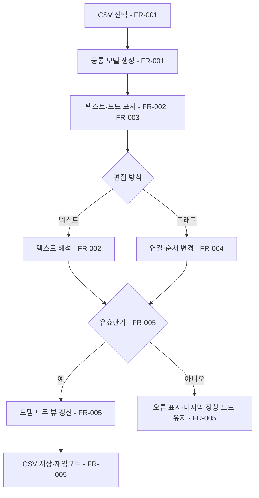

# 두 뷰 대사 편집기

## 1. 개요

- 목적: CSV에 흩어진 대사를 SUDS식 텍스트와 분기 그림에서 함께 편집하고, 선택지가 향하는 곳을 한눈에 확인한다.
- 대상: 대사를 쓰고 분기를 조정하는 게임 제작자

## 2. 범위

- 포함:
  - `Data/Dialogue/*.csv`, `Data/Talk/*.csv`, `Data/Ending/*.csv`, `Data/Strings.csv`의 텍스트 편집
  - 상담 선택지의 트리형 분기 표시와 연결선·대사 카드 이동
  - 분기가 없는 대사의 그룹·키별 시퀀스 노드 표시
  - 두 뷰의 동기화, 유효한 변경의 즉시 CSV 저장, 오류 표시
- 제외:
  - SUDS 엔진 도입과 `.sud` 파일 저장·내보내기
  - 게임 실행 시 대사 처리 방식 변경
  - `Flags.csv` 편집과 게임 UI 변경
  - CSV 주석, 미사용 열, 공백, 인용 방식의 원문 보존

## 3. 기술 방향

- 사용 기술/API: Unity 6000.3 EditorWindow, IMGUI, `Handles`, `AssetDatabase`, 기존 `Csv`, `DialogueScript`, `TalkScript`, `EndingScript`, `Strings`, `DialogueData`. 에디터 창은 프로젝트 `AGENTS.md`의 uGUI 규칙에서 사용자가 허용한 IMGUI 예외로 처리한다.
- 핵심 방식: CSV를 유일한 저장 원본으로 삼는다. 파일을 열면 편집기 전용 공통 모델로 읽고 두 뷰를 같은 모델에서 그린다. 텍스트가 유효하게 해석되거나 노드 조작이 완료되면 모델을 갱신하고 CSV로 직렬화한 뒤 해당 에셋을 재임포트한다. CSV를 재열면 두 뷰를 다시 만든다.
- 선택하지 않은 방식: SUDS의 Unreal 런타임·임포터 도입, `.sud`를 두 번째 원본으로 저장, Graph Toolkit/UI Toolkit 사용, 노드 화면 좌표 저장.
- 외부 의존성: 새 패키지 없음. SUDS의 `:Label`, `* Choice`, `Speaker: text`, `[goto Label]` 표기만 참고하고 `[eye ...]`는 이 프로젝트 전용 명령으로 둔다. 실제 SUDS 파서 호환은 요구하지 않는다.

### 텍스트 뷰 표기

- 파일마다 하나의 문서를 표시한다. `:id`가 Dialogue의 `node`, Talk의 `group`, Ending의 `id`, Strings의 `key`를 시작한다. 라벨 순서가 CSV 그룹의 첫 등장 순서이며, 대사 순서가 그룹 안의 행 순서다.
- `Dialogue`: `:node` 뒤 `[eye situation="..." back="..."]`를 표시한다. 각 선택지는 `* 선택지 글`, 이어서 들여쓴 `[eye response="..." need="..." set="..." trust=0 dilation=0 spring=0 memo="..."]`, 마지막으로 필요할 때 `[goto 대상]` 또는 `[eye ending="..."]`를 둔다. 둘 다 없으면 현재 노드에 머문다. `back`은 노드의 첫 CSV 행에 기록한다.
- `Talk`: `:group` 뒤 `[eye need="..." set="..."]`를 표시한다. 각 행은 `[eye speaker="..." memo="..."]`와 `Line: 대사`의 쌍이다. 빈 speaker, `-`, `???`는 CSV 값을 그대로 기록한다. 그룹 순서는 `TalkScript.Pick()`의 우선순위이므로 유지한다.
- `Ending`: `:id` 뒤 `[eye title="..." situation="..." after="..."]`를 표시한다. 각 행은 `[eye memo="..."]`와 `Line: 대사`의 쌍이다. `@intro`, `@idle`, `@abyss`는 title·situation·after가 없는 라벨로 표시한다.
- `Strings`: `:key` 뒤 각 행을 `[eye memo="..."]`와 `Line: 문구`의 쌍으로 표시한다. 같은 key의 여러 행은 합치지 않고 순서를 유지한다.
- `[eye ...]`의 문자열은 큰따옴표로 감싸고 `\"`, `\\`, `\n`을 이스케이프한다. `need`·`set`의 여러 값은 기존 CSV처럼 `|`로 구분하고 수치는 불변 문화권 표기로 쓴다. `*`와 `Line:` 뒤 본문도 실제 줄바꿈을 `\n`으로 표시한다. 지원하지 않는 명령·속성은 오류로 처리한다.

## 4. 구조

| 구분 | 이름 | 역할 |
|------|------|------|
| 클래스 | DialogueEditorWindow | 파일 선택, 텍스트와 노드 뷰, 오류 표시를 맡는 에디터 창 |
| 클래스 | DialogueEditorDocument | 선택 파일의 그룹·행·연결·메모를 보존하는 편집기 전용 공통 모델 |
| 클래스 | DialogueEditorFormat | CSV와 모델, SUDS식 텍스트와 모델 사이의 읽기·쓰기·검사를 맡음 |
| 클래스 | DialogueEditorGraph | 모델을 자동 배치해 그리고 연결선·카드 드래그를 모델 변경으로 변환 |

- 오브젝트 구성: 해당 없음. 에디터 전용 창이며 씬·프리팹과 런타임 GameObject를 만들지 않는다.
- 클래스 간 관계: `DialogueEditorWindow`가 파일을 선택해 `DialogueEditorFormat`으로 `DialogueEditorDocument`를 만든다. 텍스트 뷰와 `DialogueEditorGraph`는 이 문서를 공유하며, 유효한 편집만 `DialogueEditorFormat`이 CSV에 기록한다.
- 실행 순서 의존성: 해당 없음.
- 기존 코드와의 접점: 기존 런타임 파서는 변경하지 않는다. 저장 후 `AssetDatabase.ImportAsset`을 호출해 `DialogueDataPostprocessor`의 캐시 무효화와 데이터 검사를 사용한다. 새 편집기의 저장 전 검사는 해당 파일 형식의 기존 파서 규칙과 `Flags.csv` 참조를 따른다.

## 5. 동작 플로우차트

## 6. 요구사항

- FR-001: `EyeMaze/대사 편집기` 창에서 지원하는 CSV를 선택할 때 편집기는 해당 파일의 모든 알려진 열과 `memo`를 공통 모델로 읽는다.
- FR-002: 텍스트 뷰에서 지원하는 SUDS식 표기와 `[eye ...]` 값을 수정할 때 편집기는 변경된 대사·그룹 순서·연결·메타데이터를 공통 모델에 반영한다.
- FR-003: 파일을 열거나 공통 모델이 바뀔 때 노드 뷰는 `Dialogue`를 위에서 아래로 자동 배치한 분기와 화살표로 표시하고, 합류·되돌아감도 교차선으로 표시한다. 다른 파일은 그룹·키별 시퀀스 노드로 표시한다.
- FR-004: 노드 뷰에서 연결선 끝을 다른 `Dialogue` 노드에 놓을 때 `goto`를 바꾸고, 선택지·대사 카드를 다른 노드나 그룹 또는 순서 위치에 놓을 때 해당 CSV 소속과 행 순서를 바꾼다. 화면에서 노드만 옮기는 동작은 저장하지 않는다.
- FR-005: 편집 결과가 해당 CSV 형식과 기존 게임 제약을 통과할 때 두 뷰를 함께 갱신하고 CSV를 UTF-8로 즉시 기록·재임포트한다. 텍스트 입력 중 오류가 있으면 줄 위치와 이유를 보여주고 마지막 정상 노드 상태를 유지하며, 오류가 풀릴 때까지 그 초안을 저장하지 않는다.

### 상태와 데이터

| 이름 | 타입 | 설명 | 초기값 |
|------|------|------|--------|
| 선택 파일 | CSV TextAsset | 현재 편집 중인 네 종류 중 하나 | 없음 |
| 공통 모델 | DialogueEditorDocument | 그룹 순서, 행 순서, 연결, 알려진 열과 메모 | 선택 파일에서 생성 |
| 텍스트 초안 | string | 입력 중인 SUDS식 문서 | 공통 모델에서 생성 |
| 마지막 정상 모델 | DialogueEditorDocument | 오류 중 노드 표시와 복구 기준 | 파일을 열 때 생성 |
| 오류 목록 | 줄 번호·메시지 목록 | 문법·데이터 제약 오류 | 비어 있음 |

### 예외 및 경계 조건

- `Dialogue`의 첫 등장 노드가 시작 노드다. 노드·선택지 순서 변경으로 시작 노드나 선택지 순서가 달라지면 새 CSV에도 그 순서를 반영한다.
- `Dialogue` 노드의 선택지는 최대 3개다. 자동 뒤로가기 선택지는 CSV 행이 아니므로 노드 뷰에서 연결·이동 대상으로 취급하지 않는다.
- `goto`가 없는 선택지는 현재 노드 유지로, `ending`은 종료 카드로 표시한다. 두 값의 동시 지정, 존재하지 않는 대상, 중복 또는 빈 필수 ID는 오류다.
- `Talk`의 `enter`·`reveal`과 그룹 우선순위, `Ending`의 `@intro`·`@idle`·`@abyss`, `Strings`의 같은 key 다중 행을 보존한다.
- 저장할 때 알려진 열과 `memo` 값은 보존한다. 기존 CSV의 주석·미사용 열·서식과 인터리브된 그룹 행 배치는 유지하지 않아도 된다.
- 문법 오류가 있는 초안은 모델과 CSV에 반영하지 않는다. 유효한 텍스트 편집은 입력이 잠시 멈춘 뒤 검사하고 즉시 저장하며, 노드 드래그는 놓을 때 검사하고 저장한다.

## 7. Inspector 노출값

- 해당 없음. 에디터 창에서 파일을 선택하며 씬·프리팹 Inspector 값을 추가하지 않는다.

## 8. 인수 조건

- FR-001: 에디터 창에서 네 종류의 기존 CSV를 각각 열면 모든 그룹과 행, 조건, 수치, `memo`가 텍스트에 표시되고 저장 없이 재열어도 값이 같다.
- FR-002: `Dialogue` 텍스트의 선택지, `goto`, `[eye ...]` 값을 바꾸고 `Talk`·`Ending`·`Strings`의 대사와 순서를 바꾸면 노드 뷰와 저장 후 CSV에 같은 값이 나타난다.
- FR-003: `Dialogue/Eunjae.csv`를 열면 첫 노드 아래 분기가 보인다. 두 선택지가 같은 노드를 향하거나 앞 노드로 돌아가는 유효한 CSV에서는 연결선이 각각 표시된다. 다른 세 파일은 그룹·키 순서의 시퀀스 노드로 보인다.
- FR-004: 연결선 끝을 다른 노드에 놓고 선택지·대사 카드를 옮긴 뒤 CSV를 재열면 `goto`, 그룹, 행 순서가 새 배치와 일치한다.
- FR-005: 유효한 편집 후 CSV가 즉시 재임포트되고 `EyeMaze/기획 데이터 검사`와 Play Mode 대사가 새 값을 사용한다. 잘못된 라벨·명령·네 번째 선택지를 입력하면 오류 줄이 표시되고 CSV 및 노드 뷰는 마지막 정상 상태로 남으며, 수정 후 저장된다.

## 9. 미결 사항

- 없음
