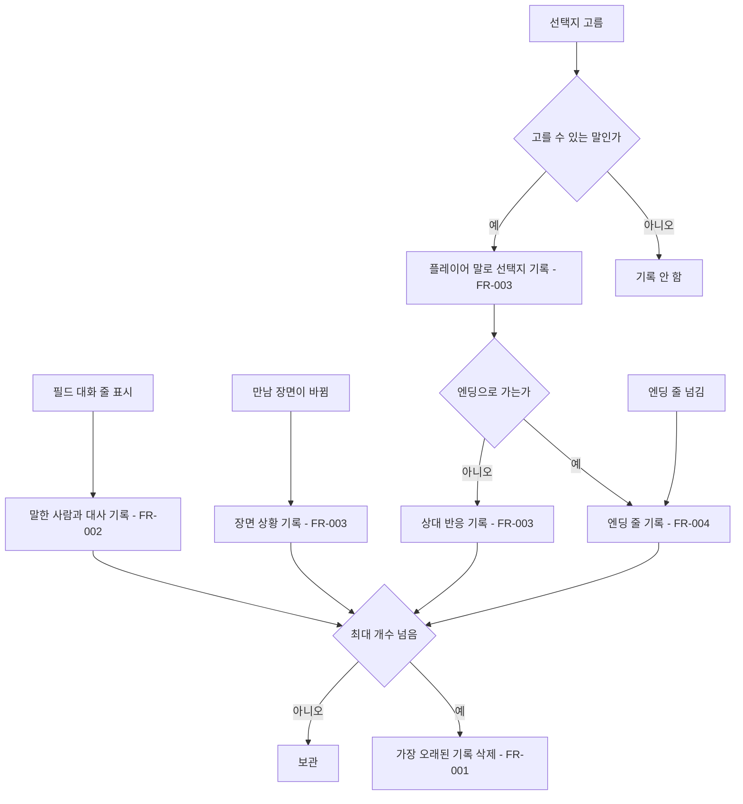
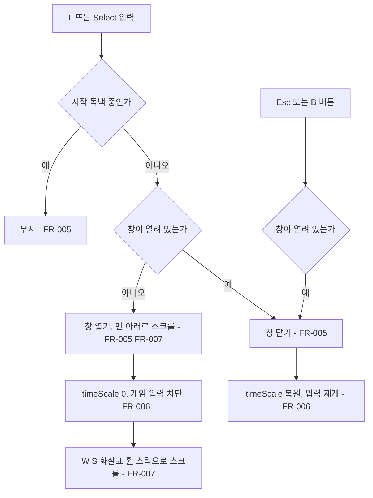

# 대화 기록

## 1. 개요

- 목적: 지나간 대사를 놓쳤을 때 플레이어가 언제든 창을 열어 지금까지의 대화를 다시 읽을 수 있게 한다.
- 대상: 플레이어

## 2. 범위

- 포함:
  - 필드 글 상자에 나온 대사(말한 사람 + 대사, 단서 살펴보기 문구 포함) 기록
  - 만남 대화의 장면 상황 문구, 플레이어가 고른 선택지, 상대의 반응 기록
  - 엔딩 마음의 소리 대사 기록
  - L 키, 게임패드 Select(View) 버튼으로 여닫는 대화 기록 창
  - 메신저처럼 플레이어가 고른 말은 오른쪽, 상대의 말은 왼쪽 말풍선으로 나눠 보여주기
  - 상대 말 왼쪽에 말한 사람 얼굴(초상화) 보여주기
  - 목록 오른쪽 세로 스크롤바
  - 창이 열린 동안 게임 일시정지와 입력 차단
  - 대화 기록 전용 Canvas 프리팹 `DialogueLogCanvas`와 그 인스턴스를 `EyeMaze` 씬에 배치
- 제외:
  - 시작 독백 기록
  - 만남 중 시스템 문구 기록 (들여다보기, 깊은 층 진입, 파편, 깜빡임, 잠긴 선택지, 이미 한 이야기 등)
  - 파일 저장, 다음 플레이로 이어지는 기록
  - 기록에서 대사 다시 듣기, 특정 지점으로 되돌아가기

## 3. 기술 방향

- 사용 기술/API: uGUI `Canvas`(Screen Space - Overlay), `CanvasScaler`, `GraphicRaycaster`, `ScrollRect`, `RectMask2D`, `Scrollbar`, `Text`, `Image`, `VerticalLayoutGroup`, `HorizontalLayoutGroup`, `LayoutElement`, `ContentSizeFitter`, Unity Input System `Keyboard`, `Gamepad`
- 핵심 방식:
  - 기록은 정적 클래스 `DialogueLog`가 `List<Entry>`로 들고 있다. 기존 `OpeningMonologue.IsPlaying`, `FieldCutscene.IsPlaying`처럼 정적 상태 `DialogueLog.IsOpen`을 두어 다른 시스템이 창이 열렸는지 확인한다.
  - 정적 상태는 `[RuntimeInitializeOnLoadMethod(SubsystemRegistration)]`로 Play 시작 때 비운다 (Domain Reload를 꺼도 이전 기록이 남지 않게).
  - 기록 지점은 대사가 화면에 나가는 메서드에 직접 `DialogueLog.Add`를 넣는다. 매 프레임 화면 글을 비교하는 방식은 쓰지 않는다.
  - 만남 장면 상황은 `EyeMazeDirector.Update()`에서 지금 장면 id가 마지막으로 기록한 장면 id와 다를 때 한 번 기록한다. (장면이 바뀌는 곳이 `GoTo`, `GoBack`, `ReturnToStart`, `ResetAll`, `LoadCase` 등 여러 곳이라 한 곳에서 처리한다)
  - 창 내용은 프리팹에 미리 만들어 둔 줄 칸(기본 100개)에 최근 기록을 하나씩 넣는다. 기록이 없는 칸은 끈다. 기록이 바뀌었을 때만 다시 채운다.
  - 줄 칸은 `HorizontalLayoutGroup`(얼굴, 말)이고, `childAlignment`로 플레이어 말은 오른쪽, 상대 말은 왼쪽, 서술은 가운데에 붙인다.
  - 얼굴은 기록할 때 함께 저장한다. 필드 대화는 글 상자에 쓰인 초상화(`_fieldPortrait`)를, 만남 반응은 손님 이름으로 `FieldNPC.PortraitOf`가 찾은 초상화를 쓴다. 얼굴이 없으면 칸은 남기고 그림만 끈다.
  - 스크롤바는 `ScrollRect.verticalScrollbar`에 연결하고 `AutoHide`로 둔다. 내용이 짧아 스크롤할 필요가 없으면 숨는다.
  - 말풍선 너비는 글의 한 줄 너비(`Text.preferredWidth`)와 `_bubbleMaxWidth` 중 작은 값을 `LayoutElement.preferredWidth`에 넣어 맞춘다. 긴 글은 최대 너비에서 줄을 바꾼다.
  - 말풍선 그림은 Unity 기본 `UISprite`(Sliced)를 쓴다.
  - 창이 열리면 `Time.timeScale`을 0으로 두고, 닫으면 열기 전 값으로 되돌린다.
- 선택하지 않은 방식:
  - 기록 전체를 `Text` 하나에 넣는 방식은 줄마다 왼쪽, 오른쪽 정렬을 나눌 수 없어 사용하지 않는다.
  - 줄 칸을 런타임에 `Instantiate`로 늘리는 방식은 UI를 코드로 만들지 않는 규칙 때문에 사용하지 않는다. 칸은 프리팹에 미리 둔다.
  - `TextMeshPro`는 기존 UI가 모두 uGUI `Text`이므로 사용하지 않는다.
  - 기존 `UI (Canvas)` 아래에 넣는 방식은 사용하지 않는다. 기존 Canvas에는 `PixelCamera`, `GameFlowUI`, `EyeMazeUI`가 붙어 있어 독립적으로 편집하기 어렵다. 대화 기록은 별도 Canvas를 쓴다.
  - UI 오브젝트를 런타임 코드(`new GameObject`, `AddComponent`)로 만드는 방식은 사용하지 않는다. 창은 프리팹 애셋으로 저장하고, 스크립트는 `[SerializeField]`로 참조만 한다.
- 외부 의존성: `GameFlow`, `EyeMazeDirector`, `FieldNPC`, `OpeningMonologue`

## 4. 구조

| 구분 | 이름 | 역할 |
|------|------|------|
| 클래스 | DialogueLog (static) | 기록 목록, 최대 개수, 열림 상태, 변경 번호를 가진다 |
| 클래스 | DialogueLogUI | 키 입력으로 창을 여닫고, 일시정지하고, 기록을 줄 칸에 채우고 스크롤한다 |
| 클래스 | GameFlow (수정) | 필드 대사를 기록하고, 창이 열린 동안 입력을 받지 않는다 |
| 클래스 | EyeMazeDirector (수정) | 장면 상황, 선택지, 반응, 엔딩 대사를 기록하고, 창이 열린 동안 입력을 받지 않는다 |
| 프리팹 | DialogueLogCanvas | `Assets/EyeMaze/Prefabs/DialogueLogCanvas.prefab`. 대화 기록 전용 Canvas와 창 구성 |
| 씬 | EyeMaze | 최상위에 `DialogueLogCanvas` 프리팹 인스턴스 `대화 기록 (Canvas)`를 가진다 |

- 오브젝트 구성: 프리팹 루트 `대화 기록 (Canvas)`는 별도 Canvas이며 항상 켜져 있고, `창`만 켜고 끈다. 아래 값은 프리팹을 처음 만들 때의 기준값이며, 이후 제작자가 편집한 값을 따른다.

| 오브젝트 | 컴포넌트 | AnchorMin | AnchorMax | SizeDelta | 비고 |
|----------|----------|-----------|-----------|-----------|------|
| 대화 기록 (Canvas) | Canvas, CanvasScaler, GraphicRaycaster, DialogueLogUI | - | - | - | Screen Space - Overlay, Sort Order 100 (기존 UI Canvas 0보다 위). Scaler는 기존과 같이 Scale With Screen Size 1920x1080, Match 0.5 |
| 창 | Image | (0, 0) | (1, 1) | (0, 0) | 검정 (0, 0, 0, 0.95), Raycast Target 켬, 기본 꺼짐 |
| 제목 | Text | (0.1, 0.9) | (0.9, 0.97) | (0, 0) | `대화 기록`, 가운데 정렬, 크기 40 |
| 목록 | ScrollRect, Image | (0.1, 0.1) | (0.9, 0.88) | (0, 0) | 세로만, 세로 스크롤바 AutoHide, Image 투명 (0, 0, 0, 0) |
| 보기 | RectMask2D | (0, 0) | (1, 1) | (-48, -24) | 목록의 Viewport. 오른쪽 스크롤바 자리만큼 좁힘 |
| 스크롤바 | Image, Scrollbar | (1, 0) | (1, 1) | (10, -24) | 목록 오른쪽 끝, 피벗 (1, 0.5). 트랙 흰색 0.08, 아래에서 위 방향, 키보드 탐색 없음 |
| 스크롤바/미끄럼 영역/손잡이 | Image | (0, 0) | (1, 1) | (0, 0) | UISprite Sliced, 흰색 0.5 |
| 내용 | VerticalLayoutGroup, ContentSizeFitter | (0, 1) | (1, 1) | (0, 0) | 피벗 (0.5, 1), 목록의 Content. 위아래 여백 8, 줄 간격 18, 자식 너비 펼침, 세로 Preferred Size |
| 줄 001~100 | HorizontalLayoutGroup | - | - | - | 내용의 자식, 기본 꺼짐. 간격 12, 자식 너비 펼치지 않음 (정렬은 스크립트가 정함) |
| 줄/얼굴 | Image, LayoutElement | - | - | - | 72x72, 비율 유지. 상대 말일 때만 켬 |
| 줄/말 | VerticalLayoutGroup | - | - | - | 간격 6 |
| 줄/말/이름 | Text | - | - | - | 크기 24, 회색 0.75. 상대 말일 때만 켬 |
| 줄/말/말풍선 | Image, VerticalLayoutGroup | - | - | - | UISprite Sliced, 안쪽 여백 좌우 20 위아래 12 |
| 줄/말/말풍선/글 | Text, LayoutElement | - | - | - | 크기 30, 줄바꿈 |
| 안내 | Text | (0.1, 0.03) | (0.9, 0.08) | (0, 0) | `L / Esc  닫기   ·   W S / ↑ ↓  스크롤`, 가운데 정렬, 크기 26, 회색 0.6 |

  글은 모두 uGUI `Text`, 글꼴 `Galmuri11`, 줄 간격 1.15로 필드 UI 텍스트 상자와 맞춘다.

- 클래스 간 관계: `GameFlow`, `EyeMazeDirector` → `DialogueLog.Add`. `DialogueLogUI` → `DialogueLog`(읽기, `IsOpen`, `ClosedFrame` 쓰기). `GameFlow`, `EyeMazeDirector` → `DialogueLog.BlocksInput`(읽기).
- 실행 순서 의존성: 해당 없음. `DialogueLog`는 정적 클래스라 초기화 순서에 묶이지 않는다.
- 기존 코드와의 접점:
  - `GameFlow.Update()`, `GameFlow.ShowConvLine()`
  - `FieldNPC.PortraitOf()`를 private에서 public으로 바꾼다
  - `EyeMazeDirector.Update()`, `EyeMazeDirector.ChooseOption()`, `EyeMazeDirector.ShowHeartLine()`, 새 메서드 `EyeMazeDirector.LogSituation()`

## 5. 동작 플로우차트

기록

창

## 6. 요구사항

- FR-001: `DialogueLog.Add(speaker, text, isPlayer, portrait)`가 불릴 때 `DialogueLog`는 기록 끝에 한 줄을 더하고, 개수가 `MaxEntries`를 넘으면 가장 오래된 줄부터 지운다. text가 비어 있으면 더하지 않는다. 기록은 Play Mode가 끝날 때까지 손님이 바뀌거나 R로 리셋해도 남는다.
- FR-002: 필드 글 상자에 대사 한 줄이 나올 때(`ShowConversation`의 첫 줄, `AdvanceText`로 넘긴 줄. 모두 `ShowConvLine`을 거친다) `GameFlow`는 그 줄의 말한 사람과 대사를 기록한다. 말한 사람이 없으면 서술로 기록한다.
- FR-003: 만남 대화에서 `EyeMazeDirector`는 다음을 기록한다.
  - 만남 중(`AcceptInput`이 켜짐, 엔딩 아님) 지금 장면이 마지막으로 기록한 장면과 다를 때 그 장면의 상황 문구를 서술로 기록한다. (`Personalize` 적용)
  - 고를 수 있는 선택지를 고를 때 선택지 글을 플레이어 말(`isPlayer`)로 기록한다.
  - 그 선택지가 엔딩으로 이어지지 않으면 손님 이름으로 반응(`Response`, `Personalize` 적용)을 기록한다. 신뢰, 동공, 부담감 변화 문구는 기록하지 않는다.
- FR-004: 엔딩 대사 한 줄이 나올 때(`ShowHeartLine`) `EyeMazeDirector`는 그 줄을 서술로 기록한다.
- FR-005: L 키 또는 게임패드 Select(View) 버튼을 누를 때 `DialogueLogUI`는 창을 열거나 닫는다. 창이 열려 있을 때 Esc 키 또는 게임패드 B(East) 버튼을 누르면 닫는다. 시작 독백 중에는 열지 않는다.
- FR-006: 창이 열려 있는 동안 `Time.timeScale`은 0이고, `GameFlow`와 `EyeMazeDirector`는 키 입력을 처리하지 않는다. 창을 닫으면 `Time.timeScale`을 열기 전 값으로 되돌린다.
- FR-007: 창이 열릴 때 `DialogueLogUI`는 최근 기록을 줄 칸에 채우고 맨 아래(가장 최근)로 스크롤한다. 플레이어 말은 이름 없이 오른쪽 `_playerBubbleColor` 말풍선에, 상대 말은 왼쪽에 얼굴을, 그 옆 위에 이름을 두고 `_otherBubbleColor` 말풍선에, 서술은 말풍선 없이 가운데 `_narrationTextColor` 글로 보여준다. 말풍선은 글 길이에 맞춰 좁아지고 `_bubbleMaxWidth`에서 줄을 바꾼다. 열린 동안 W/S, ↑/↓, 게임패드 왼쪽 스틱은 초당 `_scrollSpeed` 픽셀로 스크롤하고, 마우스 휠과 오른쪽 스크롤바 끌기는 ScrollRect 기본 동작으로 스크롤한다. 스크롤바 손잡이는 지금 보이는 위치와 비율을 보여준다.
- FR-008: `DialogueLogCanvas` 프리팹은 4장 표의 구성을 가지며, 루트의 `DialogueLogUI`에 `_window`, `_scrollRect`, `_rows`(줄 칸 100개)가 연결되어 있다. `EyeMaze` 씬은 최상위에 이 프리팹 인스턴스를 가진다. 기존 `UI (Canvas)`는 바꾸지 않는다.

구현 순서: 묶음 1 (FR-001 ~ FR-004, 기록) → 묶음 2 (FR-005 ~ FR-008, 창)

### 상태와 데이터

| 이름 | 타입 | 설명 | 초기값 |
|------|------|------|--------|
| DialogueLog.Entries | `IReadOnlyList<Entry>` | 기록 목록. Entry는 `Speaker`, `Text`, `IsPlayer`, `Portrait`. IsPlayer가 아니고 Speaker가 비면 서술 | 빈 목록 |
| DialogueLog.MaxEntries | int | 최대 기록 수. `DialogueLogUI`가 Awake에서 줄 칸 수(`_rows.Length`)로 정한다 | 100 |
| DialogueLog.Version | int | 기록이 바뀔 때마다 1씩 오른다. UI가 다시 그릴지 판단한다 | 0 |
| DialogueLog.IsOpen | bool | 창이 열려 있는지 | false |
| DialogueLog.ClosedFrame | int | 창을 닫은 프레임 번호 | -1 |
| DialogueLog.BlocksInput | bool | `IsOpen`이거나 이번 프레임에 닫혔으면 true. `GameFlow`, `EyeMazeDirector`가 입력 차단에 쓴다 | false |
| EyeMazeDirector._loggedNode | DialogueScript.Node | 마지막으로 상황을 기록한 장면. 손님이 바뀌면 다른 장면 객체가 되므로 같은 id라도 다시 기록한다. NonSerialized | null |
| DialogueLogUI._savedTimeScale | float | 창을 열기 전 timeScale | 1 |
| DialogueLogUI._drawnVersion | int | 마지막으로 그린 기록 Version | -1 |

### 예외 및 경계 조건

- 같은 대사가 연속으로 나옴: 같은 말한 사람, 같은 대사가 바로 앞 기록과 같으면 더하지 않는다. (`ShowConversationLines`가 첫 줄을 두 번 보여주는 경우 포함)
- 닫는 키가 게임 입력으로 새어 나감: 게임패드 B는 만남에서 자리 떠나기이기도 하다. 창을 닫은 프레임에는 `BlocksInput`이 true라 `GameFlow`, `EyeMazeDirector`가 그 입력을 쓰지 않는다.
- 에디트 모드: `DialogueLog.Add`는 Play Mode에서만 기록한다. 에디트 모드 인스펙터 버튼으로 장면을 바꿔도 기록하지 않는다.
- 창이 열린 채 Play Mode 종료: `OnDisable`에서 창이 열려 있으면 timeScale을 되돌리고 `IsOpen`을 false로 한다.
- 줄 칸 수보다 기록이 많음: 보관 수가 줄 칸 수와 같으므로 가장 최근 기록만 남고 보인다. 보관 수를 늘리려면 프리팹에서 줄을 복제해 `_rows`에 추가한다.
- 타자 효과 중 창 열기: Typewriter는 unscaled time을 쓰므로 창 뒤에서 계속 찍힌다. 기록에는 처음부터 전체 대사가 들어간다.
- 전환 중(줌인, 줌아웃, 암전) 창 열기: timeScale 0으로 전환이 멈추고, 닫으면 이어서 진행한다.

## 7. Inspector 노출값

`DialogueLogUI`

| 필드 | 타입 | 기본값 | 설명 |
|------|------|--------|------|
| _window | GameObject | 씬에서 연결 | 여닫는 창 |
| _scrollRect | ScrollRect | 씬에서 연결 | 목록 스크롤 |
| _rows | LogRow[] | 프리팹에서 연결 (100칸) | 줄 칸들 (줄, 레이아웃, 얼굴, 이름, 말풍선, 글, 글 레이아웃). 칸 수가 보관 수 |
| _bubbleMaxWidth | float | 1000 | 말풍선 안 글의 최대 너비 |
| _playerBubbleColor | Color | (0.3, 0.3, 0.34, 1) | 플레이어 말풍선 색 |
| _playerTextColor | Color | (0.95, 0.95, 0.95, 1) | 플레이어 말 글 색 |
| _otherBubbleColor | Color | (0.92, 0.92, 0.92, 1) | 상대 말풍선 색 |
| _otherTextColor | Color | (0.1, 0.1, 0.1, 1) | 상대 말 글 색 |
| _narrationTextColor | Color | (0.65, 0.65, 0.65, 1) | 서술 글 색 |
| _scrollSpeed | float | 600 | 키, 스틱 스크롤 속도 (초당 픽셀) |
| _pauseGame | bool | true | 열린 동안 timeScale을 0으로 둘지 |

## 8. 인수 조건

- FR-001: `_rows`를 3칸으로 줄이고 대사 5줄을 본 뒤 창을 열면 마지막 3줄만 보인다. R로 리셋하거나 다른 손님을 만나도 이전 기록이 남아 있다.
- FR-002: 필드에서 NPC에게 말을 걸어 여러 줄 대화를 넘긴 뒤 창을 열면 각 줄이 말한 사람 이름과 함께 순서대로, 중복 없이 보인다. 단서를 살펴본 문구는 이름 없이 보인다.
- FR-003: 만남에서 선택지를 하나 고른 뒤 창을 열면 `가운데 상황 → 오른쪽 선택지 말풍선 → 왼쪽 손님 이름과 반응 말풍선 → 가운데 다음 장면 상황` 순서로 보인다. 신뢰/동공 변화 문구와 잠긴 선택지 안내는 보이지 않는다.
- FR-004: 엔딩에 들어가 마음의 소리를 끝까지 넘긴 뒤 창을 열면 모든 엔딩 줄이 이름 없이 순서대로 보인다.
- FR-005: 필드, 만남, 엔딩 중 L 또는 Select로 창이 열리고 다시 누르면 닫힌다. 열린 상태에서 Esc 또는 B로 닫힌다. 시작 독백 중에는 L을 눌러도 열리지 않는다.
- FR-006: 들여다보기 중 창을 열고 몇 초 기다렸다 닫으면 부담감 막대가 그동안 오르지 않았다. 창이 열린 동안 Z, 1~4, WASD, Q를 눌러도 게임이 반응하지 않는다.
- FR-007: 창을 열면 가장 최근 기록이 아래에 보이고, 내 말은 오른쪽 어두운 회색 말풍선(흰 글), 상대 말은 왼쪽 얼굴, 이름과 함께 밝은 회색 말풍선, 서술은 가운데 회색 글로 보인다. 짧은 말은 말풍선이 좁고, 긴 말은 줄이 바뀐다. W/S, ↑/↓, 휠, 스틱, 스크롤바 끌기로 위아래 스크롤되고, 오른쪽 스크롤바 손잡이가 위치를 따라 움직인다. 기록이 짧아 스크롤할 필요가 없으면 스크롤바가 숨는다.
- FR-008: `EyeMaze` 씬을 열면 최상위에 `대화 기록 (Canvas)` 프리팹 인스턴스가 있고, `DialogueLogUI` Inspector의 `_window`, `_scrollRect`, `_rows`가 비어 있지 않다. `창`은 기본으로 꺼져 있다. 창을 열면 필드 UI, 만남 UI, 암전보다 위에 그려진다.

## 9. 미결 사항

- 없음
