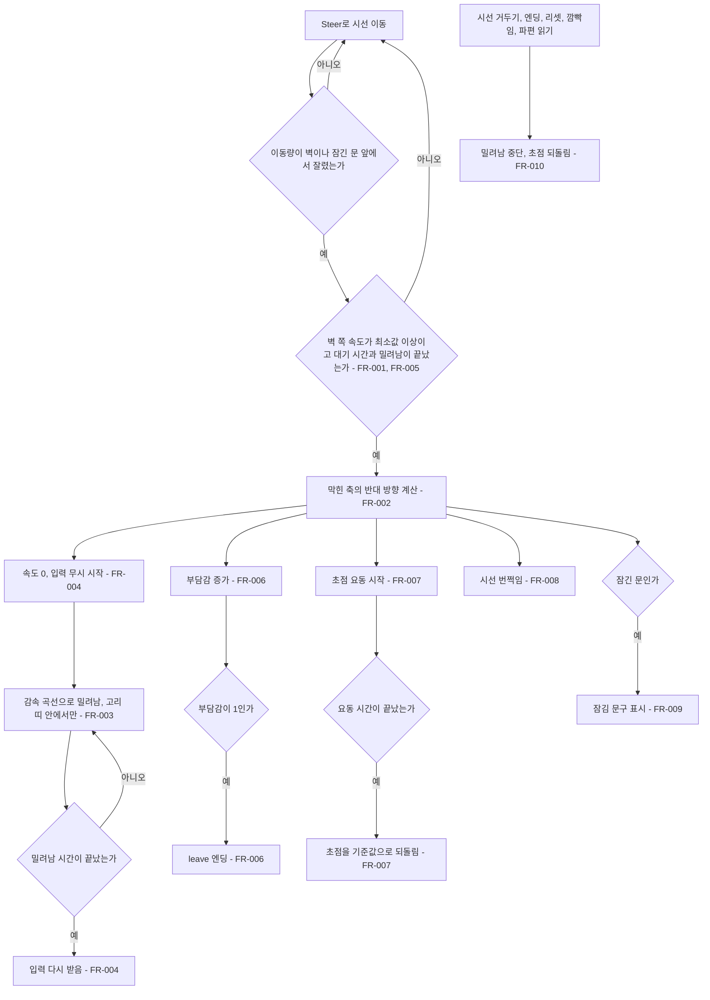

# 벽 부딪힘 밀려남

## 1. 개요

- 목적: 미로에서 시선이 벽이나 잠긴 문에 세게 부딪히면 미로가 지지직 흐려지고 시선이 벽에서 조금 밀려나게 해서, 벽에 닿는 것을 눈이 거부하는 느낌으로 전달한다. 부딪힐 때마다 부담감도 조금 오른다.
- 대상: 플레이어

## 2. 범위

- 포함:
  - 일반 벽(원호 벽, 칸막이 벽)과 잠긴 문에 부딪힘 판정
  - 벽에 수직인 방향으로 일정 거리만큼 부드럽게 밀려남
  - 밀려나는 동안 이동 입력 무시, 다시 부딪힘 대기 시간
  - 부딪힐 때 부담감 증가
  - 미로 초점(`IrisMaze.Focus`)을 요동치게 하는 지지직 연출
  - 일반 벽에 부딪혀도 시선 색이 번쩍임 (지금은 잠긴 문에서만 번쩍임)
- 제외:
  - 소리
  - 눈 그림의 초점(`EyeVisual.Focus`) 변경
  - 화면 전체 셰이더나 uGUI 노이즈 오버레이
  - 심연 안 동공 테두리에 닿았을 때의 반응
  - 에디트 모드 이동 버튼(`Nudge`)으로 벽에 닿았을 때의 반응
  - 미로 회전(스펙 006)으로 벽이 다가오는 경우 (시선도 함께 돌아서 생기지 않는다)

## 3. 기술 방향

- 사용 기술/API: 기존 `EyeMazeDirector` 이동 판정, `IrisMaze.Focus`
- 핵심 방식:
  - 부딪힘은 `ResolveRadial`, `ResolveAngular`, `CanCrossArc`에서 이동량이 벽 앞에서 잘렸을 때 감지한다. 어느 축(안쪽/바깥쪽, 둘레)에서 어느 쪽으로 막혔는지 기록한다.
  - 밀려나는 방향은 미로 기준으로 막힌 축의 반대 방향이다. 입력이나 이동 방향의 반대로 밀지 않는다. 두 축이 같은 프레임에 막히면 두 방향을 더해 정규화한다.
  - 벽 쪽 속도는 `_velocity`를 `ScreenToMaze`로 바꾼 값에서 막힌 축 성분의 크기로 계산한다. 벽을 타고 미끄러지거나 살짝 닿는 경우를 거르기 위해 이 값이 `_bumpMinSpeed` 이상일 때만 반응한다.
  - 밀려나는 이동은 `_knockbackSeconds` 동안 감속 곡선(ease-out)으로 나눠 매 프레임 기존 `ResolveRadial`, `ResolveAngular`를 거쳐 적용한다. 순간이동하지 않는다.
  - 지지직 연출은 부딪힌 순간의 `IrisMaze.Focus`를 기준값으로 저장하고, `_glitchSeconds` 동안 `기준값 - _glitchStrength × 남은비율 × 무작위(0~1)`로 바꾼다. 무작위 값은 초당 `_glitchRate`번 새로 뽑는다. 끝나면 기준값으로 정확히 되돌린다. 초점이 바뀌면 벽, 문, 파편이 굵고 흐릿해졌다 돌아오기를 반복한다.
- 선택하지 않은 방식:
  - 입력이나 이동 방향의 반대로 미는 방식은 비스듬히 벽을 타다 부딪혔을 때 왔던 길로 끌려가므로 사용하지 않는다.
  - 위치를 한 번에 옮기는 방식은 어지럽고 벽을 뚫을 수 있으므로 사용하지 않는다.
  - 카메라 셰이더와 uGUI 노이즈 오버레이는 미로 초점 값으로 충분히 표현되므로 사용하지 않는다.
- 외부 의존성: `IrisMaze`, `MazeGate`, 스펙 005 부담감(`_burden`, leave 엔딩)

## 4. 구조

| 구분 | 이름 | 역할 |
|------|------|------|
| 클래스 | EyeMazeDirector | 부딪힘 판정, 밀려남 진행, 부담감 증가, 초점 요동, 번쩍임 |
| 클래스 | IrisMaze | 바뀐 `Focus`로 벽 굵기와 투명도를 그린다 (수정 없음) |
| 씬 | EyeMaze | `EyeMazeDirector`에 새 Inspector 값을 저장한다 |
| 프리팹 | 해당 없음 | 해당 없음 |
| ScriptableObject | 해당 없음 | 해당 없음 |

- 오브젝트 구성: 새 오브젝트나 컴포넌트는 없다. 기존 `EyeMazeDirector`에 `벽 부딪힘` 헤더의 필드를 추가한다.
- 클래스 간 관계: `EyeMazeDirector` → `IrisMaze.Focus` (쓰기), `EyeMazeDirector` → `MazeGate.CanPass` (기존)
- 실행 순서 의존성: 밀려남 진행과 초점 요동은 `Update()`에서 깜빡임 처리 뒤, 부담감 처리 앞에서 한다.
- 기존 코드와의 접점: `EyeMazeDirector.Update()`, `Steer()`, `MoveBy()`, `ResolveRadial()`, `ResolveAngular()`, `CanCrossArc()`, `GateBlocked()`, `ExitGaze()`, `StartEnding()`, `ResetAll()`, 깜빡임 시작, `CheckFragment()`

## 5. 동작 플로우차트

## 6. 요구사항

- FR-001: Play Mode에서 `Steer`로 움직이다가 이동량이 일반 벽 또는 잠긴 문 앞에서 잘리고, 막힌 축의 벽 쪽 속도가 `_bumpMinSpeed` 이상일 때 `EyeMazeDirector`는 부딪힘을 시작한다.
- FR-002: 부딪힘이 시작될 때 `EyeMazeDirector`는 미로 기준으로 막힌 축의 반대 방향을 밀려나는 방향으로 정한다. 원호 벽과 잠긴 문은 안쪽/바깥쪽 방향, 칸막이 벽은 둘레 방향이다. 두 축이 같은 프레임에 막히면 두 방향을 더해 정규화한다.
- FR-003: 밀려나는 동안 `EyeMazeDirector`는 `_knockbackSeconds`에 걸쳐 감속 곡선으로 총 `_knockbackDistance`만큼 시선을 옮긴다. 이동은 기존 벽 판정을 거치고, 지금 고리 띠 밖으로 나가지 않으며, 심연에 들어가지 않는다. 밀려나는 중에 벽에 닿아도 새 부딪힘을 시작하지 않는다.
- FR-004: 부딪힘이 시작될 때 `EyeMazeDirector`는 `_velocity`를 0으로 만들고, 밀려나는 동안 이동 입력을 무시한다. 밀려남이 끝나면 기존 가속도로 다시 움직일 수 있다.
- FR-005: 부딪힘이 시작된 뒤 `_bumpCooldown`초 동안 `EyeMazeDirector`는 새 부딪힘을 시작하지 않는다. 이 동안 벽에 닿으면 기존처럼 멈추거나 미끄러지기만 한다.
- FR-006: 부딪힘이 시작될 때 `EyeMazeDirector`는 부담감을 `_bumpBurden`만큼 올린다(1을 넘지 않음). 1에 닿으면 스펙 005 FR-003과 같이 `_burdenEndLine`으로 leave 엔딩을 시작한다.
- FR-007: 부딪힘이 시작될 때 `EyeMazeDirector`는 그 순간의 `IrisMaze.Focus`를 기준값으로 저장하고, `_glitchSeconds` 동안 초점을 `기준값 - _glitchStrength × 남은비율 × 무작위(0~1)`로 바꾼다(0~1로 제한). 무작위 값은 초당 `_glitchRate`번 새로 뽑고, 끝나면 초점을 기준값으로 되돌린다. 요동 중에 새 부딪힘이 시작되면 남은비율만 1로 다시 채우고 기준값은 처음 값을 유지한다.
- FR-008: 일반 벽에 부딪힘이 시작될 때도 `EyeMazeDirector`는 잠긴 문과 같이 `_bumpFlash`를 0.6 이상으로 올려 시선 색을 번쩍이게 한다.
- FR-009: 잠긴 문에 부딪힐 때 `EyeMazeDirector`는 기존처럼 잠김 문구를 보여주고 번쩍인다. 부딪힘 조건(FR-001)을 만족하면 일반 벽과 같이 FR-002~FR-007을 적용한다.
- FR-010: 시선을 거두거나, 엔딩이 시작되거나, `ResetAll()`, 깜빡임이 시작되거나, 파편을 읽기 시작할 때 `EyeMazeDirector`는 밀려남을 즉시 멈추고 초점을 기준값으로 되돌린다.

### 상태와 데이터

| 이름 | 타입 | 설명 | 초기값 |
|------|------|------|--------|
| `_knockbackDir` | Vector2 | 미로 기준 밀려나는 방향 (안쪽/바깥쪽, 둘레) | (0, 0) |
| `_knockbackT` | float | 밀려남 경과 시간. 음수면 밀려나는 중이 아니다 | -1 |
| `_bumpCooldownT` | float | 다음 부딪힘까지 남은 시간 | 0 |
| `_glitchT` | float | 초점 요동 남은 시간 | 0 |
| `_glitchBaseFocus` | float | 요동 전 `IrisMaze.Focus` 기준값 | 1 |

### 예외 및 경계 조건

- 벽을 따라 미끄러짐: 막힌 축의 벽 쪽 속도가 `_bumpMinSpeed`보다 작으면 반응하지 않는다.
- 벽 쪽으로 계속 누르고 있음: 밀려난 뒤 다시 가속해 벽 쪽 속도가 `_bumpMinSpeed`를 넘고 대기 시간이 지났으면 다시 부딪힌다.
- 모서리에서 두 축이 동시에 막힘: 대각선으로 밀려난다 (FR-002).
- `_knockbackDistance`가 통로 폭보다 큼: 반대편 벽 앞에서 멈추고 새 부딪힘은 시작하지 않는다 (FR-003).
- 밀려난 끝에 파편이 있는 칸에 닿음: 기존 `CheckFragment()`대로 파편을 줍고, 밀려남은 FR-010대로 멈춘다.
- `_glitchStrength`가 0: 초점은 바뀌지 않고 밀려남만 일어난다.
- `_knockbackDistance`가 0: 밀려나지 않고 연출과 부담감만 적용된다.
- 에디트 모드: 부딪힘을 시작하지 않는다.
- 초점이 요동하는 동안 벽, 문, 파편이 매 프레임 다시 그려진다 (현재 씬 벽 약 190개). 연출 시간 동안만 일어난다.

## 7. Inspector 노출값

모두 `EyeMazeDirector`의 `벽 부딪힘` 헤더에 둔다.

| 필드 | 타입 | 기본값 | 설명 |
|------|------|--------|------|
| `_bumpMinSpeed` | float | 0.8 | 반응하는 최소 벽 쪽 속도 (초당 거리, 최고 이동 속도 1.6의 절반) |
| `_knockbackDistance` | float | 0.09 | 밀려나는 거리 (통로 폭 약 0.21의 절반 이하 권장) |
| `_knockbackSeconds` | float | 0.18 | 밀려나는 데 걸리는 시간(초), 이 동안 입력을 무시한다 |
| `_bumpCooldown` | float | 0.45 | 다음 부딪힘까지 기다리는 시간(초) |
| `_bumpBurden` | float (0~1) | 0.02 (씬 저장값 0.015) | 부딪힐 때 오르는 부담감 |
| `_glitchSeconds` | float | 0.3 | 지지직 연출 시간(초) |
| `_glitchStrength` | float (0~1) | 0.6 | 초점이 가장 크게 떨어지는 양. 0이면 연출 없음 |
| `_glitchRate` | float | 20 | 초당 초점이 튀는 횟수 |

## 8. 인수 조건

- FR-001: 통로 끝 벽을 향해 최고 속도로 달려가 부딪히면 반응한다. 벽에서 아주 가까운 곳에서 살짝 밀거나 벽을 따라 미끄러지면 반응하지 않는다.
- FR-002: 바깥 원호 벽에 부딪히면 안쪽으로만, 칸막이 벽에 부딪히면 둘레 방향으로만 밀려난다. 비스듬히 벽을 타다 부딪혀도 왔던 길로 끌려가지 않는다. 깜빡임으로 미로가 돌아간 뒤에도 같다.
- FR-003: 약 0.2초 동안 처음엔 빠르고 끝은 느리게 밀려난다. 좁은 통로에서도 반대편 벽을 뚫거나 다시 튕기지 않고, 가장 안쪽 고리에서 밀려나도 심연에 들어가지 않는다.
- FR-004: 밀려나는 동안 방향키를 눌러도 움직이지 않는다. 밀려남이 끝나면 다시 서서히 가속한다.
- FR-005: 벽 쪽으로 방향키를 계속 누르고 있으면 약 0.45초보다 짧은 간격으로는 반응하지 않는다.
- FR-006: 부딪힐 때마다 부담감 막대가 조금(1.5%) 오른다. 부담감이 98.5% 이상일 때 부딪히면 leave 엔딩이 시작된다.
- FR-007: 부딪히면 약 0.3초 동안 미로 벽, 문, 파편이 굵고 흐릿해졌다 돌아오기를 불규칙하게 반복하며 점점 잦아든다. 끝나면 인스펙터의 `IrisMaze` Focus 값이 부딪히기 전 값과 같다.
- FR-008: 일반 벽에 부딪히면 붉은 시선이 잠깐 흰색으로 번쩍인다.
- FR-009: 잠긴 문에 부딪히면 잠김 문구가 보이고, 일반 벽과 같이 밀려나고 흐려지며 부담감이 오른다.
- FR-010: 밀려나거나 흐려지는 도중 Q로 시선을 거두거나 R을 누르면 바로 멈추고, `IrisMaze` Focus 값이 부딪히기 전 값으로 돌아와 있다.

## 9. 미결 사항

- 없음
