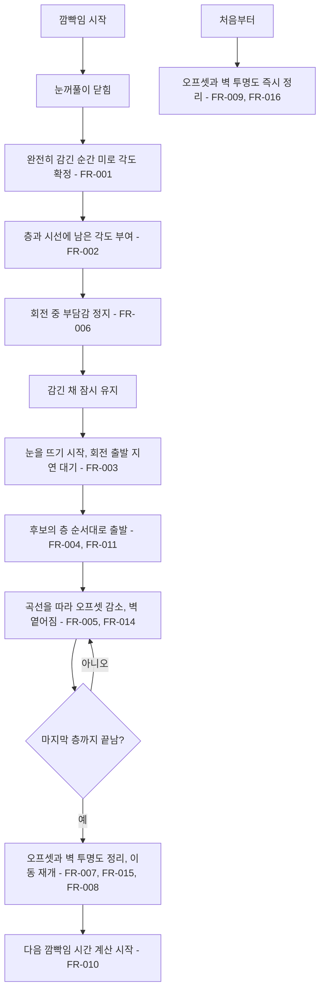
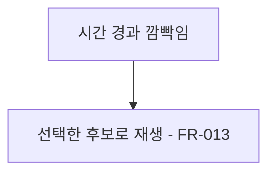

# 눈을 뜨며 보이는 미로 회전

## 1. 개요

- 목적: 깜빡임 뒤 미로가 돌아가는 움직임을 플레이어가 직접 보게 해, 맵이 변했다는 것을 직관적으로 알게 한다. 움직임은 게임 분위기에 맞게 부드럽게 가속하고 감속하며, 도는 동안 벽이 옅어졌다가 멈추며 선명해진다.
- 대상: 플레이어, 제작자(Inspector 사용자)

## 2. 범위

- 포함:
  - 눈을 뜨기 시작하고 잠시 뒤부터 보이는 미로 회전
  - 층이 도는 동안 벽과 문의 투명도 변화
  - 층 순서, 시간, 곡선, 회전 출발 지연, 벽 옅어짐 정도를 묶은 회전 연출 후보(프리셋): 자물쇠 맞춤
  - 회전 중 부담감 정지
  - 깜빡임이 끝난 뒤부터 다음 깜빡임 시간 계산
- 제외:
  - 미로 난이도, 벽 구성, `_blinkInterval` 값 변경
  - 회전 칸 수와 방향을 정하는 규칙 변경
  - 파편을 읽은 뒤의 벽 재생성 연출
  - 시선과 파편의 투명도 변화

## 3. 기술 방향

- 사용 기술/API: `AnimationCurve.EaseInOut`, `AnimationCurve.Evaluate`, `Mathf.Clamp01`, `Mathf.Sin`, `Quaternion.Euler`
- 핵심 방식: 눈이 완전히 감긴 순간 `IrisMaze`의 Transform을 최종 각도로 한 번에 확정한다. 동시에 층과 시선에 남은 각도를 화면 표시용 오프셋으로 주어 겉모습을 유지하고, 눈을 뜨기 시작한 뒤 후보의 회전 출발 지연이 지나면 곡선을 따라 오프셋을 0으로 줄인다. 층이 도는 동안에는 스펙 010의 `VisualAlpha`로 벽과 문을 옅게 했다가 되돌린다. 판정은 확정된 각도와 `MazeLayer.Offset`만 쓰므로 화면 오프셋과 표시 투명도의 영향을 받지 않는다.- 선택하지 않은 방식: 회전이 끝날 때까지 미로 Transform을 돌리면서 층마다 차이를 계산하는 방식은 판정 각도가 중간값을 지나므로 사용하지 않는다. 튕기는 오버슈트는 긴장감을 줄 수 있어 기본 곡선에서 뺀다.
- 외부 의존성: `IrisMaze`, `MazeLayer`, `GazeCursor`, 스펙 005, 스펙 006

## 4. 구조

| 구분 | 이름 | 역할 |
|------|------|------|
| 클래스 | EyeMazeDirector | 회전을 확정하고 층과 시선의 화면 오프셋을 곡선에 따라 줄이며, 층의 벽 투명도를 정한다 |
| 클래스 | MazeLayer | 칸 회전량에 화면 오프셋을 더해 표시하고, 자기 벽과 문에 표시 투명도를 전달한다 |
| 클래스 | GazeCursor | 각도에 화면 오프셋을 더해 표시한다 |
| 클래스 | BlinkTurnPreset | 연출 후보 하나의 시간, 층 순서, 곡선, 회전 출발 지연, 벽 옅어짐 정도를 담는다 |
| 씬 | EyeMaze | 구성 변경 없음. 후보 값은 스크립트 기본값으로 들어오고 Inspector에서 조절한다 |

- 오브젝트 구성: 변경 없음
- 클래스 간 관계: `EyeMazeDirector`가 `MazeLayer.BlinkVisualDeg`와 `GazeCursor.BlinkVisualDeg`에 값을 넣고, 각 컴포넌트가 자기 `Update`에서 Transform에 반영한다. 벽 투명도는 `EyeMazeDirector`가 `MazeLayer.SetWallVisualAlpha`를 호출하고, `MazeLayer`가 자식 `MazeWall`과 `MazeGate`의 `VisualAlpha`를 바꾼다.
- 실행 순서 의존성: 해당 없음
- 기존 코드와의 접점: `EyeMazeDirector.Update()`, `Blink()`, `TickBlink()`, `HandleInput()`, `AdvanceBlink()`, `ApplyBlinkVisual()`, `ClearBlinkVisual()`, `ApplyBlinkRotation()`, `ResetAll()`, `MazeLayer.Update()`, `GazeCursor.Apply()`, `MazeWall.VisualAlpha`, `MazeGate.VisualAlpha`

## 5. 동작 플로우차트

## 6. 요구사항

- FR-001: 눈이 완전히 감길 때 `EyeMazeDirector`는 미로 오브젝트를 이번 회전량만큼 최종 각도로 확정한다.
- FR-002: FR-001이 일어날 때 `EyeMazeDirector`는 각 층과 시선에 이번 회전량의 반대 각도를 화면 오프셋으로 준다.
- FR-003: 눈을 뜨기 시작하고 후보의 회전 출발 지연이 지날 때 `EyeMazeDirector`는 화면 오프셋을 줄이기 시작한다.
- FR-004: 화면 오프셋을 줄일 때 `EyeMazeDirector`는 후보의 층 순서에 따라 층 순번마다 지연 시간만큼 늦게 시작하고, 시선은 자기가 있는 층과 같은 오프셋을 쓴다.
- FR-005: 층의 화면 오프셋을 줄일 때 `EyeMazeDirector`는 후보의 회전 시간 동안 후보의 곡선 값에 따라 진행한다.
- FR-006: 회전을 확정한 뒤 마지막 층의 움직임이 끝날 때까지 `EyeMazeDirector`는 부담감을 채우지 않는다.
- FR-007: 눈 뜨기와 마지막 층의 움직임이 모두 끝날 때 `EyeMazeDirector`는 화면 오프셋을 0으로 지우고 깜빡임을 끝낸다.
- FR-008: 깜빡임이 끝난 뒤 `EyeMazeDirector`는 `_blinkRecoverSeconds`가 지나면 이동 입력을 다시 받는다.
- FR-009: 깜빡임 중 `ResetAll`이 호출될 때 `EyeMazeDirector`는 화면 오프셋을 바로 0으로 지운다.
- FR-010: 깜빡임이 진행되는 동안 `EyeMazeDirector`는 `_blinkInterval` 시간을 세지 않고, 깜빡임이 끝난 뒤부터 센다.
- FR-011: 층 번갈아 돌기를 켠 후보에서 `EyeMazeDirector`는 홀수 번째 층을 반대쪽 각도에서 출발시킨다.
- FR-013: 시간 경과로 깜빡일 때 `EyeMazeDirector`는 `_blinkPresetIndex`의 후보를 쓴다.
- FR-014: 층이 돌 때 `EyeMazeDirector`는 그 층의 벽과 문의 표시 투명도를 `1 - 벽 옅어짐 정도 × sin(π × 그 층의 회전 시간 비율)`로 바꾼다.
- FR-015: 깜빡임이 끝날 때 `EyeMazeDirector`는 벽과 문의 표시 투명도를 1로 되돌린다.
- FR-016: 깜빡임 중 `ResetAll`이 호출될 때 `EyeMazeDirector`는 벽과 문의 표시 투명도를 바로 1로 되돌린다.

### 상태와 데이터

| 이름 | 타입 | 설명 | 초기값 |
|------|------|------|--------|
| `_blinkTurning` | bool | 회전을 확정한 뒤 화면 회전이 끝나기 전인지 | false |
| `_blinkLayers` | MazeLayer[] | 이번 회전에서 움직이는 층 (바깥부터) | 빈 배열 |
| `_activePreset` | BlinkTurnPreset | 지금 재생 중인 후보 | null |
| `_blinkOpenFrom` | float | 이번 깜빡임에서 눈을 뜨기 시작하는 시각(초) | 0 |
| `MazeLayer.BlinkVisualDeg` | float | 층의 화면 표시용 회전 오프셋(도) | 0 |
| `GazeCursor.BlinkVisualDeg` | float | 시선의 화면 표시용 회전 오프셋(도) | 0 |
| `MazeLayer._wallVisualAlpha` | float | 이 층의 벽과 문에 마지막으로 전달한 표시 투명도 | 1 |

### 예외 및 경계 조건

- 회전 도중 시선을 거둠: 화면 회전은 끝까지 진행하고 회전한 각도는 대화 중에도 유지한다.
- 회전 도중 다시 들여다봄: 깜빡임이 끝나고 유예가 지날 때까지 이동 입력을 받지 않는다.
- 회전 도중 이동 키를 누름: 입력을 무시하고, 유예가 끝난 뒤 누르고 있으면 그때부터 움직인다.
- 뜨기 시간이 층 회전 전체 시간보다 긺: 눈 뜨기가 끝날 때까지 깜빡임이 이어진다.
- 후보 곡선의 끝값이 1이 아님: 깜빡임이 끝날 때 오프셋을 지우므로 최종 위치는 어긋나지 않는다.
- 프레임이 길게 끊김: 감김 구간 경계에서 시간을 멈춰 눈을 뜨기 전에 회전이 진행되지 않게 한다.
- 벽 옅어짐 정도가 0인 후보: 벽과 문의 표시 투명도를 바꾸지 않는다.
- 회전 도중 시선을 거둠: 표시 투명도는 `IrisMaze.WallColor`의 지금 투명도에 곱해진다.
- F5 후보 재생: 벽 옅어짐과 회전 출발 지연을 쓰지 않고, 스펙 010의 교차 전환이 `VisualAlpha`를 맡는다.

## 7. Inspector 노출값

| 필드 | 타입 | 기본값 | 설명 |
|------|------|--------|------|
| `_blinkPresets` | BlinkTurnPreset[] | 스펙 010의 F5 후보와 아래 표의 F6 후보 | 연출 후보 목록. 각 항목에서 시간, 층 순서, 곡선을 조절한다 |
| `_blinkPresetIndex` | int | 1 (F6) | 시간 경과 깜빡임에 쓸 후보 번호 |

| 키 | 후보 | 감기 / 유지 / 뜨기(초) | 회전 출발 지연(초) | 층 회전(초) | 층 지연(초) | 층 순서 | 벽 옅어짐 정도 | 특징 |
|----|------|------|------|------|------|------|------|------|
| F6 | 자물쇠 맞춤 | 0.4 / 0.08 / 0.55 | 0.2 | 1.0 | 0.12 | 바깥 먼저 | 0.9 | 층이 서로 반대로 돌며 옅어졌다가 맞춰지며 선명해진다 |

## 8. 인수 조건

- FR-001: Play Mode에서 깜빡임이 끝난 뒤 `미로 (Iris Maze)`의 Z 회전 변화량이 22.5도 또는 45도다.
- FR-002: 눈이 완전히 감겨 있는 동안 눈꺼풀이 미로를 가리고, 눈을 뜨기 시작할 때 미로는 감기기 전 모습에서 출발한다.
- FR-003: F6 후보의 깜빡임이 재생되면 눈이 열리기 시작하고 0.2초 뒤에 미로가 움직이기 시작한다.
- FR-004: F6 후보의 깜빡임이 재생되면 바깥 층이 먼저 움직이고 안쪽 층이 조금씩 늦게 따라오며, 시선은 자기가 있는 층의 벽과 어긋나지 않는다.
- FR-005: F6 후보의 깜빡임이 재생되면 회전이 천천히 출발해 가운데서 빨라지고 천천히 멈춘다. 후보의 곡선을 바꾸면 움직임의 느낌이 달라진다.
- FR-006: 화면 회전이 진행되는 동안 `_burden` 값이 늘지 않는다.
- FR-007: 깜빡임이 끝난 뒤 층의 Z 회전이 `Offset × 칸 각도`와 같다.
- FR-008: F6 재생 중 이동 키를 눌러도 시선이 움직이지 않고, 회전이 끝난 뒤 0.2초 뒤부터 움직인다.
- FR-009: 회전 중 R을 누르면 층과 미로가 바로 원래 각도로 돌아온다.
- FR-010: 눈을 다 뜨고 회전이 멈춘 시점부터 약 8초 뒤에 다음 깜빡임이 시작된다.
- FR-011: F6 후보의 깜빡임이 재생되면 이웃한 층이 서로 반대 방향으로 돌아 같은 위치에서 멈춘다.
- FR-013: 깜빡임이 끝나고 8초를 기다리면 다음 깜빡임도 `_blinkPresetIndex`의 후보로 재생된다.
- FR-014: F6 후보의 깜빡임이 재생되면 바깥 층부터 차례로 벽과 문이 옅어졌다가 멈추면서 선명해지고, 시선과 파편은 옅어지지 않는다.
- FR-015: 깜빡임이 끝난 뒤 모든 층의 벽과 문이 깜빡임 전과 같은 선명도다.
- FR-016: 회전 중 R을 누르면 벽과 문이 바로 원래 선명도로 돌아온다.

## 9. 미결 사항

- 없음
