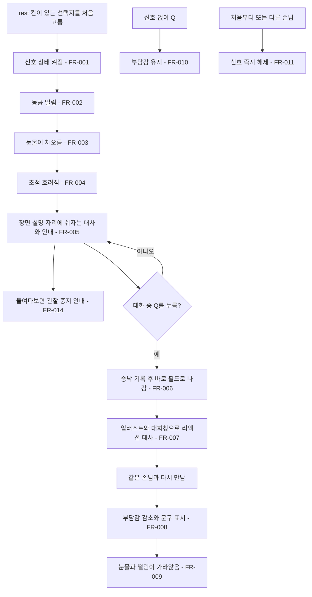

# 내담자의 휴식 신호

## 1. 개요

- 목적: 감정이 크게 흔들린 순간 내담자의 눈에 신호가 나타나게 하고, 플레이어가 그 신호를 알아채고 쉬어 줄 때만 부담감이 줄게 한다.
- 대상: 플레이어, 대화 데이터를 쓰는 제작자, 연출 값을 조절하는 제작자

## 2. 범위

- 포함:
  - 대화 CSV의 `rest` 칸으로 휴식 신호와 대사를 지정하는 기능
  - 동공 떨림, 눈물이 차오름, 초점 흐려짐으로 보여 주는 휴식 신호
  - 신호 중 장면 설명 자리에 내담자가 쉬자고 말하는 대사
  - 쉬어 주고 상담실로 돌아온 직후 내담자의 일러스트와 대화창으로 보여 주는 리액션 대사
  - 쉬고 돌아왔을 때의 부담감 감소와 문구
  - 지수의 `home` 장면, 병원비 단서로 여는 선택지 하나에 휴식 신호 추가
- 제외:
  - 신호가 없을 때 Q를 눌렀을 때의 부담감 변화 (줄지 않는다)
  - 은재 대화의 휴식 신호
  - 조작 안내 문구로 휴식을 알리는 방식
  - Q로 필드에 나갔다 돌아오는 화면 전환 변경

## 3. 기술 방향

- 사용 기술/API: 기존 `Csv`, `DialogueScript`, `Mesh`, `Mathf.PerlinNoise`, `Mathf.MoveTowards`
- 핵심 방식: 선택지의 `Rest` 대사가 있으면 신호 상태를 켠다. `ClientTearCue`가 진행도를 올리며 `Pupil.Tremble`, `EyeVisual.TearLevel`, `EyeVisual.Focus`, `IrisMaze.Focus`를 바꾼다. 신호 동안 장면 설명 자리에 대사를 보여 주고, 신호 중 Q를 누르면 바로 필드로 나간다. 필드에 돌아오면 필드 대화 CSV의 `rest` 묶음을 기존 대화창으로 보여 준다. 같은 손님과 다시 만날 때 부담감을 줄이고 신호를 거둔다.
- 선택하지 않은 방식: 신호와 동시에 자동으로 필드로 내보내는 방식은 플레이어가 알아채는 과정을 없애므로 사용하지 않는다. Q를 누른 순간 부담감을 줄이는 방식은 암전 때문에 막대가 줄어드는 모습이 보이지 않으므로 사용하지 않는다. 눈물은 UI가 아니라 눈 모양에 맞춘 메시로 그린다.
- 외부 의존성: `EyeMazeDirector`, `EyeMazeUI`, `GameFlow`, `DialogueScript`, `TalkScript`, `FieldNPC.TryTalk`, `EyeVisual`, `Pupil`, `IrisMaze`, 스펙 005

## 4. 구조

| 구분 | 이름 | 역할 |
|------|------|------|
| 클래스 | ClientTearCue | 신호 진행도를 올리고 내리며 동공, 눈물, 초점 값을 바꾸는 직렬화 클래스 |
| 클래스 | DialogueScript.Choice | `rest` 칸의 대사를 `Rest`로 담는다 |
| 클래스 | EyeMazeDirector | 신호, 대사, 승낙 상태를 관리하고 돌아왔을 때 부담감을 줄인다 |
| 클래스 | EyeVisual | 눈 아래쪽부터 차오르는 눈물을 메시로 그린다 |
| 클래스 | Pupil | 동공을 떨리게 한다 |
| 클래스 | GameFlow | 신호 중 Q로 승낙을 기록해 필드로 나가고, 돌아오면 리액션 대화를 연다 |
| 클래스 | EyeMazeUI | 신호 중 장면 설명 자리에 쉬자는 대사를 보여 준다 |
| 클래스 | TalkScript | `rest`를 예약 묶음으로 두어 평소 말을 걸 때는 고르지 않는다 |
| 데이터 | Data/Dialogue/Jisu.csv | `rest` 칸을 추가하고 선택지 하나를 채운다 |
| 데이터 | Data/Talk/Jisu.csv | `rest` 묶음에 리액션 대사를 둔다 |
| 씬 | EyeMaze | 구성 변경 없음. 눈물 메시는 Play 중에 만든다 |

- 오브젝트 구성: 눈물 메시 오브젝트는 눈 아래에 Play 중 한 번 만들며 씬에 저장하지 않는다.
- 클래스 간 관계: `GameFlow`가 `EyeMazeDirector.AcceptRest()`와 `FieldNPC.TryTalk()`를 호출한다. `EyeMazeDirector`가 `ClientTearCue.Tick()`을 호출하고, `ClientTearCue`가 눈, 동공, 미로의 값을 바꾼다.
- 실행 순서 의존성: 해당 없음
- 기존 코드와의 접점: `DialogueScript.Parse()`, `EyeMazeDirector.Update()`, `ChooseOption()`, `ToggleGaze()`, `CanReturnToStart`, `ShowEncounterGuide()`, `ResetAll()`, `GameFlow.Update()`의 Q 처리, `GameFlow.ReturnToFieldNow()`, `TalkScript.Group.IsReserved`, `EyeMazeUI`의 장면 설명, 스펙 005 FR-004

## 5. 동작 플로우차트

## 6. 요구사항

- FR-001: `rest` 칸이 채워진 선택지를 처음 고를 때 `EyeMazeDirector`는 신호 상태를 켠다.
- FR-002: 신호 상태일 때 `Pupil`은 제자리 주변에서 떨린다.
- FR-003: 신호 상태일 때 `EyeVisual`은 눈 아래쪽부터 눈물을 `_tearRiseSeconds`에 걸쳐 차오르게 한다.
- FR-004: 신호 상태일 때 `ClientTearCue`는 눈과 미로의 초점을 `_tearBlurFocus`까지 낮춘다.
- FR-005: 신호 상태에서 대화 중일 때 `EyeMazeUI`는 장면 설명 자리에 `rest` 대사와 그 아래 `(잠시 쉴 시간이 필요한 거 같다.)`를 표시한다.
- FR-006: 신호 상태에서 대화 중 Q를 누를 때 `GameFlow`는 승낙을 기록하고 바로 필드로 나간다.
- FR-007: 승낙 상태로 필드에 돌아올 때 `GameFlow`는 그 손님의 필드 대화 CSV `rest` 묶음을 일러스트와 대화창으로 보여 준다.
- FR-008: 승낙 상태로 같은 손님과 다시 만날 때 `EyeMazeDirector`는 부담감을 `_burdenRestRelief`만큼 줄이고(0 아래로는 내려가지 않음) `_restReturnMessage`를 표시한다.
- FR-009: FR-008 뒤 `ClientTearCue`는 떨림, 눈물, 초점을 `_tearFallSeconds`에 걸쳐 원래대로 되돌린다.
- FR-010: 신호 상태가 아닐 때 Q를 누르면 `GameFlow`는 바로 필드로 나가고 부담감은 바뀌지 않는다.
- FR-011: `ResetAll`이 호출될 때 `EyeMazeDirector`는 휴식 상태를 끄고 `ClientTearCue`는 떨림, 눈물, 초점을 바로 되돌린다.
- FR-012: 지수의 `home` 장면에서 `jisu_autopay_25`로 여는 선택지의 `rest` 칸에는 쉬자는 대사가 들어 있다.
- FR-013: `Data/Talk/Jisu.csv`의 `rest` 묶음에는 쉬어 준 뒤의 리액션 대사가 들어 있다.
- FR-014: 신호 상태에서 눈을 들여다볼 때 `EyeMazeUI`는 눈 속 표시 아래에 `{name}가 하고 싶은 말이 있는 거 같다. 잠시 관찰을 멈춰보자.`를 표시한다.

### 상태와 데이터

| 이름 | 타입 | 설명 | 초기값 |
|------|------|------|--------|
| `DialogueScript.Choice.Rest` | string | 쉬자는 대사. 비어 있으면 신호 없음 | 빈 문자열 |
| `_restRequested` | bool | 신호가 나타난 상태인지 | false |
| `_restLine` | string | 신호 동안 장면 설명 자리에 보여 줄 대사 | null |
| `_restAccepted` | bool | 쉬어 주어 돌아왔을 때 부담감을 줄일지 | false |
| `_amount` | float | 신호 진행도 (0~1) | 0 |
| `Pupil.Tremble` | float | 동공 떨림 세기 (0~1) | 0 |
| `EyeVisual.TearLevel` | float | 눈물 수위 (0~1) | 0 |

### 예외 및 경계 조건

- 신호를 무시하고 눈을 들여다봄: 신호는 Q를 누를 때까지 유지되고, 들여다보는 동안에도 눈물과 흐려짐이 보인다.
- 신호 중 부담감이 가득 참: 기존대로 leave 엔딩이 시작되고 신호는 가라앉는다.
- 이미 한 좋은 말을 다시 고름: 기존 규칙대로 결과가 반복되지 않으므로 신호도 다시 켜지지 않는다.
- 부담감이 이미 0임: 0으로 유지하고 문구는 표시한다.
- 신호 중 다른 장면으로 넘어감: Q를 누를 때까지 장면 설명 자리에 쉬자는 대사를 유지한다.
- 신호 중 눈을 들여다봄: 장면 설명 자리는 기존 눈 속 표시와 FR-014의 안내를 쓴다. 파편을 읽는 중과 심연에서는 안내 없이 기존 표시를 쓴다.
- `rest` 묶음이 없는 손님: 리액션 없이 필드로 돌아온다.

## 7. Inspector 노출값

| 필드 | 타입 | 기본값 | 설명 |
|------|------|--------|------|
| `_burdenRestRelief` | float (0~1) | 0.4 | 쉬어 주고 돌아왔을 때 줄어드는 부담감 |
| `_restReturnMessage` | string | `은재의 얼굴이 조금 편해졌다.\n(부담이 줄었다.)` | 돌아왔을 때 문구. '은재'는 지금 손님 이름으로 바뀐다 |
| `_tearRiseSeconds` | float | 3 | 신호가 끝까지 차오르는 시간(초) |
| `_tearFallSeconds` | float | 1.5 | 신호가 가라앉는 시간(초) |
| `_tearBlurFocus` | float (0~1) | 0.35 | 눈물이 가득 찼을 때의 초점 |
| `_trembleDistance` | float | 0.05 | 동공이 떨리는 거리 |
| `_trembleSpeed` | float | 28 | 동공이 떨리는 빠르기 |
| `_tearColor` | Color | (0.62, 0.8, 1, 0.45) | 눈물 색 |
| `_tearMaxHeight` | float (0~1) | 0.55 | 가득 찼을 때 눈 높이 대비 수위 |
| `_tearWaveHeight` | float | 0.06 | 눈물 수면의 일렁임 높이 |
| `_tearWaveSpeed` | float | 2 | 눈물 수면의 일렁임 빠르기 |

| 데이터 | 값 |
|------|------|
| `Jisu.csv` `rest` 칸 | `"…잠시 상담을 멈춰도 될까요? 너무 감정이 북받쳐 오르네요."` |
| `Talk/Jisu.csv` `rest` 묶음 1 | `"…죄송해요. 갑자기 멈춰 달라고 해서."` |
| `Talk/Jisu.csv` `rest` 묶음 2 | `"이런 얘기, 회사에선 한 번도 안 해 봤거든요."` |
| `Talk/Jisu.csv` `rest` 묶음 3 | `"기다려 주셔서 감사해요. 이제 좀 괜찮아졌어요."` |

## 8. 인수 조건

- FR-001: 지수의 `home` 장면에서 병원비 단서 선택지를 고르면 신호가 시작되고, 다른 선택지와 은재의 대화에서는 시작되지 않는다.
- FR-002: FR-001 뒤 동공이 제자리에서 떨린다.
- FR-003: FR-001 뒤 눈 아래쪽부터 눈물이 약 3초에 걸쳐 차오른다.
- FR-004: 눈물이 차오르는 동안 눈과 미로가 흐려진다.
- FR-005: 신호가 시작되면 `▶` 장면 설명이 쉬자는 대사로 바뀌고, 그 아래에 `(잠시 쉴 시간이 필요한 거 같다.)`가 보인다.
- FR-006: 신호 중 Q를 한 번 누르면 바로 상담실로 돌아간다.
- FR-007: 상담실로 돌아오면 지수의 일러스트와 대화창에 리액션 대사가 나오고 Z로 넘길 수 있다.
- FR-008: 돌아와서 지수에게 말을 걸면 부담감 막대가 0.4만큼 내려가고 돌아왔을 때 문구가 보인다.
- FR-009: FR-008 뒤 약 1.5초에 걸쳐 눈물이 빠지고 눈과 미로가 선명해지며 동공이 멈춘다.
- FR-010: 신호 전에 Q로 나갔다 돌아오면 부담감 막대가 그대로다.
- FR-011: 신호 중 R을 누르면 눈물과 떨림이 바로 사라지고 초점이 원래대로 돌아온다.
- FR-012: `Jisu.csv`의 해당 줄 `rest` 칸에 대사가 있고, 은재의 대화 CSV에는 `rest` 칸이 없다.
- FR-013: 상담이 끝난 뒤 지수에게 말을 걸어도 리액션 대사가 나오지 않는다.
- FR-014: 신호 중 Space로 들여다보면 눈 속 표시 아래에 `지수가 하고 싶은 말이 있는 거 같다. 잠시 관찰을 멈춰보자.`가 보인다.

## 9. 미결 사항

- 없음
