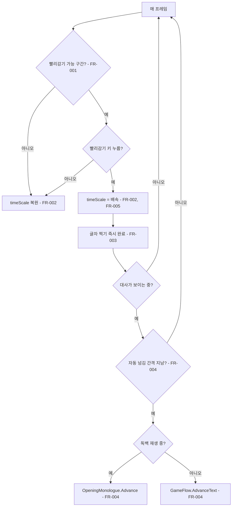
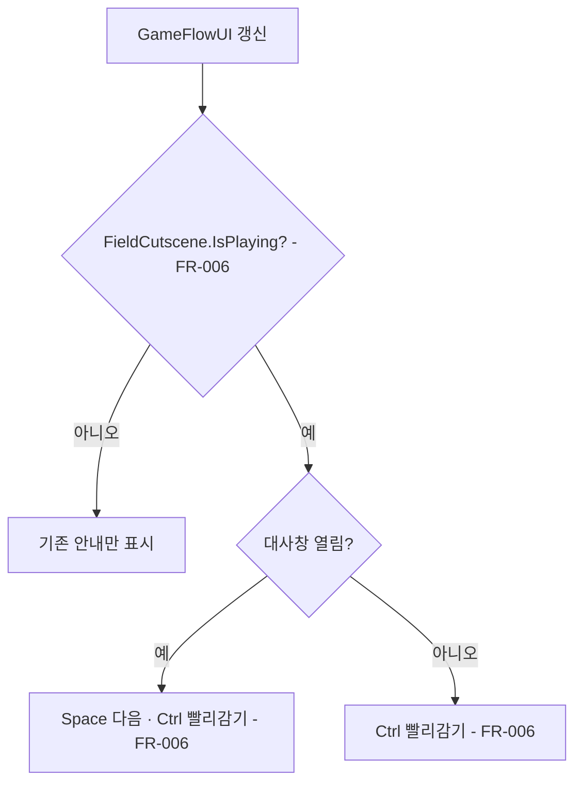
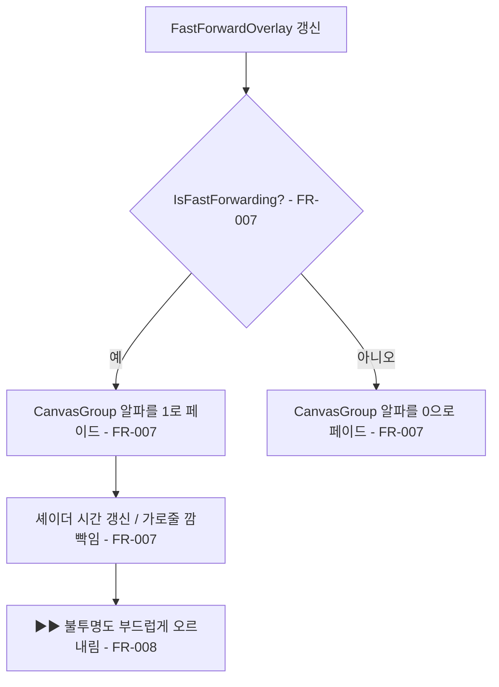

# 컷신 빨리감기

## 1. 개요

- 목적: 플레이어가 조작하지 않고 연출과 대사만 이어지는 구간을, 키를 누르고 있는 동안 빠르게 감아 넘길 수 있게 한다.
- 대상: 플레이어

## 2. 범위

- 포함:
  - 시작 독백부터 문 앞 혼잣말 B가 닫힐 때까지 (`OpeningMonologue` 재생, `FieldCutscene`의 `CallFirst`, `CallTalking`)
  - 문 상호작용 직후부터 은재 착석 뒤 서술이 끝날 때까지 (`FieldCutscene`의 `Arrive`부터 `Reveal`까지)
  - 상담이 끝난 뒤 앞 손님 퇴장부터 다음 손님 착석·첫마디까지 (`FieldCutscene`의 `ClientOut`부터 `ClientGreet`까지)
  - 위 구간에서의 연출 시간 배속, 글자 찍기 즉시 완료, 대사 자동 넘김
  - 필드 컷신 중 조작 안내 자리에 빨리감기 안내 표시
  - 빨리감기 중 화면 전체에 비디오 빨리감기 같은 흰색·회색 가로줄이 오른쪽에서 왼쪽으로 지나가며 사라지는 연출과 화면 가운데의 큰 `▶▶` 표시
- 제외:
  - 문 상호작용을 기다리는 구간 (`WaitDoor`). 플레이어가 직접 문을 열어야 한다.
  - 상담(눈 속 미로, `GameFlow.State.Encounter`)과 줌 인·줌 아웃 구간
  - 플레이어가 직접 말을 걸어 연 필드 대화와 단서 글
  - 한 번 눌러 목표 지점으로 바로 건너뛰는 기능
  - 시작 독백 화면의 빨리감기 안내 표시

## 3. 기술 방향

- 사용 기술/API: Unity Input System (`Keyboard`, `Gamepad`), `Time.timeScale`, uGUI `RawImage`·`Text`·`CanvasGroup`, UI 셰이더, `Shader.SetGlobalFloat`
- 핵심 방식:
  - 새 컴포넌트 `CutsceneFastForward`가 매 프레임 빨리감기 가능 구간인지와 빨리감기 키가 눌려 있는지를 확인한다.
  - 빨리감기 가능 구간은 `OpeningMonologue.IsPlaying || FieldCutscene.IsPlaying`으로 판정한다. `FieldCutscene.IsPlaying`은 이미 `WaitDoor`, `WaitResolved`, `AllDone`에서 false이므로 위 범위와 일치한다.
  - 빨리감기 중에는 `Time.timeScale`을 배속 값으로 올린다. `FieldCutscene`, `FieldNPC`, 문 호출 글씨, 카메라 추적은 `Time.deltaTime`/`Time.time` 기준이라 함께 빨라진다.
  - `Typewriter`는 `unscaledDeltaTime` 기준이라 배속이 듣지 않는다. 빨리감기 중에는 `Typewriter.SkipAll()`로 글을 바로 끝까지 보여준다.
  - 대사는 줄이 끝까지 보인 뒤 실제 시간(`unscaledDeltaTime`)으로 자동 넘김 간격이 지나면 넘긴다. 필드 대사창은 `GameFlow.AdvanceText()`, 시작 독백은 새로 공개하는 `OpeningMonologue.Advance()`를 부른다.
  - `OpeningMonologue`의 줄 사이 간격과 암전 해제 타이머는 `Time.unscaledDeltaTime` 대신 `Time.deltaTime`을 쓴다. 평소에는 `timeScale`이 1이라 동작이 같다.
  - 가로줄은 화면 전체를 덮는 `RawImage` 하나에 전용 UI 셰이더 `EyeMaze/FastForwardLines`를 쓴 재질을 붙여 그린다. 셰이더가 화면을 가로 행으로 나누고, 행마다 어긋난 주기로 켜질지, 밝기(회색~흰색), 길이, 출발 위치를 정한다. 켜진 줄은 한 주기 동안 오른쪽에서 왼쪽으로 이동하며, 왼쪽 머리가 가장 밝고 오른쪽 꼬리로 갈수록 흐리다. 줄은 짧게 나타난 뒤 이동하는 동안 점점 흐려져 사라진다.
  - 셰이더 시간은 `FastForwardOverlay`가 매 프레임 `Shader.SetGlobalFloat("_FastForwardTime", Time.unscaledTime)`으로 넘긴다. 배속과 상관없이 깜빡임 속도가 일정하고, 재질 애셋을 실행 중에 고치지 않는다.
  - 오버레이 전체는 `CanvasGroup` 알파로 나타나고 사라진다. `UI (Canvas)`의 마지막 자식으로 두어 시작 독백 화면보다 위에 그린다.
- 선택하지 않은 방식:
  - 각 단계의 시간을 직접 줄이는 방식은 쓰지 않는다. 기존 `FieldCutscene` 흐름을 그대로 빠르게 돌린다.
  - 목표 단계로 상태를 직접 점프시키는 방식은 쓰지 않는다.
  - 가로줄 Image를 여러 개 두고 코드로 옮기는 방식은 쓰지 않는다. 오브젝트가 많아지고 모양이 단조롭다.
  - UI 오브젝트를 코드로 생성하지 않는다. 씬에 저장된 오브젝트를 참조만 한다.
- 외부 의존성: `OpeningMonologue`, `FieldCutscene`, `GameFlow`, `GameFlowUI`, `Typewriter`, `DialogueLog`(대화 기록 창 열림 여부)

## 4. 구조

| 구분 | 이름 | 역할 |
|------|------|------|
| 클래스 | `CutsceneFastForward` (신규) | 구간 판정, 키 입력 확인, `timeScale` 변경, 글자 완료, 대사 자동 넘김, 안내 문구 제공 |
| 클래스 | `OpeningMonologue` (수정) | 넘기기 동작을 `Advance()`로, 넘길 수 있는 상태를 `CanAdvance`로 공개하고, 줄 간격·암전 해제 타이머를 `Time.deltaTime` 기준으로 바꾼다 |
| 클래스 | `GameFlowUI` (수정) | 필드 컷신 중 `_fieldHint`에 `CutsceneFastForward.Hint`를 덧붙인다 |
| 클래스 | `FastForwardOverlay` (신규) | 빨리감기 중 오버레이를 페이드로 보이고, 셰이더 시간을 넘기고, `▶▶`의 불투명도를 부드럽게 오르내린다 |
| 셰이더 | `EyeMaze/FastForwardLines` (신규, `Assets/EyeMaze/Shaders/FastForwardLines.shader`) | 무작위 가로줄 노이즈를 그리는 UI 셰이더 |
| 재질 | `FastForwardLines.mat` (신규, `Assets/EyeMaze/Materials/`) | 가로줄 셰이더 설정값(행 수, 밀도, 바뀌는 빈도, 밝기, 투명도, 길이 변화) |
| 씬 | `EyeMaze.unity` | `게임 흐름 (Game Flow)` 오브젝트에 `CutsceneFastForward`를 붙이고, `UI (Canvas)` 마지막 자식으로 `빨리감기 연출` 오브젝트를 둔다 |
| 프리팹 | 해당 없음 | 해당 없음 |
| ScriptableObject | 해당 없음 | 해당 없음 |

- 오브젝트 구성:
  - `GameFlow` 오브젝트에 `CutsceneFastForward`를 추가한다.
  - `UI (Canvas)` / `빨리감기 연출` (RectTransform 전체 채움, `CanvasGroup`, `FastForwardOverlay`)
    - `가로줄` (RectTransform 전체 채움, `RawImage` + `FastForwardLines.mat`, 레이캐스트 끔)
    - `빨리감기 표시` (화면 가운데, 560×224, `Text` `▶▶`, Galmuri11 폰트 154)
- 클래스 간 관계: `CutsceneFastForward`가 `GameFlow`, `OpeningMonologue`를 Inspector 참조로 들고 한 방향으로 호출한다. `GameFlowUI`는 `CutsceneFastForward.Hint`만, `FastForwardOverlay`는 `CutsceneFastForward.IsFastForwarding`만 읽는다. `FieldCutscene`과 `OpeningMonologue`는 `CutsceneFastForward`를 알지 못한다.
- 실행 순서 의존성: 없음. 구간 판정은 매 프레임 정적 프로퍼티를 읽는다.
- 기존 코드와의 접점:
  - `OpeningMonologue.Update`: 넘기기 처리 부분을 `Advance()`로 분리하고, `dt`를 `Time.deltaTime`으로 바꾼다.
  - `GameFlowUI.Update`: `_fieldHint` 문구 뒤에 빨리감기 안내를 덧붙인다. UI 오브젝트는 새로 만들지 않는다.
  - `FieldCutscene`, `GameFlow`, `Typewriter`: 수정하지 않는다. 기존 공개 API만 쓴다.

## 5. 동작 플로우차트

## 6. 요구사항

- FR-001: `OpeningMonologue.IsPlaying` 또는 `FieldCutscene.IsPlaying`이 true일 때만 `CutsceneFastForward`는 빨리감기를 허용한다.
- FR-002: 빨리감기 가능 구간에서 빨리감기 키를 누르고 있는 동안 `CutsceneFastForward`는 `Time.timeScale`을 배속 값으로 두고, 키를 떼거나 구간이 끝나면 1로 되돌린다.
- FR-003: 빨리감기 중일 때 `CutsceneFastForward`는 찍히고 있는 글을 바로 끝까지 보여준다.
- FR-004: 빨리감기 중 한 줄이 끝까지 보인 뒤 자동 넘김 간격(실제 시간)이 지나면 `CutsceneFastForward`는 그 줄을 넘긴다. 독백 재생 중이면 `OpeningMonologue.Advance()`, 아니면 필드 대사창이 열려 있을 때 `GameFlow.AdvanceText()`를 부른다.
- FR-005: 빨리감기 중일 때 `OpeningMonologue`의 줄 사이 간격과 암전 해제는 배속만큼 빨라진다.
- FR-006: `FieldCutscene.IsPlaying`이 true일 때 `GameFlowUI`는 필드 조작 안내 자리에 빨리감기 안내 문구를 함께 표시한다. 대사창이 열려 있으면 `Space  다음   ·   Ctrl  빨리감기`, 대사창 없이 이동만 진행 중이면 `Ctrl  빨리감기`만 보인다.

- FR-007: 빨리감기 중일 때 `FastForwardOverlay`는 화면 곳곳의 흰색·회색 가로줄이 오른쪽에서 왼쪽으로 지나가며 흐려져 사라지기를 반복하는 오버레이를 보이고, 빨리감기가 끝나면 페이드로 숨긴다.
- FR-008: 빨리감기 중일 때 `FastForwardOverlay`는 화면 가운데의 큰 `▶▶` 표시의 불투명도를 일정 주기로 부드럽게 오르내린다.

### 상태와 데이터

| 이름 | 타입 | 설명 | 초기값 |
|------|------|------|--------|
| `_active` | `bool` | 이번 프레임에 빨리감기가 적용 중인지 | `false` |
| `_advanceTimer` | `float` | 줄이 끝까지 보인 뒤 흐른 실제 시간 | `0` |
| `IsFastForwarding` | `bool` (public static 프로퍼티) | 빨리감기 중인지 | `false` |
| `Hint` | `string` (public static 프로퍼티) | 필드 컷신 중이면 안내 문구, 아니면 null | `null` |

### 예외 및 경계 조건

- 빨리감기 중 구간이 끝남 (예: 혼잣말 B를 자동으로 넘겨 `WaitDoor`가 됨): 같은 프레임에 `timeScale`을 1로 되돌리고 자동 넘김을 멈춘다. 문 상호작용을 대신 실행하지 않는다.
- 줄 중간에 키를 뗌: 이미 다 보인 줄은 그대로 두고 기존 넘기기 입력을 기다린다.
- 줄을 넘기거나 대사창이 닫힘: `_advanceTimer`를 0으로 되돌려 다음 줄도 간격만큼 보여준 뒤 넘긴다.
- 대사창 없이 이동·대기만 진행 중 (`Arrive`, `Pause`, `MotherOut`, `Between`, `DaughterIn`, `Sitting`, `ClientOut`, `ClientBetween`, `ClientIn`, `ClientSitting`): 배속만 적용하고 넘기기는 하지 않는다.
- 컴포넌트가 비활성화되거나 파괴됨: `timeScale`을 1로 되돌린다.
- 대화 기록 창(`DialogueLog.IsOpen`)이 열려 있음: `CutsceneFastForward`는 아무것도 하지 않는다. `timeScale`은 대화 기록 창의 일시정지를 따르고, 자동 넘김도 멈춘다. 창이 닫히면 키가 눌려 있으면 배속을 이어가고, 떼어져 있으면 1로 되돌린다.
- 빨리감기 키는 기존 넘기기 키(X, Enter, Space), 대화 기록 키(L)나 이동 키와 겹치지 않는 `Left Ctrl`을 기본값으로 한다.

## 7. Inspector 노출값

| 필드 | 타입 | 기본값 | 설명 |
|------|------|--------|------|
| `_flow` | `GameFlow` | 씬 연결 | 필드 대사창 넘기기에 쓴다 |
| `_monologue` | `OpeningMonologue` | 씬 연결 | 시작 독백 넘기기에 쓴다 |
| `_key` | `Key` | `LeftCtrl` | 누르고 있는 동안 빨리감는 키보드 키 |
| `_padButton` | `GamepadButton` | `RightShoulder` | 누르고 있는 동안 빨리감는 게임패드 버튼 |
| `_timeScale` | `float` | `4` | 빨리감기 중 연출 배속. 1 이상 |
| `_autoAdvanceInterval` | `float` | `0.15` | 한 줄이 끝까지 보인 뒤 자동으로 넘기기까지의 실제 시간(초). 0 이상 |
| `_hintText` | `string` | `Ctrl  빨리감기` | 빨리감기 안내 문구. `Strings.csv`의 `hint.fast_forward`가 있으면 그걸 쓴다 |
| `FastForwardOverlay._group` | `CanvasGroup` | 씬 연결 | 오버레이 전체 페이드 |
| `FastForwardOverlay._mark` | `Text` | 씬 연결 | `▶▶` 표시 |
| `FastForwardOverlay._fadeSeconds` | `float` | `0.15` | 나타나고 사라지는 시간(초, 실제 시간) |
| `FastForwardOverlay._markPulseSeconds` | `float` | `1.2` | `▶▶`가 흐려졌다 다시 밝아지는 한 주기(초, 실제 시간) |
| `FastForwardOverlay._markMinAlpha` | `float` | `0.25` | `▶▶`가 가장 흐려졌을 때의 불투명도 |
| `FastForwardLines.mat` `_Rows` | `float` | `120` | 화면을 나누는 가로 행 수. 클수록 줄이 얇다 |
| `FastForwardLines.mat` `_Density` | `float` | `0.12` | 주기마다 켜지는 행의 비율 (0~1) |
| `FastForwardLines.mat` `_Rate` | `float` | `1.5` | 행 하나에서 줄이 초당 지나가는 횟수 |
| `FastForwardLines.mat` `_Travel` | `float` | `3.6` | 줄 하나가 한 주기 동안 왼쪽으로 이동하는 거리 (화면 너비 비율) |
| `FastForwardLines.mat` `_MinLength` / `_MaxLength` | `float` | `0.15` / `0.45` | 줄 길이 범위 (화면 너비 비율) |
| `FastForwardLines.mat` `_EdgeSoftness` | `float` | `0.08` | 줄 머리(왼쪽 끝)를 흐리게 하는 폭 (줄 길이 비율) |
| `FastForwardLines.mat` `_MinBrightness` | `float` | `0.5` | 가장 어두운 줄의 밝기. 1이면 모두 흰색 |
| `FastForwardLines.mat` `_MaxAlpha` | `float` | `0.35` | 줄의 최대 불투명도 |

## 8. 인수 조건

- FR-001: Play 후 문 앞 안내 문구가 떠 있을 때와 은재 착석 서술이 끝난 뒤 빨리감기 키를 눌러도 이동 속도와 대사에 변화가 없다.
- FR-002: 어머니가 걸어 들어오는 동안 키를 누르면 이동이 눈에 띄게 빨라지고, 키를 떼면 원래 속도로 돌아온다. 구간이 끝난 뒤 Time Scale이 1이다.
- FR-003: 독백이나 어머니 대사가 찍히는 도중 키를 누르면 그 줄이 바로 끝까지 보인다.
- FR-004: 시작 독백 첫 줄에서 키를 계속 누르고 있으면 독백 7줄, 혼잣말 A·B가 자동으로 넘어가고 문 앞 안내 문구에서 멈춘다. 문을 연 뒤 다시 누르고 있으면 어머니 10줄, 퇴장, 은재 입장·착석, 서술 3줄까지 자동으로 진행하고 서술이 끝나면 멈춘다. 상담 뒤 손님 교대도 같은 방식으로 진행하고 다음 손님의 첫마디가 끝나면 멈춘다.
- FR-005: 독백 줄 사이 공백과 마지막 줄 뒤 암전 해제가 키를 누르고 있을 때 평소보다 짧다.
- FR-006: 혼잣말 A가 떠 있을 때 오른쪽 위 안내에 `Space  다음   ·   Ctrl  빨리감기`가 보이고, 문 앞 안내 문구가 뜨면 빨리감기 안내가 사라진다. 플레이어가 직접 말을 건 대화에서는 빨리감기 안내가 보이지 않는다.
- FR-007: Play 중 컷신에서 `Left Ctrl`을 누르고 있으면 흰색·회색 가로줄이 서로 다른 때에 오른쪽에서 왼쪽으로 지나가며 흐려져 사라지고, 시작 독백의 검은 화면 위에서도 보인다. 키를 떼면 짧게 사라진다. 에디트 모드와 평소 플레이에서는 보이지 않는다.
- FR-008: 빨리감기 중 화면 가운데의 큰 `▶▶`가 꺼지지 않고 흐려졌다 밝아지기를 부드럽게 반복하고, 빨리감기가 끝나면 함께 사라진다.

## 9. 미결 사항

- 없음
