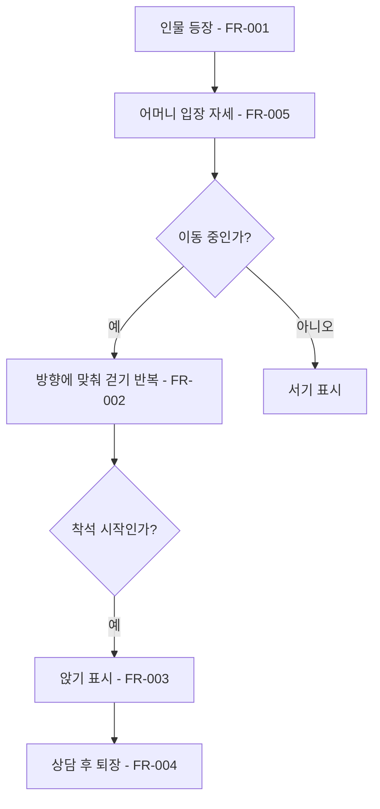

# 필드 캐릭터 걷기와 앉기

## 1. 개요

- 목적: 기존 초상화를 바탕으로 은재 어머니, 은재, 지수의 필드 모습을 만들고 입장과 착석을 자연스럽게 보여준다.
- 대상: 플레이어와 씬을 편집하는 제작자.

## 2. 범위

- 포함:
  - 세 인물의 흑백 픽셀풍 전신 스프라이트와 서기, 걷기, 앉기 표현.
  - 기존 필드 컷신과 캐릭터의 모습 연결.
- 제외:
  - 대사, 컷신 순서, 플레이어 조작 변경.

## 3. 기술 방향

- 사용 기술/API: Unity SpriteRenderer와 스프라이트 프레임, 기존 FieldNPC 및 FieldCutscene.
- 핵심 방식: 기존 초상화의 머리 모양과 복장을 유지해 인물별 전신 이미지를 만들고, 이동 상태에 따라 걷기 프레임을 반복하며 착석 시 앉은 모습을 표시한다. 좌우 이동 방향에 맞게 스프라이트를 반전한다.
- 선택하지 않은 방식: 기존 캡슐의 크기 변경만으로 인물의 동작을 표현하지 않는다.
- 외부 의존성: 기존 초상화, 필드 씬과 FieldNPC, FieldCutscene.

## 4. 구조

| 구분 | 이름 | 역할 |
|------|------|------|
| 클래스 | FieldNPC | 기존 이동 및 착석 상태와 캐릭터 표시를 연결한다. |
| 애셋 | 인물별 스프라이트 | 서기, 걷기, 앉기 이미지를 제공한다. |
| 씬 | 기존 필드 씬 | 세 인물의 스프라이트와 표시 설정을 보관한다. |

- 오브젝트 구성: 기존 인물 오브젝트에 SpriteRenderer를 연결하고 프레임 및 표시 설정을 Inspector에서 지정한다.
- 클래스 간 관계: FieldCutscene은 기존처럼 FieldNPC의 이동과 착석을 호출하고 FieldNPC가 해당 모습을 표시한다.
- 실행 순서 의존성: 기존 컷신 및 FieldNPC의 초기화 순서를 유지한다.
- 기존 코드와의 접점: FieldNPC의 등장, 이동, 착석 상태와 표시 갱신.

## 5. 동작 플로우차트

## 6. 요구사항

- FR-001: 세 인물이 필드에 등장할 때 각 초상화의 특징을 반영한 전신 캐릭터가 표시된다.
  - 은재는 성인 인물보다 조금 작은 크기로 표시한다.
- FR-002: 인물이 이동할 때 이동 방향에 맞는 걷기 동작이 반복된다.
- FR-003: 인물이 기존 컷신에서 자리에 앉을 때 앉은 자세로 전환되고 자리에 머무른다.
- FR-006: 손님이 소파에 앉을 때 씬에서 지정한 자리의 캐릭터 중심 Y를 -1.8로 맞추고, 소파 앞부분이 몸 일부를 가린다.
- FR-004: 인물이 기존 컷신에서 퇴장할 때 서서 걷는 모습으로 전환되고 퇴장 후 표시되지 않는다.
- FR-005: 은재 어머니가 처음 들어와 대화할 때 한 팔을 반대쪽 손으로 감싸 쥔 긴장된 자세를 표시한다.

### 상태와 데이터

| 이름 | 타입 | 설명 | 초기값 |
|------|------|------|--------|
| 표시 상태 | 내부 상태 | 서기, 걷기, 앉기 중 현재 모습 | 서기 |
| 걷기 프레임 | 정수 | 걷기 이미지의 현재 순서 | 0 |

### 예외 및 경계 조건

- 인물이 표시되지 않는 동안에는 스프라이트도 표시하지 않는다.
- 기존 인물 중 스프라이트가 연결되지 않은 경우 기존 표시를 유지한다.

## 7. Inspector 노출값

| 필드 | 타입 | 기본값 | 설명 |
|------|------|--------|------|
| 스프라이트 렌더러 | SpriteRenderer | 비어 있음 | 인물의 필드 모습을 표시한다. |
| 서기, 걷기, 앉기 이미지 | Sprite 및 Sprite 배열 | 비어 있음 | 인물별 자세와 걷기 프레임이다. |
| 걷기 프레임 간격 | float | 0.12초 | 걷기 이미지 교체 간격이다. |
| 입장 서기와 걷기 이미지 | Sprite 및 Sprite 배열 | 비어 있음 | 어머니의 긴장된 입장 자세를 표시한다. |

## 8. 인수 조건

- FR-001: Play Mode에서 각 인물의 외형이 구별되고 은재가 성인보다 조금 작게 보인다.
- FR-002: 입장과 퇴장 중 걷기 프레임이 반복되고 좌우 이동 방향이 맞는다.
- FR-003: 은재와 지수가 지정된 좌석에 도착해 앉은 자세로 머문다.
- FR-006: 은재와 지수가 소파에 앉았을 때 캐릭터 중심 Y가 -1.8이고 소파 앞부분이 몸 일부를 가린다.
- FR-004: 상담을 마친 손님이 서서 문 쪽으로 걸어 나간 뒤 화면에서 사라진다.
- FR-005: 어머니가 문에서 들어와 대화하는 동안 한 손으로 반대 팔을 잡은 모습이 표시되고, 퇴장하면 기존 모습으로 돌아간다.

## 9. 미결 사항

- 없음
