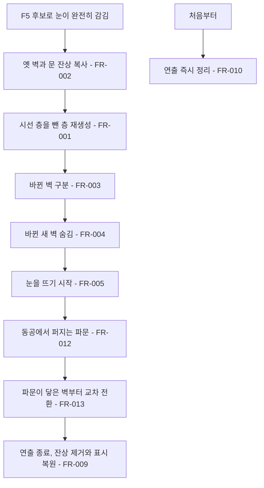
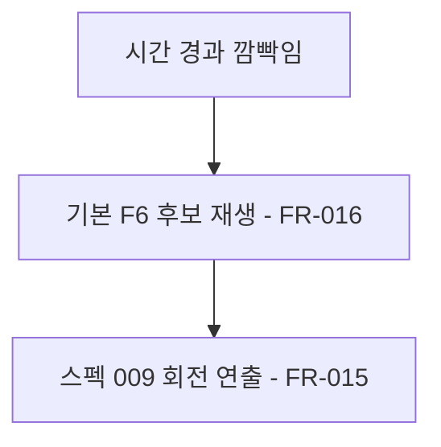

# 깜빡임 벽 변화 연출

## 1. 개요

- 목적: 미로를 돌리는 방식 외에, 깜빡임 뒤 벽이 실제로 바뀌는 모습을 동공에서 퍼지는 파문으로 보여 준다.
- 대상: 플레이어, 제작자(Inspector 사용자)

## 2. 범위

- 포함:
  - 시선이 있는 층을 뺀 층의 벽과 문을 깜빡임 때 새로 만드는 동작
  - 바뀐 벽만 골라 옛 벽에서 새 벽으로 넘어가는 구조
  - F5 동공 파문 연출
  - 깜빡임 문구를 "눈이 깜빡였다."로 통일
- 제외:
  - 스펙 009의 F6 자물쇠 맞춤 동작 변경
  - 벽 생성 규칙과 미로 난이도 변경
  - 파편을 읽은 뒤의 벽 재생성 연출

## 3. 기술 방향

- 사용 기술/API: `LineRenderer`, `AnimationCurve`, `Shapes.SetCircle`, `Shapes.SetColor`, `UnityEngine.Random`, `Mathf.Clamp01`
- 핵심 방식: 눈이 완전히 감긴 순간 옛 벽과 문의 선을 판정 없는 표시 전용 잔상으로 복사하고, 기존 `IrisMaze.Generate(seed, keepLayer)`로 새 벽을 만든다. 벽 판정은 이 순간 새 벽으로 확정되고, 눈을 뜨는 동안에는 파문이 닿은 순서대로 잔상과 새 벽의 표시값만 바꾼다.
- 선택하지 않은 방식: 옛 `MazeWall`을 남기는 방식은 `IrisMaze.FindWall`에 함께 검색되므로 사용하지 않는다. 연출 도중 벽을 하나씩 판정에 반영하는 방식은 보이는 벽과 판정이 어긋나기 쉬워 사용하지 않는다. UI 오브젝트는 만들지 않는다.
- 외부 의존성: `IrisMaze`, `MazeLayer`, `MazeWall`, `MazeGate`, `GazeCursor`, `Shapes`, `BlinkTurnPreset`, 스펙 001, 스펙 005, 스펙 009

## 4. 구조

| 구분 | 이름 | 역할 |
|------|------|------|
| 클래스 | MazeWallChangeEffect | 잔상 생성, 바뀐 벽 구분, 파문 표시 갱신과 정리를 맡는 직렬화 클래스 |
| 열거형 | BlinkChangeKind | `Rotate`, `PupilRipple` |
| 클래스 | BlinkTurnPreset | 후보가 쓸 `BlinkChangeKind`를 함께 담는다 |
| 클래스 | EyeMazeDirector | 눈이 감길 때 벽 교체를 시작하고, 눈을 뜨는 동안 연출을 진행한다 |
| 클래스 | MazeWall, MazeGate | 연출용 투명도 `VisualAlpha`를 색에 곱해 표시한다 |
| 씬 | EyeMaze | 구성 변경 없음. 표시 전용 오브젝트는 Play 중에 만들고 지운다 |

- 오브젝트 구성: 잔상과 파문은 표시 전용 `LineRenderer` 오브젝트이며 `MazeWall`, `MazeGate`를 붙이지 않는다. 잔상은 원래 층 아래에, 파문은 미로 아래에 둔다.
- 클래스 간 관계: `EyeMazeDirector`가 `[SerializeField]`로 가진 `MazeWallChangeEffect`의 시작, 진행, 정리 메서드를 호출한다. `MazeWallChangeEffect`는 `IrisMaze`의 벽과 문을 읽고 `VisualAlpha`를 바꾼다.
- 실행 순서 의존성: 해당 없음
- 기존 코드와의 접점: `EyeMazeDirector.AdvanceBlink()`, `CommitBlinkRotation()`, `Update()`, `ResetAll()`, `CreateDefaultBlinkPresets()`, `IrisMaze.Generate()`, `MazeWall.Update()`, `MazeGate.Update()`, `BlinkTurnPreset`

## 5. 동작 플로우차트

## 6. 요구사항

공통

- FR-001: F5 후보에서 눈이 완전히 감길 때 `EyeMazeDirector`는 시선이 있는 층을 뺀 층의 벽과 문을 새로 만든다.
- FR-002: FR-001 직전에 `MazeWallChangeEffect`는 다시 만들 층의 켜진 벽과 문을 표시 전용 잔상으로 복사한다.
- FR-003: FR-001 직후에 `MazeWallChangeEffect`는 종류, 고리, 칸이 같은 벽이 전후로 모두 켜져 있으면 바뀌지 않은 벽으로 보고 잔상을 지운다.
- FR-004: FR-001 직후에 `MazeWallChangeEffect`는 바뀐 새 벽과 문의 `VisualAlpha`를 0으로 만든다.
- FR-005: 눈을 뜨기 시작할 때 `MazeWallChangeEffect`는 연출 시간을 흐르게 한다.
- FR-006: 깜빡임과 연출이 진행되는 동안 `EyeMazeDirector`는 이동 입력을 받지 않는다.
- FR-007: 눈이 완전히 감긴 뒤 연출이 끝날 때까지 `EyeMazeDirector`는 부담감을 채우지 않는다.
- FR-008: 깜빡임과 연출이 진행되는 동안 `EyeMazeDirector`는 `_blinkInterval` 시간을 세지 않는다.
- FR-009: 눈 뜨기와 연출이 모두 끝날 때 `MazeWallChangeEffect`는 잔상과 파문을 지우고 새 벽의 표시값을 원래대로 되돌린다.
- FR-010: 연출 중 `ResetAll`이 호출될 때 `MazeWallChangeEffect`는 FR-009의 정리를 바로 실행한다.
- FR-011: 들여다보는 중 F5, F6 후보의 눈이 완전히 감길 때 `EyeMazeDirector`는 후보 이름 없이 "눈이 깜빡였다." 문구를 표시한다.

F5 동공 파문

- FR-012: 연출이 진행될 때 `MazeWallChangeEffect`는 원형 파문을 `IrisMaze.InnerRadius`에서 `IrisMaze.OuterRadius`까지 `_rippleSeconds` 동안 `_changeCurve`에 따라 넓히고 끝에서 투명하게 한다.
- FR-013: 파문의 반지름이 벽 중점의 반지름에 닿을 때 `MazeWallChangeEffect`는 그 벽의 잔상과 새 벽을 `_wallFadeSeconds` 동안 교차 전환한다.

기본 후보

- FR-015: F6 후보로 깜빡일 때 `EyeMazeDirector`는 스펙 009의 회전 연출을 그대로 재생한다.
- FR-016: 시간 경과로 깜빡일 때 `EyeMazeDirector`는 `_blinkPresetIndex`의 기본값인 F6 후보를 쓴다.

### 상태와 데이터

| 이름 | 타입 | 설명 | 초기값 |
|------|------|------|--------|
| `_changeKind` | BlinkChangeKind | `BlinkTurnPreset`이 쓸 연출 종류 | Rotate |
| `MazeWall.VisualAlpha` | float | 벽의 표시용 투명도 배율 | 1 |
| `MazeGate.VisualAlpha` | float | 문의 표시용 투명도 배율 | 1 |
| `_effectTime` | float | 눈을 뜨기 시작한 뒤 지난 연출 시간(초) | 0 |
| `_ghosts` | List | 잔상 선과 원래 벽 위치, 교차 전환 시작 시각 | 빈 목록 |
| `_changedWalls` | List | 새로 나타나는 벽과 문, 교차 전환 시작 시각 | 빈 목록 |

### 예외 및 경계 조건

- 바뀐 벽이 없음: 파문은 그대로 재생하고 잔상 처리만 건너뛴다.
- 층이 하나뿐이거나 다시 만들 층이 없음: 벽을 바꾸지 않고 파문만 재생한다.
- 연출 중 시선을 거둠: 연출은 끝까지 진행하고, 잔상과 파문은 `IrisMaze.WallColor`의 지금 투명도를 따른다.
- 프레임이 길게 끊김: 깜빡임 구간 경계에서 시간을 멈춰 눈을 뜨기 전에 연출이 시작되지 않게 한다.
- 씬에 이전 `_blinkPresets`가 저장되어 있음: 구현 때 Inspector 값이 F5, F6 순서의 2개가 되도록 맞춘다.

## 7. Inspector 노출값

| 필드 | 타입 | 기본값 | 설명 |
|------|------|--------|------|
| `_changeCurve` | AnimationCurve | Ease In/Out | 교차 전환과 파문 진행 곡선 |
| `_wallFadeSeconds` | float | 0.35 | 파문이 닿은 벽 하나가 바뀌는 시간(초) |
| `_rippleSeconds` | float | 1.4 | 파문이 바깥까지 가는 시간(초) |

| 키 | 후보 | 감기 / 유지 / 뜨기(초) | `BlinkChangeKind` |
|----|------|------|------|
| F5 | 동공 파문 | 0.4 / 0.08 / 0.55 | PupilRipple |
| F6 | 자물쇠 맞춤 | 스펙 009 값 | Rotate |

## 8. 인수 조건

- FR-001: `_blinkPresetIndex`를 0으로 두고 깜빡임이 재생되면 깜빡임 뒤 시선이 있는 층을 뺀 층의 벽 구성이 달라지고, 시선이 있는 층의 벽은 같다.
- FR-002: 눈이 다시 뜨일 때 바뀌는 벽의 옛 모습이 화면에 남아 있고, Hierarchy의 잔상 오브젝트에 `MazeWall`이 없다.
- FR-003: F5를 재생할 때 전후로 같은 자리에 있는 벽은 깜빡이거나 흐려지지 않는다.
- FR-004: 눈을 뜨기 시작한 순간 새로 생길 벽이 보이지 않는다.
- FR-005: 눈이 감겨 있는 동안에는 연출이 진행되지 않고, 눈이 열리기 시작하면 움직임이 시작된다.
- FR-006: 연출 중 이동 키를 눌러도 시선이 움직이지 않고, 연출이 끝나고 0.2초 뒤부터 움직인다.
- FR-007: 눈이 완전히 감긴 뒤 연출이 끝날 때까지 `_burden` 값이 늘지 않는다.
- FR-008: 연출이 끝난 시점부터 약 8초 뒤에 다음 깜빡임이 시작된다.
- FR-009: 연출이 끝난 뒤 잔상과 파문 오브젝트가 Hierarchy에 없고, 새 벽의 투명도가 원래대로다.
- FR-010: 연출 중 R을 누르면 잔상과 파문이 바로 사라진다.
- FR-011: F5와 F6 모두 눈이 완전히 감길 때 문구 줄에 "눈이 깜빡였다."만 표시된다.
- FR-012: `_blinkPresetIndex`를 0으로 두고 깜빡임이 재생되면 동공 테두리에서 시작한 원이 부드럽게 바깥까지 퍼지고 끝에서 사라진다.
- FR-013: F5를 재생할 때 파문이 지나간 벽부터 새 모양으로 바뀐다.
- FR-015: F6 후보가 재생되면 스펙 009과 같은 회전 연출이 나오고 벽 구성은 바뀌지 않는다.
- FR-016: Play를 시작해 기다리면 자동 깜빡임이 F6 후보로 재생된다.

## 9. 미결 사항

- 없음
