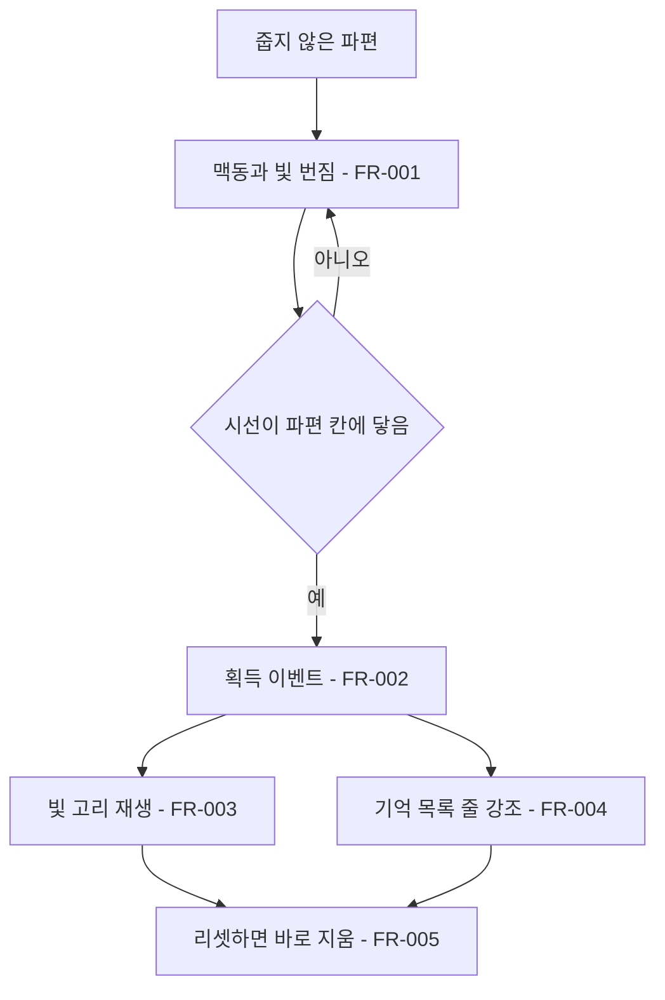

# 파편 가시성과 획득 피드백

## 1. 개요

- 목적: 미로 속 파편이 눈에 잘 띄게 하고, 파편을 주운 순간을 플레이어가 바로 알아차리게 한다.
- 대상: 플레이어, 연출 값을 조절하는 제작자

## 2. 범위

- 포함:
  - 파편 본체의 마름모 모양과 밝기 맥동, 마름모 후광
  - 파편을 주운 자리에서 퍼지는 빛 고리
  - 기억 목록에서 새로 얻은 파편 줄 강조
- 제외:
  - 시선 점보다 큰 본체
  - 소리
  - 말풍선, 읽기 상태, 부담감, 깜빡임, 이동 규칙 변경
  - 문구 추가

## 3. 기술 방향

- 사용 기술/API: `LineRenderer`, 프로젝트의 `Shapes`, `IrisMaze.LineMaterial`, uGUI `Text`의 기존 기억 목록
- 핵심 방식: `MemoryFragment.Collected` 세터에서 false→true 전환을 이벤트로 알리고, 새 컴포넌트 `FragmentFeedback`이 빛 번짐과 고리를 Play 중에 만들어 그린다.
- 선택하지 않은 방식: `EyeMazeDirector.CheckFragment()`에 호출을 추가하는 방식은 대화·깜빡임 코드와 같은 파일을 고쳐야 하므로 사용하지 않는다.
- 외부 의존성: `IrisMaze`, `MazeLayer`, `EyeMazeUI`

## 4. 구조

| 구분 | 이름 | 역할 |
|------|------|------|
| 클래스 | MemoryFragment | 맥동을 그리고 획득 이벤트를 낸다 |
| 클래스 | FragmentFeedback | 빛 번짐과 획득 고리를 만들고 재생하고 지운다 |
| 클래스 | EyeMazeUI | 기억 목록의 새 파편 줄을 강조한다 |
| 씬 | EyeMaze | `FragmentFeedback` 컴포넌트 1개를 가진다 |

- 오브젝트 구성: `FragmentFeedback`을 `EyeMaze` 씬의 오브젝트 하나에 붙인다. 파편별 씬 변경은 없다. 고리는 파편이 속한 층의 자식으로 만든다.
- 클래스 간 관계: `FragmentFeedback` → `MemoryFragment` 획득 이벤트 구독, `EyeMazeUI` → `MemoryFragment` 획득 이벤트 구독
- 실행 순서 의존성: 해당 없음
- 기존 코드와의 접점: `MemoryFragment.Collected`, `MemoryFragment.Update()`, `EyeMazeUI`의 기억 목록 표시

## 5. 동작 플로우차트

## 6. 요구사항

- FR-001: Play Mode에서 파편이 줍지 않은 상태일 때 `MemoryFragment`는 `_pulseSeconds` 주기로 맥동하는 밝기로 층 회전과 관계없이 기울지 않는 마름모 본체를 그리고, `FragmentFeedback`은 본체 뒤에 투명도가 같은 주기로 맥동하는 파편 색의 마름모 후광을 그린다.
- FR-002: `MemoryFragment.Collected`가 Play Mode에서 false에서 true로 바뀔 때 `MemoryFragment`는 획득 이벤트를 한 번 낸다.
- FR-003: 획득 이벤트를 받을 때 `FragmentFeedback`은 파편 자리에서 파편 색 고리를 `_ringSeconds` 동안 넓히며 투명하게 한다.
- FR-004: 획득 이벤트를 받을 때 `EyeMazeUI`는 기억 목록의 새 파편 줄을 `_highlightSeconds`에 걸쳐 원래 색에서 파편 색으로 바꿨다가 다시 원래 색으로 되돌린다.
- FR-005: `ResetAll`이나 손님 전환이 일어날 때 `FragmentFeedback`과 `EyeMazeUI`는 재생 중인 고리와 줄 강조를 바로 지운다.

### 상태와 데이터

| 이름 | 타입 | 설명 | 초기값 |
|------|------|------|--------|
| `MemoryFragment` 획득 이벤트 | event | 파편을 주운 순간 알리는 이벤트 | 구독 없음 |
| `_activeRings` | List | `FragmentFeedback`이 재생 중인 고리 | 빈 목록 |
| `_highlightT` | float | `EyeMazeUI`의 줄 강조 남은 시간(초) | 0 |

### 예외 및 경계 조건

- 파편 본체 크기: 마름모 대각선은 `RingWidth × 0.46`이고, 맥동해도 시선 점 지름보다 커지지 않는다.
- 대화 중과 눈물 연출 중: 맥동과 후광에도 기존 `WallAlpha`, `FocusAlpha`를 곱한다.
- 파편 위치: 층의 회전을 따라가되 Play Mode에서는 메인 카메라 렌더 텍스처(480×270)의 픽셀 중심에 맞춘다. 층 회전 자체는 바꾸지 않는다.
- 바깥 후광: `_outerGlowAlpha`가 0이면 보이지 않는다.
- 에디트 모드: 맥동, 후광, 기울기 고정, 픽셀 맞춤, 이벤트, 고리, 강조가 모두 일어나지 않는다. 파편 Transform은 Play 중에만 바뀌고 씬에 저장되지 않는다.
- `ResetAll`의 `Collected = false` 대입: 이벤트를 내지 않는다.
- 연출 전체: 말풍선, `_reading`, 부담감, 깜빡임 타이머, 이동 입력을 바꾸지 않는다.
- 파편을 읽다가 바로 닫아 깜빡임이 이어짐: 고리는 층을 따라가며 끝까지 재생하고, 표시 오프셋은 건드리지 않는다.
- 파편을 읽고 닫을 때 벽 재생성(스펙 001 FR-003): 시선이 있는 층은 다시 만들어지지 않으므로 고리에 영향이 없다.

## 7. Inspector 노출값

| 필드 | 타입 | 기본값 | 설명 |
|------|------|--------|------|
| `MemoryFragment._pulseSeconds` | float | 1.6 | 맥동 한 주기(초) |
| `MemoryFragment._pulseMinBrightness` | float | 0.7 | 맥동의 가장 어두운 밝기 배율 |
| `FragmentFeedback._glowSizeRatio` | float | 0.6 | 안쪽 후광 대각선 (`RingWidth` 배율) |
| `FragmentFeedback._glowAlpha` | float | 0.3 | 안쪽 후광 투명도 |
| `FragmentFeedback._outerGlowSizeRatio` | float | 1.3 | 바깥 후광 대각선 (`RingWidth` 배율) |
| `FragmentFeedback._outerGlowAlpha` | float | 0 | 바깥 후광 투명도 |
| `FragmentFeedback._glowPulseMinAlpha` | float | 0.45 | 맥동이 가장 어두울 때의 후광 투명도 배율 |
| `FragmentFeedback._glowPulseMinScale` | float | 1 | 맥동이 가장 작을 때의 후광 크기 배율 (1이면 크기 변화 없음) |
| `FragmentFeedback._ringSeconds` | float | 0.6 | 획득 고리 재생 시간(초) |
| `FragmentFeedback._ringEndRatio` | float | 1.5 | 고리가 끝날 때의 지름 (`RingWidth` 배율) |
| `EyeMazeUI._highlightSeconds` | float | 0.6 | 기억 목록 줄 강조 시간(초) |

## 8. 인수 조건

- FR-001: Play Mode로 눈을 들여다보면 줍지 않은 파편이 층이 돌아도 같은 마름모로 보이고, 약 1.6초 주기로 본체와 후광이 밝아졌다 어두워지며, 본체는 시선 점보다 커지지 않는다.
- FR-002: Play Mode에서 파편을 주울 때 고리와 줄 강조가 한 번만 일어나고, R로 리셋할 때와 Inspector에서 `_collected`를 바꿀 때는 일어나지 않는다.
- FR-003: 파편을 주운 자리에서 파편 색 고리가 0.6초 동안 퍼지며 사라지고, 층이 돌면 함께 돈다.
- FR-004: 파편을 주운 뒤 기억 목록의 새 줄이 원래 색에서 시작해 파편 색이 됐다가 0.6초 안에 원래 색으로 돌아온다.
- FR-005: 고리가 재생되는 동안 R을 누르면 고리와 줄 강조가 바로 사라진다.

## 9. 미결 사항

- 없음
