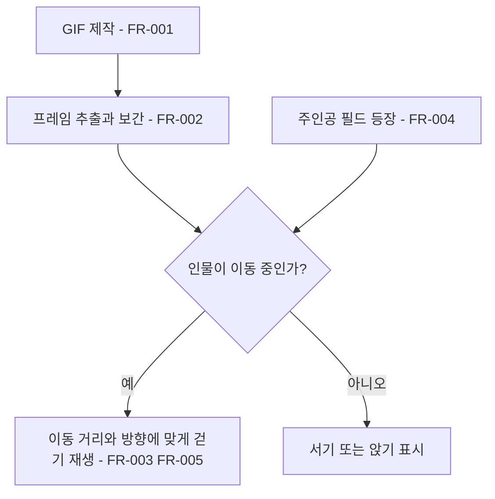

# 걷기 애니메이션과 주인공 외형

## 1. 개요

- 목적: 은재, 어머니, 지수의 걷기를 자연스럽게 개선하고 주인공을 필드 인물에 어울리는 임시 외형으로 표시한다.
- 대상: 플레이어와 씬을 편집하는 제작자.

## 2. 범위

- 포함:
  - 세 손님의 차분하고 짧은 보폭의 반복 걷기 GIF, 프레임 추출 및 중간 동작 보간.
  - 주인공의 임시 흑백 전신 외형과 서기·걷기 표시.
  - 필드 씬 연결과 실제 입력을 사용하는 Play Mode 확인.
- 제외:
  - 주인공 조작, 충돌 판정, 대사와 컷신 순서 변경.

## 3. 기술 방향

- 사용 기술/API: 애니메이션 GIF, Unity SpriteRenderer, 스프라이트 프레임, 기존 FieldNPC와 FieldPlayer.
- 핵심 방식: 인물별 연속 걷기 이미지를 제작해 반복 GIF로 만든 뒤 프레임을 추출한다. OpenCV 광학 흐름으로 인접 프레임 사이의 중간 동작을 보간하고 발 기준점을 정렬한 스프라이트로 임포트한다. 실제 이동 거리에 비례해 걷기 프레임을 진행하고 이동 방향을 반영한다. 주인공도 같은 화면에 어울리는 임시 캐릭터를 사용한다.
- 선택하지 않은 방식: 현재 두 장의 걷기 이미지와 서기 이미지만 반복하는 방식은 사용하지 않는다.
- 외부 의존성: 이미지 생성 도구, gifenc, OpenCV.js, pngjs, 기존 초상화 및 필드 씬.

## 4. 구조

| 구분 | 이름 | 역할 |
|------|------|------|
| 클래스 | FieldNPC | 손님의 이동 방향 및 걷기 상태를 스프라이트에 반영한다. |
| 클래스 | FieldPlayer | 주인공의 이동과 방향을 스프라이트에 반영한다. |
| 애셋 | 인물별 걷기 GIF 및 프레임 | 확인 가능한 걷기 원본과 게임에서 사용할 프레임을 제공한다. |
| 씬 | 기존 필드 씬 | 캐릭터별 스프라이트와 표시 설정을 보관한다. |

- 오브젝트 구성: 기존 인물 오브젝트의 SpriteRenderer와 Inspector 참조를 사용한다. 주인공의 SpriteRenderer와 이미지 참조를 씬에 지정한다.
- 클래스 간 관계: 기존 컷신은 FieldNPC를 호출하고, 기존 조작은 FieldPlayer의 이동을 호출한다. 각 클래스는 이동 상태에 맞는 이미지를 표시한다.
- 실행 순서 의존성: 기존 필드와 컷신의 초기화 순서를 유지한다.
- 기존 코드와의 접점: FieldNPC의 걷기 프레임 표시와 FieldPlayer의 표시·이동 상태.

## 5. 동작 플로우차트

## 6. 요구사항

- FR-001: 손님별 걷기 애셋을 제작할 때 짧은 보폭의 반복 걷기 GIF를 제공한다.
- FR-002: GIF를 게임용 애셋으로 변환할 때 프레임을 추출하고 중간 동작을 보간해 발 기준점을 맞춘다.
- FR-003: 손님 또는 주인공이 이동할 때 이동 방향에 맞는 걷기 동작이 반복된다.
- FR-004: 주인공이 필드에 표시될 때 다른 인물과 어울리는 임시 전신 외형이 보인다.
- FR-005: 인물의 이동 속도가 달라질 때 걷기 주기는 실제 이동 거리에 비례해 진행된다.

### 상태와 데이터

| 이름 | 타입 | 설명 | 초기값 |
|------|------|------|--------|
| 표시 프레임 | 정수 | 걷기 주기의 현재 프레임 | 0 |
| 걷기 이동 거리 | 실수 | 현재 걷기 주기에서 이동한 거리 | 0 |

### 예외 및 경계 조건

- 걷기가 중단되면 서기 이미지로 돌아간다.
- 손님이 앉을 때 기존 좌석 위치와 착석 방향을 유지한다.
- 표시 애셋이 없는 기존 오브젝트는 기존 표시를 유지한다.

## 7. Inspector 노출값

| 필드 | 타입 | 기본값 | 설명 |
|------|------|--------|------|
| 이미지 렌더러 | SpriteRenderer | 비어 있음 | 각 인물의 모습을 표시한다. |
| 서기 및 걷기 이미지 | Sprite 및 Sprite 배열 | 비어 있음 | 인물별 자세와 걷기 프레임이다. |
| 걷기 주기 거리 | float | 0.65 | 걷기 한 주기 동안 이동할 거리다. |

## 8. 인수 조건

- FR-001: 세 손님의 GIF가 각각 짧은 보폭으로 반복되는 것을 확인한다.
- FR-002: 추출 및 보간된 프레임을 확인하고 움직이는 동안 발 높이가 크게 흔들리지 않는지 확인한다.
- FR-003: Play Mode에서 손님 입장과 주인공 좌우 이동을 직접 조작해 방향과 걷기 동작을 확인한다.
- FR-004: Play Mode에서 주인공의 임시 외형과 정지 상태를 확인한다.
- FR-005: 서로 다른 속도로 같은 거리를 이동할 때 걷기 주기가 같은 비율로 진행되는지 확인한다.

## 9. 미결 사항

- 없음
