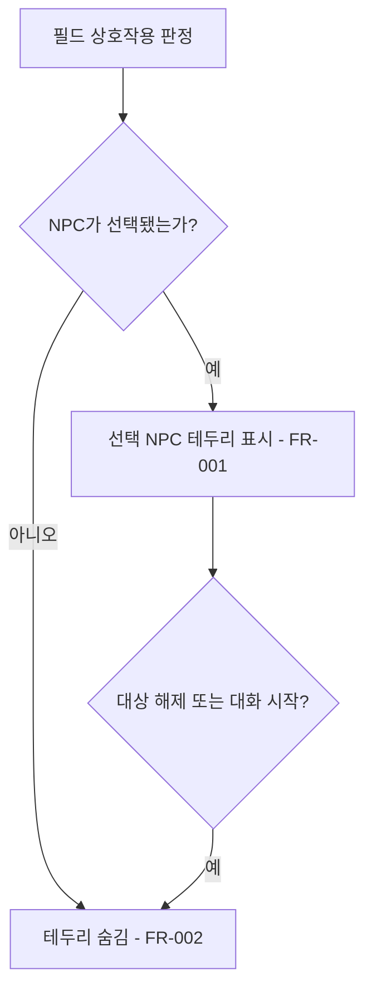

# NPC 상호작용 테두리

## 1. 개요

- 목적: 플레이어가 말을 걸 수 있는 NPC를 화면에서 알아보기 쉽게 표시한다.
- 대상: 필드에서 NPC와 상호작용하는 플레이어.

## 2. 범위

- 포함:
  - 대화 대상 NPC의 스프라이트 외곽에 색상 테두리 표시.
  - 상호작용 대상이 변경되거나 대화 및 컷신이 시작될 때 표시 갱신.
- 제외:
  - 대화 내용, 상호작용 거리, NPC 이동 및 플레이어 조작 변경.
  - 문과 단서의 표시 변경.

## 3. 기술 방향

- 사용 기술/API: Unity SpriteRenderer, 스프라이트용 머티리얼과 셰이더, 기존 GameFlow.Nearest.
- 핵심 방식: 기존 상호작용 대상으로 선택된 NPC의 스프라이트 알파 경계를 따라 테두리를 표시하고, 선택이 해제되면 일반 표시로 돌아간다. 각 스프라이트의 실제 실루엣을 따른다.
- 선택하지 않은 방식: 캐릭터 전체의 색을 바꾸거나 별도의 사각형을 그리지 않는다.
- 외부 의존성: 기존 GameFlow, FieldNPC, 스프라이트 텍스처.

## 4. 구조

| 구분 | 이름 | 역할 |
|------|------|------|
| 클래스 | GameFlow | 기존 상호작용 대상 선택 결과를 제공한다. |
| 클래스 | FieldNPC | 현재 선택 상태에 맞춰 자신의 테두리를 표시한다. |
| 셰이더 및 머티리얼 | NPC 테두리 | 스프라이트의 알파 경계에 색상을 표시한다. |
| 씬 | 기존 필드 씬 | NPC의 테두리 설정을 보관한다. |

- 오브젝트 구성: 기존 NPC의 SpriteRenderer와 테두리 머티리얼을 연결한다.
- 클래스 간 관계: FieldNPC는 GameFlow의 상호작용 대상 상태를 확인해 표시를 바꾼다.
- 실행 순서 의존성: 대상 판정 뒤에 테두리 표시를 갱신한다.
- 기존 코드와의 접점: GameFlow.Nearest, FieldNPC의 스프라이트 표시.

## 5. 동작 플로우차트

## 6. 요구사항

- FR-001: 필드에서 NPC가 현재 상호작용 대상으로 선택되면 해당 NPC의 외곽에 테두리를 표시한다.
- FR-002: NPC가 현재 상호작용 대상이 아니거나 대화·컷신 중이면 해당 NPC의 테두리를 숨긴다.

### 상태와 데이터

| 이름 | 타입 | 설명 | 초기값 |
|------|------|------|--------|
| 대상 여부 | bool | 현재 NPC가 상호작용 대상으로 선택되었는지 | false |

### 예외 및 경계 조건

- NPC가 화면에 없거나 비활성 상태면 테두리를 표시하지 않는다.
- NPC가 아닌 문과 단서는 기존 표시를 유지한다.

## 7. Inspector 노출값

| 필드 | 타입 | 기본값 | 설명 |
|------|------|--------|------|
| 테두리 색 | Color | 밝은 청록색 | 선택된 NPC의 외곽 색이다. |
| 테두리 두께 | float | 2픽셀 | 월드 렌더링 화면 기준 테두리 두께다. |

## 8. 인수 조건

- FR-001: 필드에서 NPC에 가까이 가 상호작용 안내가 나타나면 그 NPC의 실루엣에 테두리가 표시된다.
- FR-002: NPC에게서 멀어지거나 대화·컷신을 시작하면 테두리가 사라진다.

## 9. 미결 사항

- 없음
