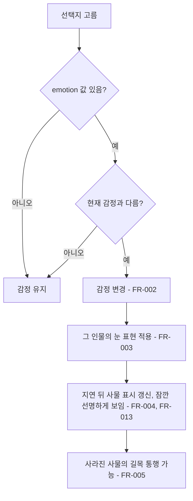
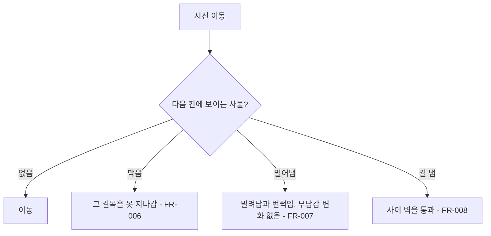

# 감정 상태와 미로 사물

## 1. 개요

- 목적: 선택지에 따라 내담자의 감정이 바뀌고, 그 감정이 인물마다 다른 눈 표현으로 드러난 뒤 미로 안에 그 인물의 사물과 장애물이 나타나거나 사라지게 하여 대화와 미로를 잇는다.
- 대상: 플레이어, 제작자(대사 CSV와 씬에 감정과 사물을 배치하는 사람)

## 2. 범위

- 포함:
  - 내담자의 현재 감정 상태 하나를 보관하고 선택지로 바꾸는 기능
  - 감정이 바뀔 때 눈이 먼저 변하고 이어서 미로가 변하는 순서
  - 인물마다 따로 정하는 감정별 눈 표현(눈꺼풀, 홍채 색조, 동공 떨림, 눈물, 시선 피함)
  - 감정에 따라 나타나고 사라지는 미로 사물(지나갈 수 없는 사물, 밀어내는 사물, 길을 내는 사물)
  - 인물 기본 지형용 사물(감정과 무관하게 처음부터 놓이는 사물)
  - 대사 CSV의 `emotion` 열
- 제외:
  - 사물을 조작해 푸는 작은 퍼즐(예: 건반 칸을 밟아 다리 놓기). 별도 스펙으로 다룬다.
  - 회상 재연과 회상 뒤 감정 변화(스펙 016)
  - 기억 잇기(스펙 017)
  - 신뢰와 동공으로 열리는 기존 문(`MazeGate`)의 조건 변경
  - 감정에 따른 동공 크기 변화. 동공 크기는 기존 `dilation` 수치만 바꾼다.
  - 사물에 닿았을 때의 부담감 변화. 부담감은 스펙 005와 스펙 007의 규칙만 따른다.
  - 지수의 사물 목록과 감정별 배치, 감정별 눈 표현 값, 선택지의 `emotion` 값. 이 스펙의 기능을 구현한 뒤 콘텐츠 작업으로 만든다.
  - 은재의 사물 목록과 감정별 배치, 감정별 눈 표현 값, 선택지의 `emotion` 값. 지수와 같은 방식의 콘텐츠 작업으로 만든다. 팀원이 쓴 대사 글은 바꾸지 않고 `emotion` 칸만 채운다.

## 3. 기술 방향

- 사용 기술/API: Unity `MonoBehaviour`, 기존 CSV 로더(`Csv`, `DialogueScript`)
- 핵심 방식: 감정은 수치가 아닌 열거형 상태 하나로 둔다. 선택지 행의 `emotion` 열 값이 있으면 그 감정으로 바꾼다. 감정이 바뀌면 `EyeMazeDirector`가 그 인물의 `ClientCase`에 저장된 감정별 눈 표현(`EmotionLook`)을 먼저 적용하고, `_emotionMazeDelay`초 뒤 미로 사물의 표시 여부를 바꾼다. 같은 감정이라도 인물마다 `EmotionLook` 값이 달라 눈이 다르게 변한다. 사물은 고리와 칸 좌표를 가진 컴포넌트이며 자신이 보일 감정 목록을 가진다.
- 이동 판정: 시선은 칸 단위가 아니라 연속 좌표로 움직인다. `EyeMazeDirector.ResolveRadial()`, `ResolveAngular()`, `CanCrossArc()`가 `IrisMaze.IsArcOpen()`, `IsRadialOpen()`으로 벽을 확인하는 자리에서 사물도 함께 확인한다. 막는 사물은 칸이 아니라 두 칸 사이의 면(길목) 하나를 맡고, 보이는 동안 그 면을 닫힌 것으로 다룬다. `길 냄` 사물은 닫힌 벽 하나를 맡아 보이는 동안 그 벽 오브젝트를 꺼서 연다. 맡은 면은 자기 층 기준 sector로 저장하고 층의 `Offset`을 더해 화면 기준 sector로 비교한다.
- 눈 표현 전달: `ClientTearCue`가 매 프레임 `Pupil.Tremble`과 `EyeVisual.TearLevel`을 덮어쓰므로 감정 값은 같은 프로퍼티에 쓰지 않는다. `Pupil`에 감정용 입력(`EmotionTrembleDistance`, `EmotionTrembleSpeed`, `EmotionShift`)을, `EyeVisual`에 감정용 입력(`EmotionClosed`, `EmotionTint`, `EmotionTearLevel`)을 추가한다. `Pupil`과 `EyeVisual`은 그릴 때 기존 값과 감정용 값 중 큰 쪽을 쓴다. 떨림과 시선 피함은 기존 떨림처럼 `Transform` 위치에만 더하고 심연 판정에는 쓰지 않는다.
- 사물 그리기: `MazeProp`은 `SpriteRenderer`로 그리고 위치는 `IrisMaze.CellLocal(ring, sector)`로 정한다. 투명도는 `MemoryFragment.MazeColor`와 같은 식(`WallAlpha`, `FocusAlpha`)을 따라 대화 중에는 흐려진다. `sortingOrder`는 파편(7)보다 아래인 6이다.
- 선택하지 않은 방식: 감정을 0~1 게이지로 두지 않는다. 감정 이름을 화면에 글자로 표시하지 않는다. 감정에 따라 미로 벽 자체를 다시 만들지 않는다(벽 변화는 스펙 010의 깜빡임에만 둔다). 사물로 시간 제한을 걸지 않는다. 모든 인물이 같은 감정 표현을 쓰도록 표현 값을 `EyeMazeDirector` 한 곳에 두지 않는다.
- 외부 의존성: `EyeMazeDirector`, `IrisMaze`, `MazeLayer`, `EyeVisual`, `Pupil`, `GazeCursor`, `ClientCase`, `ClientTearCue`, `DialogueScript`, `DialogueNode`, 스펙 007(밀려남), 스펙 011(눈물과 동공 떨림), 스펙 014(대사 편집기의 열 목록)

## 4. 구조

| 구분 | 이름 | 역할 |
|------|------|------|
| 열거형 | `ClientEmotion` | 평온, 경계, 불안, 슬픔, 안도 |
| 클래스 | `EmotionLook` | 한 감정의 눈 표현 값 묶음(직렬화 클래스) |
| 클래스 | `ClientCase` | 시작 감정과 감정별 `EmotionLook` 목록을 가진다 |
| 클래스 | `MazeProp` | 미로 칸에 놓이는 사물. 종류, 좌표, 보일 감정 목록을 가진다 |
| 열거형 | `MazePropKind` | 막음, 밀어냄, 길 냄, 다가가면 막음 |
| 클래스 | `EyeMazeDirector` | 현재 감정을 보관하고 전환 순서를 진행한다 |
| 클래스 | `EyeVisual`, `Pupil` | 전달받은 눈 표현 값을 그린다 |
| 클래스 | `DialogueNode`, `DialogueScript` | 선택지의 `emotion` 값을 읽어 보관한다 |
| 씬 | `EyeMaze` | 인물별 미로 층 아래에 `MazeProp` 오브젝트를 둔다 |

- 오브젝트 구성: 인물마다 층별 사물 묶음 오브젝트를 해당 `MazeLayer` 아래에 두고 `ClientCase._propGroups`에 등록한다. `MazeProp`은 그 묶음의 자식 오브젝트에 붙인다. 위치는 `Ring`, `Sector`로 정하고 층 회전을 따라간다. 파편 묶음(`_fragmentGroups`)과는 따로 둔다.
- 클래스 간 관계: `EyeMazeDirector`가 `ClientCase`에서 현재 감정의 `EmotionLook`을 받아 `EyeVisual`과 `Pupil`에 값을 전달한다. `EyeMazeDirector`가 `MazeProp` 목록을 참조해 표시 여부를 바꾸고, 이동 판정에서 사물의 종류를 확인한다. `MazeProp`은 다른 클래스를 호출하지 않는다.
- 실행 순서 의존성: `EyeMazeDirector`가 들여다보기를 시작할 때 현재 인물의 `MazeProp` 목록을 모으고 현재 감정에 맞춰 표시 여부를 정한다. 눈 표현 값은 `ClientTearCue.Tick()` 뒤에 합쳐 전달한다.
- 기존 코드와의 접점: `EyeMazeDirector`의 선택지 적용 처리, 이동 판정, `ResetAll()`. `DialogueNode`의 선택지 데이터. `DialogueScript`의 CSV 읽기. `EyeVisual`, `Pupil`의 표현. `ClientTearCue`가 쓰는 `Pupil.Tremble`, `EyeVisual.TearLevel`. `EyeMazeDirector.LoadCase()`의 묶음 켜고 끄기. 대사 편집기의 열 목록 세 곳(`DialogueEditorFormat.cs`의 전체 열 목록과 dialogue 단계의 `ItemColumns`, `DialogueData.cs`의 새 파일 열 목록)과 스펙 014의 머리글 목록.

## 5. 동작 플로우차트

## 6. 요구사항

- FR-001: 손님을 불러올 때(`LoadCase()`) `EyeMazeDirector`는 현재 인물의 감정을 그 인물의 `_startEmotion`으로 둔다. 들여다보기를 시작하거나 Q로 자리를 떠났다 같은 손님과 다시 만날 때는 감정을 유지하고, 사물 표시만 현재 감정에 맞춘다.
- FR-002: 선택지를 고르고 그 선택지의 `emotion` 값이 현재 감정과 다를 때 `EyeMazeDirector`는 현재 감정을 그 값으로 바꾼다.
- FR-003: 감정이 바뀔 때 `EyeMazeDirector`는 현재 인물 `ClientCase`의 그 감정 `EmotionLook` 값(눈꺼풀 닫힘, 홍채 색조, 동공 떨림 거리와 빠르기, 눈물 수위, 시선 피함)을 `_emotionEyeSeconds`초에 걸쳐 `EyeVisual`과 `Pupil`에 적용한다.
- FR-004: 눈 표현 적용이 시작되고 `_emotionMazeDelay`초가 지났을 때 `EyeMazeDirector`는 각 `MazeProp`을 새 감정에서 보일지에 따라 `_propFadeSeconds`초에 걸쳐 나타내거나 사라지게 한다.
- FR-005: 사물이 사라지기 시작할 때 `EyeMazeDirector`는 그 사물을 이동 판정에서 제외한다.
- FR-006: 보이는 `막음` 사물, 또는 뒤집힌 `다가가면 막음` 사물이 맡은 길목을 시선이 지나가려 할 때 `EyeMazeDirector`는 그 이동을 막는다.
- FR-007: 보이는 `밀어냄` 사물이 맡은 길목을 시선이 지나가려 할 때 `EyeMazeDirector`는 스펙 007 FR-002~FR-004의 밀려남과 FR-008의 번쩍임을 시작한다. `_bumpEnabled`가 꺼져 있어도 일어나며, 부담감과 초점 요동은 바꾸지 않는다.
- FR-008: `길 냄` 사물이 보이는 동안 `MazeProp`은 맡은 벽 오브젝트를 꺼서 양쪽으로 지나갈 수 있게 하고, 그 자리에 통로 방향으로 `_staffColor`의 오선 다섯 줄을 그린다. 사물 그림은 열린 틈을 비워 두도록 작게 줄여 틈 한쪽 가장자리에 둔다. 사물이 사라지기 시작하면 벽을 다시 켠다.
- FR-009: `MazeProp`의 보일 감정 목록이 비어 있을 때 그 사물은 감정과 무관하게 항상 보인다(인물 기본 지형).
- FR-010: `ResetAll()`이 호출될 때 `EyeMazeDirector`는 감정을 `_startEmotion`으로 되돌리고 눈 표현과 사물 표시를 그에 맞춘다.
- FR-011: 감정의 눈 표현과 스펙 011의 휴식 신호가 같은 값(동공 떨림, 눈물 수위)을 함께 바꾸려 할 때 `EyeMazeDirector`는 두 값 중 큰 값을 적용한다.
- FR-012: 눈을 들여다보는 동안 `EyeMazeDirector`는 시선 피함을 0으로 적용하고, 대화로 돌아오면 `_emotionEyeSeconds`초에 걸쳐 현재 감정의 값으로 되돌린다.
- FR-013: 사물이 나타나거나 사라지는 `_propFadeSeconds`초와 그 뒤 `_propRevealSeconds`초 동안 `MazeProp`은 미로의 흐려짐(`WallAlpha`, `FocusAlpha`)을 따르지 않고 선명하게 보이며, 그 뒤 `_propFadeSeconds`초에 걸쳐 미로와 같은 흐려짐으로 돌아간다.
- FR-014: `LoadCase()`가 호출될 때 `EyeMazeDirector`는 불러온 인물의 `_propGroups`만 켜고 다른 인물의 `_propGroups`는 끈다.
- FR-015: 대사 편집기는 `emotion` 열을 dialogue 단계의 선택지 속성으로 읽고 쓰며, 저장할 때 그 값을 지우지 않는다.
- FR-016: `LoadCase()`가 호출될 때와 씬에 저장된 상담으로 Play를 시작할 때 `EyeMazeDirector`는 그 인물의 모든 사물(감정과 무관)을 `IrisMaze.SetLayoutProps()`로 넘기고, Play Mode에서는 씬에 저장된 벽 대신 미로를 새로 만든다. `IrisMaze.Generate()`는 층마다 벽을 만든 뒤, 각 `막음`, `밀어냄`, `다가가면 막음` 사물에게 기준 칸(`_ring`, `_sector`)에 맞닿은 열린 면 가운데, 그 면과 이미 맡긴 면을 모두 막아도 그 면의 양쪽 칸이 `IrisMaze._maxDetourCells`칸 이하의 다른 길로 이어지고 앞서 맡긴 길목의 우회로도 끊지 않는 면을 길목으로 맡긴다(여럿이면 우회로가 가장 짧은 면). 그런 면이 없으면 기준 칸의 열린 면 하나를 고르고, 다른 사물이 맡지 않은 닫힌 벽 가운데 열었을 때 그 면의 양쪽 칸을 가장 짧게 잇는 벽 하나를 열어 우회로를 만든 뒤 맡긴다. 그래서 사물이 막은 길목 바로 둘레에 항상 돌아갈 길이 보인다. 단, 가장 바깥 고리(0번)와 그 안쪽 고리 사이의 원호 면은 길목으로 맡기지 않는다. 원호 면에 놓인 그림은 칸의 호 길이에 맞춰 커져 시작 고리의 통로를 덮고, 지나갈 수 있는 바깥 통로가 막힌 것처럼 보이기 때문이다. 각 `길 냄` 사물에게는 기준 칸에 맞닿은 닫힌 벽 하나를 맡기고, 없으면 같은 층 안에서 기준 칸으로부터 두 칸 거리까지 넓혀 찾는다. 깜빡임으로 다시 만든 층도 같고, 다시 만들지 않은 층의 사물은 맡은 면을 그대로 쓴다.
- FR-017: 길목이나 벽을 맡은 사물은 그 면의 가운데에 놓인다. `_fitToPassage`가 켜져 있으면 그림의 가로가 통로를 가로지르는 방향(방사 면은 반지름 방향, 원호 면은 원 둘레 방향)이 되도록 돌고, 그림 가로 길이가 통로 폭의 `_passageFill`배가 되도록 크기가 맞춰지되, 그림 세로(두께)가 고리 폭의 `_thicknessFill`배를 넘지 않게 더 줄여 옆 통로를 덮지 않는다. 길목을 막는 동안에는 막힌 길목 전체를 가로지르는 선(`_barrierColor`, `_barrierWidth`)을 그어 보이는 범위와 막히는 범위를 같게 한다. Play 중 길목을 맡지 못한 막음·밀어냄·다가가면 막음 사물은 막지 않으므로 그리지 않는다. 꺼져 있으면 회전과 크기는 씬 값을 쓴다. 막힌 곳을 따로 표시하는 테두리는 그리지 않는다.
- FR-018: `다가가면 막음` 사물은 보이기 시작할 때 뒤집히지 않은 상태로, 맡은 길목 옆 통로 가장자리에 `_idleScale`배 크기로 놓이며 길을 막지 않는다. 들여다보는 중 시선이 그 사물이 맡은 길목 가운데에서 `_flipDistance` 안으로 들어오면(뒤집히기 전 사물은 가장자리로 비켜나 있으므로 막힐 자리를 기준으로 잰다) `_flipSeconds`초에 걸쳐 뒤집히고(가로 크기가 0을 지났다가 다시 커짐), 0을 지날 때 그림이 `_flippedSprite`로 바뀌며(비어 있으면 `_sprite`에 `_flippedTint`를 곱함), 길목 가운데에서 전체 크기가 된다. 뒤집히기 시작한 순간부터 FR-006처럼 길목을 막는다. 뒤집힌 상태는 사물이 사라지거나 `SetShown()`으로 다시 놓일 때까지 유지된다.
- FR-019: `_dizzyRadius`가 0보다 큰 사물이 보이고 들여다보는 중 시선이 그 사물에서 `_dizzyRadius` 안에 있을 때, `EyeMazeDirector`는 그 사물에서 `_dizzyRadius` 안의 벽을 시선이 사물에 가까울수록, 벽이 사물에 가까울수록 크게(최대 `_dizzyAmplitude`), `_dizzySpeed` 빠르기로 흔들리게 그린다(`MazeWall.SetWobble()`). 흔들림은 그림만 바꾸고 이동 판정은 바꾸지 않는다. 시선이 멀어지거나 들여다보기를 멈추면 흔들림이 0이 된다.
- FR-020: 시선이 `막음`, `밀어냄`, 뒤집힌 `다가가면 막음` 사물이 맡은 길목에서 막혔고 그 사물의 `_blockedKey`가 비어 있지 않을 때 `EyeMazeDirector`는 `Strings.csv`에서 그 key의 글을 찾아 문구로 보여 준다. 글은 그 사물이 무엇인지와 내담자가 지금 왜 그 너머를 보여 주지 않는지를 주인공이 본 대로 적은 한두 문장이다.

구현 순서: 묶음 1 (FR-001, FR-002, FR-010, FR-015, 감정 상태와 데이터) → 묶음 2 (FR-003, FR-011, FR-012, 눈 표현) → 묶음 3 (FR-004 ~ FR-009, FR-013, FR-014, 미로 사물)

### 상태와 데이터

| 이름 | 타입 | 설명 | 초기값 |
|------|------|------|--------|
| `_emotion` | `ClientEmotion` | 현재 인물의 감정 | 인물의 `_startEmotion` |
| `MazeProp._visible` | `bool` | 지금 보이고 이동 판정에 쓰이는지 | 시작 감정 기준 |
| 대사 CSV `emotion` 열 | 문자열 | `calm`, `guarded`, `anxious`, `sad`, `relieved` 중 하나. 비우면 감정을 바꾸지 않는다 | 빈 값 |

### 예외 및 경계 조건

- `길 냄` 사물과 뒤집히기 전의 `다가가면 막음` 사물: 길을 막지 않으므로 FR-020의 글을 보이지 않는다.
- 같은 사물에 계속 막혀 있음: 이미 그 글이 문구 줄에 있으면 다시 쓰지 않아 글자가 처음부터 다시 찍히지 않는다.
- 사물에 막힘과 부담감: 사물에 막혀도 부담감은 오르지 않고 스펙 007의 접촉 횟수에도 넣지 않는다.
- `_blockedKey`가 `Strings.csv`에 없는 key: 글을 보이지 않는다.
- 시선이 서 있는 칸에 `막음` 사물이 새로 나타남: 사물을 나타내되 시선은 그 칸에 그대로 두고, 그 칸에서 나가는 이동은 허용한다.
- 감정 전환 연출 중 다시 감정이 바뀜: 진행 중인 전환을 끝 상태로 건너뛰고 새 전환을 시작한다.
- 이미 한 좋은 말을 다시 고름: 스펙 004 FR-008처럼 반응이 반복되지 않으므로 감정도 바꾸지 않는다.
- `emotion` 열에 정해지지 않은 값: CSV 검사 오류로 보고하고 감정을 바꾸지 않는다.
- 인물의 `_emotionLooks`에 현재 감정의 항목이 없음: 눈 표현을 기본값(눈꺼풀 닫힘 0, 색조 없음, 떨림 0, 눈물 0, 시선 피함 0)으로 적용한다.
- 감정의 눈꺼풀 닫힘과 깜빡임(스펙 006): 깜빡임이 진행되는 동안은 두 값 중 큰 값으로 그리고, 깜빡임이 끝나면 감정의 값으로 돌아온다.
- 감정의 동공 떨림과 `dilation`: 떨림은 동공의 위치만 흔들고 크기는 바꾸지 않는다.
- 시선 피함의 크기: `_gazeShift`의 길이가 `_gazeShiftMax`를 넘으면 `_gazeShiftMax`로 줄여 적용한다. 주인공이 동공을 마주 보는 것이 조작이므로 동공이 홍채 가운데에서 조금 비켜난 정도로만 쓴다.
- 시선 피함을 쓰는 감정: 콘텐츠 작업에서 경계 감정에만 값을 넣고 나머지 감정은 (0, 0)으로 둔다.
- 휴식 신호(스펙 011)와 감정의 눈물이 함께 보임: 휴식 신호는 스펙 011의 대사와 안내 문구로 구분한다.
- 에디트 모드: 사물은 모두 보이게 그리고 감정 전환은 일어나지 않는다.
- 깜빡임 회전(스펙 006, 009): 사물은 자신이 속한 층의 회전을 따라간다.
- 맡길 면이 모자람: 기준 칸 주변 면을 다른 사물이 모두 맡았으면 그 사물은 길목 없이 기준 칸 가운데에 놓이고 길을 막지 않으며, 경고를 남긴다.
- 시작 고리의 `막음` 사물: 은재의 피아노는 가장 바깥 고리(0번)에 두지 않고 같은 층의 1번 고리에 둔다. 시작하자마자 걷는 바깥 통로가 막힌 길로 읽히지 않게 하기 위해서다.
- 파편이 있는 칸: `막음` 사물과 파편을 같은 칸에 둘 수 없다. 플래그 관리자 검사에서 오류로 보고한다.

## 7. Inspector 노출값

| 필드 | 타입 | 기본값 | 설명 |
|------|------|--------|------|
| `ClientCase._startEmotion` | `ClientEmotion` | 평온 | 상담 시작 때의 감정 |
| `ClientCase._emotionLooks` | `EmotionLook[]` | 빈 배열 | 이 인물의 감정별 눈 표현 |
| `ClientCase._propGroups` | `List<GameObject>` | 빈 목록 | 이 인물의 미로 사물 묶음들 (층마다 하나) |
| `EyeMazeDirector._gazeShiftMax` | `float` | 0.05 | 시선 피함으로 동공이 비켜날 수 있는 최대 거리 |
| `EyeMazeDirector._propRevealSeconds` | `float` | 1.5 | 사물이 바뀐 뒤 선명하게 보이는 시간 |
| `EmotionLook._emotion` | `ClientEmotion` | 평온 | 이 표현이 쓰이는 감정 |
| `EmotionLook._lidClosed` | `float` (0~1) | 0 | 눈꺼풀이 닫힌 정도 |
| `EmotionLook._irisTint` | `Color` | 투명 | 홍채에 섞는 색. 알파가 섞는 세기다 |
| `EmotionLook._trembleDistance` | `float` | 0 | 동공이 떨리는 거리. 0이면 떨지 않는다 |
| `EmotionLook._trembleSpeed` | `float` | 28 | 동공이 떨리는 빠르기 |
| `EmotionLook._tearLevel` | `float` (0~1) | 0 | 눈물 수위 |
| `EmotionLook._gazeShift` | `Vector2` | (0, 0) | 동공이 한쪽으로 쏠리는 거리와 방향 |
| `EyeMazeDirector._emotionEyeSeconds` | `float` | 1.0 | 눈 표현이 바뀌는 시간 |
| `EyeMazeDirector._emotionMazeDelay` | `float` | 1.0 | 눈이 변하기 시작한 뒤 미로가 변하기까지의 시간 |
| `EyeMazeDirector._propFadeSeconds` | `float` | 0.6 | 사물이 나타나고 사라지는 시간 |
| `MazeProp._kind` | `MazePropKind` | 막음 | 사물의 종류 |
| `MazeProp._ring`, `_sector` | `int` | 0 | 놓이는 고리와 칸 |
| `MazeProp._showIn` | `ClientEmotion[]` | 빈 배열 | 보일 감정 목록. 비우면 항상 보임 |
| `IrisMaze._maxDetourCells` | `int` | 6 | 사물이 막은 길목의 양쪽 칸을 잇는 우회로의 최대 칸 수 || `MazeProp._fitToPassage` | `bool` | false (씬의 사물은 켬) | 맡은 면의 통로 폭에 맞춰 돌리고 크기를 맞출지 |
| `MazeProp._passageFill` | `float` | 0.9 | 그림 가로 길이를 통로 폭의 몇 배로 맞출지 |
| `MazeProp._staffColor` | `Color` | 흰색 반투명 | `길 냄` 사물이 그리는 오선 색 |
| `MazeProp._flipDistance` | `float` | 0.6 | `다가가면 막음` 사물이 뒤집히는 시선 거리 |
| `MazeProp._flipSeconds` | `float` | 0.35 | 뒤집히는 시간(초) |
| `MazeProp._idleScale` | `float` | 0.5 | 뒤집히기 전 크기 배율 |
| `MazeProp._flippedSprite` | `Sprite` | 없음 | 뒤집힌 뒤 그림 |
| `MazeProp._flippedTint` | `Color` | 어두운 회색 | 뒤집힌 그림이 없을 때 곱할 색 |
| `MazeProp._dizzyRadius` | `float` | 0 (은재 막음 사물은 1.2) | 어지러움 벽 흔들림이 닿는 거리. 0이면 끔 |
| `MazeProp._dizzyAmplitude` | `float` | 0.05 | 벽 흔들림 최대 폭 |
| `MazeProp._dizzySpeed` | `float` | 6 | 벽 흔들림 빠르기 |
| `MazeProp._blockedKey` | `string` | 빈 값 | 이 사물에 막혔을 때 보일 글의 `Strings.csv` key. 비우면 글을 보이지 않는다 |
| `MazeProp._sprite` | `Sprite` | 없음 | 사물 그림 |

## 8. 인수 조건

- FR-001: Play Mode에서 지수를 처음 만나 눈을 들여다보면 `_emotion`이 지수의 `_startEmotion` 값이고, 그 감정에서 보일 사물만 보인다. 선택지로 감정을 바꾼 뒤 다시 들여다봐도 바뀐 감정이 유지된다.
- FR-002: `emotion`이 `anxious`인 선택지를 고르면 Inspector의 `_emotion`이 불안으로 바뀐다. `emotion`이 빈 선택지를 고르면 바뀌지 않는다.
- FR-003: 감정이 바뀌면 눈 표현이 1초에 걸쳐 그 인물의 `EmotionLook` 값으로 바뀐다. 두 인물의 불안 `EmotionLook` 값을 다르게 넣으면 같은 불안에서 두 눈이 서로 다르게 보인다.
- FR-004: 눈이 변하기 시작하고 1초 뒤에 불안용 사물이 나타나고 이전 감정용 사물이 사라진다. 눈보다 미로가 먼저 변하지 않는다.
- FR-005: 사물이 사라지기 시작한 직후 그 칸으로 시선을 옮기면 들어가진다.
- FR-006: `막음` 사물이 놓인 길목은 지나갈 수 없고, 사물 그림이 통로를 가로질러 막고 있다.
- FR-007: `_bumpEnabled`가 꺼진 기본 설정에서 지수의 `밀어냄` 사물이 놓인 길목으로 가면 시선이 밀려나고 번쩍인다. 부담감 막대는 오르지 않고 미로가 흐려지지 않는다.
- FR-008: `길 냄` 사물이 보이는 동안 그 벽 자리에 오선이 그려지고 지나갈 수 있으며, 사물이 사라지면 벽이 돌아와 다시 막힌다.
- FR-009: `_showIn`을 비운 사물은 어떤 감정에서도 보인다.
- FR-010: R로 리셋하면 감정, 눈 표현, 사물이 상담 시작 때 상태로 돌아온다.
- FR-011: 눈물 수위 0.3인 슬픔 상태에서 휴식 신호가 시작되면 눈물이 휴식 신호의 수위까지 차오르고, 휴식 신호가 가라앉으면 0.3으로 돌아온다.
- FR-012: 시선 피함 값이 있는 감정에서 대화 중에는 동공이 조금 비켜나 있고, Space로 들여다보면 동공이 미로 한가운데에 있다. 시선을 거두면 1초에 걸쳐 다시 비켜난다.
- FR-013: 대화 중 선택지로 감정이 바뀌면 나타나거나 사라지는 사물이 흐린 미로 위에서 선명하게 보이고, 약 1.5초 뒤 미로와 같은 흐림으로 가라앉는다.
- FR-014: 지수 상담 중에는 지수의 사물만 보이고, 은재를 불러오면 지수의 사물이 꺼진다.
- FR-015: `emotion` 값이 있는 대사 CSV를 대사 편집기에서 열어 다른 칸을 고치고 저장해도 `emotion` 값이 남아 있다.
- FR-016: 어떤 감정에서든 은재와 지수의 미로에서 사물에 막혀 파편이나 다음 층 문에 닿을 수 없는 칸이 없다. 깜빡임으로 벽이 바뀐 뒤에도 같다. 은재의 미로에서 피아노 그림이 가장 바깥 고리의 통로를 덮지 않고, 깜빡임으로 벽이 바뀐 뒤에도 같다.
- FR-017: 주황 테두리 같은 표시 없이, 사물 그림만 보고도 그 길목이 막혀 있음을 알 수 있다. 막혀도 항상 다른 길로 돌아갈 수 있다.
- FR-018: 은재의 휴대폰은 처음에 통로 옆에 작게 놓여 지나갈 수 있고, 가까이 가면 뒤집히며 길목을 막아 다른 길로 돌아가야 한다. 멀어져도 돌아오지 않는다.
- FR-019: 은재의 피아노 가까이 가면 주변 벽이 흐물흐물 흔들리고, 흔들리는 동안에도 벽을 지나갈 수 있는지는 그대로다.
- FR-020: 은재가 경계 상태일 때 피아노가 막은 길목으로 시선을 밀면 문구 줄에 피아노가 무엇이고 왜 막는지를 적은 글이 나온다. 지수가 불안 상태일 때 밀어내는 사물에 닿으면 밀려나면서 그 사물의 글이 나온다.

## 9. 미결 사항

- 없음
