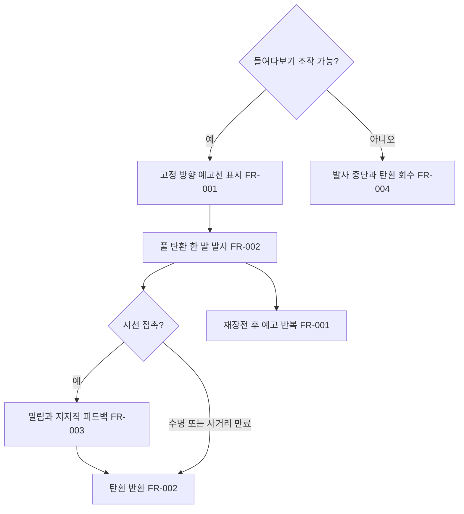

# Gunner 고정 포대와 탄환 풀링

## 1. 개요

- 목적: 미로 통로에서 발사 예고를 보고 재장전 중 통과하는 장애물을 제공한다. 탄환 프리팹을 오브젝트 풀로 재사용한다.
- 대상: 플레이어와 씬 제작자.

## 2. 범위

- 포함: 기존 Gunner 연결, 고정 방향 발사, 예고선, 재장전, 탄환 프리팹과 풀, 시선 피격, 드래그 배치 가능한 Gunner 프리팹.
- 제외: 추적 조준, 체력, 포대 파괴, 테스트 코드.

## 3. 기술 방향

- 사용 기술/API: MonoBehaviour, LineRenderer, UnityEngine.Pool.ObjectPool.
- 핵심 방식: Gunner가 예고 후 한 발을 대여해 발사한다. 탄환은 직선 이동하고 이동 구간과 시선의 거리를 검사한다. 피격, 사거리 또는 수명 만료 시 풀로 반환한다.
- 선택하지 않은 방식: 매 발사마다 Instantiate/Destroy, Rigidbody 기반 시선 충돌.
- 외부 의존성: IrisMaze, GazeCursor, EyeMazeDirector의 기존 충돌 피드백.

## 4. 구조

| 구분 | 이름 | 역할 |
|------|------|------|
| 클래스 | MazeGunner | 예고, 발사, 재장전과 풀 관리 |
| 클래스 | MazeBullet | 이동, 시선 접촉 판정과 반환 |
| 프리팹 | MazeBullet | 제작자가 편집 가능한 탄환 외형과 설정 |
| 프리팹 | Gunner | 발사점, 예고선과 풀 기준점을 포함한 재사용 포대 |
| 씬 | EyeMaze | 기존 Gunner에 컴포넌트와 참조 저장 |

- 오브젝트 구성: 기존 Gunner의 Transform과 외형을 보존하고 발사 컴포넌트와 예고용 LineRenderer를 연결한다. 탄환은 Assets/EyeMaze/Prefabs/MazeBullet.prefab으로 저장한다.
- 클래스 간 관계: MazeGunner → 풀 → MazeBullet → EyeMazeDirector 피격 진입점.
- 실행 순서 의존성: 풀 초기화를 마친 뒤 발사를 시작한다.
- 기존 코드와의 접점: EyeMazeDirector에 탄환 피격 진입점과 필요한 진행 상태 조회를 추가한다.

## 5. 동작 플로우차트

## 6. 요구사항

- FR-001: 조작 가능한 들여다보기 중 Gunner는 Inspector에 지정한 발사 기준점과 방향으로 예고, 단발 발사, 재장전을 반복한다.
- FR-002: 발사할 때 탄환 프리팹의 풀 인스턴스를 사용하고 피격 또는 수명·사거리 만료 시 반환한다.
- FR-003: 탄환 이동 구간이 시선에 닿으면 기존 벽 충돌에 준하는 밀림, 지지직과 부담감 증가를 한 번 적용한다.
- FR-004: 대화, 읽기, 깜빡임 연출, 종료 또는 비활성화로 조작이 중단되면 발사를 중단하고 활성 탄환을 회수하며 다음 조작 시 예고부터 시작한다.
- FR-005: 연결 시 기존 Gunner의 수동 배치와 외형을 보존하고 탄환 프리팹 및 조절값을 Inspector에서 편집할 수 있게 저장한다. Gunner도 프리팹으로 저장하며 발사점·예고선·풀 기준점은 프리팹 내부에 포함한다. 씬의 진행 제어와 시선은 실행 시 동일 미로 또는 동일 씬의 유일한 진행 제어에서 연결하며 Inspector 직접 지정도 지원한다. 진행 제어를 정할 수 없으면 경고 후 해당 포대만 중단한다. 발사된 탄환은 부모의 이동·회전·크기에 영향을 받지 않는 월드 좌표로 움직인다.

### 상태와 데이터

| 이름 | 타입 | 설명 | 초기값 |
|------|------|------|--------|
| 발사 단계 | enum | 대기, 예고, 재장전 | 대기 |
| 활성 탄환 | 컬렉션 | 현재 대여 중인 탄환 | 비어 있음 |

### 예외 및 경계 조건

- 빠른 탄환: 프레임 사이 이동 구간으로 접촉을 검사하여 시선을 관통하지 않게 한다.
- 풀 부족: 추가 인스턴스를 생성해 대여하고 이후 재사용한다.
- 벽: 탄환은 벽과 별도로 지정 사거리까지 직진한다. 첫 배치는 인접 통로 한 구간을 겨냥하도록 설정한다.
- Gunner가 저장된 씬에 없으면 실행 중인 에디터에서 오브젝트를 확인한 뒤 연결한다.

## 7. Inspector 노출값

| 필드 | 타입 | 기본값 | 설명 |
|------|------|--------|------|
| 발사 기준점 | Transform | Gunner | 위치와 로컬 오른쪽 방향을 발사 기준으로 사용 |
| 예고 시간 | float | 0.8초 | 발사 전 선 표시 시간 |
| 재장전 시간 | float | 1.5초 | 발사 후 대기 |
| 탄환 속도 | float | 2 | 초당 이동 거리 |
| 사거리 | float | 0.8 | 통로 한 구간 기준 초기값 |
| 탄환 수명 | float | 3초 | 최대 유지 시간 |
| 접촉 반지름 | float | 0.08 | 시선 접촉 허용 거리 |
| 풀 초기 수량 | int | 8 | 미리 생성할 탄환 수 |
| 참조와 외형 | 컴포넌트, 프리팹, 색상, 선 두께 | 씬 연결 | 미로, 시선, 진행 제어, 예고선과 탄환 외형 |

## 8. 인수 조건

- FR-001: Play Mode에서 예고선, 단발, 재장전 순서와 고정 방향 발사를 확인한다.
- FR-002: 반복 발사 후 Hierarchy의 탄환 인스턴스가 반환되고 재사용되는지 확인한다.
- FR-003: 탄환에 시선을 맞혀 밀림, 지지직, 부담감 증가가 한 번 적용되는지 확인한다.
- FR-004: 예고와 탄환 비행 중 들여다보기를 종료하거나 깜빡이면 탄환이 사라지고 복귀 시 예고부터 시작하는지 확인한다.
- FR-005: Gunner의 기존 배치를 유지하고 Inspector와 탄환 프리팹에서 수동 설정을 편집할 수 있는지 확인한다.

구현 및 확인 결과:

- FR-001: `MazeGunner.LateUpdate`, `BeginWarning`에서 예고, 발사, 재장전을 처리한다. Play Mode에서 발사 단계와 실제 프레임 진행을 확인했다.
- FR-002: `MazeGunner.Awake`, `CreateBullet`, `ReleaseBullet`과 `MazeBullet.LateUpdate`, `ReturnToPool`에서 미리 생성, 대여, 수명·거리 종료와 반환을 처리한다. 기본 설정 반복 발사 중 총 탄환 8개 유지와 회수를 확인했다.
- FR-003: `MazeBullet.LateUpdate`의 선분 접촉 판정과 `EyeMazeDirector.HitByBullet`로 밀려남·초점 요동·부담감을 처리한다. 실제 탄환에 시선을 겹쳐 씬 설정값인 부담감 0.015 증가를 확인했다. 벽 충돌 활성화 옵션과 독립적으로 적용한다.
- FR-004: `EyeMazeDirector.CanRunHazards`, `MazeGunner.ResetFire`, `OnDisable`, `OnDestroy`로 중단과 정리를 처리한다. 들여다보기 종료 시 활성 탄환 0개와 대기 상태를 확인했고 Play Mode 종료 시 신규 오류가 없었다.
- FR-005: `Assets/Scenes/EyeMaze.unity`의 기존 Gunner에 참조와 자식 Muzzle, Fire Warning을 저장했다. 기존 위치·회전·크기 보존을 확인했으며 `Assets/EyeMaze/Prefabs/MazeBullet.prefab`으로 탄환을 저장했다.
- FR-005 재사용 배치: `Assets/EyeMaze/Prefabs/Gunner.prefab`에 Muzzle, Fire Warning, Bullet Pool과 탄환 프리팹 참조를 저장했다. 씬 전용 Director·Cursor 참조는 프리팹에서 비우고 `MazeGunner.ResolveContext`로 실행 시 연결한다. 기존 씬 배치를 보존한 프리팹 인스턴스로 전환했다. Play Mode에서 추가 인스턴스를 배치하여 포대 2개의 연결 성공과 총 16개 탄환의 개별 풀 초기화, 종료 시 오류 0건을 확인했다. `MazeBullet.Launch`는 활성 탄환을 부모에서 분리하고 `DeactivateBullet`은 반환된 탄환을 해당 풀 기준점 아래로 돌려놓는다.

## 9. 미결 사항

- 없음
