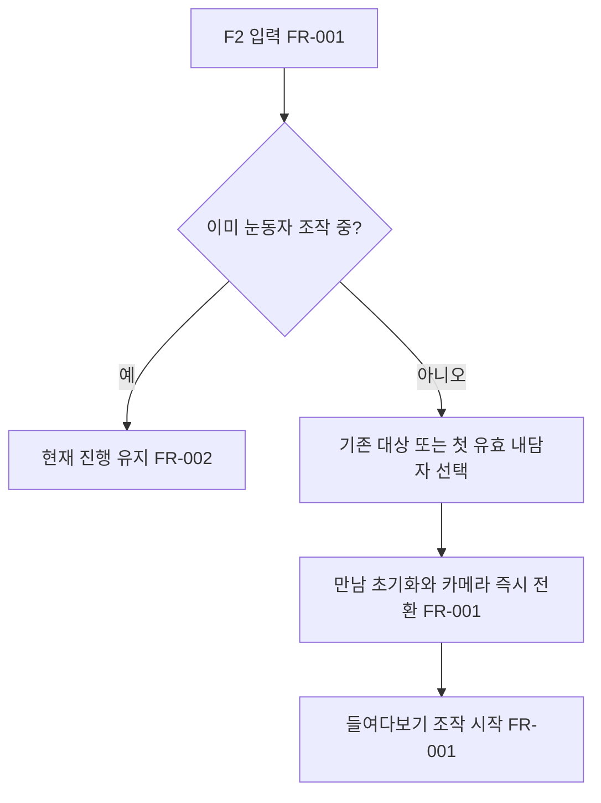

# F2 개발자 눈동자 진입

## 1. 개요

- 목적: 필드 이동과 대화를 건너뛰고 눈동자 미로를 빠르게 확인한다.
- 대상: 개발자.

## 2. 범위

- 포함: F2로 현재 EyeMaze 씬의 눈동자 미로 조작 화면에 즉시 진입.
- 제외: 별도 씬 생성, Gunner 구현, 일반 플레이 진입 흐름 변경.

## 3. 기술 방향

- 사용 기술/API: Unity Input System의 Keyboard, UNITY_EDITOR 및 DEVELOPMENT_BUILD 조건부 컴파일.
- 핵심 방식: GameFlow가 F2 입력을 받아 기존 만남 초기화와 카메라 전환을 사용한 뒤 EyeMazeDirector를 들여다보기 상태로 전환한다. 줌과 암전 대기는 생략하고 진행 중 독백을 숨기며 필드 컷신 컴포넌트는 해당 플레이 세션에서 중단한다.
- 선택하지 않은 방식: SceneManager로 현재 씬 재로드.
- 외부 의존성: GameFlow, EyeMazeDirector, ClientCase, FieldNPC.

## 4. 구조

| 구분 | 이름 | 역할 |
|------|------|------|
| 클래스 | GameFlow | 개발자 입력과 즉시 만남 진입 |
| 클래스 | EyeMazeDirector | 미로 조작 상태 진입 |

- 오브젝트 구성: 기존 씬 참조를 사용한다.
- 클래스 간 관계: GameFlow에서 기존 만남 진입 후 EyeMazeDirector의 시선 진입을 요청한다.
- 실행 순서 의존성: 만남 초기화를 먼저 완료하고 시선 조작을 시작한다.
- 기존 코드와의 접점: GameFlow.Update, EnterEncounterNow, EyeMazeDirector.ToggleGaze 및 필요 시 개발자 진입 메서드.

## 5. 동작 플로우차트

## 6. 요구사항

- FR-001: 에디터 Play Mode 또는 Development Build에서 F2를 누르면 현재 상대를 사용하고 상대가 없으면 첫 유효 ClientCase의 상대를 선택하여 줌·대화·암전 대기 없이 눈동자 미로 조작 화면으로 진입한다.
- FR-002: 이미 눈동자 조작 중 F2를 누르면 현재 미로 진행과 조작 상태를 유지한다.
- FR-003: 일반 배포 빌드에서는 F2 개발자 진입 입력을 처리하지 않는다.

### 상태와 데이터

해당 없음. 기존 만남 상태를 사용한다.

### 예외 및 경계 조건

- 유효한 상대가 없으면 상태를 변경하지 않고 개발자가 확인할 수 있는 경고를 남긴다.
- 대화나 전환 중 진입하면 기존 일시 대사와 전환 상태를 정리해 조작을 막지 않게 한다.
- 종료 상태에서 진입하면 해당 만남을 초기화하고 눈동자 조작을 시작한다.

## 7. Inspector 노출값

해당 없음. 기존 씬의 카메라와 만남 참조를 사용한다.

## 8. 인수 조건

- FR-001: Play Mode에서 필드, 대화, 화면 전환 중 각각 F2를 눌러 즉시 미로가 표시되고 시선을 움직일 수 있는지 확인한다.
- FR-002: 미로에서 시선을 이동한 뒤 F2를 다시 눌러 위치와 수집 진행이 유지되는지 확인한다.
- FR-003: 조건부 컴파일 범위를 확인해 일반 배포 빌드에서 개발자 입력 처리가 제외되는지 확인한다.

구현 및 확인 결과:

- FR-001: `GameFlow.Update`, `DebugEnterGaze`, `OpeningMonologue.DebugSkip`, `EyeMazeDirector.DebugStartGaze`에서 처리한다. Play Mode에서 F2 키 상태 이벤트를 입력하여 독백 재생 중 Field에서 Encounter/Gaze로 전환하고 암전 0, 입력 허용, 독백·컷신 중단과 미로 화면을 확인했다.
- FR-002: `GameFlow.DebugEnterGaze`의 초기 조건에서 이미 들여다보는 중이면 진행 초기화 없이 반환한다. Play Mode에서 F2 재입력 후 Gaze 유지와 탄환 풀 8개 유지를 확인했다.
- FR-003: F2 입력과 개발자 메서드를 `UNITY_EDITOR || DEVELOPMENT_BUILD`로 감쌌다. 조건부 컴파일 범위를 검토했으며 일반 배포 빌드 실행 검증은 수행하지 않았다.

## 9. 미결 사항

- 없음
