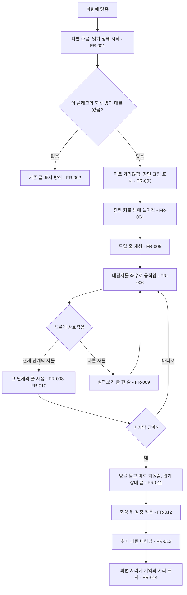

# 파편 회상 재연과 추가 파편

## 1. 개요

- 목적: 파편에 닿았을 때 글 몇 줄 대신 그 순간의 장면 그림이 나오고, 플레이어가 그 그림 속 방에 들어가 내담자가 되어 그때 한 행동을 직접 하게 한다. 회상이 끝난 뒤에는 내담자의 감정 변화와 추가 파편, 새 선택지로 이어지게 한다.
- 대상: 플레이어, 제작자(회상 대본을 쓰고 회상 방을 배치하는 사람)

## 2. 범위

- 포함:
  - 파편에 닿으면 미로가 가라앉고 장면 그림이 나오는 기능
  - 장면 그림에서 회상 방으로 들어가 내담자를 직접 움직이는 조작(필드와 같은 좌우 이동과 상호작용)
  - 방 안 사물에 상호작용하면 그 순간의 말과 일이 글로 나오는 단계 진행
  - 회상 대본 데이터(`Flashbacks.csv`)
  - 회상이 끝난 뒤의 내담자 감정 변화
  - 회상이 끝난 자리에 생기는 추가 파편
  - 회상을 본 파편 자리를 미로에 남기는 표시
  - 스펙 017의 연결 회상이 기존 회상 방을 다시 쓰고 사물만 더하는 구조
  - 필드 단서였던 내용(`clue_*`)을 파편과 추가 파편으로 옮길 수 있는 데이터 구조
- 제외:
  - 방을 옮겨 다니는 회상. 회상 한 편은 방 하나에서만 일어난다.
  - 회상 안의 분기. 플레이어는 내담자가 실제로 한 행동만 순서대로 한다.
  - 기억 잇기(스펙 017)
  - 감정에 따른 미로 사물(스펙 015)
  - 주인공의 독백이나 해설. 회상에는 그 순간에 있었던 말과 일만 넣는다.
  - 빨리감기(스펙 013). 회상은 조작 구간이므로 적용하지 않는다.
  - 지수의 회상 대본, 회상 방 배치, 그림. 이 스펙의 기능을 구현한 뒤 콘텐츠 작업으로 만든다. 그림은 Codex 기록 담당이 만들고, 기존 인물 초상과 외형이 다른 그림은 쓰지 않는다.
  - 은재의 회상 대본, 회상 방 배치, 그림. 지수와 같은 방식의 콘텐츠 작업으로 만든다. 단서 `clue_closed_piano`(닫힌 피아노)의 내용은 건반 치는 손가락 회상 뒤 나타나는 추가 파편 `eunjae_closed_piano`로 옮긴다.
  - `clue_counsel_form`(상담 신청서) 단서. 쓰지 않는다.

## 3. 기술 방향

- 사용 기술/API: Unity `MonoBehaviour`, uGUI `Image`와 `Text`(기존 만남 UI와 같은 글 컴포넌트. `Typewriter`가 `Text`만 받는다), 기존 CSV 로더(`Csv`), `Typewriter`, 기존 필드 조작 클래스(`FieldPlayer`, `FieldRoom`)
- 핵심 방식: 회상은 파편의 플래그에 묶인 방 하나와 단계 목록이다. 파편에 닿으면 `EyeMazeDirector`가 기존 파편 읽기 상태(`_reading`)로 들어가 이동, 부담감, 깜빡임, 밀려남을 멈추고 `FlashbackPlayer`에 재생을 맡긴다. `FlashbackPlayer`는 미로를 가라앉히고 그 방의 장면 그림을 보여 준 뒤, 진행 키를 받으면 카메라를 그 방으로 옮기고 방 안의 내담자(`FieldPlayer`)에게 이동 입력을 전달한다. 플레이어가 현재 단계의 사물(`FlashbackProp`)에 상호작용하면 그 단계의 대본 줄을 회상 글 칸에 순서대로 보여 준다. 마지막 단계가 끝나면 카메라와 미로를 되돌리고 완료를 알린다. 완료 때 `EyeMazeDirector`가 감정을 바꾸고 추가 파편을 나타낸다.
- 입력 나누기: 회상이 재생되는 동안 `FlashbackPlayer.IsPlaying`이 true다. 이 동안 `EyeMazeDirector.HandleInput()`의 읽기 상태 분기는 진행 키로 읽기를 끝내지 않고, `GameFlow.Update()`는 Q(자리 떠나기)를 처리하지 않는다. 글자가 찍히는 중의 진행 키는 기존처럼 `GameFlow`가 `Typewriter.SkipAll()`로 줄 전체를 보여 준다. `FlashbackPlayer`는 `Typewriter.AnyTyping`이 false일 때의 진행 키만 다음 줄로 처리한다.
- 숨은 파편: `EyeMazeDirector.Fragments`는 켜진 오브젝트만 모으므로, `_appearAfter`가 지정된 파편은 나타나기 전까지 `GameObject`를 꺼 둔다. 그러면 줍기 판정, 후광 연출(스펙 012), 파편 목록에서 함께 빠지고, 나타날 때 목록에 칸이 생긴다.
- 조작 재사용 범위: 이동 가속, 방 경계 판정, 상호작용 거리 계산만 필드와 같은 것을 쓴다. 회상 방은 상담실과 다른 공간이며 방마다 자기 `FieldRoom`(크기, 색), 배경 그림, 사물을 따로 가진다. 방은 필드와 같은 옆모습 2D 그림(투명 바탕 흰 선, 물건마다 개별 오브젝트)으로 만들고, 원근 장면 그림은 들어가기 전에만 보여 준다.
- 파편 배치 원칙(2026-11-12): 서로 이어지는 기억(`Links.csv`의 쌍, 같은 사건을 다른 때에 본 기억)은 같은 층에 둔다. 다른 층으로 옮겨 가는 순간 흐름이 끊기기 때문이다. 은재는 0층에 피아노 기억, 1층에 전화 기억(빨간 버튼, 음성 메시지, 뒤집힌 휴대폰), 2층에 열쇠 기억을 둔다. 지수는 0층에 괜찮은 척하는 기억, 1층에 그만두지 못하는 이유, 2층에 열쇠 기억을 둔다.
- 선택하지 않은 방식: 회상을 지켜보기만 하는 글 재생으로 만들지 않는다. 회상 내용을 기존 말풍선 문구(`_message`)로 보여 주지 않는다. 회상에 사실이 아닌 내용이나 일부를 가린 내용을 넣는 기능은 만들지 않는다. 회상 뒤 해설 문구를 자동으로 붙이지 않는다. 다음에 상호작용할 사물을 색이나 빛으로 미리 표시하지 않는다. `FlashbackProp`은 `FieldInteractable`을 상속하지 않는다(`GameFlow`의 필드 상호작용 탐색에 섞이지 않게 한다). 회상 화면의 UI 오브젝트를 코드로 만들지 않는다.
- 외부 의존성: `EyeMazeDirector`, `EyeMazeUI`, `MemoryFragment`, `Flags`, `IrisMaze`, `FragmentFeedback`, `DialogueLog`, `FieldPlayer`, `FieldRoom`, `Typewriter`, 스펙 005(부담감), 스펙 001(깜빡임), 스펙 008(대화 기록), 스펙 012(파편 연출), 스펙 015(감정)

## 4. 구조

| 구분 | 이름 | 역할 |
|------|------|------|
| 클래스 | `FlashbackScript` | `Flashbacks.csv`를 읽어 플래그별 단계와 대본 줄 목록을 제공한다 |
| 클래스 | `FlashbackPlayer` | 장면 그림 표시, 방 진입, 내담자 조작 전달, 단계 진행, 종료를 맡는다 |
| 클래스 | `FlashbackRoom` | 회상 방 하나. 플래그, 장면 그림, 방, 내담자, 카메라 기준점, 연결 회상용 추가 사물 묶음을 가진다 |
| 클래스 | `FlashbackProp` | 회상 방 안의 사물. id, 이름, 상호작용 범위, 살펴보기 글을 가진다 |
| 클래스 | `EyeMazeDirector` | 파편에 닿았을 때 회상을 시작하고, 끝났을 때 감정과 추가 파편을 처리한다 |
| 클래스 | `MemoryFragment` | 추가 파편의 등장 조건(`_appearAfter`)과 회상을 봤는지 여부를 가진다 |
| 데이터 | `Assets/EyeMaze/Data/Flashbacks.csv` | 회상 대본 |
| 씬 | `EyeMaze` | 회상 화면 오브젝트, `FlashbackPlayer`, 회상 방들을 둔다 |

- 오브젝트 구성:
  - 회상 화면은 기존 `UI (Canvas)`와 별개의 Canvas로 에디터에서 만든 uGUI 오브젝트 묶음(장면 그림 `Image`, 글 칸, 화자 글, 본문 글, 사물 이름 안내 글)이고 그 루트에 `FlashbackPlayer`를 붙인다. 본문 글에는 `Typewriter`를 붙인다. `FlashbackPlayer`는 이 오브젝트들을 `[SerializeField]`로 참조만 한다.
  - 회상 방은 씬의 미로와 상담실에서 떨어진 위치에 방마다 오브젝트 하나로 두고 `FlashbackRoom`을 붙인다. 그 아래에 `FieldRoom`, 배경 그림(`SpriteRenderer`), 내담자(`FieldPlayer`), 사물들(`FlashbackProp`), 시작 위치와 카메라 기준점(빈 `Transform`)을 둔다. 방 오브젝트는 꺼진 채로 저장하고 재생하는 동안만 켠다.
- 클래스 간 관계: `EyeMazeDirector`가 `FlashbackPlayer.Play(flag, roomFlag)`를 호출하고 완료 콜백을 받는다. `FlashbackPlayer`는 `FlashbackScript`에서 단계를 가져오고, `FlashbackRoom`의 내담자 `FieldPlayer.Steer()`를 호출하며, Inspector로 참조한 만남 UI 루트 오브젝트를 끄고 다시 켠다. `MemoryFragment`는 자신의 회상 본 상태에 따라 기억의 자리 그림을 그린다.
- 실행 순서 의존성: `FlashbackScript`는 `Flags`와 같은 시점에 CSV를 읽는다.
- 기존 코드와의 접점: `EyeMazeDirector.CheckFragment()`와 파편 읽기 종료 처리, `ResetAll()`. `MemoryFragment`의 표시 조건. `EyeMazeDirector.HandleInput()`의 읽기 상태 분기. `GameFlow.Update()`의 Q 처리. `MemoryFragment.Update()`의 그리기. `GameFlow`가 쓰는 카메라(`GameFlow`는 상담실 상태에서만 카메라를 매 프레임 놓으므로 회상 중 옮긴 위치가 유지된다). 플래그 관리자(`FlagManagerWindow`)의 검사.

## 5. 동작 플로우차트

## 6. 요구사항

- FR-001: 시선이 줍지 않은 파편에 닿았을 때 `EyeMazeDirector`는 그 파편을 주운 것으로 하고 파편 읽기 상태를 시작한다.
- FR-002: 주운 파편의 플래그에 회상 방 또는 회상 대본이 없을 때 `EyeMazeDirector`는 기존처럼 파편의 제목과 글을 문구로 보여 준다.
- FR-003: 주운 파편의 플래그에 회상 방과 회상 대본이 있을 때 `FlashbackPlayer`는 미로를 `_dimSeconds`초에 걸쳐 `_mazeDimAlpha`까지 가라앉히고, 만남 UI를 숨기고, 그 방의 장면 그림을 `_coverFadeSeconds`초에 걸쳐 보여 준다.
- FR-004: 장면 그림이 다 나온 뒤 플레이어가 진행 키를 눌렀을 때 `FlashbackPlayer`는 그 방을 켜고, 카메라를 그 방의 카메라 기준점과 크기로 옮기고, 내담자를 시작 위치에 둔 뒤, `_enterSeconds`초에 걸쳐 장면 그림을 그 방의 테두리(`FlashbackRoom._frame`)를 가로·세로 모두 덮는 크기로 줄이면서, 줄어드는 시간의 `_enterFadeStart` 지점부터 함께 흐려지게 해 그 아래의 옆모습 방이 다가오듯 드러나게 한다. 줄어듦은 `_enterCurve`를 따르고, 흐려짐은 부드럽게 시작하고 끝나며, 같은 시간 동안 카메라 크기는 방 크기의 `_enterCameraZoom`배에서 방 크기로 다가오다 천천히 멈춘다. 특정 사물을 향해 확대하지 않는다.
- FR-005: 방에 들어온 직후 `prop`이 빈 첫 줄들(도입 줄)이 있을 때 `FlashbackPlayer`는 그 줄들을 회상 글 칸에 `order` 순서대로 보여 준다.
- FR-006: 방 안에서 글 칸이 닫혀 있을 때 `FlashbackPlayer`는 필드와 같은 좌우 이동 입력을 내담자 `FieldPlayer`에 전달한다.
- FR-007: 방 안에서 글 칸이 닫혀 있고 내담자가 어떤 `FlashbackProp`의 상호작용 범위 안에 있을 때 `FlashbackPlayer`는 가장 가까운 사물의 행동 글(`_actionText`, 비면 이름)을 `_hintFormat` 형식(누를 키와 행동)으로 그 사물의 `_hintOffset` 위치 위에 보여 준다. 위치는 카메라 화면의 비율을 `_cameraView` 사각형 안으로 옮겨 정한다.
- FR-008: 내담자가 현재 단계의 `FlashbackProp` 범위 안에서 상호작용 키를 눌렀을 때 `FlashbackPlayer`는 그 단계의 대본 줄을 회상 글 칸에 보여 주기 시작한다.
- FR-009: 내담자가 현재 단계가 아닌 `FlashbackProp` 범위 안에서 상호작용 키를 눌렀을 때 `FlashbackPlayer`는 그 사물의 살펴보기 글 한 줄을 보여 주고 단계를 넘기지 않는다.
- FR-019: FR-009에서 그 사물을 쓰는 단계를 이미 한 번이라도 지났고 그 사물의 `_lookTextAfter`가 비어 있지 않을 때 `FlashbackPlayer`는 `_lookText` 대신 `_lookTextAfter`를 보여 준다. 쓰기 전의 글은 지금 해야 할 사물 쪽으로 눈이 가게 쓰고, 쓴 뒤의 글은 그 사물로 이미 일어난 일과 어긋나지 않게 쓴다.
- FR-010: 대본 줄이 다 나온 뒤 플레이어가 진행 키를 눌렀을 때 `FlashbackPlayer`는 그 단계의 다음 줄을 보여 주고, 단계의 마지막 줄이었으면 글 칸을 닫고 다음 단계로 넘어간다. 화자가 있는 줄은 화자 이름과 함께 보여 준다.
- FR-011: 마지막 단계의 마지막 줄에서 진행 키를 눌렀을 때 `FlashbackPlayer`는 방을 끄고, 카메라를 회상 전 위치와 크기로 되돌리고, 만남 UI를 다시 보이고, 미로를 `_dimSeconds`초에 걸쳐 되돌리며, `EyeMazeDirector`는 파편 읽기 상태를 끝내고 기존 파편 글을 닫을 때와 같이 `RespawnMaze()`를 호출한다(스펙 001 FR-003). 벽이 바뀌는 모습은 스펙 010 FR-017의 파문 교차 전환으로 보여 준다.
- FR-012: 회상이 끝났고 그 회상의 `emotion_after` 값이 있을 때 `EyeMazeDirector`는 스펙 015 FR-002와 같은 방식으로 감정을 그 값으로 바꾼다.
- FR-013: 회상이 끝났을 때 `EyeMazeDirector`는 `_appearAfter`가 그 파편의 플래그인 `MemoryFragment`를 미로에 나타낸다.
- FR-014: 회상이 끝났을 때 `EyeMazeDirector`는 그 파편의 `_seen`을 켜고, `MemoryFragment`는 자기 칸에 `_seenSprite`(그 회상의 사물 그림)를 `_seenMarkColor`로 그린다. `_seenSprite`가 없으면 본체 지름 절반 크기의 맥동 없는 마름모를 같은 색으로 그린다.
- FR-015: 회상이 재생되는 동안 `EyeMazeDirector`는 부담감 증가, 깜빡임 타이머, 밀려남, 시선 이동 입력을 멈춘다.
- FR-016: 회상 대본 줄이 글 칸에 나올 때 `FlashbackPlayer`는 그 줄을 `DialogueLog`에 남긴다. 살펴보기 글은 남기지 않는다.
- FR-017: `Play(flag, roomFlag)`의 `flag`와 `roomFlag`가 다를 때(연결 회상) `FlashbackPlayer`는 `roomFlag`의 방을 쓰고, 그 방의 추가 사물 묶음 중 `flag`와 이름이 같은 묶음만 켠다. 둘이 같을 때는 추가 사물 묶음을 모두 끈다.
- FR-018: 회상이 재생되는 동안 `EyeMazeDirector`와 `GameFlow`는 R(리셋), Q(자리 떠나기), 읽기 상태의 진행 키를 처리하지 않는다.

구현 순서: 묶음 1 (FR-001 ~ FR-005, FR-011, FR-015, FR-018, 진입과 종료) → 묶음 2 (FR-006 ~ FR-010, FR-016, 방 안 조작과 단계) → 묶음 3 (FR-012 ~ FR-014, FR-017, 회상 뒤 처리와 연결 회상)

### 상태와 데이터

| 이름 | 타입 | 설명 | 초기값 |
|------|------|------|--------|
| `Flashbacks.csv`의 `flag` | 문자열 | 이 줄이 속한 회상. 파편 플래그 또는 연결 회상의 결과 플래그 | 없음 |
| `Flashbacks.csv`의 `order` | 정수 | 회상 안에서의 순서 | 없음 |
| `Flashbacks.csv`의 `prop` | 문자열 | 이 줄에서 새 단계가 시작될 때 상호작용해야 하는 사물의 id. 비우면 앞줄과 같은 단계에 이어진다 | 빈 값 |
| `Flashbacks.csv`의 `speaker` | 문자열 | 그 순간에 말한 사람. 비우면 장면 서술 | 빈 값 |
| `Flashbacks.csv`의 `text` | 문자열 | 그 순간의 말 또는 일어난 일 | 없음 |
| `Flashbacks.csv`의 `emotion_after` | 문자열 | 회상이 끝난 뒤의 감정. 그 회상의 첫 줄에만 적는다 | 빈 값 |
| `FlashbackPlayer._stepIndex` | `int` | 지금 진행 중인 단계 번호 | 0 |
| `FlashbackPlayer.IsPlaying` | `static bool` | 회상이 재생되는 중인지. `EyeMazeDirector`와 `GameFlow`가 입력 차단에 쓴다 | false |
| `MemoryFragment._seen` | `bool` | 이 파편의 회상을 끝까지 봤는지 | false |

### 예외 및 경계 조건

- 회상 길이 기준: 방 하나, 단계 3~5개, 플레이 30초~1분을 기준으로 쓴다. 한 회상의 대본 줄이 12줄을 넘으면 플래그 관리자 검사에서 경고로 보고한다.
- 글자가 나오는 중 진행 키: 그 줄 전체를 바로 보여 준다. 다음 줄로 넘기지 않는다.
- 상호작용 범위 안 사물들의 거리가 같음: 현재 단계의 사물을 고른다. 둘 다 현재 단계가 아니면 `FlashbackProp` 목록에서 앞선 사물을 고른다.
- 회상 도중 Q 또는 R을 누름: 반응하지 않는다. 회상이 끝난 뒤에 자리를 떠나거나 리셋할 수 있다.
- 회상 대본이 없어 기존 글로 읽은 파편(FR-002): 기억의 자리가 되지 않고 그림도 남기지 않는다.
- Play Mode가 회상 도중 끝남: `OnDisable`에서 `IsPlaying`을 false로 되돌린다.
- 회상 도중 대화 기록 창(스펙 008)을 엶: 창이 열려 있는 동안 `FlashbackPlayer`는 입력을 처리하지 않는다.
- 추가 파편이 나타날 칸에 시선이 서 있음: 파편을 나타내되 그 칸을 벗어났다 다시 들어올 때 줍는다.
- `_appearAfter`가 지정된 파편: 조건이 충족되기 전에는 보이지 않고 주울 수 없다. `ResetAll()`에서 다시 숨긴다.
- 회상이 끝난 뒤의 감정이 현재 감정과 같음: 감정 전환 연출을 하지 않는다.
- 장면 그림이 없는 방: 그림 단계를 건너뛰고 미로를 가라앉힌 뒤 바로 방으로 들어간다.
- 배경 그림이 없는 방: `FieldRoom`이 그리는 바닥과 벽만 보인다.
- `Flashbacks.csv`의 `flag`가 `Flags.csv`에 없는 이름: 플래그 관리자 검사에서 오류로 보고한다.
- `Flashbacks.csv`의 `prop`이 그 방에 없는 id: 플래그 관리자 검사에서 오류로 보고한다.
- 대본 줄에 `prop`이 하나도 없는 회상: 도입 줄이 끝나면 바로 회상을 끝낸다.
- 에디트 모드: 회상은 재생되지 않는다.

## 7. Inspector 노출값

| 필드 | 타입 | 기본값 | 설명 |
|------|------|--------|------|
| `FlashbackPlayer._rooms` | `FlashbackRoom[]` | 빈 배열 | 씬에 있는 회상 방 목록 |
| `FlashbackPlayer._camera` | `Camera` | 씬의 메인 카메라 | 회상 방을 비출 카메라 |
| `FlashbackPlayer._mazeDimAlpha` | `float` | 0.15 | 회상 중 미로의 투명도 |
| `FlashbackPlayer._dimSeconds` | `float` | 0.8 | 미로가 가라앉고 되돌아오는 시간 |
| `FlashbackPlayer._coverFadeSeconds` | `float` | 0.5 | 장면 그림이 나타나는 시간 |
| `FlashbackPlayer._enterSeconds` | `float` | 2 | 장면 그림이 방 테두리 크기로 줄어들며 사라지는 시간 |
| `FlashbackPlayer._enterFadeStart` | `float` | 0.35 | 줄어드는 시간 중 흐려지기 시작하는 지점(0~0.9). 0이면 줄어들기 시작할 때부터 함께 흐려진다 |
| `FlashbackPlayer._enterCurve` | `AnimationCurve` | 천천히 시작해 천천히 끝나는 곡선 | 장면 그림이 줄어드는 빠르기 |
| `FlashbackPlayer._enterCameraZoom` | `float` | 1.15 | 진입을 시작할 때 방 카메라 크기 배율. 1보다 크면 방이 멀리서 다가온다 |
| `FlashbackPlayer._hintFormat` | `string` | `[Space] {0}` | 사물 안내 글 형식. `{0}`에 사물 행동 글이 들어간다 |
| `FlashbackPlayer._cameraView` | `RectTransform` | 씬의 도트 화면 RawImage | 카메라 화면을 띄우는 사각형. 안내 글을 사물 위에 놓을 때 쓴다 |
| `FlashbackProp._actionText` | `string` | 빈 값 | 가까이 갔을 때 보이는 행동 글. 비우면 이름을 쓴다 |
| `FlashbackProp._hintOffset` | `Vector2` | (0, 0.6) | 안내 글이 뜨는 위치. 사물 위치에서 더하는 거리 |
| `FlashbackPlayer._coverImage` | `Image` | 회상 화면의 장면 그림 | 장면 그림을 보여 줄 오브젝트 |
| `FlashbackPlayer._textBox` | `GameObject` | 회상 화면의 글 칸 | 대본 줄을 보여 줄 칸 |
| `FlashbackPlayer._speakerText`, `_bodyText`, `_hintText` | `Text` | 회상 화면의 글 오브젝트 | 화자, 본문, 사물 이름 안내 |
| `FlashbackPlayer._encounterUi` | `GameObject` | 씬의 만남 UI 루트 | 회상 중 끄고 끝나면 다시 켤 오브젝트 |
| `MemoryFragment._seenSprite` | `Sprite` | 없음 | 회상을 본 뒤 자리에 남는 사물 그림 |
| `MemoryFragment._seenRenderer` | `SpriteRenderer` | 파편의 자식 오브젝트 | 사물 그림을 그릴 렌더러 |
| `FlashbackRoom._flag` | `string` | 빈 값 | 이 방이 속한 파편의 플래그 |
| `FlashbackRoom._cover` | `Sprite` | 없음 | 먼저 나오는 장면 그림 |
| `FlashbackRoom._frame` | `FieldRoom` | 씬 연결 | 방으로 들어갈 때 장면 그림이 줄어들어 맞춰질 방 테두리 (방 안의 FieldRoom) |
| `FlashbackRoom._actor` | `FieldPlayer` | 방 안의 내담자 | 플레이어가 움직일 내담자 |
| `FlashbackRoom._startPoint` | `Transform` | 방 안의 빈 오브젝트 | 내담자의 시작 위치 |
| `FlashbackRoom._cameraPoint` | `Transform` | 방 안의 빈 오브젝트 | 카메라가 놓일 위치 |
| `FlashbackRoom._cameraSize` | `float` | 4.5 | 카메라 크기 |
| `FlashbackRoom._extraSets` | `GameObject[]` | 빈 배열 | 연결 회상 때 켜는 추가 사물 묶음. 오브젝트 이름이 연결 회상의 결과 플래그다 |
| `FlashbackProp._id` | `string` | 빈 값 | `Flashbacks.csv`의 `prop`에 적는 id |
| `FlashbackProp._displayName` | `string` | `무언가` | 가까이 갔을 때 보이는 이름 |
| `FlashbackProp._lookText` | `string` | 빈 값 | 현재 단계가 아닐 때 보이는 살펴보기 글. 비우면 반응하지 않는다 |
| `FlashbackProp._interactRange` | `float` | 0.9 | 상호작용할 수 있는 거리 |
| `MemoryFragment._appearAfter` | `string` | 빈 값 | 이 플래그의 회상이 끝난 뒤에 나타난다. 비우면 처음부터 있다 |
| `EyeMazeDirector._seenMarkColor` | `Color` | 파편 색의 반투명 | 기억의 자리 표시 색 |

## 8. 인수 조건

- FR-001: Play Mode에서 파편에 닿으면 파편이 주워지고 시선이 멈춘다.
- FR-002: 회상 방이나 대본이 없는 플래그의 파편에 닿으면 지금처럼 제목과 글이 문구로 나온다.
- FR-003: 회상 방과 대본이 있는 파편에 닿으면 미로가 0.8초에 걸쳐 흐려지고 만남 UI가 사라지며 장면 그림이 나온다.
- FR-004: 장면 그림에서 Space를 누르면 그림이 방 테두리 크기로 줄어드는 동시에 흐려지며, 그 뒤에서 필드와 같은 옆모습 방이 다가오듯 드러나고, 그림이 사라지기까지 약 2초 걸리며 그동안 방이 멀리서 다가온다. 그림은 기울지 않는다. 그 뒤 내담자가 시작 위치에 서 있다. 내담자와 물건은 대사 칸에 가리지 않는다.
- FR-005: 도입 줄이 있는 회상은 방에 들어오자마자 그 줄이 글 칸에 나온다.
- FR-006: 글 칸이 닫힌 뒤 A/D 또는 방향키로 내담자가 상담실에서와 같은 가속으로 좌우로 걷고 방 밖으로 나가지 않는다.
- FR-007: 사물 가까이 가면 그 사물 바로 위에 `[Space] 휴대폰을 집는다`처럼 누를 키와 그 사물의 행동 글이 보이고, 다른 사물로 옮기면 위치와 글이 함께 바뀌며, 멀어지면 사라진다.
- FR-008: 현재 단계의 사물 앞에서 Space를 누르면 그 단계의 첫 줄이 글 칸에 나온다.
- FR-009: 현재 단계가 아닌 사물 앞에서 Space를 누르면 살펴보기 글 한 줄만 나오고, 닫은 뒤에도 현재 단계가 그대로다.
- FR-019: 지수의 엘리베이터 회상에서 거울을 보기 전에 층 버튼을 누르면 `손이 버튼으로 가다 멈춘다. 거울에 얼굴이 비친다.`가 나오고, 버튼을 누른 뒤 다시 누르면 `7층 버튼에 불이 들어와 있다.`가 나온다.
- FR-010: 줄이 다 나온 뒤 Space를 누르면 다음 줄이 나오고, 단계의 마지막 줄에서 누르면 글 칸이 닫히고 다시 걸을 수 있다. `speaker`가 있는 줄에는 이름이 함께 보인다.
- FR-011: 마지막 단계의 마지막 줄에서 Space를 누르면 화면이 미로로 돌아오고 만남 UI가 보이며 시선을 다시 움직일 수 있다. `_respawnMazeAfterReading`이 켜져 있으면 시선이 있는 층을 뺀 나머지 층의 벽이 바뀌어 있다.
- FR-012: `emotion_after`가 `sad`인 회상이 끝나면 `_emotion`이 슬픔으로 바뀌고 스펙 015의 전환 연출이 일어난다.
- FR-013: `_appearAfter`를 지정한 파편은 처음에는 보이지 않다가 해당 회상이 끝나면 미로에 나타나고 주울 수 있다.
- FR-014: 회상이 끝난 뒤 파편이 있던 칸에 그 회상의 사물 그림이 반투명하게 남아 있다. `_seenSprite`를 비운 파편은 작은 마름모가 남는다.
- FR-015: 회상이 재생되는 동안 부담감 값이 변하지 않고, 회상에서 돌아온 직후 깜빡임이 밀려서 한꺼번에 일어나지 않는다.
- FR-016: 회상을 본 뒤 L 키로 대화 기록을 열면 회상 대본 줄이 기록에 있고 살펴보기 글은 없다.
- FR-017: `Play`에 연결 회상의 결과 플래그와 기존 방의 플래그를 주면 그 방에 결과 플래그 이름의 추가 사물 묶음이 켜진 채로 재생된다. 같은 방을 원래 파편으로 재생하면 추가 사물이 보이지 않는다.
- FR-018: 회상 방 안에서 R, Q를 눌러도 아무 일도 일어나지 않고, 줄이 다 나온 뒤의 Space는 다음 줄로만 넘어가며 회상이 중간에 끝나지 않는다.

## 9. 미결 사항

- 없음
