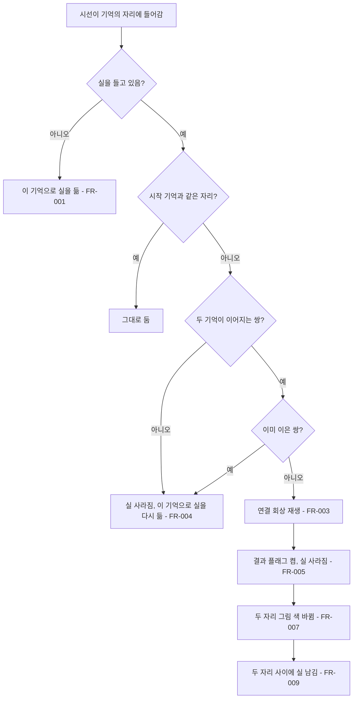
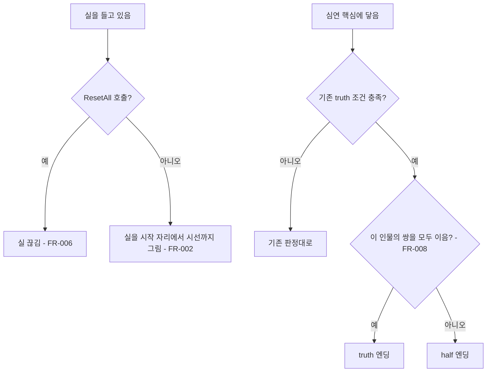

# 기억 잇기

## 1. 개요

- 사용 중지(2026-11-12): 사용자 결정으로 실 연결을 게임에서 뺐다. `EyeMaze` 씬에서 `기억 실 (Thread)` 오브젝트를 끄고, 디렉터의 `_thread`를 비우고, `_truthNeedsAllLinks`를 껐다. 진엔딩은 쌍을 잇지 않아도 기존 조건으로 나온다. 코드와 연결 회상 데이터는 남아 있다.

- 목적: 회상을 본 두 기억의 자리를 플레이어가 걸어서 이으면 두 기억이 하나의 온전한 장면으로 다시 재생되게 하여, 이야기를 한 번에 받지 않고 플레이어의 손으로 완성하게 한다.
- 대상: 플레이어, 제작자(이어지는 기억의 쌍과 연결 회상을 정하는 사람)

## 2. 범위

- 포함:
  - 기억의 자리에서 실을 들고 다른 기억의 자리까지 걷는 조작
  - 이어지는 쌍을 이었을 때의 연결 회상 재생과 결과 플래그
  - 이어지지 않는 쌍을 이었을 때의 처리(아무 일도 일어나지 않음)
  - 실이 끊기는 조건
  - 이어지는 쌍 데이터(`Links.csv`)
  - 진엔딩 판정에 그 인물의 모든 쌍을 이었는지를 더하는 조건
- 제외:
  - 이어지는 짝을 미리 알려 주는 표시나 안내. 만들지 않는다.
  - 이은 뒤 뜻을 풀이하는 독백이나 해설. 만들지 않는다.
  - 엔딩에서 아직 잇지 않은 기억이 있음을 알리는 문구. 만들지 않는다.
  - 서사 핵심 장면을 조각으로 나누는 것. 핵심 장면은 스펙 016의 회상 하나로 통째로 보여 준다.
  - 회상 화면과 재생 기능 자체(스펙 016의 `FlashbackPlayer`를 쓴다)
  - 연결 회상용 새 방. 연결 회상은 두 기억 중 한쪽의 회상 방을 다시 쓰고 사물만 더한다(스펙 016 FR-017).
  - 감정에 따른 미로 사물(스펙 015). 사물이 경로를 막는 것은 스펙 015의 이동 판정을 그대로 따른다.
  - 지수의 쌍(메신저와 엘리베이터 거울, 자동이체와 사직서) 데이터와 연결 회상 대본, 추가 사물. 이 스펙의 기능을 구현한 뒤 콘텐츠 작업으로 만든다.
  - 은재의 쌍(손가락과 닫힌 피아노, 뒤집힌 휴대폰과 음성 메시지) 데이터와 연결 회상 대본, 추가 사물. 지수와 같은 방식의 콘텐츠 작업으로 만든다.

## 3. 기술 방향

- 사용 기술/API: Unity `MonoBehaviour`, `LineRenderer`, 기존 CSV 로더(`Csv`)
- 핵심 방식: 스펙 016의 기억의 자리에 시선이 들어가면 그 자리의 기억을 실의 시작으로 든다. 실을 든 채 다른 기억의 자리에 들어가면 두 플래그의 쌍을 `Links.csv`에서 찾는다. 쌍이 있으면 그 쌍의 연결 회상을 `FlashbackPlayer`로 재생하고 결과 플래그를 켠다. 쌍이 없으면 실만 사라진다. 결과 플래그는 기존 대사 CSV의 `need`에서 일반 플래그처럼 쓴다. 심연 핵심에 닿았을 때의 `truth` 판정에는 그 인물의 모든 쌍을 이었는지를 조건으로 더한다.
- 선택하지 않은 방식: 목록 화면에서 두 기억을 골라 잇는 방식은 쓰지 않는다(미로를 걷는 행동으로 잇는다). 상호작용 키를 눌러 실을 드는 방식은 쓰지 않는다. 틀린 쌍에 벌점이나 부담감 증가를 주지 않는다. 이어질 수 있는 쌍을 색이나 빛으로 미리 표시하지 않는다. 깜빡임이나 시선 거두기로 실을 끊지 않는다(시간 압박을 더하지 않고, 실을 든 채 대화로 감정을 바꿔 길을 열 수 있게 한다).
- 외부 의존성: `EyeMazeDirector`, `MemoryFragment`, `Flags`, `IrisMaze`, `GazeCursor`, `ClientCase`, 스펙 016의 `FlashbackPlayer`와 `FlashbackScript`, 스펙 006과 009(깜빡임 회전), 스펙 015(사물 이동 판정), 스펙 014(엔딩 조건)

## 4. 구조

| 구분 | 이름 | 역할 |
|------|------|------|
| 클래스 | `MemoryLinkScript` | `Links.csv`를 읽어 두 플래그의 쌍에 대한 결과 플래그와 재사용할 방을 제공한다 |
| 클래스 | `MemoryThread` | 든 실의 시작 기억을 보관하고 시작 자리에서 시선 칸까지 지금 미로의 열린 통로로 길을 찾아 그 길을 따라 실 하나를 그린다 |
| 클래스 | `EyeMazeDirector` | 기억의 자리 진입을 판정하고 잇기 결과와 진엔딩 조건을 처리한다 |
| 데이터 | `Assets/EyeMaze/Data/Links.csv` | 이어지는 쌍, 결과 플래그, 재사용할 방 |
| 씬 | `EyeMaze` | `MemoryThread` 오브젝트를 `IrisMaze` 아래에 둔다 |

- 오브젝트 구성: `MemoryThread`는 든 실용 `LineRenderer`를 가진 오브젝트 하나에 붙인다. 이은 뒤 남는 실용 `LineRenderer`는 그 자식으로 씬에 미리 만들어 `_linkedLines`에 등록해 두고, 이은 쌍마다 하나씩 쓴다.
- 클래스 간 관계: `EyeMazeDirector`가 `MemoryThread`의 시작과 해제를 호출하고, `MemoryLinkScript`에 쌍을 묻고, `FlashbackPlayer.Play(결과 플래그, 재사용할 방의 플래그)`를 호출한다.
- 실행 순서 의존성: `MemoryLinkScript`는 `Flags`와 같은 시점에 CSV를 읽는다.
- 기존 코드와의 접점: `EyeMazeDirector`의 이동 뒤 칸 판정(`CheckFragment()`와 같은 위치), 심연 핵심 접촉 때의 엔딩 판정(`TouchCore()`의 `truth`/`half` 결정 줄), `ResetAll()`, `MemoryFragment`의 기억의 자리 그리기(스펙 016 FR-014). 플래그 관리자(`FlagManagerWindow`)의 검사.

## 5. 동작 플로우차트

## 6. 요구사항

- FR-001: 실을 들지 않은 채 시선이 기억의 자리에 들어갔을 때 `EyeMazeDirector`는 그 자리의 기억을 시작으로 실을 든다.
- FR-002: 실을 들고 있는 동안 `MemoryThread`는 시작 자리의 칸에서 시선이 있는 칸까지 지금 미로의 열린 면(`IrisMaze.IsArcOpen`, `IsRadialOpen`)만 지나는 가장 짧은 칸 목록을 찾고, 같은 고리의 옆 칸은 고리 가운데 원호로, 고리를 넘을 때는 곧게 이어 시작 자리에서 시선까지 실 하나를 그린다. 시선이 있는 칸은 가운데를 거치지 않고, 그 칸에 들어선 경계에서 시선으로 바로 이어 실이 시선보다 앞에 생기지 않는다. 시선이 다른 칸으로 옮기거나 `_repathSeconds`초가 지나면 길을 다시 찾고, 그릴 때마다 각 칸이 속한 층의 지금 회전을 반영한다. 길이 없으면 실을 숨긴다.
- FR-003: 실을 든 채 시선이 다른 기억의 자리에 들어갔고 두 기억이 `Links.csv`의 아직 잇지 않은 쌍일 때 `EyeMazeDirector`는 그 쌍의 결과 플래그에 묶인 연결 회상을 그 쌍의 `room`에 적힌 방에서 스펙 016의 `FlashbackPlayer`로 재생한다.
- FR-004: 실을 든 채 시선이 다른 기억의 자리에 들어갔고 두 기억이 `Links.csv`에 없는 쌍이거나 이미 이은 쌍일 때 `EyeMazeDirector`는 다른 반응 없이 든 실을 없애고 새로 들어간 자리의 기억으로 실을 든다.
- FR-005: 연결 회상이 끝났을 때 `EyeMazeDirector`는 그 쌍의 결과 플래그를 켜고 실을 없앤다.
- FR-006: 실을 든 동안 `ResetAll()`이 호출됐을 때 `EyeMazeDirector`는 실을 없앤다.
- FR-007: 쌍을 이었을 때 `EyeMazeDirector`는 두 `MemoryFragment`의 이은 상태를 켜고, `MemoryFragment`는 기억의 자리 그림을 `_seenMarkColor` 대신 `_linkedMarkColor`(선명한 색)로 그린다.
- FR-009: `_keepLinkedThreads`가 켜져 있고 쌍을 이었을 때 `MemoryThread`는 두 자리의 칸 사이 길을 FR-002와 같은 방식으로 찾아 `_linkedThreadColor`의 실을 남기고, `_repathSeconds`초마다 지금 미로 기준으로 길을 다시 찾는다. 길이 없으면 그동안 실을 숨긴다.
- FR-008: `_truthNeedsAllLinks`가 켜져 있고 심연 핵심에 닿아 기존 `truth` 조건(신뢰와 열쇠 파편)이 충족됐을 때 `EyeMazeDirector`는 현재 인물의 파편으로 이루어진 `Links.csv`의 쌍 중 잇지 않은 쌍이 있으면 `truth` 대신 `half` 엔딩을 시작한다.

### 상태와 데이터

| 이름 | 타입 | 설명 | 초기값 |
|------|------|------|--------|
| `Links.csv`의 `a`, `b` | 문자열 | 이어지는 두 기억의 플래그. 순서는 상관없다 | 없음 |
| `Links.csv`의 `result` | 문자열 | 이었을 때 켜지는 플래그. 연결 회상의 `Flashbacks.csv` `flag`와 같다 | 없음 |
| `Links.csv`의 `room` | 문자열 | 연결 회상이 다시 쓸 방의 플래그. `a` 또는 `b` 중 하나다 | 없음 |
| `MemoryThread._from` | `MemoryFragment` | 든 실의 시작 기억. 없으면 실을 들지 않은 상태 | 없음 |

### 예외 및 경계 조건

- 연결 회상 대본이 `Flashbacks.csv`에 없는 쌍: 플래그 관리자 검사에서 오류로 보고한다. 실행 중에는 회상 없이 결과 플래그만 켠다.
- `room`이 `a`도 `b`도 아니거나 그 플래그의 회상 방이 없음: 플래그 관리자 검사에서 오류로 보고한다. 실행 중에는 회상 없이 결과 플래그만 켠다.
- 잘못된 쌍(a와 b가 같음, a나 b가 `Flags.csv`에 없음, a나 b의 회상 대본이나 회상 방이 없어 기억의 자리가 될 수 없음): 플래그 관리자 검사에서 오류로 보고하여 이을 수 없는 쌍이 진엔딩을 막는 일을 미리 잡는다.
- 연결 회상의 `emotion_after`: 스펙 016 FR-012대로 회상이 끝난 뒤 감정을 바꾼다.
- 기억 하나가 여러 쌍에 속함: 허용한다. 쌍마다 따로 잇는다.
- 같은 `result`를 두 쌍 이상이 씀: 이은 쌍을 결과 플래그로 구분하므로 한 쌍만 이어도 나머지 쌍이 이은 것으로 처리된다. 플래그 관리자 검사에서 오류로 보고한다.
- 회상을 아직 보지 않은 파편: 기억의 자리가 아니므로 실의 시작과 끝이 될 수 없다. 파편에 닿으면 스펙 016의 회상이 먼저 재생되고, 끝난 뒤 그 자리가 기억의 자리가 된다.
- 회상이 방금 끝난 자리에 서 있음: 그 자리를 벗어났다 다시 들어올 때 실을 든다.
- 실을 든 채 시선을 거둠: 실을 유지한다. 실은 시작 자리에서 시선이 멈춘 위치까지 그대로 그려 둔다.
- 실을 든 채 대화 선택지를 고름: 실을 유지한다.
- 실을 든 채 스펙 015의 사물에 막힘: 실을 유지한다. 시선을 거두고 대화로 감정을 바꿔 길을 연 뒤 다시 들여다보면 이어서 걸을 수 있다.
- 실을 든 채 깜빡임 회전(스펙 006, 009)이 일어남: 실을 유지한다. 실의 양 끝은 회전하는 동안 기억의 자리와 시선의 화면 위치를 매 프레임 따라간다.
- 실을 든 채 Q로 자리를 떠났다가 같은 손님과 다시 만남: 실을 유지한다.
- 쌍이 하나도 없는 인물: FR-008의 조건은 항상 충족된 것으로 본다.
- `ResetAll()`: 켠 결과 플래그, 자리 그림의 색, 이은 뒤 남은 실을 처음 상태로 되돌린다.
- 이은 쌍이 `_linkedLines` 수보다 많음: 남은 실을 더 그리지 않고 자리 그림의 색만 바꾼다.
- 손님이 바뀜: 이은 뒤 남은 실은 그 인물의 파편 묶음이 꺼져 있는 동안 그리지 않는다.
- 에디트 모드: 실을 들지 않는다.

## 7. Inspector 노출값

| 필드 | 타입 | 기본값 | 설명 |
|------|------|--------|------|
| `MemoryThread._threadColor` | `Color` | 파편 색의 반투명 | 실의 색 |
| `MemoryThread._threadWidth` | `float` | 0.03 | 실의 굵기 |
| `MemoryThread._maze` | `IrisMaze` | 씬의 미로 | 열린 통로로 길을 찾을 미로 |
| `MemoryThread._repathSeconds` | `float` | 0.25 | 미로가 바뀌었는지 보고 길을 다시 찾는 간격(초) |
| `EyeMazeDirector._linkedMarkColor` | `Color` | 흰색 | 이은 뒤의 기억의 자리 그림 색 |
| `MemoryThread._keepLinkedThreads` | `bool` | true | 이은 두 자리 사이에 실을 남길지 |
| `MemoryThread._linkedThreadColor` | `Color` | 흰색의 반투명 | 이은 뒤 남는 실의 색 |
| `MemoryThread._linkedLines` | `LineRenderer[]` | 씬에 만든 4개 | 이은 뒤 남는 실을 그릴 렌더러들 |
| `EyeMazeDirector._truthNeedsAllLinks` | `bool` | true | 진엔딩에 그 인물의 모든 쌍 잇기를 요구할지 |

## 8. 인수 조건

- FR-001: Play Mode에서 회상을 본 파편 자리를 벗어났다 다시 들어가면 실을 든 상태가 된다.
- FR-002: 실을 든 채 움직이면 그 자리에서 시선까지 실 하나가 벽을 넘지 않고 통로 가운데를 따라 그려지고, 걸어온 자취가 아니라 지금 길로 다시 그려져 꼬이거나 겹치지 않는다. 실의 끝은 시선에서 끝나고 시선이 들어선 칸의 가운데로 먼저 뻗어 나가지 않는다. 깜빡임으로 층이 도는 동안에도 실이 통로에 붙어 함께 돈다. 벽이 바뀌어 길이 끊기면 실이 사라졌다가 길이 생기면 다시 보인다.
- FR-003: `Links.csv`에 있는 쌍의 두 자리를 이으면 `room`에 적힌 방에서 연결 회상이 재생되고, 그 방에 추가 사물이 보인다.
- FR-004: `Links.csv`에 없는 쌍의 두 자리를 이으면 회상도 문구도 부담감 변화도 없고, 실이 두 번째 자리에서 새로 시작된다. 이미 이은 쌍을 다시 이어도 같다.
- FR-005: 연결 회상이 끝나면 결과 플래그가 켜져 있고(플래그 관리자에서 확인), 그 플래그를 `need`로 가진 선택지가 `???`가 아닌 글로 보인다.
- FR-006: 실을 든 채 깜빡임이 일어나거나 Space로 시선을 거뒀다 다시 들여다봐도 실이 남아 있다. R로 리셋하면 사라진다.
- FR-007: 쌍을 이은 뒤 두 자리의 사물 그림이 반투명에서 선명한 색으로 바뀌어 있다.
- FR-009: 쌍을 이은 뒤 두 자리 사이 통로를 따라 실 하나가 남고, 깜빡임과 벽 변화 뒤에는 바뀐 통로를 따라 다시 그려진다. `_keepLinkedThreads`를 끄고 이으면 실이 남지 않는다.
- FR-008: 지수의 신뢰와 열쇠 파편 조건을 채우고 두 쌍 중 하나만 이은 채 심연 핵심에 닿으면 `half` 엔딩이 나온다. 두 쌍을 모두 이으면 `truth` 엔딩이 나온다. `_truthNeedsAllLinks`를 끄면 쌍을 잇지 않아도 `truth` 엔딩이 나온다.

## 9. 미결 사항

- 없음
