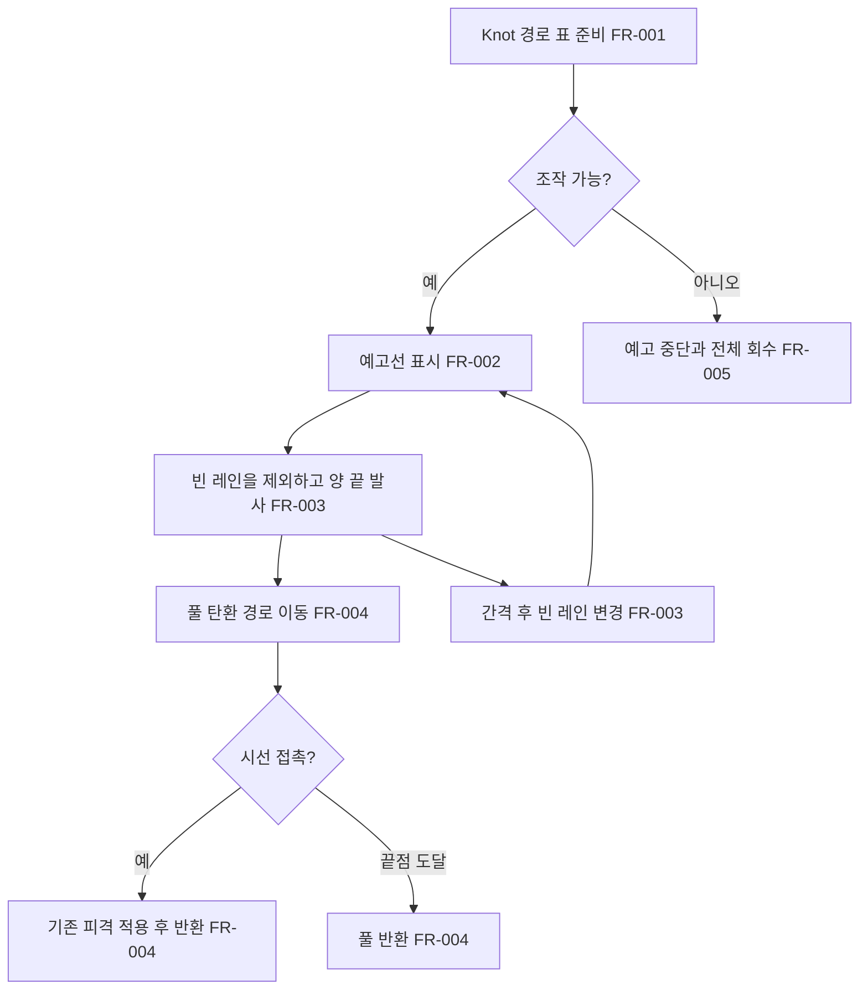

# 스플라인 양방향 탄막

## 1. 개요

- 목적: 제작자가 배치한 Knot 경로에서 양쪽 탄막 사이의 빈틈을 피하는 장애물을 제공한다.
- 대상: 플레이어와 미로 제작자.

## 2. 범위

- 포함: 기존 Obstacles/Spline 연결, 양 끝 발사, 경로 추종, 번갈아 이동하는 빈 레인, 예고, 풀링, 피격과 회수.
- 제외: 기존 Knot 수정, UI 생성, Gunner 동작 변경, 테스트 코드.

## 3. 기술 방향

- 사용 기술/API: Unity Splines SplineContainer, LineRenderer, ObjectPool.
- 핵심 방식: Knot로 정의한 첫 스플라인을 월드 좌표의 호 길이 표로 샘플링하고 양 끝에서 반대 방향으로 탄환을 보낸다. 경로 접선의 XY 수직 방향으로 레인을 배치하고 매 웨이브 한 레인을 비운다. 방향별 빈 레인은 동일하게 하여 회피 경로를 보장한다.
- 선택하지 않은 방식: Knot를 직선으로만 잇기, 물리 Collider 시선 판정, 매번 탄환 생성·파괴.
- 외부 의존성: 설치된 Unity Splines, EyeMazeDirector.CanRunHazards와 HitByBullet.

## 4. 구조

| 구분 | 이름 | 역할 |
|------|------|------|
| 클래스 | SplineBarrage | 경로 표, 웨이브와 풀 관리 |
| 클래스 | SplineBarrageBullet | 양방향 경로 추종과 시선 피격 |
| 프리팹 | SplineBarrageBullet | 풀링할 탄환 외형 |
| 씬 | EyeMaze | 기존 Spline에 발사 컴포넌트 연결 |

- 오브젝트 구성: 기존 Spline의 Transform과 Knot를 보존하고 풀 기준점과 경로 예고선만 추가한다.
- 클래스 간 관계: SplineBarrage가 탄환을 대여하고 이동을 갱신하며 피격은 기존 디렉터를 사용한다.
- 실행 순서 의존성: Awake에서 참조와 경로 표, 풀을 준비한 뒤 LateUpdate에서 처리한다.
- 기존 코드와의 접점: 기존 공개 진행 상태와 피격 진입점만 사용한다.

## 5. 동작 플로우차트

## 6. 요구사항

- FR-001: 시작할 때 기존 첫 스플라인의 Knot와 곡선을 따라 이동할 경로 표를 만든다. 기존 Transform과 Knot는 변경하지 않는다.
- FR-002: 조작 중 각 웨이브 발사 전에 실제 탄환 레인에 예고선을 표시한다.
- FR-003: 예고가 끝나면 양 끝에서 반대 방향으로 탄환을 발사하고 매 웨이브 동일한 빈 레인 하나를 양쪽에 남긴다. 빈 레인은 순서대로 순환한다.
- FR-004: 탄환은 풀에서 재사용하며 경로 끝이나 수명 만료, 시선 접촉 시 반환한다. 접촉 시 기존 밀림·지지직·부담감을 적용한다.
- FR-005: 읽기, 대화, 깜빡임, 종료 또는 비활성화 시 예고와 활성 탄환을 정리하고 복귀 시 첫 예고부터 재시작한다.

### 상태와 데이터

| 이름 | 타입 | 설명 | 초기값 |
|------|------|------|--------|
| 웨이브 번호 | int | 빈 레인 순환 기준 | 0 |
| 경로 표 | Vector3[], float[] | 월드 위치와 누적 거리 | 시작 시 계산 |
| 활성 탄환 | List | 대여한 탄환 | 비어 있음 |

### 예외 및 경계 조건

- 2개 미만 Knot, 길이 0, 닫힌 경로 또는 미로 진행 제어 없음: 경고 후 해당 장애물만 중단한다.
- Inspector 직접 진행 제어 지정이 없으면 부모 미로 또는 동일 씬의 유일한 디렉터를 사용한다.
- 빠른 탄환은 이동 구간을 작은 거리로 나누어 접촉을 확인한다.
- 경로는 해당 활성 세션 시작 시 샘플링한다. 재활성화 시 다시 계산하며 일반 편집에서는 제작자의 수동 배치를 보존한다.

## 7. Inspector 노출값

| 필드 | 타입 | 기본값 | 설명 |
|------|------|--------|------|
| 경로·디렉터·탄환·풀·예고선 | 참조 | 씬 연결 | 경로와 렌더링 구성 |
| 예고 시간 | float | 0.6초 | 발사 전 예고 |
| 웨이브 간격 | float | 1.2초 | 발사 후 다음 예고까지 |
| 레인 수 | int | 3 | 빈 레인을 포함한 통로 수 |
| 레인 간격 | float | 0.14 | 접선 수직 방향 오프셋 |
| 탄속 | float | 0.65 | 월드 거리/초 |
| 수명 | float | 8초 | 최대 비행 시간 |
| 접촉 반지름 | float | 0.045 | 시선과의 접촉 거리 |
| 초기 풀 수량 | int | 24 | 미리 생성할 탄환 수 |

## 8. 인수 조건

- FR-001: 기존 4개 Knot 위치를 저장 전후 비교하고 탄환이 곡선을 따르는지 확인한다.
- FR-002: 레인별 예고선이 빈 레인을 비우고 발사 전 표시되는지 확인한다.
- FR-003: 양 끝에서 발사된 탄환이 서로 다가오며 빈 레인이 순환하는지 확인한다.
- FR-004: 반복 발사에서 풀 재사용과 끝점 반환, 시선 접촉 시 부담감 증가를 확인한다.
- FR-005: 들여다보기 종료 후 활성 탄환과 예고선이 사라지고 다시 진입하면 예고부터 시작하는지 확인한다.

구현 및 확인 결과:

- FR-001: `SplineBarrage.BuildPath`, `PointAt`에서 기존 곡선을 거리 표로 사용한다. 기존 4개 Knot와 Transform 보존을 확인했으며 경로 길이는 약 1.45044였다.
- FR-002: `SplineBarrage.BeginWarning`, `HideWarnings`로 현재 탄환 레인만 예고한다. Play Mode 화면에서 예고 경로를 확인했다.
- FR-003: `SplineBarrage.FireWave`, `LaneOffset`으로 양 끝의 방향 +1/-1과 동일 빈 레인, 웨이브 순환을 처리한다. 실제 활성 탄환의 양방향 진행과 레인 오프셋 변경을 확인했다.
- FR-004: `SplineBarrage`의 풀 관리와 `SplineBarrageBullet.Advance`에서 이동, 선분 접촉, 끝점·수명 반환을 처리한다. 반복 발사 중 총 24개 탄환을 유지했고 시선 접촉 후 부담감 증가와 접촉 탄환 반환을 확인했다.
- FR-005: `LateUpdate`, `ResetBarrage`, `OnDisable`, `OnDestroy`에서 중단과 회수를 처리한다. 들여다보기 종료 후 활성 탄환 0개, 표시 예고선 0개를 확인했고 Play Mode 종료 시 콘솔 오류가 없었다.

## 9. 미결 사항

- 없음
