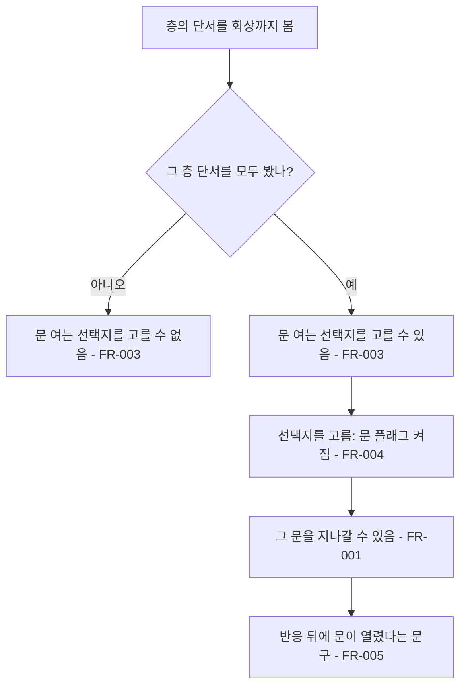

# 선택지로 여는 층 문

## 1. 개요

- 목적: 층 사이 문이 신뢰 수치가 아니라 정해진 선택지로만 열리게 해서, 중요하지 않은 선택지로 신뢰가 올라 문이 의도치 않게 열리는 일을 없앤다. 문을 여는 선택지는 그 층의 단서를 모두 본 뒤에만 고를 수 있게 한다.
- 대상: 플레이어, 대화 데이터를 쓰는 제작자

## 2. 범위

- 포함:
  - 층 사이 문을 플래그로 여는 조건
  - 인물별로 문마다 여는 플래그를 정하는 설정
  - 문을 여는 선택지의 `need`(그 층 단서 전부)와 `set`(문 플래그) 데이터
  - 선택지 반응 뒤에 붙는 신뢰 안내와 문 안내 문구의 분리
- 제외:
  - 동공 입구(가장 안쪽 문)의 조건. 지금처럼 동공 열림으로 연다.
  - 신뢰 수치의 계산과 엔딩 판정(`truth_trust`, `leave_trust`). 그대로 둔다.
  - 선택지 문장 수정

## 3. 기술 방향

- 사용 기술/API: 기존 `Flags`(플래그 켜기와 확인), 대화 CSV의 `need`, `set` 칸
- 핵심 방식: `MazeGate`에 여는 플래그(`_requiredFlag`)를 더한다. 플래그가 적힌 문은 `Flags.IsOn()`이 참일 때만 지나갈 수 있고 신뢰는 보지 않는다. 플래그는 대화 CSV의 `set` 칸으로 선택지가 켠다. 문을 여는 선택지는 `need` 칸에 그 층의 파편 플래그를 `|`로 모두 적어, 전부 켜져야 고를 수 있게 한다.
- 선택하지 않은 방식: 신뢰 기준값을 올려 문이 덜 열리게 하는 방식은 쓰지 않는다(여전히 무관한 선택지가 문을 연다). 단서를 모두 모으면 선택지 없이 문이 저절로 열리는 방식은 쓰지 않는다(문은 대화의 결과로 열려야 한다).
- 외부 의존성: 스펙 004의 문 통과 판정과 선택 뒤 문구, 스펙 016의 파편 플래그(회상을 본 뒤 켜짐), `IrisMaze.Generate()`의 층 문 생성

## 4. 구조

| 구분 | 이름 | 역할 |
|------|------|------|
| 클래스 | `MazeGate` | 여는 플래그가 있으면 플래그로, 없으면 기존 조건으로 통과를 판단한다 |
| 클래스 | `ClientCase` | 인물의 문 플래그 목록(`_gateFlags`)을 가진다 |
| 클래스 | `IrisMaze` | 문 플래그 목록을 받아 두고 층 문을 만들 때 넣는다 |
| 클래스 | `EyeMazeDirector` | 손님을 불러올 때 문 플래그를 미로에 넘기고, 선택 뒤 문구를 정한다 |
| 데이터 | `Flags.csv` | 문 플래그 정의 |
| 데이터 | `Jisu_Day1.csv`, `Eunjae_Day1.csv` | 문을 여는 선택지의 `need`, `set` |

- 오브젝트 구성: 새 오브젝트는 없다. 층 문은 지금처럼 `IrisMaze`가 벽 묶음 아래에 만든다.
- 클래스 간 관계: `EyeMazeDirector`가 `ClientCase._gateFlags`를 `IrisMaze.SetGateFlags()`로 넘기고, `IrisMaze`가 문을 만들 때 `MazeGate.Setup()`에 플래그를 넣는다. `MazeGate`는 `Flags`만 읽는다.
- 실행 순서 의존성: 문 플래그는 미로를 새로 만들기 전에 넘긴다(`RebuildMaze()` 안에서 `Generate()` 앞).
- 기존 코드와의 접점: `MazeGate.CanPass()`, `MazeGate.Setup()`, `IrisMaze.Generate()`의 층 문 생성, `EyeMazeDirector.ChooseOption()`의 선택 뒤 문구, `EyeMazeDirector.RebuildMaze()`

## 5. 동작 플로우차트

## 6. 요구사항

- FR-001: `_requiredFlag`가 비어 있지 않은 `MazeGate`를 시선이 지나가려 할 때 `MazeGate.CanPass()`는 그 플래그가 켜져 있으면 통과시키고, 꺼져 있으면 막는다. 이때 신뢰는 보지 않는다. 동공 조건(`_requiredDilation`)이 함께 있으면 둘 다 채워야 한다.
- FR-002: 손님을 불러올 때와 씬에 저장된 상담으로 Play를 시작할 때 `EyeMazeDirector`는 그 인물의 `ClientCase._gateFlags`를 `IrisMaze.SetGateFlags()`로 넘긴다. `IrisMaze.Generate()`는 층 번호 N(1부터)의 문을 만들 때 목록의 N-1번째 플래그를 `_requiredFlag`로 넣고 신뢰 조건을 끈다. 목록에 그 자리가 없거나 비어 있으면 예전처럼 신뢰 N을 조건으로 넣는다.
- FR-003: 문을 여는 선택지는 대화 CSV의 `need` 칸에 그 층의 파편 플래그를 모두 적는다. 기존 규칙대로 `need`의 플래그가 모두 켜져야 그 선택지를 고를 수 있다.
- FR-004: 문을 여는 선택지는 대화 CSV의 `set` 칸에 문 플래그를 적는다. 기존 규칙대로 선택지를 고르면 그 플래그가 켜진다.
- FR-005: 선택지를 고른 뒤 `EyeMazeDirector`는 신뢰가 올랐으면 `msg.trust_up_no_gate`(`(신뢰가 깊어졌다.)`)를 붙이고, 그와 별개로 지나갈 수 있는 문 수가 늘었으면 `msg.gate_open`(`(눈 속 어딘가의 문이 열렸다.)`)을 붙인다.
- FR-006: 지수와 은재의 문 플래그와 문을 여는 선택지는 아래 표와 같다.

| 인물 | 문 | 문 플래그 | `need` (모두 필요) | 문을 여는 선택지 |
|------|----|-----------|--------------------|------------------|
| 지수 | 0층 → 1층 | `jisu_gate_1` | `jisu_messenger_0312`, `jisu_elevator_mirror` | `smile` 장면의 "대답이 빠른 편이시네요…" |
| 지수 | 1층 → 2층 | `jisu_gate_2` | `jisu_resignation`, `jisu_autopay_25` | `work` 장면의 "떠나고 싶은 마음이랑 붙잡는 마음이…" |
| 은재 | 0층 → 1층 | `eunjae_gate_1` | `eunjae_piano_hands`, `eunjae_closed_piano` | `window` 장면의 "쇼팽 녹턴 20번…" |
| 은재 | 1층 → 2층 | `eunjae_gate_2` | `eunjae_red_button`, `eunjae_voicemail`, `eunjae_phone_flipped` | `red_eyes` 장면의 "그날 일, 다들 아는 이야기랑…" |

### 상태와 데이터

| 이름 | 타입 | 설명 | 초기값 |
|------|------|------|--------|
| `MazeGate._requiredFlag` | `string` | 이 문을 여는 플래그. 비어 있으면 플래그 조건 없음. 문을 만들 때 채워진다 | 빈 값 |
| `MazeGate._order` | `int` | 바깥에서 몇 번째 층 문인지. 막혔을 때 문구를 고르는 데 쓴다 | 1 |

### 예외 및 경계 조건

- 문 플래그는 켜졌는데 신뢰가 낮음: 문은 열린다. 신뢰는 문과 무관하다.
- 신뢰는 높은데 문 플래그가 꺼짐: 문은 닫혀 있다.
- 깜빡임으로 문이 새로 만들어짐: 새 문도 같은 플래그를 받으므로 이미 연 문은 열린 채다.
- `ResetAll()`: 플래그가 지워지므로 문도 다시 닫힌다.
- 문 플래그가 없는 인물: 신뢰로 열리는 예전 방식 그대로다.
- 막혔을 때 문구: 기존 `gate.first`(첫 문), `gate.deep`(그 안쪽 문)을 그대로 쓰고, 문 번호로 가린다.
- 문을 여는 선택지를 이미 고른 뒤 다시 고름: 스펙 004 FR-008대로 반응이 반복되지 않고, 문은 이미 열려 있다.

## 7. Inspector 노출값

| 필드 | 타입 | 기본값 | 설명 |
|------|------|--------|------|
| `ClientCase._gateFlags` | `string[]` | 빈 배열 | 층 문을 여는 플래그. 0번이 1층으로 들어가는 문 |

## 8. 인수 조건

- FR-001: 문 플래그가 꺼진 동안에는 신뢰를 아무리 올려도 그 문에서 막힌다. 문 플래그가 켜지면 신뢰가 0이어도 지나간다.
- FR-002: 깜빡임으로 미로가 바뀐 뒤에도 연 문은 열려 있고, 안 연 문은 닫혀 있다.
- FR-003: 지수의 0층 단서를 하나만 본 상태에서는 "대답이 빠른 편이시네요…" 선택지를 고를 수 없고, 둘 다 보면 고를 수 있다.
- FR-004: 그 선택지를 고르면 1층으로 가는 문이 열린다.
- FR-005: 문을 여는 선택지를 고르면 `(눈 속 어딘가의 문이 열렸다.)`가 나오고, 신뢰만 오르는 선택지에서는 `(신뢰가 깊어졌다.)`만 나온다.
- FR-006: 은재와 지수 모두 표의 선택지 네 개로만 층 문이 열린다.

## 9. 미결 사항

- 없음
