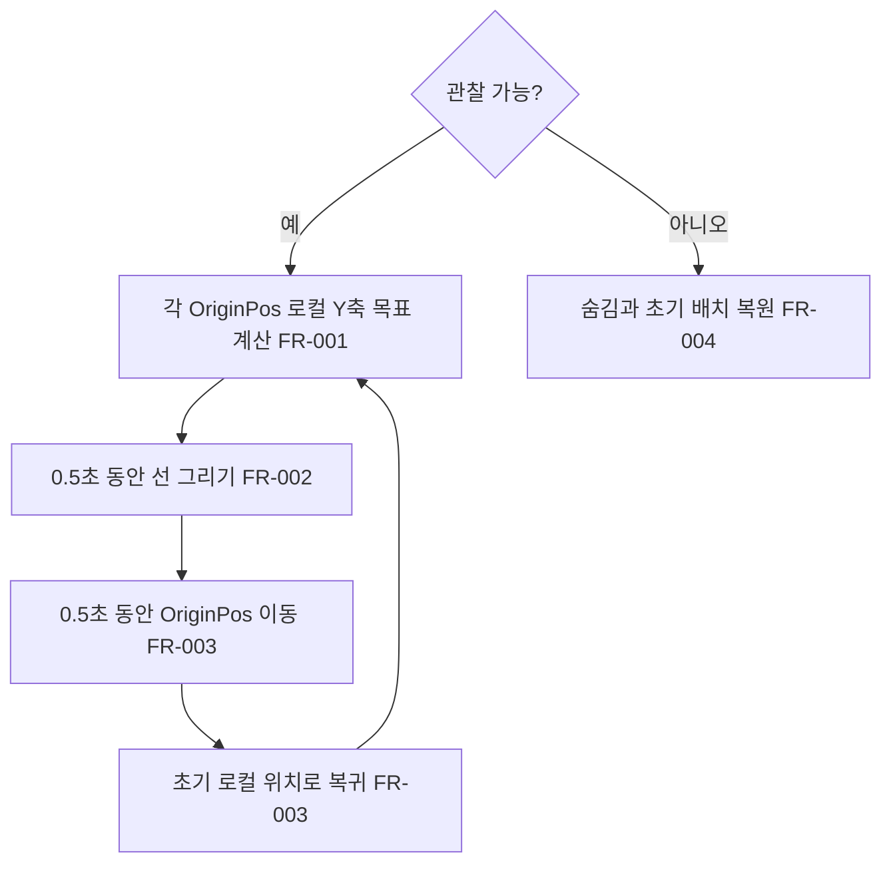

# OriginPos 로컬 Y축 라인 장애물

## 1. 개요
- 목적: 제작자가 정한 OriginPos 회전을 기준으로 선을 그리고 같은 경로로 이동한다.
- 대상: 제작자와 플레이어.

## 2. 범위
- 포함: 현재 배치된 기준점, 로컬 Y축 방향, 0.5초 그리기와 0.5초 이동, 관찰 상태 연동.
- 제외: 원호·스플라인·Knot 참조, 물리 Collider 추가, 테스트 코드.

## 3. 기술 방향
- 사용 기술/API: Transform.up/right, LineRenderer, Mathf.Sin, EyeMazeDirector.
- 핵심 방식: 초기 배치에서 OriginPos.up * 구간 길이만큼 떨어진 곳을 목표로 정한다. 0.5초 그리기 완료 즉시 0.5초 동안 동일 경로를 따라 이동한다. 도착하면 기록된 초기 로컬 위치로 즉시 돌아간 뒤 같은 동작을 반복한다. 기존 파형은 진폭으로 조절하며 0이면 직선이다.
- 선택하지 않은 방식: 다른 미로 오브젝트 자동 조준.
- 외부 의존성: 기존 선 프리팹과 관찰 상태.

## 4. 구조
| 구분 | 이름 | 역할 |
|------|------|------|
| 클래스 | SplineObstacle | 씬의 기존 스크립트 연결 유지, 선과 이동 처리 |
| 씬 | EyeMaze | OriginPos 목록과 연출 시간 저장 |

- 오브젝트 구성: 현재 Hierarchy의 Gunner/OriginPos와 선 프리팹을 사용한다. 삭제된 LineObstacle과 기준점들을 복원하지 않는다. 기준점 목록을 지정하면 여러 개도 사용할 수 있다.
- 클래스 간 관계: SplineObstacle이 각 OriginPos와 EyeMazeDirector를 참조한다.
- 실행 순서 의존성: Awake에서 초기 배치를 기록하고 관찰 시작 시 현재 위치와 회전으로 구간을 계산한다.
- 기존 코드와의 접점: DrawLines, BeginSegment, WavePoint, LateUpdate, StopDrawing.

## 5. 동작 플로우차트

## 6. 요구사항
- FR-001: 각 구간의 목표는 OriginPos의 현재 위치와 로컬 Y축, 구간 길이로 계산하며 수동 회전을 덮어쓰지 않는다.
- FR-002: 선을 0.5초 동안 확장하며 이 단계에서 OriginPos는 움직이지 않는다. 선은 재사용한다.
- FR-003: 선 그리기가 끝나면 별도 대기 없이 같은 경로를 따라 실제 OriginPos가 0.5초 동안 이동한다. 목표에 도착하면 기록된 초기 로컬 위치로 즉시 돌아가 같은 위치에서 다시 시작하며 전진 거리가 누적되지 않는다.
- 주기 경계에서는 선을 숨기고 모든 정점을 복귀한 시작 위치로 초기화한다. 다음 프레임에 선 길이가 생기면 표시하며 길이 0인 선은 렌더링하지 않는다.
- 직선은 양 끝점 2개만 사용한다. 파형은 현재 표시 길이에 따라 샘플 수를 줄여 서로 겹치는 점을 피하고, 월드 길이 0.0001 미만은 숨긴다. 제작자가 지정한 굵기와 연출 시간은 유지한다.
- FR-004: 관찰 중에만 재생하고 중단 시 선을 숨기며 초기 로컬 위치를 복원한다.
- FR-005: 관찰 조작 중 시선이 현재 표시된 선에 닿으면 부담감을 높인다. 실제 선분과 굵기, 시선 반지름을 사용하고 숨겨진 선은 제외한다. 여러 선이 겹쳐도 장애물별 접촉 간격마다 한 번 적용하며 최대 부담감에서는 기존 상담 종료를 실행한다.
- 접촉 시 거너 탄환과 공통 피격 처리로 밀려남, 시선 점멸, 초점 요동과 부담감 증가를 적용한다. 피격 후 기본 0.5초 동안 모든 라인·탄환의 추가 피격을 막는다. 무적 중에는 피드백과 부담감이 중복 적용되지 않는다. 라인 부담감은 해당 장애물의 설정값을 사용하며 숨김·비접촉은 제외한다.

### 상태와 데이터
- 초기 로컬 위치, 구간 시작·끝, 로컬 X축 파형 방향, 경과 시간을 저장한다.

### 예외 및 경계 조건
- 방향은 구간 시작 시 저장하고 다음 구간에서 현재 회전을 다시 읽는다.
- 초기 위치는 기록만 하며 Awake에서 배치를 변경하지 않는다.

## 7. Inspector 노출값
| 필드 | 타입 | 기본값 | 설명 |
|------|------|--------|------|
| OriginPos·선·진행 제어 | 참조 | 씬 연결 | 위치와 표시 기준 |
| 그리기 시간 | float | 0.5초 | 선 확장 시간 |
| 이동 시간 | float | 0.5초 | OriginPos 이동 시간 |
| 구간 길이 | float | 0.22 | 로컬 Y축의 월드 전진 거리 |
| 진폭 | float | 0 | 기본 직선, 양수이면 sin 파형 |
| 파형 수 | int | 1 | 구간 내 sin 주기 |
| 샘플 수 | int | 24 | 선 분할 수 |
| 접촉 부담감 | float | 0.02 | 한 번에 증가할 양 |
| 접촉 간격 | float | 0.5초 | 지속 접촉 적용 간격 |
| 시선 판정 반지름 | float | 0.04 | 선 굵기 절반에 더하는 반지름 |
| EyeMazeDirector 장애물 피격 무적 시간 | float | 0.5초 | 라인과 탄환이 공유하는 피격 방지 시간 |

## 8. 인수 조건
- FR-001: 기준점 하나를 회전시켜 해당 선의 목표가 로컬 Y축 방향인지 확인한다.
- FR-002: 첫 0.5초 동안 기준점은 고정되고 선만 확장되는지 확인한다.
- FR-003: 다음 0.5초 동안 기준점이 이동한 후 초기 위치로 복귀하고 여러 주기의 시작점과 목표가 동일한지 확인한다.
- FR-004: 관찰 종료 시 선 숨김과 초기 위치 복원을 확인한다.
- FR-005: 접촉 시 증가, 쿨다운 중 중복 방지, 선 밖과 숨김 상태 제외, 최대 부담감 종료를 확인한다.

구현 및 확인 결과:
- FR-001: `BeginSegment`에서 현재 위치 + `origin.up * _segmentLength`를 목표로 저장한다. Play Mode에서 기준점 회전을 변경해 목표 방향과 로컬 Y축의 내적 1을 확인했다.
- FR-002: `LateUpdate`에서 `_elapsed / _drawDuration`으로 선을 확장한다. 그리기·이동 시간 0.5초를 씬에 저장했고 경과 0.4897초에서 기준점 이동 오차가 약 0.00000024로 고정 상태임을 확인했다.
- FR-003: `_elapsed - _drawDuration`으로 이동 진행률을 계산하고 주기가 끝나면 기록된 초기 로컬 위치로 복귀한 뒤 다음 구간을 계산한다. Play Mode에서 여러 주기 뒤에도 시작점의 초기 로컬 위치 대비 오차가 약 0.000049로 동일하여 위치가 누적되지 않음을 확인했다. 오차는 부모 좌표 변환의 부동소수점 정밀도 범위다.
- FR-003 주기 경계: `BeginSegment`에서 선을 숨기고 모든 정점을 초기 시작 위치로 맞춘다. `LateUpdate`는 길이가 생기는 동안만 표시한다. Play Mode에서 복귀 경계의 선 숨김, 전체 정점 초기화, 경과 시간 0과 컴파일 성공을 확인했다.
- FR-002·FR-003 굵은 선 처리: `RenderSegment`에서 직선은 2개 점만 사용하고 파형은 현재 길이에 맞게 점 수를 조절한다. 길이 0.0001 미만은 숨기고 좌표를 갱신한 후 표시한다. Play Mode에서 사용자가 설정한 굵기 0.2를 유지한 채 시작·끝 진행률 0, 0.00001, 0.001, 0.01, 0.5, 1의 표시 상태와 직선 점 수 2개를 확인했다. 컴파일은 성공했다.
- FR-004: 기존 관찰 상태 연동과 `StopDrawing`의 숨김·초기 로컬 위치 복원을 유지했다. 검증 후 Play Mode를 종료하여 수동 배치를 보존했다.
- FR-005: `SplineObstacle.CheckLineContact`가 표시된 선분과 시선의 거리, 굵기 곡선과 판정 반지름으로 접촉을 판단하고 `EyeMazeDirector.AddObstacleBurden`으로 부담감을 적용한다. Play Mode에서 첫 접촉 +0.02, 같은 쿨다운 중 +0, 숨긴 선 +0, 선 밖 +0, 쿨다운 해제 후 재접촉 +0.02를 확인했다. 부담감 0.99에서 접촉하면 1.0으로 제한되고 Ending 모드로 전환됐다. 컴파일 성공을 확인했다.
- FR-005 공통 피격: `HitByBullet`과 `AddObstacleBurden`이 `TryApplyHazardHit`를 공유한다. 라인은 접촉점에서 시선으로 향하는 방향으로 밀어내며, 접촉점과 시선이 같으면 선의 수직 방향을 사용한다. Play Mode에서 라인 +0.02와 점멸 0.6, 초점 요동 활성, 밀려남 시작, 공유 무적 0.5초를 확인했다. 무적 중 탄환·라인 추가 부담감은 각각 0이었고 무적 경과 후 라인 +0.02가 다시 적용됐다. 탄환 피격 후에도 라인 증가가 0이었다.

## 9. 미결 사항
- 없음
