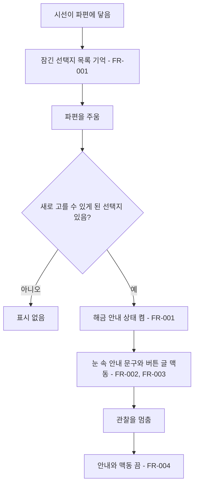
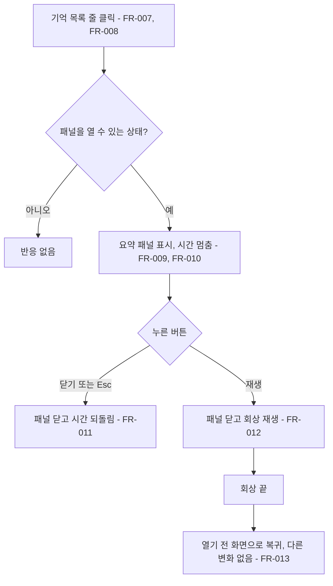

# 단서 해금 피드백과 단서 다시 보기

## 1. 개요

- 목적: 단서를 봐서 잠겨 있던 선택지가 열린 순간을 플레이어가 바로 알아차려 관찰을 멈추고 대화로 돌아갈 이유를 느끼게 한다. 이미 본 단서는 기억 목록에서 눌러 요약을 읽고 회상을 다시 볼 수 있게 한다.
- 대상: 플레이어, 연출 값을 조절하는 제작자

## 2. 범위

- 포함:
  - 파편을 주워 잠긴 선택지가 열렸을 때의 눈 속 안내 문구와 `관찰 중지` 버튼 글 맥동

  - 기억 목록을 줄마다 누를 수 있는 버튼으로 표시
  - 파편 요약 패널(제목, 획득 문구, `재생`, `닫기`)
  - 요약 패널에서 회상 다시 재생
- 제외:
  - 키보드만으로 기억 목록 줄을 고르는 조작
  - 파편 요약 글을 새로 쓰는 일 (기존 `Flags.csv`의 `title`, `text`를 쓴다)
  - 회상 대본과 회상 방의 변경
  - 선택지가 열리는 조건(`need`)의 변경
  - 대화 화면에서 새로 열린 선택지를 따로 표시하는 일 (어느 선택지가 방금 열렸는지 짚어 주면 그것부터 고르게 되므로 하지 않는다)

## 3. 기술 방향

- 사용 기술/API: uGUI `Button`, `Text`, Unity Input System, `Time.timeScale`
- 핵심 방식:
  - 파편을 줍기 직전에 잠겨 있던 선택지를 모든 장면에서 모으고, 주운 직후 그중 고를 수 있게 된 선택지가 있는지만 본다.
  - 기억 목록 줄과 요약 패널은 씬에 미리 놓은 UI를 `[SerializeField]`로 참조하고, 보이기와 글만 바꾼다. 버튼 클릭은 Play를 시작할 때 코드로 연결한다.
  - 요약 패널이 열려 있는 동안 대화 기록 창(스펙 008)과 같이 `Time.timeScale`을 0으로 두고, 닫을 때 열기 전 값으로 되돌린다.
  - 다시 재생은 스펙 016의 `FlashbackPlayer.Play()`를 그대로 쓰고, 끝났을 때의 처리만 다르게 한다.
- 선택하지 않은 방식:
  - 기억 목록 줄을 코드로 생성하지 않는다 (UI GameObject는 씬에 저장한다).
  - TextMeshPro를 쓰지 않는다 (기존 만남 UI와 같은 uGUI `Text`).
  - 요약 글을 따로 저장하는 새 CSV를 만들지 않는다.
- 외부 의존성: `EyeMazeDirector`, `EyeMazeUI`, `FlashbackPlayer`, `MemoryFragment`, `DialogueScript`, `Flags`, `Strings`, `DialogueLog`, `GameFlow`

## 4. 구조

| 구분 | 이름 | 역할 |
|------|------|------|
| 클래스 | `EyeMazeDirector` | 선택지가 새로 열렸는지 판단, 요약 패널을 열 수 있는지 판단, 회상 다시 재생 |
| 클래스 | `EyeMazeUI` | 눈 속 안내 문구, 버튼 글 맥동, 기억 목록 줄 표시 |
| 클래스 | `FragmentRecapUI` | 요약 패널 열기, 닫기, 재생 |
| 씬 | `EyeMaze` | 기억 목록 줄 버튼과 요약 패널 |

- 오브젝트 구성: 만남 UI의 기억 목록 글 아래에 줄 버튼(`Button` + 자식 `Text`) 8개를 둔다. 만남 UI 아래에 항상 켜진 `기억 요약 (Recap)` 오브젝트에 `FragmentRecapUI`를 붙이고, 그 자식인 패널(배경 `Image`, 제목 `Text`, 본문 `Text`, `재생` 버튼, `닫기` 버튼)은 꺼 둔다.
- 클래스 간 관계: `EyeMazeUI`가 줄 버튼 클릭을 받아 `FragmentRecapUI.Open()`을 부른다. `FragmentRecapUI`가 `EyeMazeDirector.ReplayFlashback()`을 부른다. `EyeMazeDirector`와 `GameFlow`는 `FragmentRecapUI.BlocksInput`을 읽어 입력을 막는다.
- 실행 순서 의존성: 해당 없음
- 기존 코드와의 접점: `EyeMazeDirector.CheckFragment()`, `ExitGaze()`, `ResetAll()`, `Update()`의 입력 차단, `EyeMazeUI.Update()`, `GameFlow`의 입력 차단

## 5. 동작 플로우차트

선택지 해금 피드백

단서 다시 보기

## 6. 요구사항

선택지 해금 피드백

- FR-001: Play Mode에서 시선이 파편을 주웠을 때 `EyeMazeDirector`는 지금 손님 대화의 모든 장면에서, 줍기 직전에는 `need`가 채워지지 않아 고를 수 없었고 주운 직후에는 고를 수 있게 된 선택지가 하나라도 있으면 해금 안내 상태를 켠다.
- FR-002: 해금 안내 상태에서 눈을 들여다보는 중이고 파편을 읽는 중과 심연이 아닐 때 `EyeMazeUI`는 눈 속 표시 아래에 `ui.new_talk_hint`(`(새로 꺼낼 수 있는 이야기가 생겼다. 관찰을 멈춰보자.)`)를 보여 준다.
- FR-003: 해금 안내 상태에서 눈을 들여다보는 중일 때 `EyeMazeUI`는 `관찰 중지` 버튼 글의 색을 원래 색과 `_gazePulseColor` 사이에서 `_newTalkPulseSeconds` 주기로 오가게 한다.
- FR-004: 시선을 거두어 대화로 돌아올 때 `EyeMazeDirector`는 해금 안내 상태를 끄고, `EyeMazeUI`는 버튼 글의 색을 원래 색으로 되돌린다.

단서 다시 보기

- FR-007: `EyeMazeUI`는 기억 목록의 머리글(`파편들 (N/M)`) 아래에 주운 파편마다 줄 버튼 하나를 주운 순서와 무관하게 파편 목록 순서대로 보여 주고, 남는 줄 버튼은 숨긴다. 주운 파편이 없으면 머리글 아래에 `· 아직 없음`을 보여 준다.
- FR-008: Play Mode에서 줄 버튼을 누르고 `EyeMazeDirector.CanOpenRecap`이 true일 때 `FragmentRecapUI`는 그 파편의 요약 패널을 연다.
- FR-009: 요약 패널이 열릴 때 `FragmentRecapUI`는 파편의 제목과 획득 문구(`MemoryFragment.Title`, `Text`)를 보여 주고, 그 파편에 회상 방과 회상 대본이 있으면 `재생`과 `닫기`를, 없으면 `닫기`만 보여 준다.
- FR-010: 요약 패널이 열려 있는 동안 `Time.timeScale`은 0이고, `EyeMazeDirector`와 `GameFlow`는 키 입력을 처리하지 않는다.
- FR-011: `닫기`를 누르거나 Esc 키 또는 게임패드 B(East) 버튼을 누를 때 `FragmentRecapUI`는 패널을 닫고 `Time.timeScale`을 열기 전 값으로 되돌린다.
- FR-012: `재생`을 누를 때 `FragmentRecapUI`는 FR-011과 같이 패널을 닫은 뒤 `EyeMazeDirector.ReplayFlashback()`을 부르고, `EyeMazeDirector`는 그 파편의 회상을 스펙 016 FR-003 ~ FR-010과 같이 처음부터 재생한다.
- FR-013: 다시 재생한 회상이 끝났을 때 `EyeMazeDirector`는 읽기 상태만 끝내고, 감정, 추가 파편, 기억의 자리, 미로 벽, 문구를 바꾸지 않는다.
- FR-014: 스펙 012 FR-004의 줄 강조는 새로 얻은 파편의 줄 버튼 글 색에 적용한다.

구현 순서: 묶음 1 (FR-001 ~ FR-004, 해금 피드백) → 묶음 2 (FR-007 ~ FR-014, 다시 보기)

### 상태와 데이터

| 이름 | 타입 | 설명 | 초기값 |
|------|------|------|--------|

| `EyeMazeDirector._newTalkReady` | `bool` | 해금 안내 상태인지 | false |

| `EyeMazeDirector.CanOpenRecap` | `bool` (계산값) | 요약 패널을 열 수 있는지 | - |
| `FragmentRecapUI.IsOpen` | `static bool` | 패널이 열려 있는지 | false |
| `FragmentRecapUI.ClosedFrame` | `static int` | 패널을 닫은 프레임 번호 | -1 |
| `FragmentRecapUI.BlocksInput` | `static bool` (계산값) | `IsOpen`이거나 이번 프레임에 닫혔으면 true | false |
| `FragmentRecapUI._fragment` | `MemoryFragment` | 지금 패널에 보이는 파편 | 없음 |
| `FragmentRecapUI._savedTimeScale` | `float` | 패널을 열기 전 timeScale | 1 |

### 예외 및 경계 조건

- 새로 열린 선택지가 지금 장면이 아닌 다른 장면에 있음: 안내와 맥동은 똑같이 나온다.
- 대화 화면: 새로 열린 선택지도 다른 선택지와 같은 색으로 보인다.
- 파편 하나로는 열리지 않는 선택지(스펙 018의 문 선택지): 그 층의 마지막 단서를 주운 순간에만 FR-001이 일어난다.
- 주운 직후 회상이 재생됨: 안내는 회상이 끝나고 눈 속 화면으로 돌아온 뒤에 보인다. 읽는 중과 회상 중에는 기존 표시를 쓴다.
- 해금 안내와 휴식 신호 안내(스펙 011 FR-014)가 함께 켜짐: 두 문구를 휴식 신호, 해금 순서로 줄을 바꿔 모두 보여 준다.
- 관찰을 멈췄다가 새로 열린 선택지를 고르지 않고 다시 들여다봄: 안내와 맥동은 다시 나오지 않는다.
- `ResetAll()`과 손님 전환: 해금 안내 상태를 지운다.
- 에디트 모드: 안내와 맥동이 일어나지 않는다. 기억 목록 줄은 에디트 모드에서도 주운 파편을 보여 준다.
- `CanOpenRecap`이 false인 때: 손님과 만나지 않는 중(필드), 엔딩, 심연, 파편을 읽는 중, 회상 재생 중, 선택지 결과 줄을 넘기는 중, 깜빡임과 벽 변화 연출 중, 대화 기록 창이 열려 있는 중. 이때 줄 버튼을 눌러도 반응하지 않는다.
- 주운 파편이 줄 버튼 수보다 많음: 줄 버튼 수만큼만 보인다. 늘리려면 씬에서 줄을 복제해 `_memoryRows`에 추가한다.
- 회상 방이 없는 파편: `재생` 버튼을 숨기고 `닫기`만 보인다.
- 요약 패널이 열린 채 대화 기록 창(L)을 엶: 대화 기록 창이 열려 있는 동안 요약 패널은 Esc와 게임패드 B에 반응하지 않고, 대화 기록 창을 닫은 뒤 닫을 수 있다.
- 요약 패널이 열린 채 Play Mode 종료: `OnDisable`에서 `Time.timeScale`을 되돌리고 `IsOpen`을 false로 한다.
- 다시 재생 중: 스펙 016 FR-015, FR-018과 같이 부담감, 깜빡임, 이동, R, Q가 멈춘다. 대화 중에 재생해도 끝나면 대화 화면으로 돌아온다.
- 다시 재생한 회상의 대본 줄: 스펙 016 FR-016과 같이 대화 기록에 다시 남는다.
- 패널을 닫은 프레임의 Esc, B, 클릭: `BlocksInput`이 true라 `GameFlow`와 `EyeMazeDirector`가 그 입력을 쓰지 않는다.

## 7. Inspector 노출값

| 필드 | 타입 | 기본값 | 설명 |
|------|------|--------|------|
| `EyeMazeUI._gazePulseColor` | `Color` | (0.85, 0.35, 0.1, 1) | `관찰 중지` 버튼 글이 맥동할 때 오가는 색 |
| `EyeMazeUI._newTalkPulseSeconds` | `float` | 1.2 | 버튼 글 색이 한 번 오가는 시간(초) |
| `EyeMazeUI._memoryRows` | `Button[]` | 줄 버튼 8개 | 기억 목록의 줄 버튼 |
| `EyeMazeUI._memoryRowLabels` | `Text[]` | 줄 글 8개 | 줄 버튼의 글 |
| `EyeMazeUI._recap` | `FragmentRecapUI` | 씬의 요약 패널 | 줄을 눌렀을 때 열 패널 |
| `FragmentRecapUI._director` | `EyeMazeDirector` | 씬의 디렉터 | 열 수 있는지 묻고 재생을 맡길 디렉터 |
| `FragmentRecapUI._panel` | `GameObject` | 패널 오브젝트 | 열고 닫을 패널 |
| `FragmentRecapUI._titleText` | `Text` | 제목 글 | 파편 제목 |
| `FragmentRecapUI._bodyText` | `Text` | 본문 글 | 파편 획득 문구 |
| `FragmentRecapUI._playButton` | `Button` | 재생 버튼 | 회상 다시 재생 |
| `FragmentRecapUI._closeButton` | `Button` | 닫기 버튼 | 패널 닫기 |

## 8. 인수 조건

- FR-001: 지수의 눈에서 메신저 파편만 주우면 표시가 없고, 엘리베이터 거울 파편까지 주우면 해금 안내 상태가 켜진다.
- FR-002: FR-001 직후 회상이 끝나고 눈 속 화면으로 돌아오면 눈 속 표시 아래에 `(새로 꺼낼 수 있는 이야기가 생겼다. 관찰을 멈춰보자.)`가 보인다.
- FR-003: 같은 때 `관찰 중지 (Space)` 버튼 글의 색이 주기적으로 밝아졌다 돌아온다.
- FR-004: Space로 관찰을 멈추면 안내 문구가 사라지고 버튼 글이 원래 색으로 돌아온다.

- FR-007: 파편을 주울 때마다 기억 목록에 줄이 하나씩 늘고, 주운 파편이 없을 때는 `· 아직 없음`만 보인다.
- FR-008: 대화 중과 들여다보는 중에 줄을 누르면 패널이 열리고, 엔딩 중이나 회상 중에는 열리지 않는다.
- FR-009: 패널에 그 파편의 제목과 획득 문구가 보인다. 회상이 있는 파편은 `재생`과 `닫기`가, 없는 파편은 `닫기`만 보인다.
- FR-010: 패널이 열려 있는 동안 들여다보는 중이어도 부담감 막대가 오르지 않고, 이동 키와 숫자키, Q가 듣지 않는다.
- FR-011: `닫기`나 Esc로 패널이 닫히고 게임이 다시 흐른다.
- FR-012: `재생`을 누르면 패널이 닫히고 그 파편의 장면 그림부터 회상이 다시 시작된다.
- FR-013: 다시 본 회상이 끝나면 열기 전 화면(대화 또는 눈 속)으로 돌아오고, 미로의 벽과 내담자의 눈 표현, 문구 줄이 그대로다.
- FR-014: 파편을 주운 직후 그 파편의 줄 글이 파편 색으로 바뀌었다가 원래 색으로 돌아온다.

## 9. 미결 사항

- 없음
