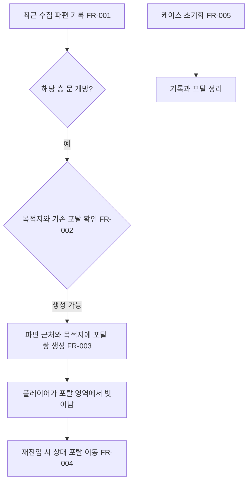

# 층 개방 파편 포탈

## 1. 개요
- 목적: 층의 문이 열리면 수집한 파편 근처와 해당 층의 potal_destination에 포탈 쌍을 만들어 양방향 이동한다.
- 대상: 플레이어와 미로 제작자.

## 2. 범위
- 포함: 층 개방 감지, 최근 수집 파편 기록, 층별 양방향 포탈 한 쌍, 초기화와 프리팹.
- 제외: 새로운 목적지 위치 추정, 물리 Collider, 새 UI, 테스트 코드.

## 3. 기술 방향
- 사용 기술/API: MemoryFragment.PickedUp, MazeGate.CanPass, LineRenderer, 프리팹.
- 핵심 방식: 파편이 속한 층 소유 문의 통과 조건이 충족되면 파편 근처와 Inspector의 목적지에 포탈을 하나씩 생성해 서로 연결한다. 시선 진입 시 상대 포탈 위치로 이동하고 도착 포탈은 이탈 전까지 진입을 막는다.
- 선택하지 않은 방식: 프레임마다 포탈 생성, 임의 목적지 자동 배치.
- 외부 의존성: EyeMazeDirector, IrisMaze, GazeCursor, MemoryFragment, MazeLayer, MazeGate.

## 4. 구조
| 구분 | 이름 | 역할 |
|------|------|------|
| 클래스 | FragmentPortalSystem | 층별 파편·목적지 연결과 포탈 생성 관리 |
| 클래스 | FragmentPortal | 진입 감지와 이동 요청 |
| 프리팹 | FragmentPortal | 구분되는 고리형 포탈 |
| 씬 | EyeMaze | 층별 destination 참조와 생성 설정 |

- 오브젝트 구성: 디렉터에 시스템을 붙이고 층과 destination을 연결한다. 출발 포탈은 파편과 같은 층 아래, 도착 포탈은 destination 아래에 생성되어 각 기준점의 이동과 회전을 따른다.
- 클래스 간 관계: 수집 이벤트 → 시스템 → 포탈 → 디렉터의 이동 진입점.
- 실행 순서 의존성: 수집 기록 후 LateUpdate에서 생성하며 읽기·깜빡임 중에는 이동하지 않는다.
- 기존 코드와의 접점: GazeCursor에 월드 좌표 이동, EyeMazeDirector에 포탈 이동 진입점을 추가한다.

## 5. 동작 플로우차트

## 6. 요구사항
- FR-001: 파편 수집 시 해당 미로·케이스의 파편만 기록하고 층별 최근 파편을 저장한다.
- FR-002: 파편이 있는 층의 소유 문이 CanPass이면 해당 층이 열린 것으로 판단한다. 목적지는 층별 Inspector 참조를 사용하고 누락되면 경고 후 해당 포탈 생성만 보류한다.
- FR-003: 열린 층마다 최근 수집 파편의 지정 오프셋과 목적지 위치에 포탈을 하나씩 생성한다. 각 층에 한 쌍만 생성하며 수동 목적지 배치는 변경하지 않는다.
- FR-004: 조작 가능한 관찰 중 포탈 영역을 벗어났다가 들어오면 상대 포탈의 현재 월드 좌표로 시선을 옮기며 속도와 밀려남을 정리한다. 도착 직후 양쪽 진입을 잠가 자동 왕복을 막고 영역 이탈 후 재진입해야 돌아갈 수 있다. 읽기 중 또는 생성 직후 자동 이동하지 않는다. UI에 포탈 이동 전용 문구를 표시하지 않는다.
- FR-005: 파편 상태 초기화 또는 케이스 변경 시 양쪽 포탈과 수집 기록을 정리한다. 관찰 종료·재진입으로 같은 케이스의 포탈이 중복되지 않는다.

### 상태와 데이터
- 층별 최근 파편 참조와 생성 포탈을 보관한다.

### 예외 및 경계 조건
- 층 안의 여러 문 중 하나라도 통과 가능하면 그 층의 지름길을 제공한다.
- 원래부터 열린 층은 파편 수집 후 생성한다.
- destination 누락 시 다른 층의 목적지로 대신 보내지 않는다. 세 층의 Potal_Destination이 씬에 연결돼 있으며, 2·3층의 초기 배치는 스펙 022에서 다룬다.
- 깜빡임으로 벽이 재생성되어도 포탈은 벽 컨테이너와 분리해 유지한다.

## 7. Inspector 노출값
| 필드 | 타입 | 기본값 | 설명 |
|------|------|--------|------|
| 디렉터·포탈 프리팹 | 참조 | 씬 연결 | 생성과 이동 |
| 층별 연결 | MazeLayer·Transform 배열 | 씬 연결 | 각 층의 potal_destination |
| 생성 오프셋 | Vector2 | (0.14, 0) | 파편 기준 층 로컬 오프셋 |
| 진입 반지름 | float | 0.13 | 포탈 접촉 거리 |

## 8. 인수 조건
- FR-001: 파편을 수집하여 해당 층의 기록만 변경되는지 확인한다.
- FR-002: 잠긴 문에서는 생성하지 않고 열리면 생성하며 목적지 누락은 건너뛰는지 확인한다.
- FR-003: 파편 근처와 목적지에 층별 포탈 한 쌍만 생성되는지 확인한다.
- FR-004: 양방향 이동과 도착 직후 자동 재이동 차단을 확인하며 UI에 이동 전용 문구가 나오지 않는지 확인한다.
- FR-005: 재생성 중복 방지와 케이스 초기화 시 양쪽 포탈 정리를 확인한다.

구현 및 확인 결과:
- FR-001: `FragmentPortalSystem.RecordFragment`에서 미로와 활성 파편을 필터링하고 층별 최근 파편을 저장한다. 실제 케이스의 0층 파편 수집 이벤트로 생성 조건을 확인했다.
- FR-002: `IsLayerOpen`과 층별 연결 목록을 사용한다. 문이 잠긴 상태의 포탈 수 0, 신뢰 조건 충족 후 1을 확인했다. 세 층의 목적지가 연결돼 있다. 2·3층은 파편 수집과 개방 조건 충족 후 각각 한 쌍이 생성되고, 왕복 이동 오차는 최대 약 0.00000024였다.
- FR-003: `FragmentPortalSystem.LateUpdate`와 `FragmentPortal.prefab`에서 파편 근처에 생성한다. 여러 번 갱신해도 포탈 수가 1로 유지됐다. 포탈의 실제 게임 화면도 확인했다.
- FR-004: `FragmentPortal.LateUpdate`, `EyeMazeDirector.TravelThroughPortal`, `GazeCursor.MoveToWorld`에서 진입과 이동을 처리한다. 읽기 중 및 생성 직후 이동 차단을 확인했고 영역 이탈 후 재진입 시 목적지와 시선의 위치 오차는 약 0.00000018이었다.
- FR-005: `ClearPortals`와 케이스 변경 확인으로 정리한다. 수집 상태 초기화 이벤트 후 생성 포탈 기록이 0개로 정리됐다. 컴파일 성공을 확인했다.
- 양방향 확장 FR-003~005: `FragmentPortalSystem`이 파편 쪽과 목적지 쪽 포탈을 각각 하나 생성하고 `FragmentPortal.Initialize`로 서로 연결한다. 이동하면 양쪽 진입 대기를 해제하여 영역 이탈 전 재이동을 차단한다. UI 이동 전용 문구를 삭제했다. Play Mode에서 출발·도착 각 1개 유지, 왕복 위치 오차 약 0.00000024 이하, 도착 위치에서 여러 번 갱신해도 자동 왕복 없음, 초기화 후 양쪽 기록 0개와 비활성화를 확인했다. 컴파일은 성공했다.

## 9. 미결 사항
- 없음. 목적지가 누락되면 생성하지 않고 설정 누락으로 처리한다.
