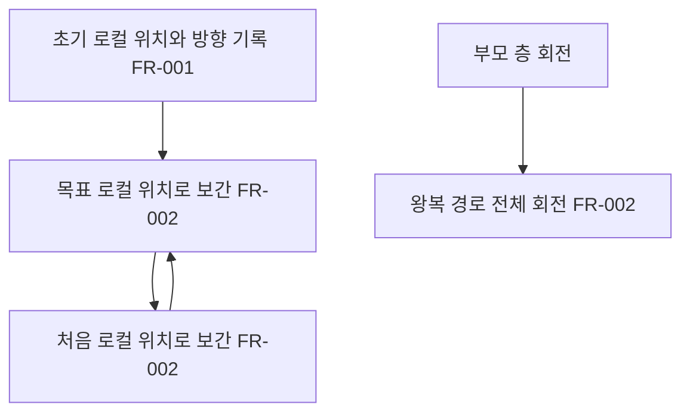

# 왕복 장애물의 층 회전 추종

## 1. 개요
- 목적: 왕복 장애물이 미로 회전 후 이전 월드 위치로 돌아가는 문제를 해결한다.
- 대상: 미로 제작자와 플레이어.

## 2. 범위
- 포함: MoveObstaclesBasic의 왕복 위치와 보간 좌표계 변경.
- 제외: 다른 장애물 변경, 씬 배치 변경, 이동 시간·거리·피격 설정 변경, 테스트 코드.

## 3. 기술 방향
- 사용 기술/API: Transform.localPosition, Transform.InverseTransformVector, Vector3.Lerp.
- 핵심 방식: 초기 위치를 부모 로컬 좌표로 기록하고 월드 이동 벡터를 부모 좌표로 변환해 목표를 구한다. 왕복 보간 결과를 localPosition에 반영한다.
- 선택하지 않은 방식: 고정 월드 위치를 매 프레임 대입.
- 외부 의존성: 기존 MazeLayer의 부모 Transform 회전과 기존 피격 처리.

## 4. 구조
| 구분 | 이름 | 역할 |
|------|------|------|
| 클래스 | MoveObstaclesBasic | 부모 좌표계에서 왕복 이동 |

- 오브젝트 구성: 기존 Obstacles 아래 장애물 배치를 유지한다.
- 클래스 간 관계: 부모의 위치·회전은 Transform 계층으로 자동 반영한다.
- 실행 순서 의존성: Start에서 현재 수동 배치를 기준으로 두 끝점을 기록한다.
- 기존 코드와의 접점: MoveObstacle, MoveTo.

## 5. 동작 플로우차트

## 6. 요구사항
- FR-001: 초기 수동 위치와 로컬 Y축 진행 방향을 부모 좌표계로 기록하며 기존 편도 월드 이동 거리와 시간을 보존한다.
- FR-002: 왕복 중 부모 층이 회전하면 장애물과 이동 경로가 함께 회전하고 이전 월드 위치로 복귀하지 않는다. 기존 피격 로직은 유지한다.

### 상태와 데이터
- 기존 코루틴의 두 끝점 Vector3를 부모 로컬 좌표로 사용한다.

### 예외 및 경계 조건
- 부모가 없으면 월드 좌표와 같은 로컬 좌표에서 이동한다.
- 부모의 비균일 크기가 있어도 초기 월드 이동 거리를 보존하도록 방향이 아닌 벡터를 역변환한다.

## 7. Inspector 노출값
- 기존 이동 시간·거리·피격 참조와 수치를 그대로 사용한다. 추가 필드 없음.

## 8. 인수 조건
- FR-001: 기존 씬의 왕복 거리와 편도 시간이 유지되는지 확인한다.
- FR-002: 실행 중 부모 층을 회전한 뒤에도 현재 로컬 위치가 동일한 왕복 선분 안에 있고 월드 위치가 회전한 경로 위에 유지되는지 확인한다.

구현 및 확인 결과:
- FR-001: `MoveObstacle`에서 localPosition을 시작점으로 사용하고 기존 월드 이동 벡터를 부모의 InverseTransformVector로 변환한다. 기존 필드명·거리·시간·피격 코드를 유지했다.
- FR-002: `MoveTo`의 매 프레임 위치와 도착 위치를 localPosition에 반영한다. Play Mode에서 0층을 45도 회전한 뒤 프레임 3과 4를 실제 진행시켜 장애물 4개의 이동을 확인했다. 부모 로컬 왕복 선분의 수직 오차는 최대 약 0.00000017이었고 이전 월드 위치로 돌아가지 않았다. 컴파일 성공을 확인했으며 검증 후 Play Mode를 종료해 저장 배치를 보존했다.
- 씬 참조 확인: MoveObstaclesBasic 4개의 Director 참조 누락으로 CheckContact에서 반복 NullReferenceException이 발생하고 Console Error Pause가 켜져 있었다. 네 참조를 해당 씬의 게임 디렉터로 연결해 저장했다. 재실행에서 모든 참조가 유효했고 프레임 1092→1233 진행 중 isPaused=false를 확인했다. 검증 후 Play Mode를 종료하고 Pause=false로 복구했다. 별도의 Unity GameObjectInspector·TransformInspector 선택 대상 오류는 이동 스크립트 오류와 구분된다.

## 9. 미결 사항
- 없음
