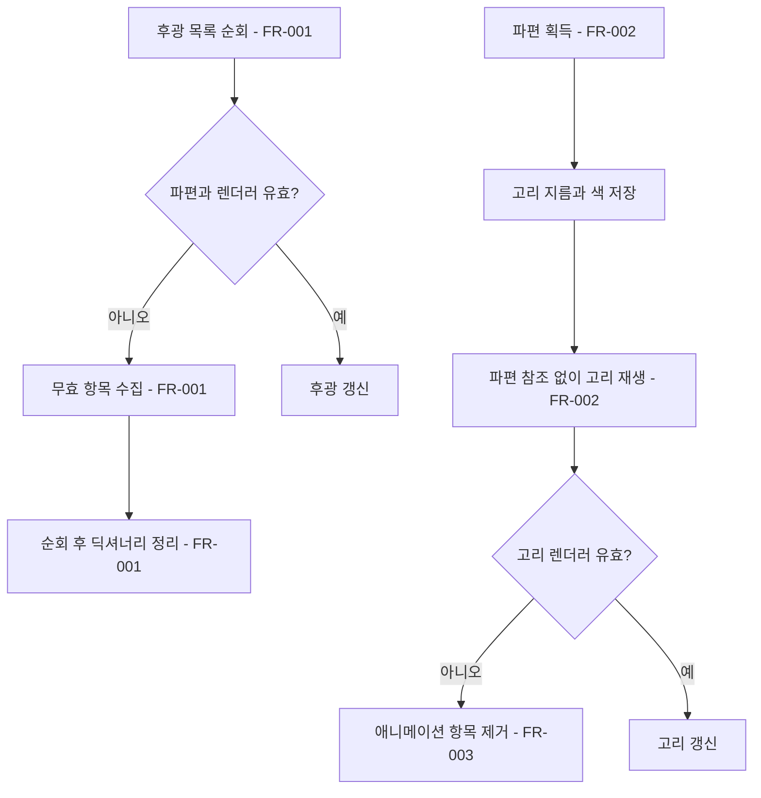

# 파편 피드백의 파편 수명 분리

## 1. 개요

- 목적: 파괴된 기억 파편 참조를 후광 갱신과 획득 고리 애니메이션이 계속 사용해 발생하는 MissingReferenceException을 막는다.
- 대상: 눈동자 미로의 파편 피드백 시스템.

## 2. 범위

- 포함:
  - 파괴된 파편과 렌더러를 후광 목록에서 제거
  - 획득 고리 애니메이션이 파편 객체에 의존하지 않도록 필요한 시각값을 획득 시점에 저장
  - 외부에서 고리 렌더러가 파괴된 경우 애니메이션 목록에서 정리
- 제외:
  - Unity Editor Inspector의 stale 선택 대상 오류
  - 파편 생성, 삭제, 씬 전환 정책 변경

## 3. 기술 방향

- 사용 기술/API: UnityEngine.Object null 비교, Dictionary, List, LineRenderer.
- 핵심 방식: 매 프레임 후광 목록의 파편 및 렌더러 생존 여부를 확인하고, 파괴된 항목은 순회가 끝난 뒤 두 딕셔너리에서 제거한다. 획득 고리는 파편 참조 대신 시작 지름과 색을 보관한다.
- 선택하지 않은 방식: 파편 파괴 시점에 모든 피드백 소유자를 직접 호출하는 결합 방식.
- 외부 의존성: MemoryFragment, MazeLayer, IrisMaze, Shapes.

## 4. 구조

| 구분 | 이름 | 역할 |
|------|------|------|
| 클래스 | FragmentFeedback | 파편 후광 목록과 획득 고리 수명 관리 |
| 클래스 | ActiveRing | 파편과 분리된 고리 애니메이션 상태 보관 |

- 오브젝트 구성: 기존 씬의 FragmentFeedback 컴포넌트를 사용한다.
- 클래스 간 관계: FragmentFeedback이 파편을 조회해 후광을 그리고, 획득 이벤트에 고리 상태를 생성한다.
- 실행 순서 의존성: LateUpdate에서 무효 후광 항목을 수집하고 딕셔너리 순회가 끝난 뒤 제거한다.
- 기존 코드와의 접점: FragmentFeedback.UpdateGlows, PlayRing, UpdateRings, DrawRing, ClearRings.

## 5. 동작 플로우차트

## 6. 요구사항

- FR-001: 후광을 갱신할 때 파편 또는 렌더러가 파괴된 항목은 프레임 갱신을 건너뛰고 딕셔너리에서 제거한다.
- FR-002: 파편 획득 시 생성한 고리는 시작 지름과 색을 저장해 파편 객체가 파괴된 뒤에도 애니메이션을 계속한다.
- FR-003: 고리 렌더러가 먼저 파괴되면 해당 고리 상태를 애니메이션 목록에서 제거한다.

### 상태와 데이터

| 이름 | 타입 | 설명 | 초기값 |
|------|------|------|--------|
| _staleFragments | List<MemoryFragment> | 후광 딕셔너리에서 제거할 파편 키 | 빈 목록 |
| ActiveRing.StartDiameter | float | 고리 시작 지름 | 획득 당시 값 |
| ActiveRing.Color | Color | 고리 표시 색 | 획득 당시 색 |

### 예외 및 경계 조건

- 파편이나 렌더러가 파괴된 프레임: Unity 객체 null 비교로 감지하고 유효하지 않은 렌더러를 호출하지 않는다.
- 파편 층이 이미 파괴된 상태로 획득 이벤트가 전달되면 고리를 만들지 않는다.

## 7. Inspector 노출값

| 필드 | 타입 | 기본값 | 설명 |
|------|------|--------|------|
| 해당 없음 | - | - | 기존 Inspector 설정을 변경하지 않는다. |

## 8. 인수 조건

- FR-001: Play Mode에서 기억 파편이 파괴되거나 케이스가 전환된 뒤 Console에 FragmentFeedback의 MissingReferenceException이 반복되지 않고 무효 후광 항목이 제거되는지 확인한다.
- FR-002: 파편 획득 직후 파편 오브젝트를 제거해도 고리가 남은 재생 시간 동안 정상적으로 사라지는지 확인한다.
- FR-003: 고리의 부모 층을 먼저 제거해도 Console 오류 없이 애니메이션 항목이 정리되는지 확인한다.

구현 및 확인 결과:
- FR-001: `UpdateGlows`에서 파괴된 파편/렌더러 키를 임시 목록에 모은 뒤 두 후광 딕셔너리에서 제거한다. Play Mode에서 파편 하나를 임시 파괴하고 수 초간 실행했을 때 `FragmentFeedback` 예외가 추가되지 않았다.
- FR-002: `ActiveRing`은 파편 참조 대신 획득 시점의 지름과 색을 보관한다. 고리 갱신 중 원본 파편을 참조하지 않는다.
- FR-003: `UpdateRings`와 `ClearRings`가 이미 파괴된 LineRenderer를 건너뛴다. Play Mode 검증에서 컴파일 오류 없이 프레임이 1에서 8,204까지 진행되고 `isPaused=false`였다.
- 별도 에디터 오류: `GameObjectInspector.OnEnable` 및 `TransformInspector.OnEnable`에서 발생하는 `m_Targets`/null 대상 오류는 `FragmentFeedback` 호출 스택과 무관한 Unity Editor Inspector 오류로 남아 있다. 이 오류는 Inspector 창 재생성 후에도 Play 전환 때 재현됐다.

## 9. 미결 사항

- 없음
