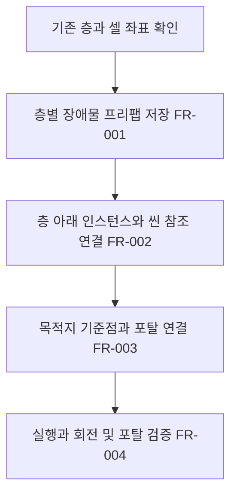

# 2·3층 장애물과 포탈 목적지 배치

## 1. 개요
- 목적: 미완료된 2·3층 장애물 프리팹·씬 배치와 층별 포탈 목적지 연결을 마무리한다.
- 대상: 미로 제작자와 플레이어.

## 2. 범위
- 포함: 기존 왕복 장애물과 Gunner를 재사용한 층별 프리팹, 2·3층 인스턴스 배치, 포탈 목적지 연결, Play Mode 확인.
- 제외: 1층 배치 변경, 신규 장애물 동작, 대화 데이터 수정, UI 변경, 테스트 코드.

## 3. 기술 방향
- 사용 기술/API: Unity Editor, PrefabUtility, SerializedObject, 기존 MoveObstaclesBasic·MazeGunner·FragmentPortalSystem.
- 핵심 방식: 2·3층에 각각 왕복 장애물 2개와 Gunner 1개를 포함한 프리팹을 사용한다. 인물별 파편 묶음 아래에 인스턴스를 두고, 각 파편에 인접한 접근 셀에 한 번 배치한다. 현재 벽 기준 연결된 이웃 셀을 우선하며 같은 셀과 목적지 셀은 비운다. 인물 전환 시 기존 파편 묶음의 활성 전환을 함께 따른다. 씬의 Director·Cursor 참조는 프리팹 인스턴스에 연결한다.
- 선택하지 않은 방식: 런타임 자동 배치, 기존 1층 오브젝트 이동, 수동 배치의 반복 덮어쓰기.
- 외부 의존성: 스펙 015·019·020의 기존 발사·포탈·부모 로컬 이동 동작.
- 승인 범위: 사용자의 미완료 3개 항목 진행 지시를 적용한다. FR-001~FR-004 순서로 진행한다.

## 4. 구조
| 구분 | 이름 | 역할 |
|------|------|------|
| 프리팹 | Layer2Obstacles | 2층 왕복 장애물 2개와 Gunner 1개 |
| 프리팹 | Layer3Obstacles | 3층 왕복 장애물 2개와 Gunner 1개 |
| 씬 | EyeMaze | 층 아래 장애물 프리팹 인스턴스와 목적지 연결 |

- 오브젝트 구성: 각 MazeLayer의 인물별 파편 묶음 아래 프리팹 인스턴스를 두고, 층 바로 아래 별도 Potal_Destination 기준점을 둔다. 프리팹 기본 좌표는 은재 기준이며 지수 인스턴스는 해당 파편 좌표로 재정의한다.
- 클래스 간 관계: 기존 장애물은 씬 Director를 참조하고 기존 포탈 시스템은 층과 목적지 Transform을 참조한다.
- 실행 순서 의존성: 기존 컴포넌트의 Awake·Start 동작을 유지한다.
- 기존 코드와의 접점: 런타임 코드 변경 없이 씬·프리팹 설정으로 연결한다.

## 5. 동작 플로우차트

## 6. 요구사항
- FR-001: 장애물 애셋을 생성할 때 2층·3층별 프리팹에 기존 왕복 장애물 2개와 Gunner 1개를 저장한다.
- FR-002: 씬에 배치할 때 프리팹 인스턴스를 해당 층의 인물별 파편 묶음 아래 두고, 파편이 있는 셀과 목적지 셀을 피한 인접 접근 셀에 배치한다. 필요한 Director·Cursor 참조를 연결하며 1층 설정은 보존한다. 케이스 전환 시 해당 인물의 장애물만 활성화한다.
- FR-003: 포탈 목적지가 없는 2·3층에 편집 가능한 Transform을 한 번 생성하고 FragmentPortalSystem에 연결한다. 초기 위치는 각 층 가장 안쪽 고리의 출구 문과 같은 섹터 중앙을 사용한다.
- FR-004: Play Mode에서 프레임 진행, 신규 장애물 이동·발사와 층 회전 추종, 2·3층 포탈 생성·왕복 이동을 확인한다.

### 상태와 데이터
| 이름 | 타입 | 설명 | 초기값 |
|------|------|------|--------|
| 층별 장애물 | 프리팹 인스턴스 | 2·3층의 인물별 한 묶음 | 활성 케이스별 왕복 2개·Gunner 1개 |
| 층별 목적지 | Transform | 기존 포탈 시스템의 목적지 | 해당 층 출구 셀 중앙 |

### 예외 및 경계 조건
- 기존 목적지가 이미 연결돼 있으면 해당 Transform과 위치를 유지한다.
- 초기 배치 이후 수동으로 편집한 위치·회전·시간은 런타임에서 덮어쓰지 않는다.
- 포탈 동작 조건과 자동 왕복 차단은 스펙 019를 유지한다.

## 7. Inspector 노출값
| 필드 | 타입 | 기본값 | 설명 |
|------|------|--------|------|
| 장애물·목적지 Transform | Transform | 씬 저장값 | 제작자가 위치·회전·크기 편집 |
| 왕복 이동 시간·거리 | float | 1초·셀 내 거리 | 기존 컴포넌트에서 편집 |
| Gunner 발사 설정 | 기존 필드 | 기존 프리팹 기준 | 예고·재장전·속도·거리 편집 |
| 층별 목적지 연결 | 기존 배열 | 각 층과 목적지 | 포탈 시스템에서 편집 |

## 8. 인수 조건
- FR-001: Project에서 두 프리팹 각각에 왕복 장애물 2개·Gunner 1개가 있는지 확인한다.
- FR-002: Hierarchy에서 2·3층의 인물별 파편 묶음 아래 프리팹 연결과 필수 참조를 확인한다. 장애물이 파편 접근 셀에 있고 파편 셀과 목적지 셀을 비우는지, 케이스 전환 시 해당 인물의 장애물만 켜지는지 확인한다. 1층 Transform·설정이 유지되는지 비교한다.
- FR-003: Inspector에서 세 층의 목적지가 모두 연결되고 신규 목적지가 해당 층 셀 안에 있는지 확인한다.
- FR-004: Play Mode에서 프레임 진행과 장애물 이동·발사, 층 회전 후 부모 좌표 추종, 두 층의 포탈 왕복 및 Console 오류를 확인한다.

구현 및 확인 결과:
- FR-001: `Layer2Obstacles.prefab`과 `Layer3Obstacles.prefab`에 각각 왕복 장애물 2개와 Gunner 1개를 저장했다. 런타임 코드는 변경하지 않았다.
- FR-002: `EyeMaze.unity`의 은재·지수 파편 묶음 아래 각 2개씩 총 4개 인스턴스를 배치했다. 파편과 같은 셀·목적지 셀을 피했고, 파편과 배치 셀 중심 거리는 약 0.35~0.83이다. 인물 전환 후 은재 장애물 0개, 지수 왕복 장애물 4개·Gunner 2개 활성화를 확인했다. 각 케이스에서 활성 왕복 장애물 4개의 위치 변화와 두 Gunner의 실제 발사 기록을 확인했다. 기존 1층 장애물의 위치·회전·크기는 유지됐다.
- FR-003: 세 층의 목적지 참조가 연결돼 있고, 2·3층의 목적지는 해당 층의 가장 안쪽 출구 셀 중앙에 저장됐다. 양쪽 포탈이 각각 한 쌍씩 생성되는 것을 확인했다.
- FR-004: Play Mode에서 은재 확인 시 203프레임, 지수 확인 시 179프레임이 진행됐고 일시정지되지 않았다. 층을 45도 회전한 뒤 활성 왕복 장애물 4개의 로컬·월드 좌표 오차는 0이었다. 2·3층 포탈 도착 오차는 각각 약 0.00000024·0.00000006, 복귀 오차는 모두 0이었다. Console 오류 0건과 컴파일 실패 없음, 게임 화면을 확인했다. 검증용 신뢰·깜빡임 설정은 Play Mode 종료로 복원했다.

## 9. 미결 사항
- 없음.
