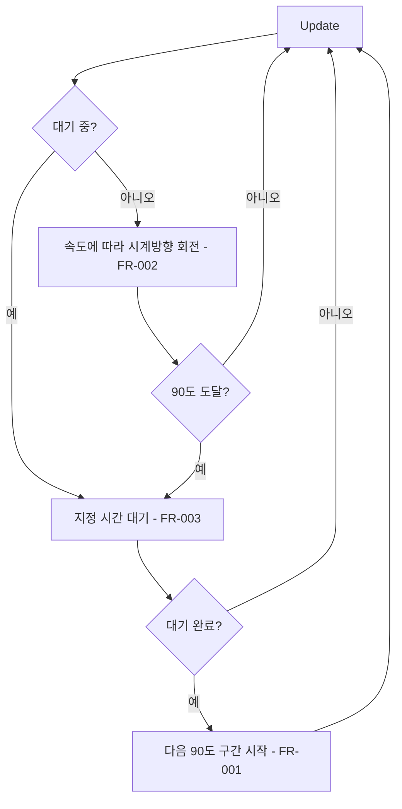

# 장애물 90도 회전과 대기 반복

## 1. 개요
- 목적: 장애물이 시계방향으로 90도 회전한 뒤 지정 시간만큼 쉬는 동작을 반복한다.
- 대상: 장애물 제작자.

## 2. 범위
- 포함: RotationObstaclesBasic의 회전·대기 루프와 Inspector 속도·대기 시간.
- 제외: 씬·프리팹 배치 변경, 피격 처리, 공전, 다른 스크립트 수정.

## 3. 기술 방향
- 사용 기술/API: Transform.Rotate, Time.deltaTime, Space.Self, Mathf.Min.
- 핵심 방식: Update에서 현재 구간의 누적 회전량을 기록하고 남은 각도 이하로만 회전하여 정확히 90도에서 멈춘다. 이후 지정 대기 시간을 경과시키고 다음 90도 구간을 시작한다.
- 선택하지 않은 방식: 순간 90도 회전, 초기 회전값 덮어쓰기, Rigidbody 회전.
- 외부 의존성: UnityEngine.

## 4. 구조
| 구분 | 이름 | 역할 |
|------|------|------|
| 클래스 | RotationObstaclesBasic | 자체 중심 기준 90도 회전과 대기 반복 |

- 오브젝트 구성: 회전할 장애물에 기존 컴포넌트를 사용한다.
- 클래스 간 관계: 해당 없음.
- 실행 순서 의존성: 해당 없음.
- 기존 코드와의 접점: Update에 회전·대기 상태 처리를 추가한다.

## 5. 동작 플로우차트

## 6. 요구사항
- FR-001: 플레이 중 장애물이 시계방향 90도 회전을 완료하면 대기 후 다음 90도 회전을 반복한다.
- FR-002: 제작자가 Inspector 회전 속도를 변경하면 회전 구간의 초당 회전량에 반영한다.
- FR-003: 회전 완료 후 Inspector 대기 시간만큼 현재 각도를 유지한다.

### 상태와 데이터
- 현재 구간의 누적 회전량, 대기 경과 시간과 대기 여부를 비직렬화 private 필드로 관리한다.
- 회전 구간의 각도는 상수 90도다.

### 예외 및 경계 조건
- 회전 속도 0이면 회전 구간에서 멈춘다. 이미 시작한 대기는 계속 진행한다.
- 대기 시간 0이면 별도 대기 없이 다음 90도 회전을 진행한다.
- 음수 속도와 대기 시간은 계산 시 0으로 제한한다.
- Time.timeScale이 0이면 회전과 대기를 멈춘다.
- 비활성화 동안 진행을 멈추고 다시 활성화하면 현재 진행 상태에서 이어간다.
- 초기 위치·회전·크기를 덮어쓰지 않으며 부모 회전도 유지한다.

## 7. Inspector 노출값
| 필드 | 타입 | 기본값 | 설명 |
|------|------|--------|------|
| _rotationSpeed | float | 90 | 초당 회전 각도. 최소 0, 단위 도/초 |
| _pauseSeconds | float | 1.5 | 매 90도 회전 후 쉬는 시간. 최소 0, 단위 초 |

## 8. 인수 조건
- FR-001: 기본값에서 약 1초간 90도 회전하고 1.5초 쉬는 동작이 두 구간 이상 반복되는지 확인한다.
- FR-002: 속도 180에서 90도 회전에 약 0.5초가 걸리고, 회전 중 속도 0이면 현재 각도에서 멈추는지 확인한다.
- FR-003: 대기 시간을 3초로 변경하면 90도마다 약 3초 쉬고 0이면 별도 대기 없이 이어 도는지 확인한다.

구현 및 확인 결과:
- FR-001: RotationObstaclesBasic.Update에서 누적 각도와 90도까지 남은 각도를 사용해 회전량을 제한하고 완료 시 누적 각도를 초기화한다. 대기 종료 후 다음 회전 구간을 진행한다.
- FR-002: 기존 _rotationSpeed를 매 프레임 읽고 Time.deltaTime에 곱한다. 음수 속도는 0으로 제한한다.
- FR-003: Inspector에 _pauseSeconds를 기본 1.5초로 노출하고 대기 중에는 Transform을 변경하지 않는다. 0 이하이면 대기 상태에 진입하지 않는다.
- Unity 컴파일 완료, failed=false, compilationFailed=false, 컴파일 오류 목록 0개와 Console 오류 0개를 확인했다. 사용자가 실행 중인 Play Mode를 유지하기 위해 재시작·검증용 오브젝트 추가·시간 설정 변경은 수행하지 않았다. 실제 회전·대기 시간 실측은 수행하지 않았다.

## 9. 미결 사항
- 없음
