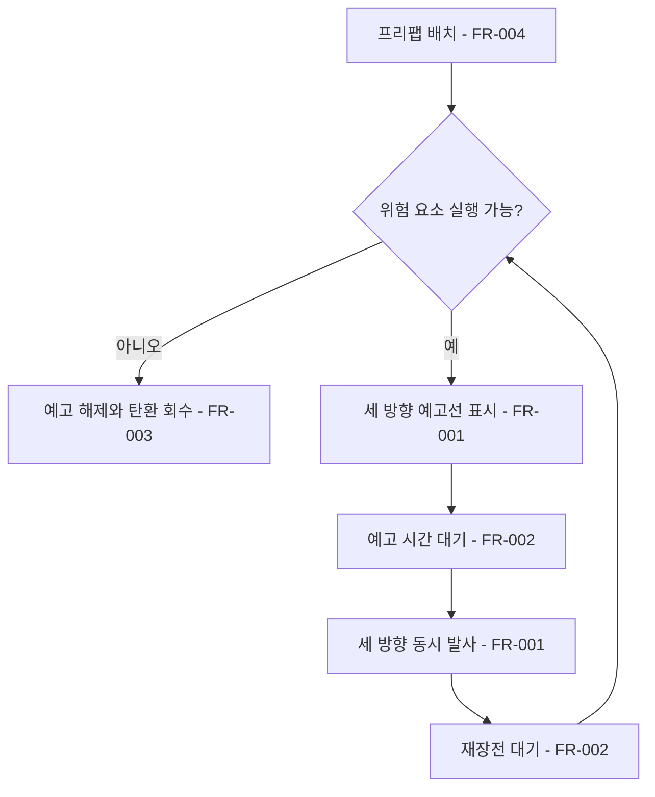

# 세 방향 주기 발사 포탑

## 1. 개요
- 목적: 45도, 90도, 135도 방향으로 동시에 포탄을 반복 발사하는 재사용 포탑을 제공한다.
- 대상: 미로 제작자와 플레이어.

## 2. 범위
- 포함: MazeGunner의 다방향 발사 옵션과 ThreeWayTurret 프리팹 생성.
- 제외: 기존 포탑의 발사 패턴 변경, 씬 자동 배치, 새로운 피격 규칙, 테스트 코드.

## 3. 기술 방향
- 사용 기술/API: 기존 MazeGunner, MazeBullet, ObjectPool, LineRenderer, Quaternion.AngleAxis.
- 핵심 방식: MazeGunner에 발사 각도 목록과 추가 예고선 참조를 제공한다. 기존 포탑은 기본 목록 0도로 단발을 유지하고 새 프리팹은 45도, 90도, 135도를 저장한다. 한 발사 시점에 각 방향으로 탄환을 하나씩 대여한다.
- 선택하지 않은 방식: 매 발사마다 탄환 생성·파괴, 플레이어 자동 조준.
- 외부 의존성: EyeMazeDirector.CanRunHazards, 기존 탄환 피격과 반환 로직.

## 4. 구조
| 구분 | 이름 | 역할 |
|------|------|------|
| 클래스 | MazeGunner | 단방향 및 다방향 예고·발사·풀 관리 |
| 클래스 | MazeBullet | 기존 이동·피격·회수 동작 재사용 |
| 프리팹 | ThreeWayTurret | 포탑 본체, Muzzle, 세 예고선, Bullet Pool 구성 |

- 오브젝트 구성: 프리팹 루트의 MazeGunner가 Muzzle과 예고선 세 개를 참조한다.
- 클래스 간 관계: MazeGunner가 기존 MazeBullet을 소유하며 Director와 Cursor는 기존 연결 방식을 사용한다.
- 실행 순서 의존성: 기존 Awake 풀 초기화 후 LateUpdate로 예고·발사를 진행한다.
- 기존 코드와의 접점: MazeGunner의 예고선 갱신, 발사, 초기화와 입력 검증. 기존 씬과 Gunner 프리팹은 편집하지 않는다.

## 5. 동작 플로우차트

## 6. 요구사항
- FR-001: 발사 시점에 포탑은 로컬 오른쪽을 0도로 삼고 반시계방향 45도·90도·135도에 포탄을 동시에 하나씩 발사한다.
- FR-002: 실행 가능한 동안 포탑은 Inspector의 예고 시간과 재장전 시간의 합을 주기로 반복 발사한다.
- FR-003: 탄환 비행 중 기존 포탑과 같은 피격·사거리·수명·풀 반환 규칙을 적용하고, 위험 요소 실행이 중단되면 예고와 활성 탄환을 정리한다.
- FR-004: 제작자가 ThreeWayTurret 프리팹을 미로에 배치하면 참조가 연결된 세 방향 포탑을 사용할 수 있다.

### 상태와 데이터
- 기존 발사 단계, 타이머, 활성 탄환 목록과 풀을 재사용한다.
- 기존 포탑의 각도 기본값은 0도 한 개로 유지한다.

### 예외 및 경계 조건
- 포탑을 회전하면 세 발사 방향도 함께 회전한다. 발사 이후 탄환은 발사 시 방향으로 직진한다.
- 발사 각도 목록이 비어 있으면 기존처럼 0도 단발로 처리한다.
- 예고 시간과 재장전 시간은 각각 최소 0.01초로 제한한다.
- 새 프리팹은 씬에 자동 배치하지 않는다.

## 7. Inspector 노출값
| 필드 | 타입 | 새 프리팹 기본값 | 설명 |
|------|------|----------------|------|
| 발사 각도 목록 | float[] | 45, 90, 135 | Muzzle 로컬 오른쪽 기준 각도 |
| 추가 예고선 | LineRenderer[] | 두 개 연결 | 기존 예고선과 함께 세 방향 표시 |
| 예고 시간 | float | 0.8초 | 처음 발사까지 예고 시간 |
| 재장전 시간 | float | 1.2초 | 발사 후 대기. 기본 반복 주기는 2초 |
| 기존 탄환 설정 | 기존 타입 | 속도 2, 사거리 0.8, 수명 3초 | 기존 속도·사거리·수명·접촉 반지름·풀 설정 재사용 |

## 8. 인수 조건
- FR-001: 회전 0인 포탑에서 오른쪽 위·위·왼쪽 위로 동시에 세 발이 나가고, 기존 Gunner는 단발을 유지하는지 확인한다.
- FR-002: 기본값으로 첫 예고 후 약 2초 간격으로 세 발씩 반복 발사하며 Inspector 시간 변경이 반영되는지 확인한다.
- FR-003: 탄환 피격과 수명·사거리 회수, 관찰 종료 시 예고와 탄환 정리가 기존대로 동작하는지 확인한다.
- FR-004: 새 프리팹의 탄환과 세 예고선 참조가 유효하고 미로에 배치 후 실행 가능한지 확인한다.

구현 및 확인 결과:
- FR-001: MazeGunner.GetFireDirection과 LateUpdate에서 Muzzle 회전과 발사 각도를 합성하고 같은 프레임에 각 방향 탄환을 대여한다. Play Mode에서 45도, 90.00001도, 135도로 세 발씩 나가는 것을 세 차례 관찰했다. 기존 Gunner 프리팹도 별도 실행 인스턴스에서 단발을 확인했다.
- FR-002: 기존 예고·재장전 타이머를 재사용하며 새 프리팹에 0.8초 예고와 1.2초 재장전을 저장했다. 관측 발사 시점은 시작 후 0.807초, 2.823초, 4.840초였다. 프레임은 2921에서 3303까지 진행했다.
- FR-003: 기존 MazeBullet의 이동·피격·반환을 그대로 사용한다. 실제 비행 종료 후 활성 탄환 0개와 풀 자식 12개를 확인했다. 별도 실행 점검에서 세 예고선 표시, 활성 탄환 3개 발사 후 ExitGaze와 다음 LateUpdate 처리로 활성 탄환 0개, 예고선 모두 비활성, CanFire=false를 확인했다. 피격 수치 자체는 이번 작업에서 재검증하지 않았다.
- FR-004: Assets/EyeMaze/Prefabs/ThreeWayTurret.prefab에 탄환, Muzzle, 예고선 3개, 풀 기준점을 연결했다. 실제 미로 아래 임시 실행 인스턴스의 Director·Cursor 자동 연결과 발사를 확인했다. 씬에 영구 배치는 추가하지 않았고 Play Mode를 종료했다.
- Unity 컴파일 완료 상태에서 compilationFailed=false와 오류 목록 0개를 확인했다. 실행 검증 중 Console 오류도 0개였다.

## 9. 미결 사항
- 없음
