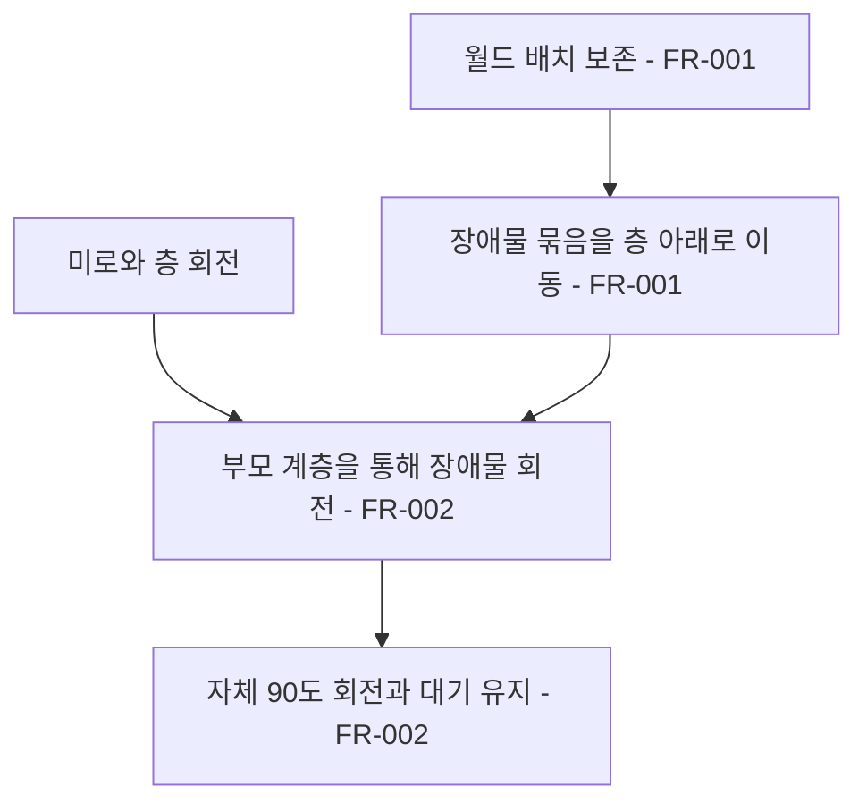

# 파편 아래 장애물의 미로 회전 추종 복구

## 1. 개요
- 목적: 장애물 묶음을 해당 층의 직접 자식으로 두어 미로와 층 회전의 전달 구조를 명확히 한다. 최초 진단에서 의심한 파편의 월드 회전 고정은 현재 부모 묶음에 MemoryFragment 컴포넌트가 없어 원인으로 확정할 수 없다.
- 대상: 3층 회전 장애물과 제작자.

## 2. 범위
- 포함: 현재 씬에서 파편 아래의 Layer3Obstacles를 같은 MazeLayer의 직접 자식으로 이동한다.
- 제외: 파편 표시 코드 변경, 장애물 회전 속도·대기 시간 변경, 다른 씬과 프리팹 변경.

## 3. 기술 방향
- 사용 기술/API: Unity Editor, Undo.SetTransformParent.
- 핵심 방식: 월드 배치를 보존하면서 Layer3Obstacles의 부모를 파편에서 기존 소속 MazeLayer로 변경한다. 부모 Transform 계층을 통해 미로와 층의 회전을 함께 받는다.
- 선택하지 않은 방식: MemoryFragment의 회전 고정 제거, 장애물 스크립트에서 미로 각도 중복 가산.
- 외부 의존성: MazeLayer, MemoryFragment, 기존 RotationObstaclesBasic.

## 4. 구조
| 구분 | 이름 | 역할 |
|------|------|------|
| 씬 오브젝트 | Layer3Obstacles | 3층의 직접 자식인 장애물 묶음 |

- 오브젝트 구성: 미로 / 층 3 / Layer3Obstacles / 회전 장애물.
- 클래스 간 관계: 기존 회전 코드는 자체 회전을 담당하고 부모 층은 미로 회전을 전달한다.
- 실행 순서 의존성: 중간 파편 묶음을 거치지 않고 해당 MazeLayer의 회전을 직접 상속한다.
- 기존 코드와의 접점: 스크립트 수정 없음.

## 5. 동작 플로우차트

## 6. 요구사항
- FR-001: 부모를 변경할 때 장애물의 현재 월드 위치·회전·크기와 Inspector 설정을 보존한다.
- FR-002: 미로 또는 해당 층이 회전하면 장애물의 위치와 방향이 함께 회전하며 자체 90도 회전·대기 동작도 유지한다.

### 상태와 데이터
- 별도 런타임 상태 없음.

### 예외 및 경계 조건
- Play Mode가 종료된 현재 편집 씬에서만 배치를 수정한다.
- 해당 묶음 이외의 파편과 장애물 배치는 변경하지 않는다.

## 7. Inspector 노출값
- 추가 없음. 기존 Rotation Speed와 Pause Seconds 유지.

## 8. 인수 조건
- FR-001: 변경 전후 각 장애물의 월드 Transform과 회전·대기 필드 값이 동일한지 확인한다.
- FR-002: Play Mode에서 부모 미로와 층을 회전시킨 후 장애물의 위치·방향 추종과 자체 회전·대기 진행을 확인한다. 검증 후 Play Mode를 종료한다.

구현 및 확인 결과:
- FR-001: 은재 파편 묶음 아래에서 회전 장애물 2개를 포함한 Layer3Obstacles 프리팹 인스턴스를 찾아 Undo.SetTransformParent로 같은 3층의 직접 자식으로 옮기고 EyeMaze 씬을 저장했다. 자식 전체의 월드 위치·회전·크기 변경 오차는 모두 0이었고 회전 스크립트의 직렬화 설정도 동일했다. 지수 파편 아래의 별도 Layer3Obstacles는 변경하지 않았다.
- FR-002: Play Mode에서 미로 자체를 45도 회전하고 3층 Offset을 한 칸 증가시켰다. 회전 장애물의 부모 기준 예상 월드 위치·회전과 실제 값의 오차는 모두 0이었다. 프레임 2451에서 2826까지 진행하며 자체 회전 후 대기를 두 번 관찰했고 대기 시간은 1.510546초와 1.506067초였다. Console 오류와 컴파일 오류는 0개였다. 검증 후 Play Mode를 종료하고 실행 중 임시 회전 변경은 저장하지 않았다.

## 9. 미결 사항
- 없음
