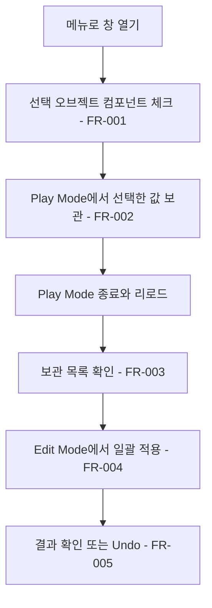

# Play Mode 컴포넌트 값 일괄 보관과 적용

## 1. 개요
- 목적: Play Mode에서 조절한 여러 컴포넌트의 Inspector 값을 보관하고 종료 후 원래 컴포넌트에 일괄 적용한다.
- 대상: Unity 에디터에서 게임 수치를 조절하는 제작자.

## 2. 범위
- 포함: 선택 오브젝트의 컴포넌트 목록, 체크 선택, 수치·설정값 보관, Edit Mode 일괄 적용, Undo.
- 제외: 플레이 중 생성한 오브젝트의 영구 생성, 컴포넌트 추가·삭제, 계층 구조 복원, 자동 적용, 외부 패키지 설치.

## 3. 기술 방향
- 사용 기술/API: EditorWindow IMGUI, Selection, SerializedObject/SerializedProperty, GlobalObjectId, SessionState, Undo.
- 핵심 방식: 저장된 씬에 원래 존재하는 컴포넌트를 GlobalObjectId로 식별하고 Inspector의 편집 가능한 직렬화 필드 값을 SessionState에 보관한다. 도메인 리로드와 Play Mode 종료 후에도 보관본을 유지하며 Edit Mode에서 명시적으로 적용한다.
- 선택하지 않은 방식: Unity 클립보드 사용, 전체 씬 덮어쓰기, 런타임 참조의 instanceID를 Edit Mode에 복원.
- 외부 의존성: UnityEditor와 UnityEngine만 사용한다. 기존 에디터 도구의 IMGUI 패턴을 따른다.

## 4. 구조
| 구분 | 이름 | 역할 |
|------|------|------|
| EditorWindow | PlayModeValuesWindow | 컴포넌트 선택, 보관, 적용과 결과 표시 |
| 에디터 보조 클래스 | PlayModeValuesStore | 보관 데이터, 식별자와 직렬화 프로퍼티 처리 |

- 오브젝트 구성: 새 씬 오브젝트는 필요 없다. Assets/EyeMaze/Scripts/Editor에 도구를 둔다.
- 클래스 간 관계: 창이 보관 저장소를 호출한다. 런타임 게임 코드는 참조하지 않는다.
- 실행 순서 의존성: Play Mode에서 보관 후 종료하고 Edit Mode에서 적용한다.
- 기존 코드와의 접점: 게임 코드 수정 없음.

## 5. 동작 플로우차트

## 6. 요구사항
- FR-001: 제작자가 EyeMaze/플레이 값 보관 창을 열면 선택 오브젝트의 컴포넌트를 체크해 보관 대상을 지정한다. 자식 포함 옵션을 제공하고 기본값은 끈다. Transform은 기본 선택에서 제외한다.
- FR-002: Play Mode에서 값 보관 버튼을 누르면 체크한 컴포넌트의 지원되는 Inspector 값을 보관한다. 다른 대상을 추가 보관하면 기존 목록에 누적하고 같은 대상은 최신 보관본으로 교체한다.
- FR-003: Play Mode 종료 또는 도메인 리로드 후에도 현재 에디터 세션의 보관 목록과 대상 경로를 표시하고 전체 비우기 기능을 제공한다.
- FR-004: Edit Mode에서 저장한 값 일괄 적용 버튼을 누르면 기존 컴포넌트의 지원되는 직렬화 필드만 복원하고 씬을 dirty로 표시한다. 씬 저장은 사용자가 Ctrl+S로 수행한다.
- FR-005: 적용한 변경은 한 번의 Undo로 되돌릴 수 있고, 적용·건너뜀 개수와 사유를 창에 표시한다.

### 상태와 데이터
- 컴포넌트별 GlobalObjectId, 타입, 오브젝트 경로, 필드 경로·타입·보관값을 저장한다.
- 기본 지원값: 정수, 실수, bool, enum, string, Color, Vector2/3/4, Vector2Int/3Int, Quaternion, Rect/RectInt, Bounds/BoundsInt와 해당 값으로 구성된 직렬화 구조체·배열·목록.
- 편집 가능한 Inspector 필드 단위로 보관하며 컴포넌트의 비직렬화 실행 상태는 저장하지 않는다.

### 예외 및 경계 조건
- Play Mode 신규 생성 대상, 저장되지 않은 씬 대상, 삭제된 대상, 타입 변경 또는 지원하지 않는 필드는 사유와 함께 건너뛴다.
- 오브젝트 참조, 스크립트 참조, ManagedReference, AnimationCurve, Gradient와 컴포넌트 내부 식별·프리팹 연결 정보는 복원하지 않는다. 기존 참조를 보존한다.
- 게임 코드가 Inspector에 직렬화한 실행 중 상태도 보관 대상이 될 수 있으므로 사용자가 체크한 컴포넌트만 처리한다.
- 저장 버튼은 Play Mode에서만, 적용 버튼은 안정된 Edit Mode에서만 활성화한다.
- 에디터 종료 후까지 보관하는 기능은 제공하지 않는다.

## 7. Inspector 노출값
- 해당 없음. 에디터 창에 자식 포함, 컴포넌트 체크 목록, 선택 값 보관, 저장 값 일괄 적용, 전체 비우기를 제공한다.

## 8. 인수 조건
- FR-001: 오브젝트 여러 개 선택 시 컴포넌트 체크 목록이 표시되고 자식 포함 옵션과 Transform 기본 제외를 확인한다.
- FR-002: 회전 속도·대기 시간과 포탑 속도처럼 서로 다른 컴포넌트 값을 보관하고, 선택을 바꿔 추가 보관해도 이전 항목이 유지되는지 확인한다.
- FR-003: 보관 후 Play Mode를 종료하고 창을 다시 열어 목록이 유지되는지 확인한다.
- FR-004: 일괄 적용 후 각 컴포넌트 값이 보관값으로 복원되고 기존 오브젝트 참조와 비직렬화 상태는 덮어쓰지 않는지 확인한다.
- FR-005: 삭제·미지원 대상 처리 결과가 표시되고 Undo 한 번으로 적용 이전 값이 복구되는지 확인한다. 테스트 코드는 작성하지 않는다.

구현 및 확인 결과:
- FR-001: PlayModeValuesWindow.Open과 RefreshSelection에서 메뉴·컴포넌트 체크 목록·자식 포함·Transform 기본 제외를 제공한다.
- FR-002: PlayModeValuesStore.Capture가 SessionState에 보관본을 누적하며 동일 대상은 교체한다. Play Mode에서 회전 장애물의 속도 137·대기 2.75와 다른 프리팹 포탑의 탄속 4.25·각도 목록 3개를 나누어 보관하고 목록 2개 유지를 확인했다.
- FR-003: InitializeOnLoad 구독과 SessionState를 통해 편집 대상 식별자·보관값을 유지한다. 프리팹 인스턴스의 Play Mode 식별자 변화를 원본과 인스턴스 ID 합성 키로 대응하며 적용에는 원래 GlobalObjectId를 사용한다. 실제 Play Mode 종료 후 목록 2개를 읽었다.
- FR-004: Apply가 SerializedProperty별 지원값만 적용한다. Edit Mode에서 회전 137·대기 2.75와 탄속 4.25·각도 배열 크기 3의 적용, 적용 2개·건너뜀 0개를 확인했다. 오브젝트 참조는 지원하지 않는 필드로 기록하고 보관 대상에서 제외했다.
- FR-005: Apply가 Undo 그룹과 적용 결과를 제공한다. Undo 한 번 후 두 컴포넌트의 전체 직렬화 JSON이 적용 직전과 일치함을 확인했다. 검증용 보관본과 임시 수치를 정리했으며 창을 열어 두었다. 삭제 대상 검증은 별도 수행하지 않았다.
- Unity 컴파일 완료와 Console 오류 0개를 확인했다. 새 테스트 코드와 검증용 씬 배치는 추가하지 않았다.

## 9. 미결 사항
- 없음
