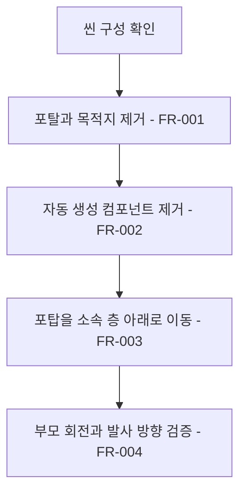

# 현재 씬 포탈 제거와 세 방향 포탑 회전 추종

## 1. 개요
- 목적: 현재 EyeMaze 씬에서 포탈의 배치·자동 생성을 제거하고 세 방향 포탑이 미로와 층의 회전을 직접 상속하도록 한다.
- 대상: 제작자와 플레이어.

## 2. 범위
- 포함: 현재 씬의 FragmentPortalSystem 컴포넌트, FragmentPortal 오브젝트, 비어 있는 Potal_Destination 세 개 제거. 씬의 ThreeWayTurret을 소속 2층의 직접 자식으로 이동.
- 제외: 포탈 스크립트·프리팹 파일 삭제, 다른 씬 변경, 포탑 자체 90도 회전 기능 추가, 이미 발사한 탄환의 비행 방향 변경.

## 3. 기술 방향
- 사용 기술/API: Undo.DestroyObjectImmediate, Undo.SetTransformParent, Unity Editor.
- 핵심 방식: 포탈 생성 컴포넌트를 씬에서 제거해 재생성도 차단한다. ThreeWayTurret은 현재 월드 배치를 유지해 해당 MazeLayer 아래로 옮기고 기존 Muzzle 기준 세 방향 발사를 재사용한다.
- 선택하지 않은 방식: 탄환을 매 프레임 미로 각도로 꺾기, 포탑 스크립트에 부모 회전을 중복 가산하기.
- 외부 의존성: MazeGunner, MazeLayer, IrisMaze.

## 4. 구조
| 구분 | 이름 | 역할 |
|------|------|------|
| 씬 | EyeMaze | 포탈 배치와 생성 컴포넌트 제거 |
| 씬 오브젝트 | ThreeWayTurret | 2층 직속 포탑 |

- 오브젝트 구성: 미로 / 층 2 / ThreeWayTurret.
- 클래스 간 관계: 포탑의 부모 회전은 Transform 계층으로 상속하고 발사 방향은 기존 GetFireDirection을 사용한다.
- 실행 순서 의존성: 씬 수정은 Edit Mode에서 수행한다.
- 기존 코드와의 접점: 게임 스크립트 변경 없음.

## 5. 동작 플로우차트

## 6. 요구사항
- FR-001: 현재 씬에서 포탈 오브젝트와 비어 있는 포탈 목적지 오브젝트를 모두 제거한다.
- FR-002: Play Mode에 진입해도 해당 씬에서 포탈이 다시 생성되지 않는다.
- FR-003: 포탑 부모를 변경할 때 월드 위치·회전·크기와 Inspector 설정을 보존한다.
- FR-004: 미로 또는 2층이 회전하면 포탑과 앞으로 발사하는 세 탄환의 방향이 그 회전을 따른다.

### 상태와 데이터
- 새 상태 없음.

### 예외 및 경계 조건
- 현재 편집 씬에는 FragmentPortalSystem 1개와 자식이 없는 Potal_Destination 3개가 있고 배치된 FragmentPortal은 없다.
- ThreeWayTurret은 현재 2층 / 파편 · 은재 / Layer2Obstacles 아래에 있다. 이 중간 묶음에는 회전 고정 스크립트가 없으므로 원인을 단정하지 않고 변경 후 실제 회전·발사를 확인한다.
- 발사된 탄환은 기존처럼 발사 시의 월드 방향으로 직진한다.
- 포탑 외형이 좌우 대칭이어도 Muzzle과 예고선·탄환의 방향을 기준으로 검증한다.

## 7. Inspector 노출값
- 추가 없음. 기존 포탑 설정을 보존한다.

## 8. 인수 조건
- FR-001: 현재 씬에서 FragmentPortal과 비어 있는 Potal_Destination이 0개인지 확인한다.
- FR-002: FragmentPortalSystem 0개와 Play Mode의 포탈 0개를 확인한다.
- FR-003: 변경 전후 포탑과 자식의 월드 Transform 및 컴포넌트 직렬화 설정이 동일한지 확인한다.
- FR-004: Play Mode에서 미로·2층을 회전하고 세 방향 예고선과 발사 방향이 동일 각도만큼 변하는지 확인한다. 검증 후 종료한다.

구현 및 확인 결과:
- FR-001: EyeMaze 씬에서 자식이 없는 Potal_Destination 3개를 Undo.DestroyObjectImmediate로 제거했다. 기존 FragmentPortal 배치 개수는 0개였다.
- FR-002: 디렉터의 FragmentPortalSystem 1개를 제거하고 씬을 저장했다. Play Mode에서도 시스템 0개와 포탈 0개를 확인했다. 포탈 스크립트와 프리팹 파일은 보존했다.
- FR-003: ThreeWayTurret 프리팹 인스턴스를 2층의 직접 자식으로 옮겼다. 포탑과 자식 전체의 월드 위치·회전·크기 오차는 0이었으며 MazeGunner의 전체 직렬화 설정도 동일했다.
- FR-004: Play Mode에서 미로를 45도, 2층을 한 칸 22.5도 회전해 총 67.5도를 적용했다. Muzzle 방향 변화 오차, 세 방향 예고선 방향 오차와 실제 발사 탄환 3개의 방향 오차가 모두 0도였다. 프레임 3009에서 3052까지 실제 진행을 확인했다. 검증 후 Play Mode를 종료해 임시 회전값은 저장하지 않았다.
- 실행 검증 중 Console 오류와 컴파일 오류는 0개였다.

## 9. 미결 사항
- 없음
