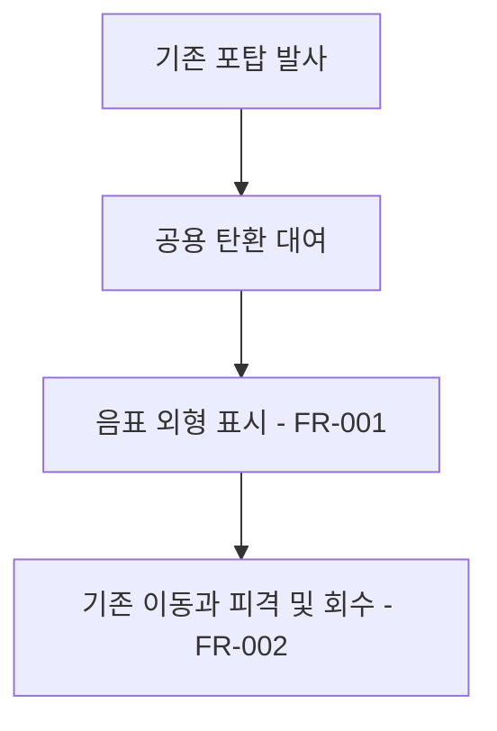

# 포탑 탄환 음표 외형

## 1. 개요
- 목적: 포탑에서 발사하는 원형 탄환을 팔분음표 모양으로 표시한다.
- 대상: 플레이어와 제작자.

## 2. 범위
- 포함: 공용 MazeBullet 프리팹의 탄환 그림을 음표 머리·기둥·꼬리로 변경한다.
- 제외: 이동·피격·발사 각도·주기·풀링 변경, 음향 추가, 다른 탄막 프리팹 변경.

## 3. 기술 방향
- 사용 기술/API: 프리팹에 저장된 로컬 좌표 LineRenderer.
- 핵심 방식: 기존 원형 선을 작은 타원형 음표 머리로 바꾸고 기둥과 꼬리 선을 자식으로 저장해 팔분음표 형태를 만든다. 기존 주황색과 정렬 순서를 유지한다.
- 선택하지 않은 방식: 폰트 의존 음표 문자, 외부 이미지, 매 프레임 그림 생성.
- 외부 의존성: 기존 MazeBullet과 MazeGunner의 탄환 프리팹 참조.

## 4. 구조
| 구분 | 이름 | 역할 |
|------|------|------|
| 프리팹 | MazeBullet | 음표 머리·기둥·꼬리가 있는 공용 포탑 탄환 |

- 오브젝트 구성: 기존 루트의 머리 LineRenderer와 자식 Stem, Flag LineRenderer.
- 클래스 간 관계: 기존 MazeGunner의 프리팹 참조를 유지한다. ThreeWayTurret을 포함해 이 탄환을 공유하는 포탑에 반영된다.
- 실행 순서 의존성: 해당 없음.
- 기존 코드와의 접점: 게임 스크립트 수정 없음.

## 5. 동작 플로우차트

## 6. 요구사항
- FR-001: 포탑 탄환이 표시될 때 타원형 머리·기둥·꼬리가 있는 팔분음표 형태로 보인다.
- FR-002: 외형 변경 후에도 기존 발사 방향·속도·피격 반지름·사거리·수명·풀 반환 동작을 유지한다.

### 상태와 데이터
- 새 런타임 상태 없음. 선 점 목록·폭·색을 프리팹에 저장한다.

### 예외 및 경계 조건
- 음표는 기존 탄환 Transform과 함께 발사 방향에 맞춰 회전한다.
- 공용 MazeBullet을 쓰는 모든 포탑에 음표 외형이 반영된다.
- 기존 피격 반지름 안에 들어오는 크기로 음표를 구성한다.

## 7. Inspector 노출값
- 추가 스크립트 필드 없음. 프리팹의 선 좌표·두께·색과 자식 Transform으로 외형을 편집한다.

## 8. 인수 조건
- FR-001: 프리팹과 실제 발사 화면에서 머리·기둥·꼬리가 연결된 음표 형태인지 시각 확인한다.
- FR-002: 실제 발사 후 이동과 회수, 포탑의 기존 탄환 설정 유지와 Console 오류 0개를 확인한다.

구현 및 확인 결과:
- FR-001: MazeBullet.prefab의 기존 LineRenderer를 둥근 캡으로 채운 음표 머리로 변경하고 Stem과 Flag 자식 LineRenderer를 저장했다. 세 선 모두 기존 주황색·재질·정렬 순서와 로컬 좌표를 사용한다. 렌더한 Temp/NoteBulletPreview.png에서 채워진 머리·기둥·꼬리의 음표 형태를 시각 확인했다. 실제 Game 뷰도 Temp/NoteBulletsGame.png로 확인했으며 기존 저해상도 전체 화면에서는 탄환 표시가 매우 작다.
- FR-002: MazeBullet과 MazeGunner의 게임 코드는 변경하지 않았다. 실제 ThreeWayTurret 발사에서 활성 탄환 3개와 각 탄환의 선 렌더러 3개를 확인했다. 프레임 2682에서 2740까지 발사를 진행했고 이후 2770까지 비행을 진행해 최대 이동 약 0.7922와 탄환 3개 반환을 확인했다. Console 오류 0개와 compilationFailed=false를 확인했다. 피격 수치 실측은 별도 수행하지 않았다. 검증 후 Play Mode를 종료했다.

## 9. 미결 사항
- 없음
