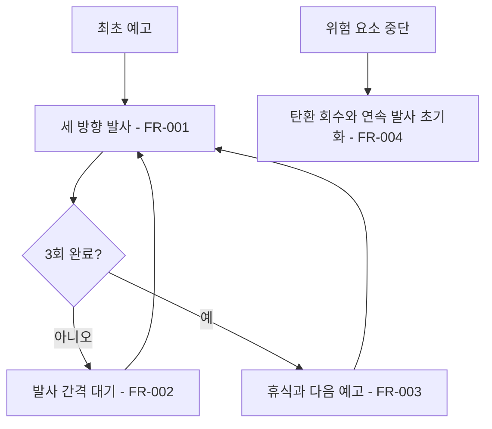

# 세 방향 음표 포탑 3회 연속 발사

## 1. 개요
- 목적: ThreeWayTurret이 세 방향 음표 발사를 3회 연속 수행하고 지정 시간 동안 쉬도록 한다.
- 대상: 제작자와 플레이어.

## 2. 범위
- 포함: MazeGunner의 선택형 3회 연속 발사, 연속 발사 간격·휴식 시간 설정, ThreeWayTurret 프리팹과 현재 씬 인스턴스 적용.
- 제외: 기존 단발 Gunner 패턴 변경, 탄환 이동·피격·외형 변경, 포탑 배치 변경.

## 3. 기술 방향
- 사용 기술/API: 기존 MazeGunner 발사 단계, Time.deltaTime, ObjectPool.
- 핵심 방식: 연속 발사 옵션이 켜지면 기존 세 방향 발사를 한 묶음으로 계산해 3묶음을 발사한다. 묶음 사이에는 Burst Interval을 기다리고 세 번째 묶음 뒤에는 Burst Rest Seconds를 기다린다. 최초 예고는 기존 Warning Seconds를 사용한다. 다음 묶음의 예고는 휴식 마지막 구간에 포함해 휴식 시간에 추가되지 않는다.
- 선택하지 않은 방식: 포탑 3개 복제, 매 발사 Instantiate, 단발 포탑 일괄 패턴 변경.
- 외부 의존성: 기존 MazeBullet 풀과 EyeMazeDirector.CanRunHazards.

## 4. 구조
| 구분 | 이름 | 역할 |
|------|------|------|
| 클래스 | MazeGunner | 단발과 선택형 3회 연속 발사 단계 처리 |
| 프리팹 | ThreeWayTurret | 연속 발사 옵션과 시간 기본값 저장 |
| 씬 | EyeMaze | 기존 ThreeWayTurret 인스턴스에 연속 발사 적용 |

- 오브젝트 구성: 현재 포탑과 부모 구조를 유지한다.
- 클래스 간 관계: 기존 탄환과 풀을 그대로 사용한다.
- 실행 순서 의존성: 초기 예고 후 매 LateUpdate에서 발사 간격·휴식을 처리한다.
- 기존 코드와의 접점: MazeGunner.LateUpdate, OnValidate, ResetFire 및 발사 헬퍼.

## 5. 동작 플로우차트

## 6. 요구사항
- FR-001: ThreeWayTurret이 실행 가능할 때 45도·90도·135도 음표 3발을 동시에 발사하는 동작을 3회 연속 수행한다. 한 연속 발사 묶음의 총 탄환 수는 9발이다.
- FR-002: 제작자가 Burst Interval을 변경하면 연속하는 첫째·둘째 및 둘째·셋째 발사 사이의 시간에 반영한다.
- FR-003: 세 번째 발사 이후 Burst Rest Seconds가 지나면 다음 3회 연속 발사를 시작한다.
- FR-004: 위험 요소 실행이 중단되면 활성 탄환·예고와 연속 발사 진행을 초기화하고 재개 시 최초 예고부터 시작한다. 옵션이 꺼진 기존 Gunner는 기존 단발 패턴을 유지한다.

### 상태와 데이터
- 현재 연속 발사 횟수와 발사 단계 타이머를 관리한다.
- 연속 발사 횟수는 3회로 고정한다.

### 예외 및 경계 조건
- 발사 간격과 휴식 시간은 최소 0.01초로 제한한다.
- 휴식이 예고 시간보다 짧으면 휴식 전체를 예고로 사용한다.
- Time.timeScale이 0이면 발사 간격과 휴식 진행도 멈춘다.
- 각 발사 시점의 Muzzle 회전을 사용해 미로 회전을 반영하며 이미 발사된 탄환은 기존 방향으로 직진한다.
- 기존 Reload Seconds는 연속 발사 옵션이 꺼진 단발 패턴에서만 사용한다.

## 7. Inspector 노출값
| 필드 | 타입 | ThreeWayTurret 기본값 | 설명 |
|------|------|----------------------|------|
| Burst Fire | bool | true | 3회 연속 발사 사용. 기존 Gunner 기본값은 false |
| Burst Interval | float | 0.2초 | 연속 발사 사이 간격 |
| Burst Rest Seconds | float | 1.5초 | 세 번째 발사부터 다음 첫 발사까지 쉬는 시간. 다음 예고 포함 |
| Warning Seconds | 기존 float | 기존값 유지 | 최초 예고와 휴식 마지막 예고의 최대 시간 |

## 8. 인수 조건
- FR-001: Play Mode에서 3발 동시 발사가 3회 이어져 총 9발이 발사되는지 확인한다.
- FR-002: 기본 간격 약 0.2초와 변경한 간격이 발사 시점에 반영되는지 확인한다.
- FR-003: 세 번째 발사 이후 약 1.5초 쉬고 반복하며 Inspector 휴식 변경도 반영되는지 확인한다.
- FR-004: 중단·재개 시 초기 예고와 탄환 정리를 확인하고 기존 단발 Gunner 동작·Console 오류 0개를 확인한다.

구현 및 확인 결과:
- FR-001: MazeGunner.FireVolley에서 각 방향으로 동시에 발사하고 _burstShotsFired와 BurstInterval/BurstRest 단계로 3회 연속 발사를 처리한다. ThreeWayTurret 프리팹과 현재 씬 인스턴스 1개에 옵션을 켜고 기본값을 저장했다. Play Mode에서 완료 횟수 1→2→3→1이 반복되며 매 발사마다 세 방향 탄환이 나오는 것을 10회 관찰했다.
- FR-002: BurstInterval 단계에서 _burstInterval을 매 프레임 읽는다. 기본 0.2초의 실제 발사 간격은 0.207~0.213초였고 실행 중 0.35초로 변경한 뒤 0.360초 간격을 확인했다.
- FR-003: BurstRest 단계에서 _burstRestSeconds를 사용하고 마지막 예고를 휴식 안에 포함한다. 기본 1.5초의 실제 휴식은 1.504초와 1.509초였으며 실행 중 0.9초로 변경한 뒤 0.905초를 확인했다.
- FR-004: ResetFire가 탄환·예고·타이머·횟수를 초기화한다. 관찰 종료 후 활성 탄환 0개, 예고 비활성, 완료 횟수 0과 재개 시 Warning 단계를 확인했다. 별도 기존 Gunner 프리팹 인스턴스의 Burst Fire=false와 3차례 단발 발사도 확인했다.
- Unity 컴파일 완료와 Console 오류 0개를 확인했다. 프레임 4207→4693에서 실행을 관찰했다. 검증 후 Play Mode를 종료했으며 임시 위치와 변경 시간 설정은 저장하지 않았다.

## 9. 미결 사항
- 없음
