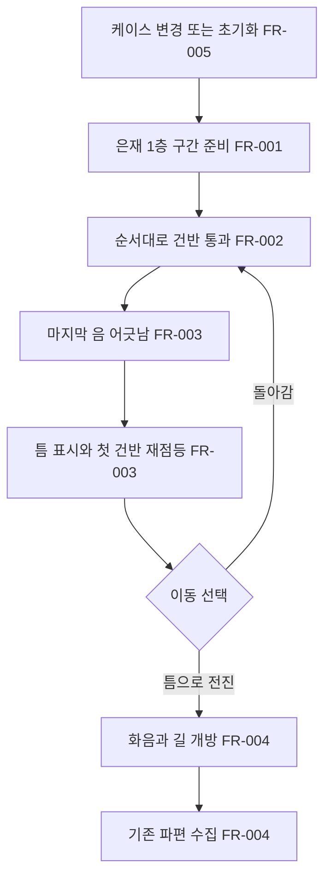

# 1층 끝나지 않는 연주

## 1. 개요
- 목적: 은재의 완벽주의를, 틀린 연주를 반복하거나 불완전한 채 앞으로 가는 이동 선택으로 표현한다.
- 대상: WASD로 시선을 움직이는 플레이어.

## 2. 범위
- 포함: 은재 1층 건반 치는 손가락 파편 앞의 건반 4개, 순서 연주, 마지막 불협화음, 반복 유도, 틈 통과와 화음, 파편 수집 연결.
- 제외: 추가 입력키, 새 UI, 지수 및 다른 층 변경, 기존 포탑 변경, 테스트 코드.

## 3. 기술 방향
- 사용 기술/API: 기존 시선 위치, LineRenderer, AudioSource·WAV AudioClip, MazeWall, 기존 파편 수집.
- 핵심 방식: 1층 안쪽 고리의 파편 직전 네 셀에 건반을 저장한다. 건반 셀을 지나가면 음과 빛을 내고 마지막 음은 반드시 어긋난다. 마지막 건반과 파편 사이 벽은 첫 실패부터 틈을 드러내며 통과 가능해진다. 돌아가서 다시 연주할 수 있지만, 틈으로 전진하면 해결된다. 부담감은 기존 관찰 시간 누적을 사용한다.
- 선택하지 않은 방식: 순간이동으로 처음에 되돌리기, 정답 음을 맞히는 입력, 런타임 Transform 자동 배치.
- 외부 의존성: EyeMazeDirector, IrisMaze, MemoryFragment, MazeLayer.
- 배치: 파편 셀을 포함하는 안쪽 고리 구간을 독립적인 막다른 주머니로 만들고 시작 부분에 입구를 둔다. 바깥 고리에는 구간을 돌아가는 통로를 확보한다. 생성·깜빡임 뒤에도 같은 논리 벽 상태를 적용하며 다른 인물에서는 원래 미로를 사용한다.

## 4. 구조
| 구분 | 이름 | 역할 |
|------|------|------|
| 클래스 | PianoLoopPuzzle | 단계, 음·빛, 틈과 완료 상태 |
| 프리팹 | ImperfectPianoLoop | 건반, 틈 표시와 AudioSource |
| 씬 | EyeMaze | 은재 1층의 시선·파편·미로 참조 |
| 오디오 | PianoLoop WAV | 세 음, 불협화음, 해결 화음 |

- 오브젝트 구성: 층 아래 프리팹을 저장하고 Inspector로 건반·틈 위치와 외형·소리를 지정한다.
- 클래스 간 관계: 퍼즐은 미로의 지정 벽을 제어하고, 디렉터는 해당 파편을 수집할 때 해결 상태를 확인한다.
- 실행 순서 의존성: 미로 벽 생성 직후 퍼즐 벽을 반영하고, 조작 가능한 관찰 중에만 건반·틈 진입을 처리한다.
- 기존 코드와의 접점: IrisMaze.Generate의 생성 완료 지점, EyeMazeDirector.CheckFragment의 대상 파편 조건.

## 5. 동작 플로우차트

## 6. 요구사항
- FR-001: 은재 상담일 때만 1층 파편 앞의 네 건반과 입구·우회 통로·파편 주머니를 활성화한다. 위치와 연출 설정은 씬·프리팹의 Inspector 값을 사용한다.
- FR-002: 관찰 중 기대하는 건반 영역에 새로 들어가면 해당 음을 한 번 재생하고 빛을 남기며 다음 건반을 강조한다. 순서가 아닌 건반은 진행시키지 않는다. 첫 건반으로 돌아오면 처음부터 다시 연주할 수 있다.
- FR-003: 네 번째 건반을 밟으면 불협화음을 내고 반복 횟수를 늘린다. 첫 실패부터 마지막 건반 옆 벽에 통과 가능한 틈을 표시하며 반복할수록 표시를 밝힌다. 짧은 대기 후 첫 건반을 다시 강조하고 위치는 강제로 이동시키지 않는다.
- FR-004: 한 번 이상 어긋난 후 틈을 지나 파편 방향으로 이동하면 해결 화음을 내고 길을 열린 상태로 유지한다. 해결 전 해당 파편은 수집되지 않고 해결 후 기존 방식으로 수집한다.
- FR-005: 읽기·깜빡임·다른 인물 동안 진행을 멈춘다. 케이스 변경과 파편 초기화에서는 진행을 초기화하고, 은재를 떠나면 퍼즐이 적용했던 기존 벽 상태를 복원한다. 벽 재생성 직후에도 현재 퍼즐 상태를 반영한다.

### 상태와 데이터
| 이름 | 타입 | 설명 | 초기값 |
|------|------|------|--------|
| 다음 건반 | int | 다음에 통과할 건반 | 0 |
| 반복 횟수 | int | 마지막 음 실패 수 | 0 |
| 해결 여부 | bool | 틈으로 전진했는지 | false |

### 예외 및 경계 조건
- 한 건반 위에 머물러도 음이 반복 재생되지 않는다.
- 첫 실패부터 해결 가능하며 반복 횟수를 강제하지 않는다.
- 벽 재생성으로 파괴된 참조는 다시 찾아 연결하고 원래 벽 상태는 오브젝트별로 보관한다.
- 기존 파편 위치는 바꾸지 않는다. 다른 경로에서 접근하거나 디버그로 옮겨도 해결 전 대상 파편만 수집을 보류한다.

## 7. Inspector 노출값
| 필드 | 타입 | 기본값 | 설명 |
|------|------|--------|------|
| 미로·디렉터·케이스·대상 파편 | 참조 | 씬 연결 | 적용 대상 |
| 건반과 음·틈 표시 | 참조 배열 | 프리팹 저장값 | 독립적인 외형·배치·소리 |
| 진입 반지름 | float | 0.17 | 건반과 틈 감지 거리 |
| 반복 대기 | float | 1.2초 | 첫 건반 재점등 시간 |
| 기본·강조·실패 색 | Color | 씬 저장값 | 빛 연출 |
| 구간 시작·파편 셀 | int | 파편 직전 네 셀 | 제작자가 명시적으로 편집하는 미로 구간 |
| 음량 | AudioSource.volume | 0.35 | 재생 크기 |

## 8. 인수 조건
- FR-001: 은재 1층에 네 건반과 닫힌 파편 입구가 보이고 바깥 우회로와 시작 입구에 이동할 수 있는지 확인한다.
- FR-002: 네 건반을 순서대로 지나갈 때 음·점등이 바뀌고 머무르기·역순 이동으로 진행이 건너뛰지 않는지 확인한다.
- FR-003: 마지막 건반에서 어긋난 소리와 틈이 나타나고 첫 건반이 다시 빛나는지, 반복할 때 틈이 더 선명해지는지 확인한다.
- FR-004: 첫 실패 뒤 틈으로 이동해 화음을 듣고 파편을 수집할 수 있는지 확인한다. 해결 전 디버그로 파편에 접근해도 수집되지 않는지 확인한다.
- FR-005: 깜빡임 후 배치·벽·진행이 유지되고, 초기화 및 은재·지수 전환에서 상태와 벽이 정상 복원되는지 확인한다.

## 9. 미결 사항
- 없음.
