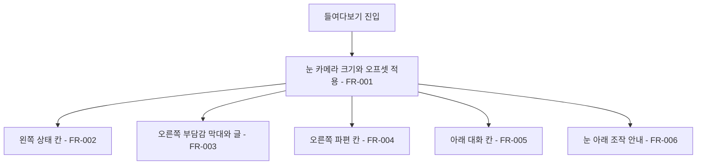

# 상담 화면 레이아웃 재배치

## 1. 개요

- 목적: 포토샵 시안에 맞춰 상담 화면의 눈을 키우고, 상태 칸·부담감 막대·파편 칸의 좌우 위치를 바꾼다.
- 대상: 플레이어, 레이아웃을 조절하는 제작자

## 2. 범위

- 포함:
  - `EyeMaze` 씬 `만남 UI` 아래 칸들의 RectTransform anchor 값 변경
  - `GameFlow`의 `_eyeCamSize`, `_eyeCamOffset` 값 변경으로 눈 확대와 위치 조정
- 제외:
  - 스크립트 코드 변경
  - 칸 내부 자식(상황 글, 신뢰도 막대, 버튼, 선택지)의 상대 배치 변경
  - 눈 모양(`EyeVisual`) 수치와 미로 크기 변경
  - 필드 UI, 대화 기록 창

## 3. 기술 방향

- 사용 기술/API: uGUI `RectTransform` anchor, 정사영 카메라 `orthographicSize`
- 핵심 방식: 각 칸은 화면 비율 anchor로 배치되어 있으므로 anchorMin/anchorMax만 시안 비율로 바꾼다. 눈은 카메라 크기를 줄여 약 1.2배 확대하고, 카메라 오프셋으로 눈 중심을 화면 높이 약 0.67에 둔다.
- 선택하지 않은 방식: 눈 오브젝트의 Transform 스케일 변경은 미로·탄환·시선 이동 수치와 함께 커지므로 사용하지 않는다.
- 외부 의존성: `GameFlow`, `EyeMazeUI`가 참조하는 기존 UI 오브젝트

## 4. 구조

| 구분 | 이름 | 역할 |
|------|------|------|
| 씬 | EyeMaze | `만남 UI` 칸 anchor와 `GameFlow` 눈 카메라 값을 저장한다 |

- 오브젝트 구성: 변경 없음
- 클래스 간 관계: 변경 없음
- 실행 순서 의존성: 해당 없음
- 기존 코드와의 접점: 없음 (씬 직렬화 값만 변경)

## 5. 동작 플로우차트

## 6. 요구사항

- FR-001: 상담 화면일 때 눈은 가로 화면의 약 0.23~0.76 구간을 차지하고, 눈꼬리 높이가 화면 아래에서 약 0.67이 되도록 `_eyeCamSize`를 5.5, `_eyeCamOffset`을 (0, -1.85)로 둔다.
- FR-002: `상황 칸`은 화면 왼쪽 anchor (0.012, 0.36)~(0.232, 0.985)에 놓인다.
- FR-003: `부담감 막대 칸`은 anchor (0.773, 0.36)~(0.798, 0.93), `부담감 글`은 anchor (0.76, 0.94)~(0.81, 0.98)에 놓인다.
- FR-004: `파편들 칸`은 anchor (0.803, 0.36)~(0.99, 0.975)에 놓인다.
- FR-005: `대화 칸`은 anchor (0.012, 0.015)~(0.99, 0.33)에 놓인다.
- FR-006: `조작 안내`는 눈 아래 가운데 anchor (0.24, 0.33)~(0.76, 0.36)에 놓인다.

### 상태와 데이터

해당 없음

### 예외 및 경계 조건

- 눈 윗부분 속눈썹 끝은 시안처럼 화면 위쪽에서 일부 잘릴 수 있다.

## 7. Inspector 노출값

| 필드 | 타입 | 기본값 | 설명 |
|------|------|--------|------|
| GameFlow._eyeCamSize | float | 5.5 (씬 값) | 작을수록 눈이 커진다 |
| GameFlow._eyeCamOffset | Vector2 | (0, -1.85) (씬 값) | 눈 대비 카메라 위치. y가 0에 가까울수록 눈이 아래로 내려간다 |

## 8. 인수 조건

- FR-001: F9로 들여다보기에 들어가 눈 좌우 끝이 상태 칸 오른쪽과 부담감 막대 왼쪽 사이에 들어오는지 확인한다.
- FR-002: 상태 칸(상황, 신뢰도 막대, 관찰 중지 버튼)이 화면 왼쪽 위에 보이는지 확인한다.
- FR-003: 부담감 막대와 글이 눈 오른쪽에 보이고 부담감이 오르면 막대가 아래에서 차오르는지 확인한다.
- FR-004: 파편 목록이 화면 오른쪽 위 칸에 보이는지 확인한다.
- FR-005: 대화 칸이 화면 아래 가로 전체에 보이는지 확인한다.
- FR-006: 조작 안내가 눈 아래, 대화 칸 위에 보이는지 확인한다.

## 9. 미결 사항

- 없음
