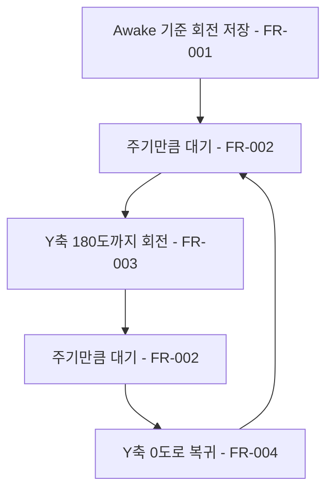

# 공격성 오브젝트 Y축 반바퀴 왕복 회전

## 1. 개요

- 목적: `OnAggression`이 계산만 하고 적용하지 않던 회전을, 지정한 주기마다 Y축으로 반바퀴 돌았다가 원점으로 돌아오는 동작으로 고친다.
- 대상: 플레이어, 회전 값을 조절하는 제작자

## 2. 범위

- 포함:
  - `OnAggression`의 Y축 180도 회전과 원점 복귀 반복
  - 회전 속도와 주기의 Inspector 노출
- 제외:
  - 씬·프리팹 배치 (현재 이 컴포넌트를 쓰는 씬·프리팹이 없다)
  - `Aggression` 오브젝트 크기에 따라 켜고 끄는 동작 (`WaitForAggression`)

## 3. 기술 방향

- 사용 기술/API: `Transform.localRotation`, `Quaternion.Euler`, `Mathf.MoveTowards`
- 핵심 방식: 시작 시 `localRotation`을 기준 회전으로 저장하고, 현재 각도를 0 또는 180도로 `_rotationSpeed`(도/초)에 맞춰 옮겨 `기준 회전 * Euler(0, 각도, 0)`으로 적용한다. 목표 각도에 닿으면 `_periodSeconds` 동안 멈췄다가 목표를 반대쪽으로 바꾼다.
- 선택하지 않은 방식: `Mathf.Sin(Time.time)` 보간은 멈춤 구간과 속도를 따로 정할 수 없어 사용하지 않는다. `GameObject.Find("Aggression")`은 대상이 없으면 시작 시 예외가 나고 회전에 필요 없으므로 제거한다.
- 외부 의존성: 없음

## 4. 구조

| 구분 | 이름 | 역할 |
|------|------|------|
| 클래스 | OnAggression | Y축 반바퀴 왕복 회전 |

- 오브젝트 구성: 회전시킬 오브젝트에 `OnAggression`을 붙인다.
- 클래스 간 관계: 해당 없음
- 실행 순서 의존성: `Awake`에서 기준 회전을 저장한다.
- 기존 코드와의 접점: `Assets/EyeMaze/Scripts/Obstacles/OnAggression.cs` 전체

## 5. 동작 플로우차트

## 6. 요구사항

- FR-001: `Awake`일 때 `OnAggression`은 현재 `localRotation`을 기준 회전으로 저장한다.
- FR-002: 목표 각도에 도달했을 때 `OnAggression`은 `_periodSeconds` 동안 멈춘다.
- FR-003: 0도에서 멈춤이 끝났을 때 `OnAggression`은 `_rotationSpeed`로 기준 회전에서 Y축 180도까지 돈다.
- FR-004: 180도에서 멈춤이 끝났을 때 `OnAggression`은 `_rotationSpeed`로 Y축 0도(기준 회전)까지 되돌아간다.

### 상태와 데이터

| 이름 | 타입 | 설명 | 초기값 |
|------|------|------|--------|
| _baseRotation | Quaternion | 기준 회전 | Awake 시 localRotation |
| _angle | float | 기준에서 돈 Y 각도 | 0 |
| _targetAngle | float | 현재 목표 각도 (0 또는 180) | 0 |
| _waitElapsed | float | 멈춤 경과 시간 | 0 |

### 예외 및 경계 조건

- `_rotationSpeed`가 0이면 회전하지 않는다.
- `_periodSeconds`가 0이면 멈추지 않고 바로 반대로 돈다.

## 7. Inspector 노출값

| 필드 | 타입 | 기본값 | 설명 |
|------|------|--------|------|
| _rotationSpeed | float | 180 | Y축 초당 회전 각도 |
| _periodSeconds | float | 2 | 반바퀴 회전과 복귀 사이에 멈추는 시간(초) |

## 8. 인수 조건

- FR-001: 오브젝트를 임의 각도로 돌려 둔 뒤 Play하면 그 각도에서 회전이 시작된다.
- FR-002: 180도와 0도에 도달할 때마다 `_periodSeconds` 동안 멈춘다.
- FR-003: 멈춤 뒤 Y축으로 반바퀴 돈다. `_rotationSpeed`를 360으로 바꾸면 0.5초 만에 돈다.
- FR-004: 다음 멈춤 뒤 처음 각도로 돌아온다.

## 9. 미결 사항

- 없음
