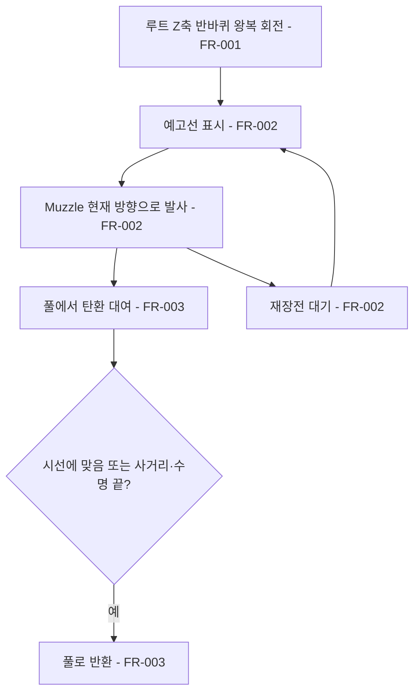

# 공격성 오브젝트 회전 방향 주기 발사

## 1. 개요

- 목적: Z축 반바퀴 왕복 회전하는 공격성 오브젝트가 일정 주기마다 자신이 바라보는 방향으로 풀링 탄환을 쏘게 한다.
- 대상: 플레이어, 발사 값을 조절하는 제작자

## 2. 범위

- 포함:
  - `Gunner.prefab`을 바탕으로 한 프리팹 변형 `AggressionGunner.prefab` 생성
  - 루트에 `OnAggression`을 추가해 Muzzle이 회전을 따라가게 구성
- 제외:
  - 새 스크립트 작성과 `OnAggression`, `MazeGunner`, `MazeBullet` 코드 수정
  - 씬 배치 (제작자가 원하는 위치에 프리팹을 놓는다)
  - 탄환 외형 변경

## 3. 기술 방향

- 사용 기술/API: 프리팹 변형(Prefab Variant), `UnityEngine.Pool.ObjectPool<T>`(기존 `MazeGunner` 내부)
- 핵심 방식: `Gunner.prefab` 루트에 이미 있는 `MazeGunner`가 발사 방향을 `Muzzle.rotation * Vector3.right`로 계산한다. 같은 루트에 `OnAggression`을 붙이면 루트 회전에 따라 Muzzle 방향이 바뀌므로, 코드 수정 없이 회전한 방향으로 쏜다. Z축은 미로 평면(XY)에 수직이므로 회전한 각도 그대로 발사 방향이 돌아가며, 반바퀴 돈 뒤에는 처음과 정반대 방향으로 쏜다.
- 선택하지 않은 방식: 풀 전용 스크립트나 `OnAggression` 내부 풀 구현은 `MazeGunner`의 예고선, 풀링, 피격 판정을 중복하므로 사용하지 않는다.
- 외부 의존성: `MazeGunner`, `MazeBullet`, `MazeBullet.prefab`, `OnAggression`, `EyeMazeDirector`

## 4. 구조

| 구분 | 이름 | 역할 |
|------|------|------|
| 프리팹 | AggressionGunner | `Gunner` 변형. 루트에 `OnAggression` 추가 |
| 클래스 | OnAggression | 루트 Z축 반바퀴 왕복 회전 (기존) |
| 클래스 | MazeGunner | 예고, 주기 발사, 탄환 풀 관리 (기존) |

- 오브젝트 구성: 루트(`MazeGunner`, `OnAggression`) 아래 Muzzle, Fire Warning, Bullet Pool (`Gunner`와 동일)
- 클래스 간 관계: `OnAggression`은 루트 Transform만 돌리고, `MazeGunner`는 Muzzle의 현재 회전을 읽어 발사한다. 두 컴포넌트는 서로 참조하지 않는다.
- 실행 순서 의존성: 없음
- 기존 코드와의 접점: 없음 (프리팹 추가만)

## 5. 동작 플로우차트

## 6. 요구사항

- FR-001: 플레이 중 `AggressionGunner` 루트는 `OnAggression` 설정대로 Z축 반바퀴 왕복 회전하고, Muzzle과 예고선이 함께 돈다.
- FR-002: 미로 위험 요소가 동작할 때 `AggressionGunner`는 `_warningSeconds` 예고 뒤 Muzzle이 바라보는 방향으로 발사하고, `_reloadSeconds` 뒤 다시 예고를 시작한다.
- FR-003: 발사된 탄환은 `Bullet Pool`에서 대여되고, 시선에 맞거나 사거리·수명이 끝나면 풀로 반환된다.

### 상태와 데이터

해당 없음 (기존 `MazeGunner`, `OnAggression` 상태를 그대로 사용)

### 예외 및 경계 조건

- 회전 도중 발사: 그 순간 Muzzle이 가리키는 각도로 쏜다.
- 탄환 외형: 기존 `MazeBullet`처럼 발사 방향을 향해 회전한다.

## 7. Inspector 노출값

| 필드 | 타입 | 기본값 | 설명 |
|------|------|--------|------|
| OnAggression._rotationSpeed | float | 180 | Z축 초당 회전 각도 |
| OnAggression._periodSeconds | float | 2 | 반바퀴 회전과 복귀 사이 멈춤(초) |
| MazeGunner._warningSeconds | float | 0.8 (Gunner 값) | 발사 전 예고 시간 |
| MazeGunner._reloadSeconds | float | 1.5 (Gunner 값) | 발사 후 다음 예고까지 시간. 발사 주기 = 예고 + 재장전 |
| MazeGunner._bulletSpeed, _range, _bulletLifetime | float | Gunner 값 | 탄속, 사거리, 수명 |
| MazeGunner._initialPoolSize | int | Gunner 값 | 미리 만들어 둘 탄환 수 |

## 8. 인수 조건

- FR-001: 프리팹을 미로에 놓고 Play하면 루트와 예고선이 반바퀴 왕복한다.
- FR-002: 0도에서 멈춰 있을 때와 180도에서 멈춰 있을 때 서로 정반대 방향으로 약 2.3초(0.8+1.5)마다 탄환이 나간다.
- FR-003: 발사가 반복돼도 Bullet Pool 아래 탄환 수가 계속 늘지 않고 재사용된다.

## 9. 미결 사항

- 없음
