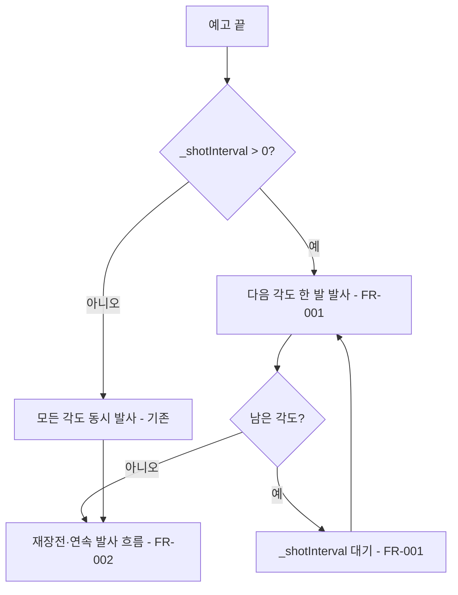
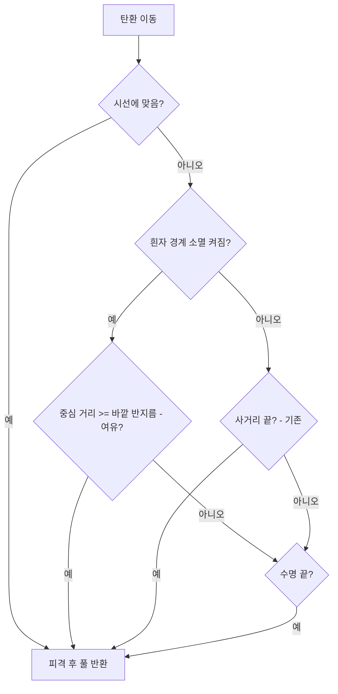

# 공격성 포대 순차 발사·원형 탄환·흰자 직전 소멸

## 1. 개요

- 목적: `AggressionGunner`가 지정 각도들로 동시에 쏘던 탄환을 각도 순서대로 간격을 두고 쏘고, 탄환을 잘 보이는 원형으로 바꾸며, 탄환이 고정 사거리 대신 눈동자 흰자 바로 앞에서 사라지게 한다.
- 대상: 플레이어, 발사 값을 조절하는 제작자

## 2. 범위

- 포함:
  - `MazeGunner`에 각도별 순차 발사 간격 옵션 추가
  - `MazeGunner`에 홍채 바깥 경계 소멸 옵션 추가와 `MazeBullet`의 소멸 조건 분기
  - `MazeBullet.prefab` 변형 `AggressionBullet.prefab`(원형) 생성
  - `AggressionGunner.prefab`에 위 옵션과 원형 탄환 지정
- 제외:
  - 기존 `Gunner`, `ThreeWayTurret`의 발사 방식과 음표 탄환 (새 옵션 기본값이 기존 동작이다)
  - 풀 전용 스크립트 (풀은 이미 포대마다 따로 있고, 소멸 조건은 포대 설정으로 나뉜다)
  - 추가 예고선 배치

## 3. 기술 방향

- 사용 기술/API: 기존 `ObjectPool<MazeBullet>`, `LineRenderer` 둥근 끝(`numCapVertices`), 프리팹 변형
- 핵심 방식:
  - 순차 발사: `_shotInterval`이 0보다 크면 한 번의 발사에서 각도 목록을 한 발씩 `_shotInterval`초 간격으로 쏜다. 각 발은 쏘는 순간의 Muzzle 회전으로 방향을 정한다. 마지막 발을 쏜 뒤 기존 재장전·연속 발사 흐름으로 넘어간다. 0이면 기존처럼 동시에 쏜다.
  - 흰자 직전 소멸: `_despawnAtIrisEdge`가 켜져 있으면 탄환은 미로 중심에서의 거리가 `IrisMaze.OuterRadius`(월드 크기 반영)에서 `_irisEdgeMargin`을 뺀 값 이상이 될 때 풀로 돌아간다. 이때 `_range`는 쓰지 않고 `_bulletLifetime`은 안전장치로 유지한다.
  - 원형 탄환: `MazeBullet.prefab` 변형에서 Flag·Stem을 끄고, 머리 선을 아주 짧게 하고 둥근 끝을 켜서 꽉 찬 원으로 보이게 한다.
- 선택하지 않은 방식: 별도 풀 스크립트나 별도 탄환 클래스는 풀링·피격 코드를 중복하므로 사용하지 않는다. 각 포대는 이미 자기 풀을 갖고 있어 소멸 조건이 달라도 섞이지 않는다.
- 외부 의존성: `MazeGunner`, `MazeBullet`, `EyeMazeDirector.Maze`, `IrisMaze.OuterRadius`

## 4. 구조

| 구분 | 이름 | 역할 |
|------|------|------|
| 클래스 | MazeGunner | 순차 발사 간격, 흰자 경계 소멸 설정과 경계 반지름 제공 |
| 클래스 | MazeBullet | 포대 설정에 따라 사거리 또는 흰자 경계에서 풀로 반환 |
| 프리팹 | AggressionBullet | `MazeBullet` 변형. 원형 외형 |
| 프리팹 | AggressionGunner | 순차 간격 0.2, 흰자 경계 소멸, `AggressionBullet` 사용 |

- 오브젝트 구성: 기존과 같다.
- 클래스 간 관계: `MazeBullet`이 소유 포대의 `DespawnAtIrisEdge`, `IrisEdgeRadius`, `IrisCenter`를 읽는다.
- 실행 순서 의존성: 없음
- 기존 코드와의 접점: `MazeGunner.LateUpdate`, `FireVolley`, `ResetFire`, `UpdateWarningLines`, `MazeBullet.LateUpdate`

## 5. 동작 플로우차트

## 6. 요구사항

- FR-001: `_shotInterval`이 0보다 클 때 `MazeGunner`는 예고가 끝나면 각도 목록 순서대로 한 발씩 `_shotInterval`초 간격으로 쏘고, 각 발은 쏘는 순간의 Muzzle 방향을 쓴다.
- FR-002: 마지막 각도를 쏜 뒤 `MazeGunner`는 기존과 같이 재장전 또는 연속 발사 단계로 넘어간다. `_shotInterval`이 0이면 기존처럼 동시에 쏜다.
- FR-003: `_despawnAtIrisEdge`가 켜져 있을 때 `MazeBullet`은 미로 중심 거리가 바깥 반지름에서 `_irisEdgeMargin`을 뺀 값에 닿으면 풀로 돌아가고, 사거리 제한은 쓰지 않는다. 꺼져 있으면 기존 사거리로 사라진다.
- FR-004: `AggressionBullet`은 Flag·Stem 없이 꽉 찬 원으로 보인다.
- FR-005: `AggressionGunner`는 `_shotInterval` 0.2, `_despawnAtIrisEdge` 켜짐, `AggressionBullet`을 기본값으로 갖는다.

### 상태와 데이터

| 이름 | 타입 | 설명 | 초기값 |
|------|------|------|--------|
| _nextShotIndex | int | 순차 발사 중 다음에 쏠 각도 번호 | 0 |
| FirePhase.Sequencing | enum 값 | 순차 발사 진행 중 | - |

### 예외 및 경계 조건

- 순차 발사 중 위험 요소가 멈추면: 기존 `ResetFire`처럼 활성 탄환을 회수하고 다음 예고부터 다시 시작한다.
- 탄환이 이미 경계 밖에서 출발하면: 첫 프레임에 바로 반환된다.
- 예고선: 기존대로 각도 목록과 예고선 개수만큼 표시한다.

## 7. Inspector 노출값

| 필드 | 타입 | 기본값 | 설명 |
|------|------|--------|------|
| MazeGunner._shotInterval | float | 0 (AggressionGunner 0.2) | 각도 사이 발사 간격(초). 0이면 동시 발사 |
| MazeGunner._despawnAtIrisEdge | bool | false (AggressionGunner true) | 사거리 대신 흰자 직전에서 소멸 |
| MazeGunner._irisEdgeMargin | float | 0.05 | 바깥 반지름에서 뺄 여유 거리 |
| AggressionBullet 머리 선 굵기 | float | 0.12 (스펙 035) | 원 지름 |

## 8. 인수 조건

- FR-001: 각도 7개면 탄환이 0.2초 간격으로 한 발씩, 회전 중인 방향을 따라 나간다.
- FR-002: 기존 `Gunner`, `ThreeWayTurret`은 이전과 똑같이 동시에 쏜다.
- FR-003: AggressionGunner 탄환은 홍채 바깥 테두리 바로 앞에서 사라지고, 기존 포대 탄환은 이전 사거리에서 사라진다.
- FR-004: AggressionGunner 탄환이 원으로 보인다.
- FR-005: 프리팹을 새로 놓으면 위 설정이 들어 있다.

## 9. 미결 사항

- 없음
