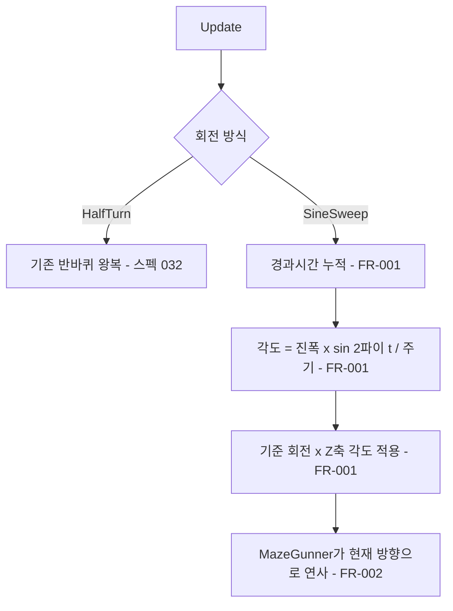

# 공격성 포대 사인파 탄막 패턴

## 1. 개요

- 목적: `AggressionGunner`의 공격을 탄막 슈팅 게임 보스처럼, 총구가 사인파로 좌우로 흔들리며 연사해 탄들이 물결 모양 줄기를 그리게 한다.
- 대상: 플레이어, 패턴 값을 조절하는 제작자

## 2. 범위

- 포함:
  - `OnAggression`에 사인파 흔들기 회전 방식 추가 (기존 반바퀴 왕복은 선택지로 유지)
  - `AggressionGunner.prefab`을 사인파 연사 설정으로 변경
  - `AggressionBullet.prefab` 지름을 0.12로 확대
- 제외:
  - `MazeGunner`, `MazeBullet` 코드 수정 (스펙 034 기능을 그대로 쓴다)
  - 씬에 놓인 인스턴스의 덮어쓴 값 변경 (제작자가 Inspector에서 Revert하거나 직접 조절한다)
  - 다른 포대

## 3. 기술 방향

- 사용 기술/API: `Mathf.Sin`, `Transform.localRotation`
- 핵심 방식: `OnAggression`의 회전 방식이 `SineSweep`이면 기준 회전에서 Z축 각도를 `_sweepAmplitude * sin(2π * 경과시간 / _sweepPeriod)`로 매 프레임 정한다. `MazeGunner`는 쏘는 순간의 Muzzle 방향으로 직선 탄을 짧은 간격으로 계속 쏘므로, 탄들이 이어져 물결 줄기가 된다. 여러 각도(갈래)를 동시에 쏘면 갈래마다 같은 물결이 생긴다.
- 선택하지 않은 방식: 탄환마다 옆으로 출렁이며 나는 방식은 사용자가 고르지 않았다. 발사 방향 흔들기를 `MazeGunner`에 넣는 방식은 이미 회전을 맡는 `OnAggression`과 역할이 겹쳐 사용하지 않는다.
- 외부 의존성: `MazeGunner`(스펙 015·034), `AggressionBullet`

## 4. 구조

| 구분 | 이름 | 역할 |
|------|------|------|
| 클래스 | OnAggression | 반바퀴 왕복 또는 사인파 흔들기 회전 |
| 프리팹 | AggressionGunner | 사인파 흔들기 + 3갈래 연사 설정 |
| 프리팹 | AggressionBullet | 지름 0.12 원형 탄환 |

- 오브젝트 구성: 기존과 같다.
- 클래스 간 관계: 기존과 같다. `OnAggression`은 루트만 돌리고 `MazeGunner`는 Muzzle 방향을 읽는다.
- 실행 순서 의존성: 없음
- 기존 코드와의 접점: `OnAggression.Update`, `RotateAggression`

## 5. 동작 플로우차트

## 6. 요구사항

- FR-001: 회전 방식이 `SineSweep`일 때 `OnAggression`은 기준 회전에서 Z축으로 `_sweepAmplitude * sin(2π * t / _sweepPeriod)`만큼 돌린 회전을 매 프레임 적용한다.
- FR-002: `AggressionGunner`는 사인파 흔들기와 함께 3갈래(0·120·240도)를 동시에 짧은 간격(재장전 0.1초)으로 연사해 갈래마다 물결 모양 탄 줄기를 만든다. 예고선은 연사 중 깜빡이므로 쓰지 않는다.
- FR-003: 회전 방식이 `HalfTurn`일 때 `OnAggression`은 기존(스펙 032)과 똑같이 동작한다. 스크립트 기본값은 `HalfTurn`이다.
- FR-004: `AggressionBullet`은 지름 0.12 원으로 보인다.

### 상태와 데이터

| 이름 | 타입 | 설명 | 초기값 |
|------|------|------|--------|
| _sweepElapsed | float | 사인파 경과 시간 | 0 |

### 예외 및 경계 조건

- `_sweepPeriod`는 0.01 이상으로 제한한다.
- `_sweepAmplitude`가 0이면 흔들리지 않고 고정 방향으로 쏜다.

## 7. Inspector 노출값

| 필드 | 타입 | 기본값 (AggressionGunner) | 설명 |
|------|------|--------|------|
| OnAggression._pattern | enum | HalfTurn (SineSweep) | 회전 방식 |
| OnAggression._sweepAmplitude | float | 45 (45) | 좌우로 흔드는 최대 각도 |
| OnAggression._sweepPeriod | float | 2 (2) | 한 번 왕복하는 시간(초) |
| MazeGunner._fireAngles | float[] | (0, 120, 240) | 갈래 방향 |
| MazeGunner._shotInterval | float | (0) | 갈래 동시 발사 |
| MazeGunner._warningSeconds | float | (0.01) | 예고 최소화 |
| MazeGunner._reloadSeconds | float | (0.1) | 연사 간격 |
| MazeGunner._warningLine | LineRenderer | (없음) | 예고선 끔 |

## 8. 인수 조건

- FR-001: 프리팹 루트가 ±45도 사이를 2초 주기로 부드럽게 흔든다.
- FR-002: 미로 중심에서 세 갈래 탄 줄기가 물결치며 퍼지고, 탄은 흰자 직전에서 사라진다.
- FR-003: 회전 방식을 HalfTurn으로 바꾸면 이전과 같이 반바퀴 왕복한다.
- FR-004: 탄환이 이전보다 크게 보인다.

## 9. 미결 사항

- 없음
