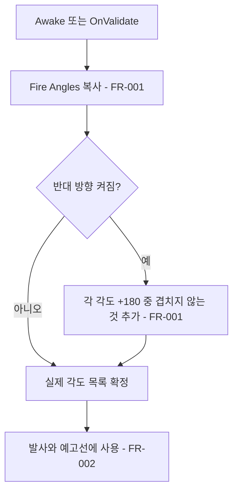

# 포대 반대 방향 동시 발사

## 1. 개요

- 목적: 포대에 지정한 발사 각도마다 정반대(180도 뒤) 방향으로도 함께 쏘게 해, 앞뒤 양쪽으로 퍼지는 탄막을 만든다.
- 대상: 플레이어, 포대 값을 조절하는 제작자

## 2. 범위

- 포함:
  - `MazeGunner`에 반대 방향 발사 옵션 `_fireOpposite` 추가
  - `AggressionGunner.prefab`에서 옵션 켜기
- 제외:
  - 기존 `Gunner`, `ThreeWayTurret` 설정 변경 (옵션 기본값 꺼짐)
  - 씬 인스턴스 값 변경

## 3. 기술 방향

- 사용 기술/API: `Mathf.DeltaAngle`
- 핵심 방식: `_fireOpposite`가 켜지면 `_fireAngles`의 각 값 a 뒤에 a+180을 덧붙인 실제 발사 각도 목록을 만든다. 같은 방향이 이미 목록에 있으면 덧붙이지 않는다. 동시 발사, 순차 발사(`_shotInterval`), 예고선 모두 이 목록을 쓴다. 회전(`OnAggression`)을 따라 앞뒤 방향이 함께 돈다.
- 선택하지 않은 방식: 반대 부호(-a) 추가는 사용자가 원한 동작이 아니어서 사용하지 않는다.
- 외부 의존성: `MazeGunner`(스펙 015·034)

## 4. 구조

| 구분 | 이름 | 역할 |
|------|------|------|
| 클래스 | MazeGunner | 반대 방향을 포함한 실제 발사 각도 목록 관리 |
| 프리팹 | AggressionGunner | `_fireOpposite` 켜짐 |

- 오브젝트 구성: 기존과 같다.
- 클래스 간 관계: 기존과 같다.
- 실행 순서 의존성: `Awake`와 `OnValidate`에서 실제 각도 목록을 만든다.
- 기존 코드와의 접점: `MazeGunner.ShotCount`, `GetFireDirection`, `Awake`, `OnValidate`

## 5. 동작 플로우차트

## 6. 요구사항

- FR-001: `_fireOpposite`가 켜져 있을 때 `MazeGunner`는 `_fireAngles`의 각 각도 a에 대해 a+180을 실제 발사 각도에 추가하고, 이미 같은 방향이 있으면 추가하지 않는다.
- FR-002: `MazeGunner`는 동시 발사, 순차 발사, 예고선에 실제 발사 각도 목록을 사용한다.
- FR-003: `_fireOpposite`가 꺼져 있으면 기존과 똑같이 `_fireAngles`만 쏜다.

### 상태와 데이터

| 이름 | 타입 | 설명 | 초기값 |
|------|------|------|--------|
| _shotAngles | float[] | 반대 방향을 포함한 실제 발사 각도 | Awake 시 계산 |

### 예외 및 경계 조건

- `_fireAngles`가 비어 있으면: 기존처럼 0도 한 발을 쏜다.
- Play 중 Inspector에서 각도나 옵션을 바꾸면: `OnValidate`에서 목록을 다시 만든다.

## 7. Inspector 노출값

| 필드 | 타입 | 기본값 | 설명 |
|------|------|--------|------|
| _fireOpposite | bool | false (AggressionGunner true) | 각도마다 정반대 방향으로도 함께 발사 |

## 8. 인수 조건

- FR-001: 각도 0~90(15도 간격 7개)에 켜면 180~270이 더해져 14방향으로 쏜다. 0, 120, 240이면 180, 300, 60이 더해져 6갈래가 된다.
- FR-002: 순차 발사 간격을 넣으면 추가된 방향도 차례로 나간다.
- FR-003: 기존 포대는 변화가 없다.

## 9. 미결 사항

- 없음
