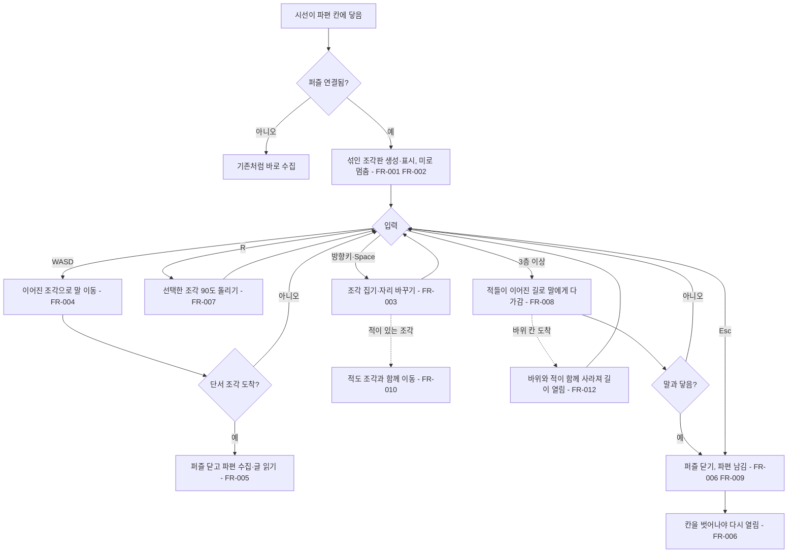

# 파편 열기 조각 맞추기 미로

## 1. 개요

- 목적: 시선이 파편에 닿으면 바로 줍지 않고, 길이 그려진 조각들의 자리를 바꿔 시작점에서 단서까지 길을 이은 뒤 작은 말을 직접 걸려 단서에 닿아야 파편을 얻게 한다.
- 대상: 플레이어, 퍼즐 값을 조절하는 제작자

## 2. 범위

- 포함:
  - 퍼즐 생성(층별 크기, 항상 풀 수 있게 섞인 조각판), 표시, 조각 자리 바꾸기, 말 걷기, 성공·포기 처리를 맡는 `FragmentPuzzle`
  - `EyeMazeDirector`의 파편 수집 흐름을 퍼즐 경유로 변경
  - 퍼즐 중 위험 요소·깜빡임·부담감 증가 멈춤
  - 씬에 퍼즐 오브젝트 배치와 Director 연결 (이미 배치된 `파편 퍼즐` 오브젝트를 그대로 쓴다)
  - 이전 선 잇기 퍼즐 동작과 실패 시 부담감 증가 제거
- 제외:
  - 홍채 미로 자체 변경
  - uGUI 패널 (퍼즐판은 미로와 같은 선 그림으로 눈 위에 그린다)
  - 판 밖 조각, 그림(스프라이트) 조각
  - 처음 섞을 때 조각 방향 섞기 (회전은 쉽게 풀기 위한 도구로만 쓴다)
  - 퍼즐 효과음
  - 파편 본문(제목·글) 내용 변경

## 3. 기술 방향

- 사용 기술/API: `LineRenderer`(기존 `Shapes` 도우미), Input System `Keyboard`, `System.Random`
- 핵심 방식:
  - 조각: 판은 n×n 칸이고 칸마다 조각이 하나 있다. 조각은 위·아래·왼쪽·오른쪽 중 길이 나 있는 쪽을 가진다. 이웃한 두 조각이 서로 마주 보는 쪽에 모두 길이 있으면 이어진다.
  - 생성: 왼쪽 아래 시작 칸에서 오른쪽 위 단서 칸까지 무작위 경로를 하나 만들고, 그 경로의 조각에 경로 방향 길을 낸다. 경로 밖 조각은 길을 1~2개 무작위로 낸다. 그 뒤 시작·단서 조각을 뺀 조각들의 자리를 섞는다. 섞기 전 배치가 정답이므로 항상 풀 수 있다. 섞은 결과가 이미 이어져 있으면 다시 섞는다.
  - 크기: 파편이 있는 층 번호로 `_gridSizes`에서 고른다 (기본 1층 3, 2층 3, 3층 4).
  - 조각 바꾸기: 방향키로 선택 틀을 옮기고 Space로 조각을 집는다. 다른 칸에서 Space를 누르면 두 조각이 `_swapSeconds` 동안 미끄러지며 자리를 바꾼다. 같은 칸에서 Space를 누르면 집기를 취소한다. 시작 조각, 단서 조각, 말이 서 있는 조각은 고정이라 집거나 바꿀 수 없다.
  - 돌리기: R을 누르면 선택 틀의 조각이 `_rotateSeconds` 동안 시계 방향으로 90도 돈다. 열린 쪽 비트마스크도 위→오른쪽→아래→왼쪽으로 한 칸씩 민다. 고정 조각은 돌릴 수 없다. 퍼즐 중 R은 Director의 처음부터 기능으로 가지 않는다.
  - 걷기: WASD로 말이 이어진 이웃 조각으로 `_moveSeconds` 동안 미끄러지며 한 칸 간다. 키를 누르고 있으면 계속 간다. 말이 단서 조각에 닿으면 성공이다.
  - 적: `_enemyFromFloor`층(기본 3층)부터 적이 `_enemyCount`명(기본 2명) 나온다. 시작·단서 칸을 뺀, 시작 칸에서 판 한 변 이상 떨어진 칸 중 서로 다른 칸에 무작위로 놓는다. 퍼즐이 열리고 `_enemyStartDelay` 뒤부터, 쉬는 시간 `_enemyPauseSeconds`마다 이어진 길만 따라 말에게 가는 가장 짧은 길의 첫 칸으로 `_enemyMoveSeconds` 동안 걷는다. 다른 적이 있는 칸은 지나가지 않는다. 말에게 이어진 길이 없으면 제자리에서 기다린다.
  - 적이 있는 조각: 적이 서 있거나 걷고 있어도 그 조각을 집고, 바꾸고, 돌릴 수 있다. 서 있는 적은 조각과 함께 옮겨진다. 걷고 있던 적의 출발·도착 조각을 바꾸거나 돌리면 그 적은 반 넘게 걸었으면 도착 칸에, 아니면 출발 칸에 멈춰 서서 그 조각과 함께 움직이고, 쉬는 시간 뒤 다시 길을 찾는다. 멈춘 칸이 바위면 바위를 부순다.
  - 붙잡힘: 말과 적의 화면 위치가 칸 크기의 0.45배보다 가까워지면(엇갈려 지나가도) 퍼즐이 닫히고, 파편은 남는다. 포기와 같이 칸을 벗어났다 돌아오면 새 퍼즐로 다시 도전한다.
  - 바위: 적이 나오는 퍼즐에서는 정답 경로 가운데쯤(시작·단서 바로 옆 제외) 칸에 바위를 `_rockCount`개(기본 1, 적 수 이하) 놓는다. 바위 칸 조각은 정답 방향 그대로 고정되어 집거나 돌릴 수 없고, 말은 바위 칸으로 들어갈 수 없다. 시작과 이어진 길 표시도 바위에서 끊긴다. 섞을 때는 바위를 빼고 봐도 이어지지 않게 섞는다.
  - 바위 부수기: 적은 바위 칸도 길로 보고 말에게 간다. 적이 바위 칸에 들어가면 바위와 그 적이 함께 사라져 길이 열린다. 적 조각은 옮길 수 있으므로, 적 하나를 바위 너머 이웃 칸으로 옮겨 길을 잇고 말을 바위 반대편에 세우면 적 하나만으로 항상 바위를 부술 수 있다.
  - 실패: 적에게 붙잡히는 것 말고는 실패 상황이 없다. 막히면 조각을 다시 바꾸면 된다.
  - 표시: 미로 중심 위에 어두운 원판을 깔고, 조각마다 테두리와 길(가운데에서 열린 쪽 가장자리까지 굵은 선)을 그린다. 고정 조각은 테두리를 흐리게, 시작점은 큰 점, 단서는 고리, 말은 밝은 점, 선택 틀과 집은 조각은 강조색으로 그린다. 시작 조각과 이어진 길은 밝게 그려 어디까지 이어졌는지 보이게 한다.
- 선택하지 않은 방식: uGUI 패널은 UI 생성 규칙상 격자 크기마다 요소를 미리 만들어야 하고 눈 위 선 그림과 어울리지 않아 쓰지 않는다. 길이 이어지면 말이 자동으로 이동하는 방식은 사용자가 직접 걷기를 골라 쓰지 않는다.
- 외부 의존성: `EyeMazeDirector`, `MemoryFragment`, `IrisMaze`, `Shapes`, `Strings`, `DialogueLog`

## 4. 구조

| 구분 | 이름 | 역할 |
|------|------|------|
| 클래스 | FragmentPuzzle | 조각판 생성, 그리기, 조각 바꾸기, 말 걷기, 성공·포기 판정 |
| 클래스 | EyeMazeDirector | 파편에 닿으면 퍼즐 열기, 결과에 따라 수집·닫기 |
| 씬 | EyeMaze | `파편 퍼즐` 오브젝트(눈 아래, 미로 중심 위치)와 Director 연결 |

- 오브젝트 구성: 눈(`EyeVisual`) 아래, 미로 중심 위치에 `파편 퍼즐` GameObject와 `FragmentPuzzle`을 둔다. 깜빡임 때 도는 미로 아래에 두면 퍼즐판이 기울어지므로 미로 밖에 둔다. 조각마다 자식 오브젝트를 런타임에 만들어, 자리를 바꿀 때 그 오브젝트를 옮긴다.
- 클래스 간 관계: `EyeMazeDirector`가 `[SerializeField] FragmentPuzzle`을 참조해 `Open`을 부르고, 퍼즐은 `Solved`, `Cancelled` 이벤트로 결과를 알린다. 연결되지 않은 경우 기존처럼 바로 줍는다.
- 실행 순서 의존성: 없음
- 기존 코드와의 접점: `EyeMazeDirector.CheckFragment`, `CanRunHazards`, `Update`의 깜빡임·부담감 진행 조건, `HandleInput`, `OnEnable`/`OnDisable`의 이벤트 구독. 실패 이벤트 구독과 `OnPuzzleFailed`, `_failBurden`은 지운다.

## 5. 동작 플로우차트

## 6. 요구사항

- FR-001: 퍼즐이 연결된 상태에서 시선이 아직 줍지 않은 파편에 닿으면 `EyeMazeDirector`는 파편을 바로 줍지 않고 `FragmentPuzzle.Open`으로 그 파편 층 크기의 새 조각판을 연다. `FragmentPuzzle`은 정답 배치에서 고정 조각을 뺀 조각을 섞어, 처음에는 시작과 단서가 이어지지 않은 판을 보여 준다.
- FR-002: 퍼즐이 열려 있는 동안 `EyeMazeDirector`는 시선 이동, 위험 요소(`CanRunHazards`), 깜빡임, 부담감 증가를 멈춘다.
- FR-003: 퍼즐이 열려 있을 때 `FragmentPuzzle`은 방향키로 선택 틀을 옮기고, Space로 고정되지 않은 조각을 집고, 다른 고정되지 않은 칸에서 Space를 누르면 두 조각을 `_swapSeconds` 동안 미끄러지게 해 자리를 바꾼다. 집은 칸에서 다시 Space를 누르면 집기를 취소한다.
- FR-004: 퍼즐이 열려 있을 때 `FragmentPuzzle`은 WASD 입력마다 말을 서로 길이 마주 보는 이웃 조각으로 `_moveSeconds` 동안 미끄러지게 옮기고, 키를 누르고 있으면 계속 옮긴다. 조각이 미끄러지는 동안에는 걷지 않는다.
- FR-005: 말이 단서 조각에 도착하면 `FragmentPuzzle`은 성공을 알리고, `EyeMazeDirector`는 퍼즐을 닫고 기존과 같이 파편을 수집하고 글을 보여 준다.
- FR-006: Esc를 누르면 퍼즐이 닫히고 파편은 줍지 않은 채 남는다. 시선이 그 칸을 벗어났다가 다시 들어와야 퍼즐이 다시 열린다.
- FR-007: 퍼즐이 열려 있을 때 R을 누르면 `FragmentPuzzle`은 선택 틀의 고정되지 않은 조각을 `_rotateSeconds` 동안 시계 방향으로 90도 돌리고, 열린 쪽도 같이 돌린 뒤 이어진 길을 다시 계산한다. 도는 동안에는 다른 조작과 걷기를 받지 않는다.
- FR-008: 파편 층이 `_enemyFromFloor` 이상일 때 `FragmentPuzzle`은 `_enemyCount`명의 적을 시작 칸에서 먼 서로 다른 칸에 두고, `_enemyStartDelay` 뒤부터 쉬는 시간마다 이어진 길만 따라 말에게 가는 가장 짧은 길로 한 칸씩 걷게 한다. 이어진 길이 없으면 적은 기다리고, 다른 적이 있는 칸은 지나가지 않는다.
- FR-010: 적이 서 있거나 걷고 있는 조각도 집고, 바꾸고, 돌릴 수 있으며, `FragmentPuzzle`은 서 있는 적을 조각과 함께 옮긴다. 걷던 적은 가까운 칸에 멈춰 세운 뒤 그 조각과 함께 옮긴다.
- FR-011: 적이 나오는 퍼즐에서 `FragmentPuzzle`은 정답 경로 가운데쯤 칸에 바위를 적 수 이하로 놓고, 바위 칸 조각을 고정하며, 말이 바위 칸으로 들어가지 못하게 한다.
- FR-012: 적이 바위 칸에 들어가면 `FragmentPuzzle`은 그 바위와 적을 함께 없애 말이 지나갈 수 있게 한다. 적 하나만으로도 바위를 부술 수 있다.
- FR-009: 말과 적이 닿으면 `FragmentPuzzle`은 퍼즐을 닫고 붙잡힘을 알리며, `EyeMazeDirector`는 파편을 줍지 않고 남긴 채 안내 문구를 띄운다. 시선이 그 칸을 벗어났다가 다시 들어오면 새 퍼즐로 다시 도전한다.

### 상태와 데이터

| 이름 | 타입 | 설명 | 초기값 |
|------|------|------|--------|
| EyeMazeDirector._puzzleFragment | MemoryFragment | 퍼즐로 여는 중인 파편 | null |
| EyeMazeDirector._declinedFragment | MemoryFragment | 포기 후 칸을 벗어나기 전까지 다시 열지 않을 파편 | null |
| FragmentPuzzle._size | int | 판 한 변의 칸 수 | 0 |
| FragmentPuzzle._tiles | Tile 배열 | 칸마다 놓인 조각(열린 쪽, 그리기 오브젝트) | 생성 시 |
| FragmentPuzzle._cursor | int | 선택 틀이 있는 칸 | 시작 칸 |
| FragmentPuzzle._picked | int | 집은 칸(-1이면 없음) | -1 |
| FragmentPuzzle._walker | int | 말이 있는 칸 | 시작 칸 |
| FragmentPuzzle._swapT / _moveT | float | 자리 바꾸기·걷기 진행도(1이면 끝) | 1 |

### 예외 및 경계 조건

- 층 번호가 `_gridSizes` 범위를 넘으면 마지막 값을 쓴다. 크기는 2 이상으로 제한한다.
- 고정 조각(시작, 단서, 말이 서 있는 칸)에서 Space를 누르면 아무 일도 하지 않는다.
- 말이 다른 칸으로 걸어가면 그전 칸은 다시 바꿀 수 있고, 새 칸이 고정된다. 집어 둔 조각 위로 말이 걸어가면 집기를 취소한다.
- 퍼즐 중 관찰 중지(Space)와 처음부터(R)는 Director가 받지 않는다. 퍼즐 밖으로 나가려면 Esc를 쓴다. 대화 기록 창이 열려 있으면 퍼즐 입력을 받지 않는다.
- 퍼즐 중 Play Mode를 끄거나 들여다보기가 끝나면 퍼즐을 닫는다.

## 7. Inspector 노출값

| 필드 | 타입 | 기본값 | 설명 |
|------|------|--------|------|
| FragmentPuzzle._gridSizes | int[] | 3, 3, 4 | 층별 판 한 변의 칸 수 |
| FragmentPuzzle._decoyMinPaths / _decoyMaxPaths | int | 1 / 2 | 정답 경로 밖 조각의 길 수 범위 |
| FragmentPuzzle._swapSeconds | float | 0.15 | 조각이 자리를 바꾸는 시간(초) |
| FragmentPuzzle._rotateSeconds | float | 0.12 | 조각이 90도 도는 시간(초) |
| FragmentPuzzle._enemyFromFloor | int | 3 | 적이 나오기 시작하는 층(1부터, 0이면 없음) |
| FragmentPuzzle._enemyCount | int | 2 | 한 퍼즐에 나오는 적의 수 |
| FragmentPuzzle._rockCount | int | 1 | 적이 나오는 퍼즐의 바위 수(적 수 이하로 제한) |
| FragmentPuzzle._rockColor / _rockSize | Color / float | 회갈색 / 0.5 | 바위 색과 크기(칸 크기 비율) |
| FragmentPuzzle._enemyStartDelay | float | 1.5 | 퍼즐이 열린 뒤 적이 움직이기 시작할 때까지(초) |
| FragmentPuzzle._enemyPauseSeconds | float | 0.5 | 적이 한 칸 걷고 쉬는 시간(초) |
| FragmentPuzzle._enemyMoveSeconds | float | 0.3 | 적이 한 칸 걷는 시간(초) |
| FragmentPuzzle._enemyColor / _enemySize | Color / float | 빨강 / 0.24 | 적 색과 크기(마름모) |
| FragmentPuzzle._moveSeconds | float | 0.12 | 말이 한 칸 걷는 시간(초) |
| FragmentPuzzle._boardSize | float | 3.2 | 퍼즐판 한 변 길이(월드) |
| FragmentPuzzle._backdropDiameter | float | 4.8 | 뒤에 까는 어두운 원판 지름 |
| FragmentPuzzle._lineMaterial | Material | 미로 선 재질 | 선 재질 |
| FragmentPuzzle._backdropColor / _frameColor / _pathColor / _linkedColor / _walkerColor / _cursorColor / _pickedColor | Color | 불투명 검정 / 회색 / 회색 / 흰색 / 하늘색 / 노랑 / 주황 | 색 |
| FragmentPuzzle._frameWidth / _pathWidth / _walkerSize | float | 0.03 / 0.14 / 0.22 | 두께와 말 크기 |
| FragmentPuzzle._sortingOrder | int | 20 | 그리기 순서 (눈꺼풀 22 아래) |
| EyeMazeDirector._puzzle | FragmentPuzzle | 씬 오브젝트 | 비우면 기존처럼 바로 줍는다 |

## 8. 인수 조건

- FR-001: 1·2층 파편에 닿으면 3×3, 3층은 4×4 조각판이 눈 가운데 뜨고, 처음에는 시작과 단서가 이어져 있지 않다.
- FR-002: 퍼즐 중 탄환·장애물이 멈추고 부담감 막대가 오르지 않는다.
- FR-003: 방향키로 틀이 움직이고, Space 두 번으로 두 조각이 미끄러지며 자리를 바꾼다. 시작·단서·말이 있는 조각은 집히지 않는다.
- FR-004: WASD로 말이 이어진 길로만 한 칸씩 부드럽게 걸어가고, 누르고 있으면 계속 걷는다.
- FR-005: 말이 단서에 닿으면 퍼즐이 닫히고 파편 글이 나온다.
- FR-006: Esc로 닫으면 파편은 그대로 있고, 칸을 벗어났다 돌아오면 새 조각판이 열린다.
- FR-007: R을 누르면 선택한 조각이 부드럽게 90도 돌고, 길이 맞으면 바로 흰색으로 이어진다. 시작·단서·말이 있는 조각은 돌지 않고, 퍼즐 중 R로 게임이 처음부터 시작되지 않는다.
- FR-008: 1·2층 퍼즐에는 적이 없고, 3층 퍼즐에는 빨간 마름모 적 2명이 시작에서 먼 칸에 나와 말과 길이 이어지면 다가온다. 길을 끊으면 멈춘다.
- FR-010: 적이 서 있는 조각을 다른 조각과 바꾸면 적도 함께 미끄러져 옮겨지고, 돌리면 적은 그 조각 위에 그대로 있다. 적이 길을 따라 걸어오는 중에도 그 길의 조각을 바꾸거나 돌릴 수 있다.
- FR-011: 3층 퍼즐의 정답 길 위에 바위가 하나 있고, 그 조각은 옮기거나 돌릴 수 없으며 말이 지나가지 못한다.
- FR-012: 말을 바위 반대편에 세우고 적과 바위를 이어 주면 적이 바위로 들어가 함께 사라지고, 그 길로 단서까지 갈 수 있다.
- FR-009: 적이 말에 닿으면 퍼즐이 닫히고 파편은 그대로 있으며, 칸을 벗어났다 돌아오면 새 퍼즐이 열린다.

## 9. 미결 사항

- 없음
