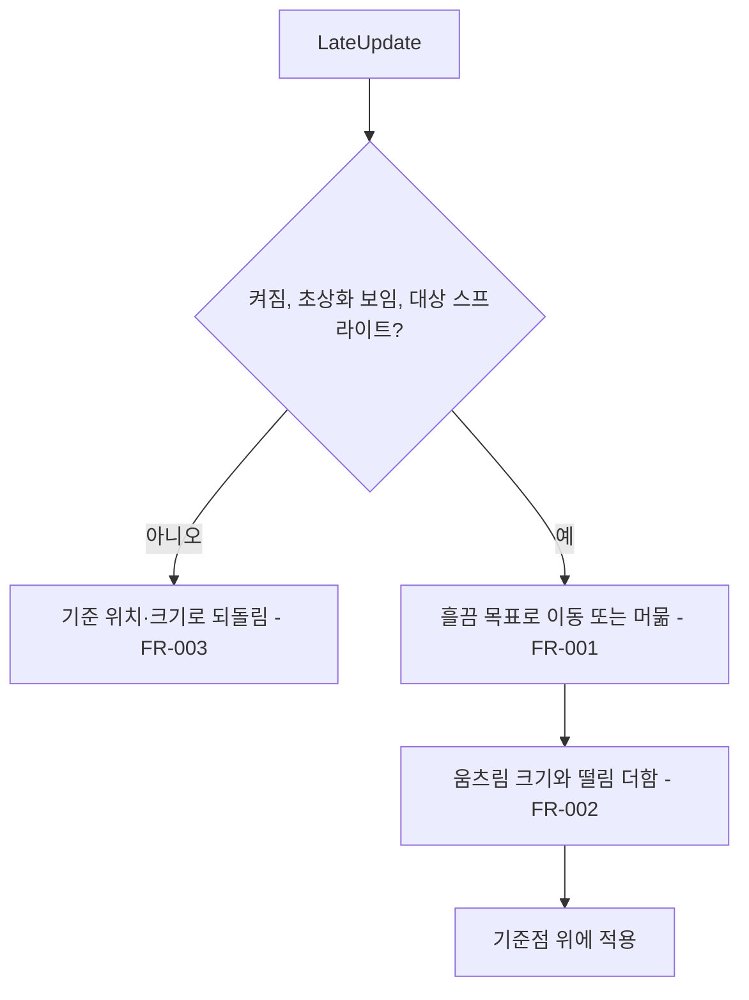

# 은재 초상화 경계 루프 애니메이션

## 1. 개요

- 목적: 대화 상자에 은재 초상화가 떠 있는 동안 주변을 흘끔거리고 몸을 움츠리는 경계 동작을 반복해, 은재가 긴장하고 있다는 것을 그림 한 장으로도 보여 준다.
- 대상: 플레이어, 초상화 움직임을 조절하는 제작자

## 2. 범위

- 포함:
  - 초상화 `Image`의 위치·크기를 코드로 움직이는 `PortraitWaryMotion` 컴포넌트
  - 씬의 대화 상자 초상화 오브젝트에 컴포넌트를 붙이고 은재 초상화 스프라이트 연결
- 제외:
  - 새 그림(프레임) 추가, Animator·AnimationClip
  - 대화 기록 창의 작은 얼굴
  - 눈 속 화면, 필드 캡슐 움직임
  - 경계 동작을 켜는 이벤트 조건 (지금은 Inspector 옵션으로만 켠다)

## 3. 기술 방향

- 사용 기술/API: uGUI `Image`, `RectTransform.anchoredPosition`, `localScale`, `Mathf.SmoothStep`, `Mathf.PerlinNoise`, `Time.unscaledDeltaTime`
- 핵심 방식:
  - 흘끔거림: 왼쪽 → 오른쪽 → 가운데 순서로 목표 위치를 바꾼다. 목표로는 `_glanceSeconds` 동안 빠르게 옮기고, 도착하면 `_holdSeconds` 동안 그 자리에 머문다. 이 순서를 끝없이 반복한다.
  - 움츠림: `_breathSeconds` 주기로 세로 크기를 1과 `_shrinkScale` 사이에서 오르내려 숨을 죽였다 내쉬는 것처럼 보이게 한다.
  - 떨림: Perlin 노이즈로 `_tremble` 픽셀 안에서 아주 작게 떨린다.
  - 기준점: 씬에 저장된 초상화 위치·크기를 처음 한 번 기억하고, 그 위에 움직임을 더한다. 동작이 꺼지거나 다른 사람 초상화로 바뀌면 기준점으로 되돌린다.
  - 적용 시점: `GameFlowUI`가 `Update`에서 초상화 스프라이트를 바꾸므로, 움직임은 `LateUpdate`에서 적용한다.
- 선택하지 않은 방식: Animator와 AnimationClip은 프로젝트에 쓰는 곳이 없고, 초상화 오브젝트를 모든 사람이 함께 쓰기 때문에 은재일 때만 재생하는 조건을 걸기 번거로워 쓰지 않는다.
- 외부 의존성: `GameFlowUI`(초상화 스프라이트 교체)

## 4. 구조

| 구분 | 이름 | 역할 |
|------|------|------|
| 클래스 | PortraitWaryMotion | 지정한 스프라이트가 보이는 동안 초상화를 경계 동작으로 움직임 |
| 씬 | EyeMaze | 대화 상자 초상화 `Image` 오브젝트에 컴포넌트를 붙이고 은재 초상화 연결 |

- 오브젝트 구성: `GameFlowUI._portrait`가 가리키는 초상화 `Image` 오브젝트에 `PortraitWaryMotion`을 붙인다.
- 클래스 간 관계: `PortraitWaryMotion`은 같은 오브젝트의 `Image`를 `[SerializeField]`로 참조하고 현재 스프라이트만 읽는다. `GameFlowUI`는 바꾸지 않는다.
- 실행 순서 의존성: `GameFlowUI.Update`가 스프라이트를 바꾼 뒤 `LateUpdate`에서 판단한다.
- 기존 코드와의 접점: 없음 (새 컴포넌트만 추가)

## 5. 동작 플로우차트

## 6. 요구사항

- FR-001: `_play`가 켜져 있고 초상화 `Image`가 보이며 그 스프라이트가 `_sprites`에 있을 때, `PortraitWaryMotion`은 초상화를 왼쪽·오른쪽·가운데 순서로 `_glanceDistance`만큼 빠르게 옮기고 각 자리에서 `_holdSeconds` 동안 머무는 동작을 반복한다.
- FR-002: FR-001 동작 중 `PortraitWaryMotion`은 `_breathSeconds` 주기로 세로 크기를 1과 `_shrinkScale` 사이에서 오르내리고, `_tremble` 픽셀 안에서 작게 떨게 한다.
- FR-003: 조건이 맞지 않으면 `PortraitWaryMotion`은 초상화를 씬에 저장된 위치·크기로 되돌리고 동작 진행을 처음으로 돌린다.

### 상태와 데이터

| 이름 | 타입 | 설명 | 초기값 |
|------|------|------|--------|
| _basePos / _baseScale | Vector2 / Vector3 | 씬에 저장된 초상화 위치·크기 | Awake 시 기억 |
| _step | int | 흘끔 순서 (0 왼쪽, 1 오른쪽, 2 가운데) | 0 |
| _stepT | float | 현재 흘끔 단계에서 지난 시간 | 0 |
| _fromX | float | 현재 단계 시작 위치 | 0 |
| _time | float | 움츠림·떨림 시간 | 0 |

### 예외 및 경계 조건

- `_sprites`가 비어 있으면: 동작하지 않는다.
- 시간 정지(`timeScale` 0) 중에도 대화는 진행되므로 `unscaledDeltaTime`을 쓴다.
- 대화 중 말하는 사람이 바뀌어 다른 초상화가 뜨면: 그 즉시 기준점으로 되돌린다.

## 7. Inspector 노출값

| 필드 | 타입 | 기본값 | 설명 |
|------|------|--------|------|
| _image | Image | 같은 오브젝트의 초상화 | 움직일 초상화 |
| _play | bool | true | 경계 동작 켜기 |
| _sprites | Sprite[] | 은재 초상화 | 경계 동작을 재생할 초상화 |
| _glanceDistance | float | 6 | 좌우로 흘끔거리는 폭(픽셀) |
| _glanceSeconds | float | 0.15 | 한쪽으로 옮기는 시간(초) |
| _holdSeconds | float | 0.8 | 한 자리에 머무는 시간(초) |
| _shrinkScale | float | 0.97 | 움츠렸을 때 세로 크기 비율 |
| _breathSeconds | float | 1.6 | 움츠렸다 펴는 한 주기(초) |
| _tremble | float | 0.6 | 떨림 폭(픽셀) |
| _trembleSpeed | float | 18 | 떨림 빠르기 |

## 8. 인수 조건

- FR-001: 은재가 말하는 동안 초상화가 왼쪽, 오른쪽, 가운데를 차례로 흘끔 보고 잠깐씩 멈추기를 반복한다.
- FR-002: 초상화가 숨을 죽이듯 살짝 줄었다 펴지고, 가만히 있을 때도 아주 작게 떨린다.
- FR-003: 다른 사람이 말하거나 대화가 끝나면 초상화가 원래 자리·크기로 돌아온다. `_play`를 끄면 움직이지 않는다.

## 9. 미결 사항

- 없음
