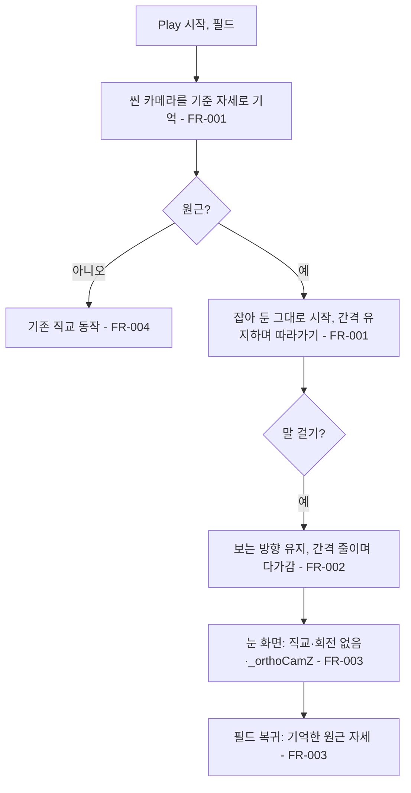

# 필드 2.5D 원근 카메라

## 1. 개요

- 목적: 사이드뷰 필드(사무실)를 제작자가 에디트 모드에서 잡아 둔 원근 카메라 그대로 보여 줘, 3D 사무실 배경의 깊이가 보이는 2.5D 화면을 만든다. 에디트 모드와 Play 모드의 화각이 같아야 한다.
- 대상: 플레이어, 카메라를 잡는 제작자

## 2. 범위

- 포함:
  - `GameFlow`가 Play 시작 때 씬 카메라(투영, 시야각, 회전, 위치)를 필드 기준 자세로 기억하고, 원근이면 덮어쓰지 않는다
  - 필드 따라가기, 말 걸 때 줌인, 눈 화면 ↔ 필드 전환에서 기준 자세 유지
  - 사무실 배경 머티리얼(`M_Office`, `Material #25`)을 URP Simple Lit으로 바꾸고 씬에 방향광 하나 추가
- 제외:
  - 눈 화면(만남, 미로)은 지금처럼 직교 카메라를 쓴다
  - 사무실 모델 배치, 기존 선 그림 가구·캐릭터 변경
  - 픽셀 렌더 텍스처 설정 변경

## 3. 기술 방향

- 사용 기술/API: `Camera.orthographic`, `Camera.fieldOfView`, URP `Simple Lit`, `Light`(Directional)
- 핵심 방식:
  - 기준 자세: Play 시작 때 필드 상태이면 카메라의 원근 여부, 시야각, 회전과 "카메라 위치 - 따라가기 목표" 간격을 기억한다. 시작 때 따라가기 목표는 에디트 모드와 같으므로 카메라는 잡아 둔 그대로 시작한다.
  - 따라가기: 원근이면 목표 + 간격으로 기존과 같은 부드러움으로 따라간다. 회전과 시야각은 바꾸지 않는다.
  - 줌인: 원근이면 바라보는 점을 상대 위치로 옮기면서 간격을 `_zoomInSize / _fieldCamSize` 비율까지 줄여 보는 방향 그대로 다가간다.
  - 눈 화면: 직교, 회전 없음, z `_orthoCamZ`로 바꾼다. 필드로 돌아오면 기억한 원근 자세로 되돌린다.
  - 에디트 모드 버튼: "눈 화면 보기"는 바꾸기 전에 지금 카메라를 기준 자세로 기억하고, "필드 화면 보기"는 그 자세로 되돌린다.
  - 씬 카메라가 직교이면 기존과 똑같이 동작한다.
  - 배경 조명: 사무실 머티리얼을 Simple Lit(텍스처·색 유지, 반짝임 없음)으로 바꾸고, 방 안쪽을 비추는 방향광 하나를 둔다. 선 그림(Sprites/Default)은 조명 영향을 받지 않는다.
- 선택하지 않은 방식: 시야각·기울기 값으로 카메라 위치를 계산해 덮어쓰는 방식은 제작자가 잡은 카메라와 Play 화면이 달라져 쓰지 않는다. 필드와 눈 화면에 카메라를 따로 두는 방식은 렌더 텍스처·UI 연결을 모두 바꿔야 해서 쓰지 않는다.
- 외부 의존성: `GameFlow`, Main Camera, `FieldRoom`, `FieldPlayer`, 사무실 모델 머티리얼

## 4. 구조

| 구분 | 이름 | 역할 |
|------|------|------|
| 클래스 | GameFlow | 필드 기준 자세 기억·유지, 눈 화면 직교 전환 |
| 씬 | EyeMaze | 원근으로 잡아 둔 Main Camera, `배경 조명 (Directional Light)` |
| 머티리얼 | M_Office, Material #25 | URP Simple Lit |

- 오브젝트 구성: 기존 Main Camera를 그대로 쓴다. 씬 루트에 방향광 하나를 둔다.
- 클래스 간 관계: 변경 없음
- 실행 순서 의존성: `GameFlow.Start`에서 카메라를 옮기기 전에 기준 자세를 기억한다.
- 기존 코드와의 접점: `GameFlow.Start`, `Update`의 Field·ZoomIn 처리, `BeginEncounter`, `ReturnToFieldNow`, `PlaceCamera`

## 5. 동작 플로우차트

## 6. 요구사항

- FR-001: Play 시작 때 필드이면 `GameFlow`는 씬 카메라의 투영, 시야각, 회전, 따라가기 목표와의 간격을 기억하고, 원근이면 카메라를 옮기지 않고 시작해 간격을 유지하며 따라간다.
- FR-002: 원근일 때 말을 걸면 `GameFlow`는 보는 방향을 유지한 채 바라보는 점을 상대로 옮기고 간격을 줄여 다가간다.
- FR-003: 눈 화면으로 들어가면 `GameFlow`는 카메라를 직교, 회전 없음, `_orthoCamZ`로 두고, 필드로 돌아오면 기억한 자세로 되돌린다. 에디트 모드 버튼도 같은 자세를 쓴다.
- FR-004: 씬 카메라가 직교이면 기존과 똑같이 동작한다.
- FR-005: 사무실 배경 머티리얼은 Simple Lit을 쓰고, 씬의 방향광으로 밝기와 음영이 생긴다.

### 상태와 데이터

| 이름 | 타입 | 설명 | 초기값 |
|------|------|------|--------|
| _fieldPoseSaved | bool | 필드 기준 자세를 기억했는지 | false |
| _fieldPerspective / _fieldFov / _fieldRotation | bool / float / Quaternion | 기억한 투영, 시야각, 회전 | Start 때 |
| _fieldOffset | Vector3 | 따라가기 목표에서 카메라까지의 간격 | Start 때 |
| _zoomFromLook | Vector3 | 줌인 시작 때 바라보던 점 | 줌인 시작 때 |

### 예외 및 경계 조건

- 에디트 모드에서 "눈 화면 보기" 뒤 스크립트가 다시 컴파일되면 기억한 자세가 사라진다. 그때 "필드 화면 보기"는 직교로 놓으므로 카메라를 다시 잡거나 실행 취소한다.

## 7. Inspector 노출값

| 필드 | 타입 | 기본값 | 설명 |
|------|------|--------|------|
| _orthoCamZ | float | -10 | 원근 필드에서 눈 화면(직교)으로 바꿀 때 카메라 z |

- 필드 화각은 씬의 Main Camera(Projection, Field of View, Transform)에서 직접 잡는다.

## 8. 인수 조건

- FR-001: 에디트 모드에서 잡은 카메라와 Play 시작 화면의 시야각·위치·회전이 같다.
- FR-002: 말을 걸면 상대에게 다가가며 암전된다.
- FR-003: 눈 화면은 평평하게 보이고, 필드로 돌아오면 처음 잡은 화각이다.
- FR-004: 씬 카메라를 직교로 두면 이전 화면과 같다.
- FR-005: 사무실 벽·바닥·천장이 방향광에 따라 다른 밝기로 보인다.

## 9. 미결 사항

- 없음
